# Documentation

## Overview

This document justifies the aggregates defined in the domain model.  
For each aggregate, one representative scenario is presented through a sequence diagram and a short explanation.  
The goal is to show the aggregate’s responsibility by demonstrating an invariant enforced by its aggregate root.

---

## User Aggregate Justification

### Aggregate Root
User

---

### Why is it an Aggregate?
The User was modeled as a separate aggregate because it serves as the primary consistency boundary for identity, authentication, and security within the AISafe system. It encapsulates the user's personal identification (Email, FullName, PhoneNumber) and their operational AlsafeProfile, which contains sensitive security data like SecurityClearance and SkillsAssessment.

---

### Responsibility
Manage the identity, authentication, and security profiles (authorizations and skills assessments) of all actors in the AISafe system, ensuring that only authorized and qualified personnel have access to operational functionalities.

---

### Enforced Invariant

- Valid Email Domain: A user must be identified by a unique email address that must belong to a list of domains authorized by the system.
- Security Readiness: To have an AlsafeProfile, the user must have an active security clearance and a skills assessment completed within the last 5 years.

---

### Representative Scenario
Registering a new user in the system. The aggregate root must validate whether the provided email address complies with domain restrictions before allowing the entity to be created, ensuring the integrity of the identification from the start.

---

### Sequence Diagram
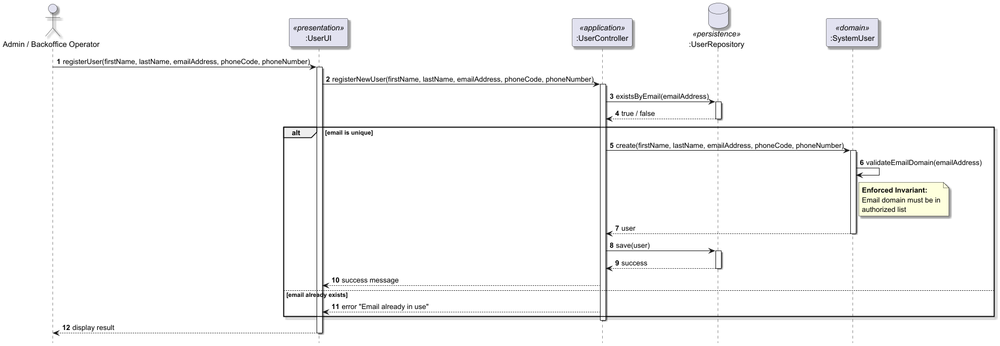

---

### Short Explanation
- The scenario begins when the Administrator submits a new user's data through the interface. 
- The request reaches the UserController (Application Layer), which coordinates the process and uses the UserRepository to ensure the global uniqueness of the email in the database.
- The Aggregate Root (User) validates the business invariant: the Email value object must belong to an authorized Email_Domain. If the domain is invalid, the entity refuses its own creation.
- The final write operation through the repository uses JPA to persist the new user and its associated value objects atomically.
- This demonstrates that the aggregate is responsible for maintaining security integrity and access control at the domain level.

---

---

## AircraftModel Aggregate Justification

### Aggregate Root
AircraftModel

---

### Why is it an Aggregate?
The AircraftModel is modeled as an independent aggregate because it serves as the consistency boundary for the technical and performance specifications of an aircraft type. It has a unique global identity (modelID) and is responsible for ensuring that the model never becomes invalid or "without an engine," internally managing the list of CertifiedEngine (Value Objects).

---

### Responsibility
Managing the technical specifications, performance parameters (like MTOW, Drag/Lift coefficients), and the list of certified engines for a specific type of motorized commercial aircraft.

---

### Enforced Invariant

- Minimum Engine Certification: An aircraft model must always have at least one certified engine model associated with it.

---

### Representative Scenario
Removing an engine model from an aircraft model. The root must ensure that the model does not become "engine-less," as every commercial aircraft must have a valid motorization type to exist in the system.

---

### Sequence Diagram
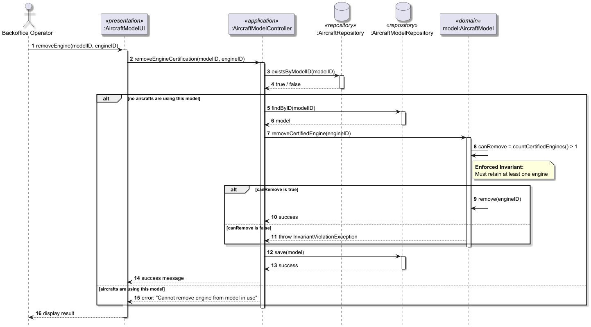

---

### Short Explanation
- The scenario starts when a Backoffice Operator attempts to remove an engine certification from a model.
- The AircraftModelController coordinates the process, first checking the AircraftRepository to see if there are any active aircraft using this model, and preventing operation if so (US058 Rule).
- If the operation is allowed, the request reaches the AircraftModel aggregate root through the application layer.
- The aggregate root validates the engine count condition: it only proceeds with the removal if there is more than one engine certified.
- The operation only succeeds if the invariant (minimum one engine) is respected.
- This shows that the aggregate is responsible for maintaining the technical integrity and certification status of the aircraft type.

---

---

## FlightRoute Aggregate Justification

### Aggregate Root
FlightRoute

---

### Why is it an Aggregate?
A FlightRoute is modeled as an independent aggregate because it represents the logical definition of an air operation, possessing a unique global identity (the route name, e.g., TP123) that must be protected against duplicates throughout the system. It defines a consistency boundary for connecting airports and operational data, ensuring that the basic route structure is valid before any flight instance can be created from it.

---

### Responsibility
Defining the logical connection and path between a specific origin airport and a destination airport for an air transport company.

---

### Enforced Invariant

- Route Name Uniqueness and Format: The route name must be unique and follow a strict format of 2 airline letters followed by 1 to 4 digits (e.g., TP123).
- Origin and Destination Distinction: The origin and destination airports must be different; a route cannot connect an airport to itself.

---

### Representative Scenario
Creating a new Flight Route. The aggregate root must ensure that the RouteName value object is unique and matches the company's identifier before allowing the route to be registered in the system.

---

### Sequence Diagram
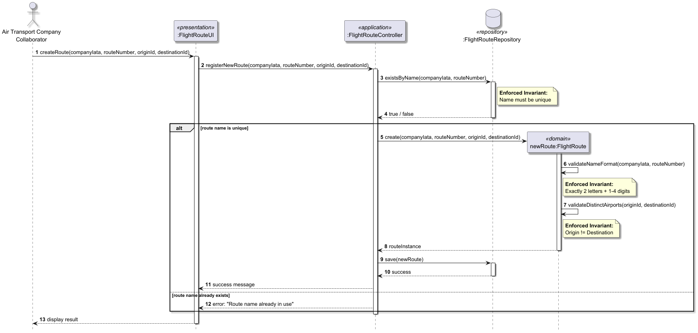

---

### Short Explanation
- The scenario starts when an Air Transport Company Collaborator tries to define a new route.
- The request reaches the aggregate root (via the repository for uniqueness checks).
- The FlightRoute root enforces the invariant that the origin and destination must be different and the name format is valid.
- The operation only succeeds if the invariant regarding uniqueness and formatting is respected.
- This shows that the aggregate is responsible for maintaining the logical consistency of the company's network.

---

## Flight Aggregate Justification

### Aggregate Root
Flight

---

### Why is it an Aggregate?
The Flight is modeled as a separate aggregate because it represents the operational instance of a FlightRoute and serves as the primary consistency boundary for a specific flight operation. The FlightPlan is encapsulated as a Value Object within this aggregate, ensuring that the flight knows its own technical description and requirements.Other aggregates, such as Aircraft or SystemUser (Pilot), are only referenced by their IDs, maintaining Low Coupling while allowing the Flight to enforce business rules across these associations.

---

### Responsibility
The Flight aggregate is responsible for managing the lifecycle of a specific flight operation. Its duties include uniquely identifying the flight through a FlightDesignator, linking it to a specific FlightRoute, and managing the submission and validation of one or more FlightPlans (DSLs) until a final, valid plan is accepted for execution.

---

### Enforced Invariant
- A Flight can only have an "Active" flight plan, and it must be valid.
- The aggregate root must ensure that RouteID referenced within a submitted FlightPlan is compatible with the Flight's RouteID.

---

### Representative Scenario
Adding a valid flight plan to a flight. The aggregate root must ensure that the flight plan being added is in a Validated status and that all its parameters are valid before allowing the association, ensuring that only consistent and properly defined plans can be linked to active flights.

---

### Sequence Diagram
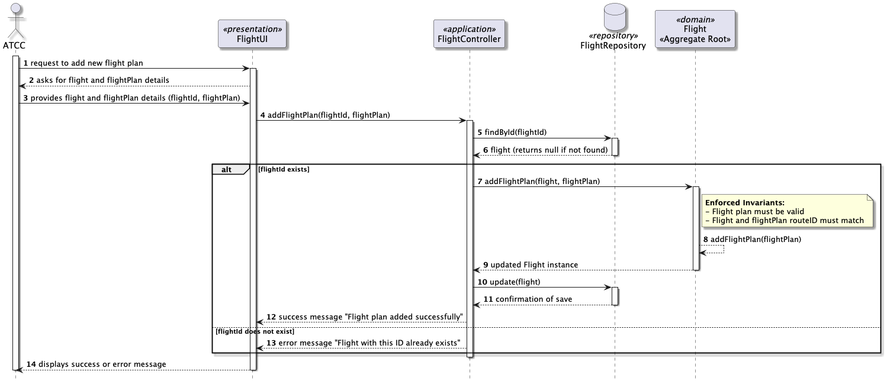

---

### Short Explanation
- The scenario begins when an Air Transport Company Collaborator (ATCC) requests to add a new flight plan to an existing scheduled flight. 
- The FlightController coordinates the process by first retrieving the specific Flight instance from the FlightRepository using its unique ID. 
- Once the Flight (Aggregate Root) is retrieved, the controller delegates the business logic to it by calling the addFlightPlan method. 
- The Flight Aggregate Root then acts as the consistency guardian by enforcing critical invariants:
  - It verifies that the FlightPlan is internally valid
  - It ensures the RouteID inside the flight plan matches the RouteID already assigned to the Flight instance, preventing a pilot from uploading a plan for the wrong destination. 
- If these conditions are met, the Flight updates its internal state to include the new plan. 
- Finally, the controller persists the updated state of the Flight aggregate back to the database. This ensures that the flight and its plan are treated as a single, atomic unit, maintaining high cohesion as suggested by the PO.

---

## WeatherData Aggregate Justification

### Aggregate Root
WeatherData

---

### Why is it an Aggregate?
WeatherData was modeled as a separate aggregate because it has an independent lifecycle. Weather information can be registered manually, imported in bulk from external sources, and consulted by multiple actors (Weather Person, Pilot, Flight Control Operator). These operations must maintain their own consistency rules independently of the AirControlArea that references them.

---

### Responsibility
Managing weather observations registered for a specific air control area, including all meteorological data (wind direction, wind speed, temperature, pressure, etc.) provided by Weather Persons or imported from external sources.

---

### Enforced Invariant
Valid Area Association: Weather data can only exist if it is associated with a registered and valid AirControlArea. Weather data without a valid area reference is not allowed in the system. 
Required fields must be filled in

---

### Representative Scenario
Registering new weather data for a specific air control area assuming that all other Value Objects (data, source, wind direction, wind speed, temperature, pressure) are already valid.

---

### Sequence Diagram
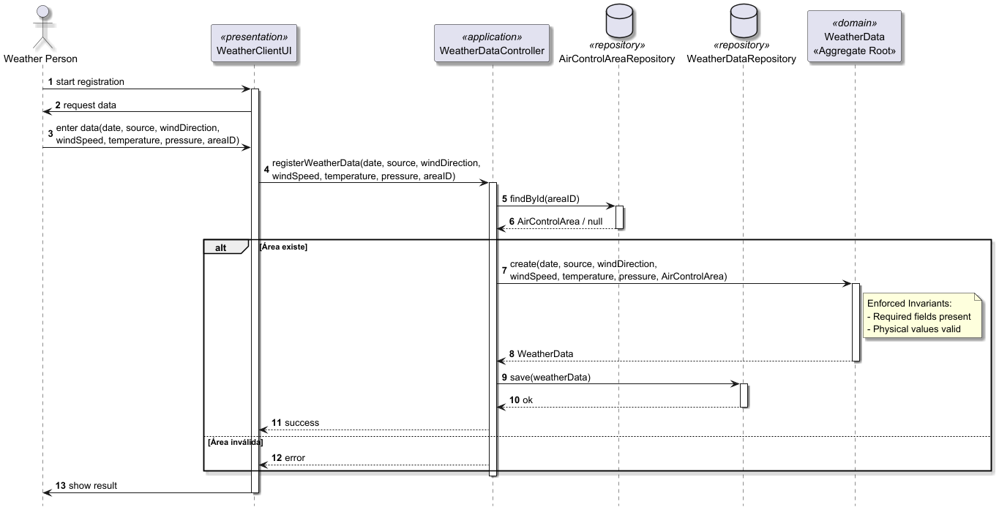

---

### Short Explanation
- The scenario starts when a Weather Person initiates the registration of weather data through the WeatherClientUI.
- The UI sends the data directly to the WeatherDataController.
- The Controller first checks if the provided areaID corresponds to an existing AirControlArea.
- This sequence diagram illustrates the creation of the WeatherData aggregate assuming that all other Value Objects (data, source, wind direction, wind speed, temperature, pressure) are already valid and in accordance with the domain rules.
- Only after confirming the valid area association does the aggregate root get instantiated.
- The WeatherData aggregate enforces the invariant that every weather observation must be associated with a valid AirControlArea.
- This demonstrates that the WeatherData aggregate is responsible for guaranteeing the integrity and contextual correctness of all meteorological information in the system.

---

---

## AirControlArea Aggregate Justification

### Aggregate Root
AirControlArea

---

### Why is it an Aggregate?
AirControlArea was modeled as a separate aggregate because it defines a critical consistency boundary in the system. The unique area code, geographic boundaries and minimum fuel requirements at arrival are business rules that must be enforced together in a single transaction. Other aggregates (such as Airport and WeatherData) only reference it by ID and do not own its internal data.

---

### Responsibility
Defining and managing a controlled airspace zone with a unique identifier, valid geographic boundaries and operational safety constraints (e.g. minimum fuel at destination).

---

### Enforced Invariant
- **Unique Area Code and Valid Boundaries**: An AirControlArea must have a unique `areaCode` in the entire system and must contain valid, non-empty geographic boundaries.
- `minFuelAtArrival` must be a positive value.

---

### Representative Scenario
Creating a new AirControlArea assuming that the geoBoundaries are valid and minFuelAtArrival is a positive value according to the domain rules.

---

### Sequence Diagram
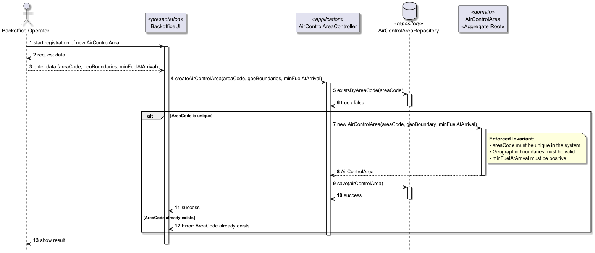

---

### Short Explanation
- The scenario starts when a Backoffice Operator initiates the registration of a new air control area through the BackofficeUI.
- The UI sends the data (`areaCode`, `geoBoundaries` and `minFuelAtArrival`) directly to the `AirControlAreaController`.
- The Controller first verifies whether the `areaCode` is already in use by querying the repository.
- This sequence diagram illustrates the creation of the `AirControlArea` aggregate **assuming that the geoBoundaries are valid and `minFuelAtArrival` is a positive value according to the domain rules**.
- Only after confirming the uniqueness of the area code does the aggregate root get instantiated.
- The `AirControlArea` aggregate root enforces its invariants, ensuring the uniqueness of the area code and the validity of its internal data.
- This demonstrates that the aggregate is responsible for maintaining the structural integrity and safety constraints of the controlled airspace in the system.

---

---

## Aircraft Aggregate Justification

### Aggregate Root
Aircraft

---

### Why is it an Aggregate?
Aircraft was modeled as a separate aggregate because it represents a concrete aircraft in operation, with its own identity and lifecycle in the system. Its registration, company association, aircraft model, cabin configuration, crew size, and operational status must be managed consistently as a whole. Other aggregates, such as FlightPlan or AirTransportCompany, only reference the aircraft by ID and do not control its internal state.

---

### Responsibility
Managing a specific aircraft in the system, including its unique identification, company association, model, cabin configuration, crew size, and operational status.

---

### Enforced Invariant
- **Unique Registration**: An Aircraft must have a unique `registration` in the entire system.

---

### Representative Scenario
Registering a new Aircraft in the system.

---

### Sequence Diagram
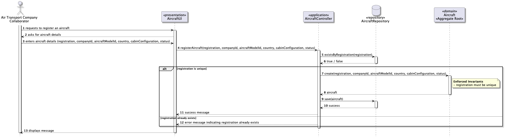

---

### Short Explanation
- The scenario starts when an Air Transport Company Collaborator submits the aircraft data through the UI.
- The request reaches the AircraftController, which coordinates the process and queries the repository to check if the registration already exists.
- If the registration is unique, the Aircraft aggregate root is created, enforcing the invariant of unique identification.
- The new aircraft is then persisted through the repository in a consistent operation.
- If the registration already exists, the creation is blocked and an error message is returned.
- This demonstrates that the aggregate is responsible for ensuring the uniqueness and integrity of aircraft identification in the system.

---

---

## EngineModel Aggregate Justification

### Aggregate Root
Engine Model

---

### Why is it an Aggregate?
The EngineModel is modeled as a separate aggregate because it defines a critical technical consistency boundary for the system's physics and simulation engine. The specific combination of motorization type, power output, and fuel consumption coefficients (TSFC) forms a set of business rules that must be enforced together to ensure a valid engine profile. Other aggregates, such as the AircraftModel, only reference the EngineModel by its unique ID. This ensures that the core technical specifications remain protected and consistent, preventing external entities from modifying the fundamental physical properties of a engine model.

---

### Responsibility
The EngineModel is responsible for managing the technical definition of aircraft engines. This includes defining the motorization type (e.g., Turbofan, Turboprop), power ratings, and the Thrust Specific Fuel Consumption (TSFC), which is essential for calculating fuel burn during a flight.

---

### Enforced Invariant
- Ensure that technical parameters like power and TSFC are always strictly positive values. Since these are used as divisors or multipliers in physics engines, a zero or negative value would result in mathematical errors and invalid simulation reports.
- The aggregate must ensure that the Fuel Type is compatible with the selected Motorization Type, maintaining the physical integrity of the model.

### Representative Scenario
Registering a new engine model in the system.

---

### Sequence Diagram
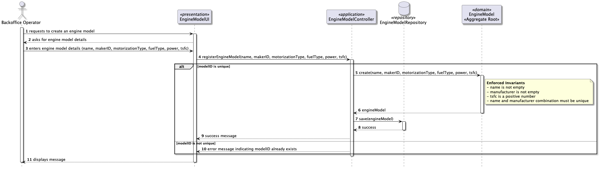

---

### Short Explanation
- The scenario begins with the Backoffice Operator providing the engine's technical details. 
- The EngineModelController orchestrates the process. 
- The EngineModel Aggregate Root is then instantiated. During its creation, it enforces the business invariants: ensuring the TSFC is a positive number and that the combination of the name and makerID is unique. 
- If the data is invalid, the object creation fails, preventing inconsistent data from reaching the Repository. 
- Once the Aggregate Root is successfully created and validated, it is saved.

---

---

## PilotCertification Aggregate Justification

### Aggregate Root
PilotCertification

---

### Why is it an Aggregate?
PilotCertification was modeled as a separate aggregate because it represents a clear consistency boundary. The rules regarding a pilot's active status and the minimum number of certified aircraft models must be enforced together transactionally. This prevents invalid states (e.g., an active pilot with zero certifications) and keeps the certification logic independent from the SystemUser and AirTransportCompany aggregates.

---

### Responsibility
Managing a pilot’s certifications for specific aircraft models within an air transport company, ensuring that only properly certified pilots can be assigned to flights.

---

### Enforced Invariant
- **Minimum Certification**: An active pilot must always have at least one valid aircraft model certification.

---

### Representative Scenario
Removing an aircraft model certification from a pilot assuming that the remaining certifications are valid.

---

### Sequence Diagram
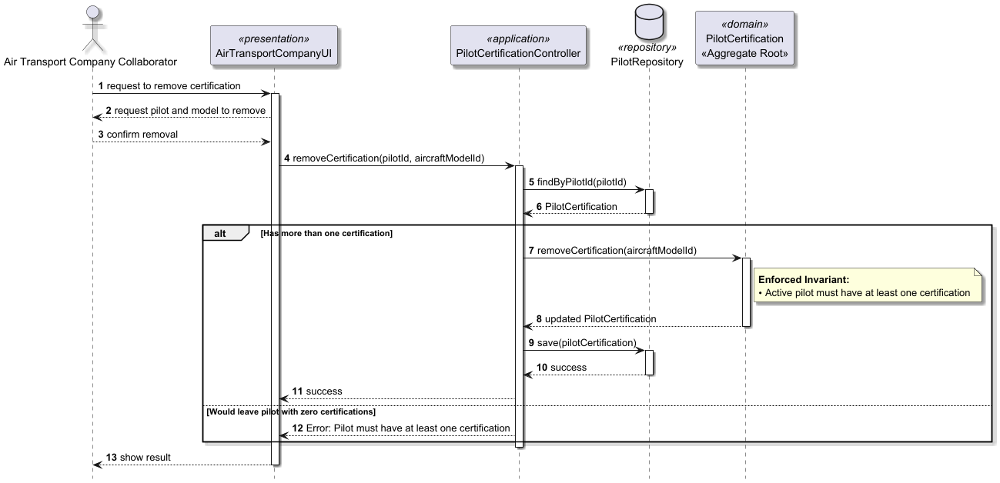

---

### Short Explanation
- The scenario starts when an Air Transport Company Collaborator attempts to remove an aircraft model certification from a pilot through the AirTransportCompanyUI.
- The request reaches the `PilotCertificationController`.
- The controller loads the PilotCertification aggregate and checks the current number of certifications.
- This sequence diagram illustrates the removal of a certification **assuming that the remaining certifications are valid**.
- The aggregate root enforces the invariant that an active pilot must retain at least one valid certification.
- The operation only succeeds if the invariant is respected.
- This demonstrates that the PilotCertification aggregate is responsible for guaranteeing flight safety by enforcing pilot qualification rules.

---

---

## AirTransportCompany Aggregate Justification

### Aggregate Root
AirTransportCompany

---

### Why is it an Aggregate?
AirTransportCompany was modeled as a separate aggregate because it represents an organizational entity with its own identity and consistency rules. Its company name, IATA code, ICAO code, and collaborator memberships must be managed together as a single consistency boundary. Other aggregates, such as Aircraft, FlightRoute, and PilotCertification, only reference the company by ID and do not control its internal state.

---

### Responsibility
Managing the identity of an air transport company and its internal memberships, ensuring that the company is uniquely identified in the system and that its collaborators are correctly associated with it.

---

### Enforced Invariant
- **Unique Company Identification**: An AirTransportCompany must have a unique company name, IATA code, and ICAO code in the system.
- **Valid Membership Association**: Every `CompanyMembership` must reference a valid `SystemUser` associated with that company.

---

### Representative Scenario
Registering a new air transport company in the system.

---

### Sequence Diagram
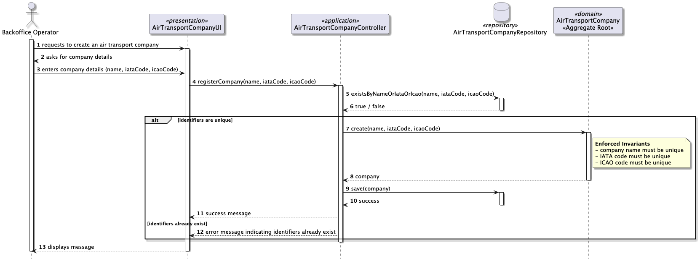

---

### Short Explanation
- The scenario starts when a Backoffice Operator requests the creation of a new air transport company through the UI.
- The request reaches the AirTransportCompanyController, which coordinates the process and queries the repository to verify whether the company name, IATA code, or ICAO code already exists.
- If the identifiers are unique, the AirTransportCompany aggregate root is created, enforcing the invariant that the company must have unique identification in the system.
- The new company is then persisted through the repository in a consistent operation.
- If any identifier already exists, the operation is rejected and an error message is returned.
- This demonstrates that the aggregate is responsible for preserving the identity and integrity of air transport companies in the system.

---

---

## Airport Aggregate Justification

### Aggregate Root
Airport

---

### Why is it an Aggregate?
Airport was modeled as a separate aggregate because it represents a real-world physical entity with its own identity and lifecycle. Its identification codes (IATA and ICAO), geographic location, elevation, and association with an AirControlArea must be managed together as a single consistency boundary. Other aggregates only reference the airport by ID and do not control its internal state.

---

### Responsibility
Managing airport information, including its unique identification, geographic location, elevation, and association with a specific AirControlArea.

---

### Enforced Invariant
- **Unique Identification**: An Airport must have unique IATA and ICAO codes in the system.
- **Valid Area Association**: An Airport must be associated with exactly one existing AirControlArea.
- **Valid Location Data**: Coordinates must be valid (latitude and longitude) and elevation must be defined.

---

### Representative Scenario
Registering a new airport in the system.

---

### Sequence Diagram
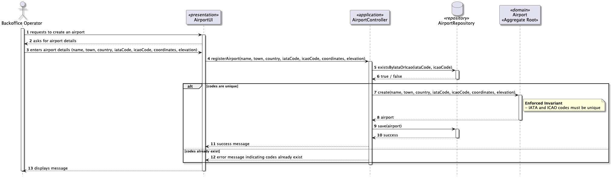

---

### Short Explanation
- The scenario starts when a Backoffice Operator requests the creation of a new airport through the UI.
- The request reaches the AirportController, which coordinates the process and queries the repository to verify whether the IATA or ICAO codes already exist.
- If the codes are unique, the Airport aggregate root is created.
- The aggregate root enforces its invariants by ensuring that the airport has unique identification (IATA and ICAO codes), is associated with a valid AirControlArea, and contains valid location data.
- The new airport is then persisted through the repository in a consistent operation.
- If any code already exists, the operation is rejected and an error message is returned.
- This demonstrates that the aggregate is responsible for maintaining the identity, location integrity, and correct association of airports in the system.

---

---