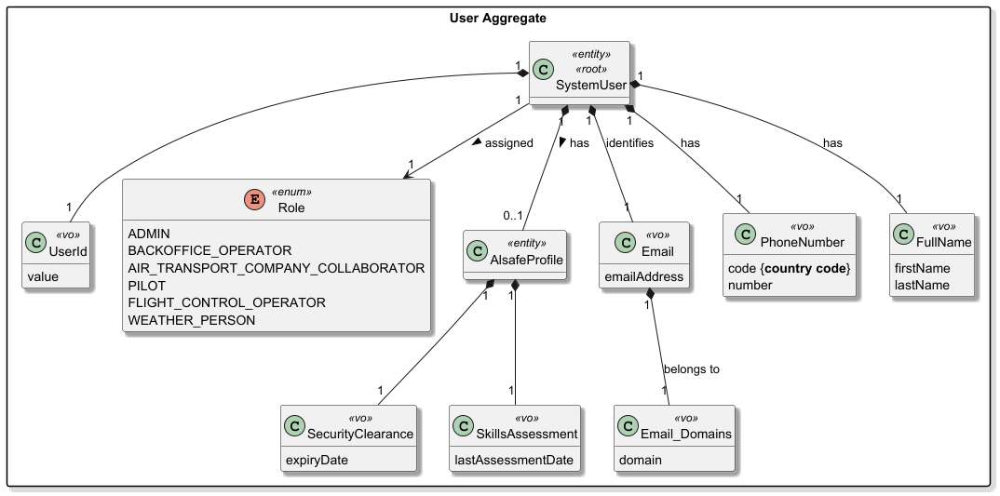
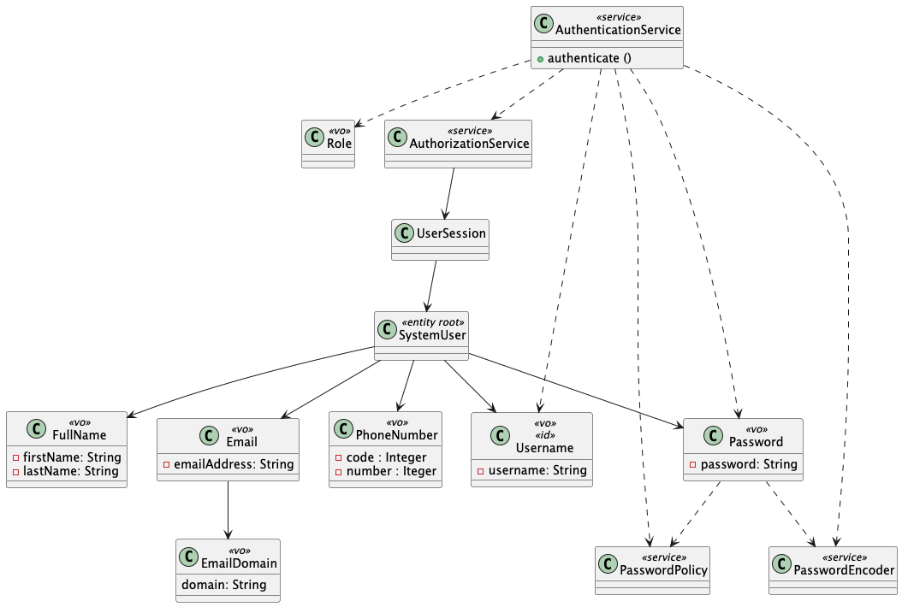

# US030 Authentication and authorization

## 1. Context

* As a Project Manager, I want the system to support and apply authentication and authorization for all its users and funcionalities.
* This task is being developed for the first time in the sprint 2 and it has dependencies with the following requirements:
  * NFR09 - Mandatory support for authentication and authorization in all functionalities.

### 1.1 List of issues

**Main Issue:** Issue #56

Analysis: Issue #58

**Design:** Issue #85

**Implement:**

**Test:**

## 2. Requirements

**US030 -** As a Project Manager, I want the system to support and apply authentication and authorization for all its users and funcionalities.

### Acceptance Criteria:

* **US030.1 -** The system must require authentication for all users accessing protected functionalities.
* **US030.2 -** The system must support user login with valid credentials.
* **US030.3 -** The system must reject access when invalid credentials are provided.
* **US030.4 -** The system must enforce authorization rules based on user roles (e.g., Administrator, Backoffice Operator, etc.).
* **US030.5 -** The system must restrict access to functionalities according to user permissions.
* **US030.6 -** The system must ensure that only authorized users can perform specific actions.
* **US030.7 -** The system must maintain user sessions securely after successful authentication.
* **US030.8 -** The system must allow users to log out, terminating their session.
* **US030.9 -** The system must protect sensitive data and operations from unauthorized access.
* **US030.10 -** Authentication and authorization mechanisms must also apply to operations executed via bootstrap.
* **US030.11 -** Upon successful login, the system must confirm the operation to the user.

### Dependencies/References:

Regarding this requirement, we understand that it relates to:

- US031 - Register users: It is necessary to have registered users before they can be authenticated.
- US044 / US078 / US086: Remote access requirements that explicitly demand the enforcement of authentication and authorization rules over the network.
- Section 3.1.1: Defines the concepts of users, unique emails, authorized domains, and the necessity of credentials for any system interaction.

## 3. Analysis

The domain model for user must serve as the primary consistency boundary for identity and security, encapsulating personal identification and operational profiles to enforce business invariants related to email domain authorization and professional security readiness.




| Attribute         | Description                                                | Constraints                                                               |
| ----------------- | ---------------------------------------------------------- | ------------------------------------------------------------------------- |
| UserId            | Unique identifier of user                                  | UUID, auto-generated by the system                                        |
| Role              | User Role one the system (e.g. WEATHER PERSON, PILOT, ...) | Must exist in the Role enum (e.g., ADMIN, PILOT, ATCC).                   |
| AlSafeProfile     | Internal entity for security data                          | Linked to SystemUser; contains security and assessment status.            |
| SecurityClearance | Mandatory security status                                  | Must include an automatic expiry date.                                    |
| SkillsAssessment  | Periodic technical evaluation                              | Must be renewed every 5 years per regulations.                            |
| Email             | Primary user identification                                | Must be unique and follow the standard email format.                      |
| EmailDomains      | List of email domains available                            | Must be in authorized list                                                |
| PhoneNumber       | Phone Number of the user                                   | Must be unique, have a valid country code (e.g. +351) and standard digits |
| FullName          | Full Name of the user                                      | Must not be empty, composed by the first and last name                    |

**Key business rules:**

* Email Uniqueness: Every user must be identified by a unique email address.
* Authorized Domains: The user's email domain must belong to a predefined authorized list (Business Invariant).
* Security Readiness: To possess an active AlsafeProfile, the user must have a valid security clearance and a technical assessment completed within the last 5 years.
* Role Validation: A user must be assigned a role that exists within the system's permission structure.

**Relationship with the domain:**
`User` is an independent aggregate whose invariant is ensuring identity integrity and security readiness. It serves as the primary consistency boundary for authentication and access control within the AISafe platform. The aggregate root (SystemUser) protects the AlsafeProfile and its associated security VOs, ensuring that only users with valid certifications and clearances can interact with operational functions like flight simulation or route management.

## 4. Design

### 4.1. Realization

The framework used for the implementation of this requirement is the one that was given by the course.

The design of the solution for this requirement is based on the following class diagram:



For the implementation of this requirement, the following steps need followed for every new functionality that needs to be protected by authentication and authorization:

#### 1. Configuration

The authentication and authorization services must be initialized in the application's Main method using the AuthzRegistry. This singleton registry links the services to the appropriate repositories and policies.

```java
// Example of configuration in the Main method
    public static void main(String[] args) {
      AuthzRegistry.configure(PersistenceContext.repositories().users(),
              new EcamplePasswordPolicy(), new PlainTextEncoder());
    }
```

#### 2. Authentication (Login)

Authentication is typically handled in the presentation layer . The AuthenticationService is used to verify the user's credentials.

```java
protected boolean doShow(){
    // Example of performing authentication
    if (AuthenticationService.authenticate(userName, password, onlyWithThisRole).isPresent()) {
        return true; // Login successful}
    }
}
```

#### 3. Authorization (Access Control)

Authorization is enforced within the Controllers to ensure that only users with the required roles can execute specific business logic. This is achieved using the AuthorizationService.

```java
   public class ChangeDishTypeController implements Controller {
   private final AuthorizationService authz = AuthzRegistry.authorizationService();

   public DishType changeDishType(final DishType theDishType, final String newDescription) {
         // Enforce role-based access control
         authz.ensureAuthenticatedUserHasAnyOf(
            CafeteriaRoles.POWER_USER,
            CafeteriaRoles.MENU_MANAGER
         );

        // Logic continues only if authorized...
   }
}
```

### 4.2. Acceptance Tests

Include here the main tests used to validate the functionality. Focus on how they relate to the acceptance criteria. May be automated or manual tests.

**Test 1:** *Verifies that it is not possible to ...*

**Refers to Acceptance Criteria:** US666.1

```
@Test(expected = IllegalArgumentException.class)
public void ensureXxxxYyyy() {
	...
}
````

## 5. Implementation

The implementation follows the design presented in section 4 and uses the EAPLI framework authentication and authorization services.

### 5.1 Evidence of implementation aligned with design

The following evidences show that the implementation matches the planned architecture (configuration -> authentication -> authorization):

1. **Framework configuration in application startup**

   - `aiSafe.Main` initializes `AuthzRegistry` with user repository, password policy and encoder.
   - `aiSafe.app.bootstrap.AisafeBootstrap` also initializes `AuthzRegistry` before bootstrap operations.
2. **Authentication in presentation layer**

   - `LoginUI` performs credential validation through `AuthenticationCredentialHandler`.
   - Invalid credentials are rejected with limited retry attempts.
   - Successful authentication grants access to the Backoffice main menu.
3. **Role-based authorization for protected actions**

   - `MainMenu` checks user roles before exposing protected options.
   - `AuthorizationGuardService` centralizes role checks for protected backoffice operations (`ADMIN` and `BACKOFFICE_OPERATOR`).
   - Protected operations call guard methods before execution.
4. **Session lifecycle management**

   - `MyUserMenu` includes session-aware actions (session info, change user, logout).
   - `LogoutUI` terminates session through `AuthorizationService.clearSession()`.
5. **Bootstrap authorization**

   - `MasterDataBootstrapper` allows first-time initialization without existing users.
   - When users already exist, it requires authentication with `ADMIN` role before executing bootstrap actions.

### 5.2 Relevant artifacts and configuration files

The main files required to understand and execute this implementation are:

- **Authentication/authorization setup**
  - `aisafe.app.backoffice.console/src/main/java/aiSafe/Main.java`
  - `aisafe.app.bootstrap/src/main/java/aiSafe/app/bootstrap/AisafeBootstrap.java`
- **Login and session management**
  - `aisafe.app.backoffice.console/src/main/java/aiSafe/app/backoffice/console/authz/LoginUI.java`
  - `aisafe.app.backoffice.console/src/main/java/aiSafe/app/backoffice/console/presentation/authz/MyUserMenu.java`
  - `aisafe.app.backoffice.console/src/main/java/aiSafe/app/backoffice/console/presentation/authz/LogoutUI.java`
- **Authorization enforcement**
  - `aisafe.core/src/main/java/aiSafe/usermanagement/application/AuthorizationGuardService.java`
  - `aisafe.app.backoffice.console/src/main/java/aiSafe/app/backoffice/console/presentation/MainMenu.java`
- **Bootstrap protection**
  - `aisafe.bootstrappers/src/main/java/aiSafe/infrastructure/bootstrap/MasterDataBootstrapper.java`
- **Persistence/auth technical configuration**
  - `aisafe.persistence.impl/src/main/resources/META-INF/persistence.xml`
  - `aisafe.infrastructure.application/src/main/resources/application.properties.sample`

### 5.3 Major commits (summary)

The following commits are the major milestones related to this requirement and its technical baseline:

- `8fd95a6` - Multi-module Maven project structure required to separate core, infrastructure, persistence, bootstrap and console layers.
- `8818347` - Initial analysis artifacts and documentation work for user authentication and authorization.
- `e443ab2` - Bootstrap application/module introduction and startup wiring.
- `0e5f79f` - Design artifacts update (class diagram and implementation guidance).

> Note: additional US030 implementation adjustments (login/menu/session/authorization guards and bootstrap role checks) are present in the current working tree and should be included in the next related commit(s).

## 6. Integration/Demonstration

*In this section the team should describe the efforts realized in order to integrate this functionality with the other parts/components of the system*

*It is also important to explain any scripts or instructions required to execute an demonstrate this functionality*

## 7. Observations

*This section should be used to include any content that does not fit any of the previous sections.*

*The team should present here, for instance, a critical prespective on the developed work including the analysis of alternative solutioons or related works*

*The team should include in this section statements/references regarding third party works that were used in the development this work.*
