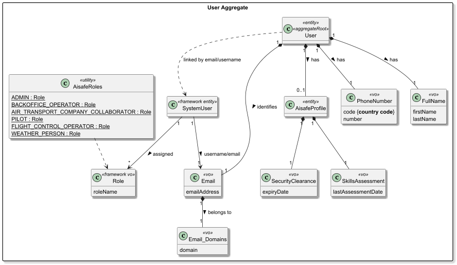
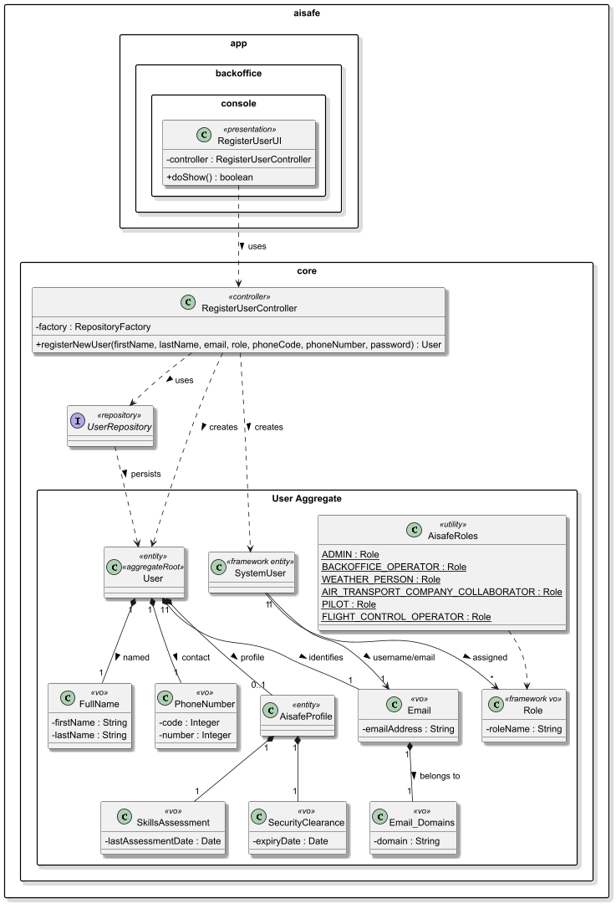
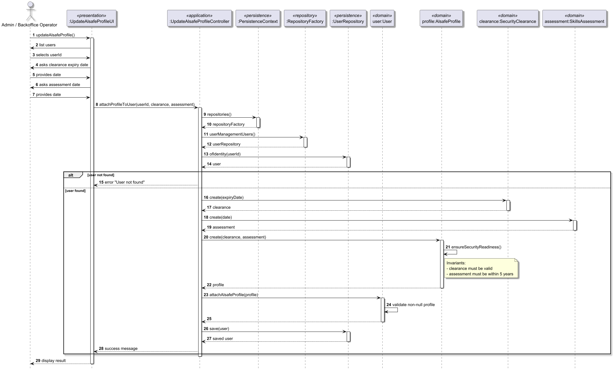

# US031 - Register users

## 1. Context

* As Administrator, I want to be able to register users of the backoffice.
* This task is being developed for the first time in the sprint 2 and it has dependencies with the following requirements:
  * US030 - Authentication and authorization. 

### 1.1 List of issues

**Main Issue:** Issue #44

**Analysis**: Issue #48

**Design and Unit Test:** Issue #82

**Implement:** Issue #98


## 2. Requirements

**US031 -** As Administrator, I want to be able to register users of the backoffice.

### Acceptance Criteria:
* **US031.1 -** The system must allow an Administrator to register new backoffice users.
* **US031.2 -** A user must have the required attributes (e.g., username, email, password, and role).
* **US031.3 -** All mandatory fields must be provided; the system must not allow registration with missing data.
* **US031.4 -** The system must validate the format of user attributes (e.g., valid email format, password rules).
* **US031.5 -** Each user must be unique (e.g., no duplicate emails).
* **US031.6 -** The system must assign a role to the user (e.g., Administrator, Backoffice Operator).
* **US031.7 -** The registration must be achievable via a bootstrap process.
* **US031.8 -** Upon successful registration, the system must confirm the operation to the Administrator.

### Dependencies/References:

Regarding this requirement, we understand that it relates to:
- US030: Every user created must be subject to the system's authentication and authorization rules.
- US032 / US033: Users registered here will later be managed (enabled/disabled) and listed.
- SECTION 3.1.1: "Users and roles" in the project requirements document.

## 3. Analysis

The domain model for user must serve as the primary consistency boundary for identity and security, encapsulating personal identification and operational profiles to enforce business invariants related to email domain authorization and professional security readiness.



| Attribute              | Description                                                 | Constraints                                                                                                                          |
|------------------------|-------------------------------------------------------------|--------------------------------------------------------------------------------------------------------------------------------------|
| Role                   | User Role one the system (e.g. WEATHER PERSON, PILOT, ...)  | Represented by Role value object from framework; assigned only within SystemUser.                                                    |
| AlSafeProfile          | Internal entity for security data                           | Linked to SystemUser; contains security and assessment status.                                                                       |
| SecurityClearance      | Mandatory security status                                   | Must include an automatic expiry date.                                                                                               |
| SkillsAssessment       | Periodic technical evaluation                               | Must be renewed every 5 years per regulations.                                                                                       |
| Email                  | Primary user identification                                 | Must be unique and follow the standard email format.                                                                                 |
| EmailDomains           | List of email domains available                             | Must be in authorized list                                                                                                           |
| PhoneNumber            | Phone Number of the user                                    | Must be unique, have a valid country code (e.g. +351) and standard digits                                                            |
| FullName               | Full Name of the user                                       | Must not be empty, composed by the first and last name                                                                               |
| SystemUser (Framework) | Authentication and authorization aggregate root             | Managed by framework. Stores username/email, password, and assigned roles (RoleSet). Linked logically to User via email/username.    |

**Key business rules:**
* Email Uniqueness: Every user must be identified by a unique email address.
* Authorized Domains: The user's email domain must belong to a predefined authorized list (Business Invariant).
* Security Readiness: To possess an active AlsafeProfile, the user must have a valid security clearance and a technical assessment completed within the last 5 years.
* Role Validation: A user must be assigned a role that exists within the system's permission structure.

**Client clarifications:**
* Security clearance requirements apply to all users. Although Administrators and Backoffice Users can update them. There should be a restriction that a user could not update its own security clearance.

**Relationship with the domain:**  
`User` is an independent aggregate whose invariant is ensuring identity integrity and security readiness. It serves as the primary consistency boundary for authentication and access control within the AISafe platform. The aggregate root (SystemUser) protects the AlsafeProfile and its associated security VOs, ensuring that only users with valid certifications and clearances can interact with operational functions like flight simulation or route management. 

## 4. Design

*In this sections, the team should present the solution design that was adopted to solve the requirement. This should include, at least, a diagram of the realization of the functionality (e.g., sequence diagram) and the specification of the main tests used to validade the functionality. A class diagram may be useful to describe the classes involved.*

### 4.1. Realization

The design of the solution for this requirement is based on the following class diagram: 



The following sequence diagram illustrates the realization of US031 - Register users


The following sequence diagram illustrates the update of users aisafe profile after register




### 4.2. Acceptance Tests

Include here the main tests used to validate the functionality. Focus on how they relate to the acceptance criteria. May be automated or manual tests.

**Test 1:** *Verifies that a user is successfully created when all mandatory attributes are valid.*

**Refers to Acceptance Criteria:** US031.1, US031.2, US031.6, US031.8

```java
@Test
void ensureUserIsCreatedSuccessfully() {
  final var user = new User(
          new FullName("John", "Doe"),
          new Email("john.doe@company.com"),
          new PhoneNumber(351, 912345678),
          AisafeRoles.ADMIN
  );

  assertNotNull(user.identity());
  assertEquals(AisafeRoles.ADMIN, user.assignedRole());
}
````

**Test 2:** *Verifies that creating a user with missing mandatory fields is rejected.*

**Refers to Acceptance Criteria:** US031.3

```java
@Test
void ensureUserCannotBeCreatedWithNullEmail() {
  assertThrows(IllegalArgumentException.class, () ->
          new User(
                  new FullName("John", "Doe"),
                  null,
                  new PhoneNumber(351, 912345678),
                  AisafeRoles.ADMIN
          )
  );
}
````

**Test 3:** *Verifies that creating a user with an invalid email format is rejected.*

**Refers to Acceptance Criteria:** US031.4

```java
@Test
void ensureInvalidEmailFormatIsRejected() {
  assertThrows(IllegalArgumentException.class, () ->
          new User(
                  new FullName("John", "Doe"),
                  new Email("invalid-email-format"),
                  new PhoneNumber(351, 912345678),
                  AisafeRoles.ADMIN
          )
  );
}
````

**Test 4:** *Verifies that the email domain must belong to the authorized list.*

**Refers to Acceptance Criteria:** US031.4 (domain validation business rule)

```java
@Test
void ensureEmailDomainMustBeAuthorized() {
  assertThrows(IllegalArgumentException.class, () ->
          new User(
                  new FullName("John", "Doe"),
                  new Email("john@gmail.com"), 
                  new PhoneNumber(351, 912345678),
                  AisafeRoles.ADMIN
          )
  );
}
````
**Test 6:** *Verifies that creating a user without a role is rejected.*

**Refers to Acceptance Criteria:** US031.6

```java
@Test
void ensureUserRoleCannotBeNull() {
  assertThrows(IllegalArgumentException.class, () ->
          new User(
                  new FullName("John", "Doe"),
                  new Email("john.doe@company.com"),
                  new PhoneNumber(351, 912345678),
                  null
          )
  );
}
````

**Test 7:** *Verifies that creating a user with an invalid phone number is rejected.*

**Refers to Acceptance Criteria:** US031.4

```java
@Test
void ensureInvalidPhoneNumberIsRejected() {
  assertThrows(IllegalArgumentException.class, () ->
          new User(
                  new FullName("John", "Doe"),
                  new Email("john.doe@company.com"),
                  new PhoneNumber(351, -123456), // invalid number
                  AisafeRoles.ADMIN
          )
  );
}
````

**Test 8:** *Verifies that creating a user with an empty name is rejected.*

**Refers to Acceptance Criteria:** US031.3

```java
@Test
void ensureFullNameCannotBeEmpty() {
  assertThrows(IllegalArgumentException.class, () ->
          new User(
                  new FullName("", ""),
                  new Email("john.doe@company.com"),
                  new PhoneNumber(351, 912345678),
                  AisafeRoles.ADMIN
          )
  );
}
````

**Test 9:** *Verifies that AlsafeProfile can be successfully attached to a user.*

**Refers to Acceptance Criteria:** US031.2

```java
@Test
void ensureAlsafeProfileCanBeAttachedSuccessfully() {

  final var user = new User(
          new FullName("John", "Doe"),
          new Email("john.doe@company.com"),
          new PhoneNumber(351, 912345678),
          AisafeRoles.ADMIN
  );

  final var profile = new AlsafeProfile(
          new SecurityClearance(java.time.LocalDate.now().plusYears(1)),
          new SkillsAssessment(java.time.LocalDate.now().minusYears(1))
  );

  user.attachAlsafeProfile(profile);

  assertNotNull(user.alsafeProfile());
}
````

**Test 10:** *Verifies that attaching a null AlsafeProfile is rejected.*

**Refers to Acceptance Criteria:** US031.3

```java
@Test
void ensureNullAlsafeProfileIsRejected() {

  final var user = buildValidUser();

  assertThrows(IllegalArgumentException.class, () ->
          user.attachAlsafeProfile(null)
  );
}
````

**Test 11:** *Verifies that sameAs is based on email uniqueness.*

**Refers to Acceptance Criteria:** US031.5

```java
@Test
void ensureSameAsReturnsTrueForSameEmail() {

  final var user1 = new User(
          new FullName("John", "Doe"),
          new Email("john.doe@company.com"),
          new PhoneNumber(351, 912345678),
          AisafeRoles.ADMIN
  );

  final var user2 = new User(
          new FullName("Johnny", "Doe"),
          new Email("john.doe@company.com"),
          new PhoneNumber(351, 987654321),
          AisafeRoles.BACKOFFICE_OPERATOR
  );

  assertTrue(user1.sameAs(user2));
}
````

## 5. Implementation

The implementation follows the design presented in section 4 and applies Domain-Driven Design principles across all layers of the AISafe system. The solution ensures a strict separation between the authentication domain (SystemUser from the framework) and the business domain (User aggregate), while maintaining consistency through email/username linkage.

### 5.1. Evidence of implementation aligned with design

The following evidence demonstrates that the implementation is consistent with the designed architecture and fulfills all requirements of US031 - Register users.

1. **Domain invariants enforced at construction**
- The `User` aggregate ensures all mandatory attributes are validated at creation time.
- `FullName`, `Email`, and `PhoneNumber` are implemented as value objects with internal validation rules.
- Null values and invalid formats (e.g., empty names, invalid phone numbers) are rejected immediately via constructor checks and `Preconditions`.
This guarantees compliance with:
- US031.3 (mandatory fields)
- US031.4 (format validation)

2. **Value objects and encapsulation of business rules**
- Each user attribute is modelled as a dedicated value object:
  - `FullName`
  - `Email`
  - `EmailDomain`
  - `PhoneNumber`
- The `Email` value object ensures syntactic validation and domain consistency.
- `EmailDomain` enforces authorization against a predefined list of allowed domains.

3. **Security and profile modelling**
- The `AisafeProfile` entity aggregates operational security information.
- It encapsulates:
  - SecurityClearance (mandatory security authorization with expiry date)
  - SkillsAssessment (technical evaluation with renewal constraints)
This ensures compliance with internal regulatory rules:
- Security clearance must always include an expiry date.
- Skills assessment must be periodically updated (5-year cycle rule).

4. **Uniqueness enforced at two levels**
- Domain level: `sameAs` ensures logical identity comparison based on email.
- Database level: `@UniqueConstraint` on email and phone number ensures persistence integrity.
This guarantees:
- US031.5 (no duplicate users)

5. **Role-based access control**
- The User Registration submenu is only rendered for users with `ADMIN` role, as enforced in `MainMenu`.
- The controller additionally calls `authz.ensureAuthenticatedUserHasAnyOf(AisafeRoles.ADMIN)` before executing any registration logic, satisfying integration with **US030**.

5.1. **Role-based access control via framework integration**
- User roles are managed by the framework `Role` value object.
- Roles are assigned within `SystemUser` using the framework RoleSet.
- The `User` aggregate stores only the role representation as a string (`roleAuthority`) when necessary for business reference.
- The `AisafeRoles` utility class centralizes all system roles:
  - ADMIN 
  - BACKOFFICE_OPERATOR 
  - WEATHER_PERSON 
  - PILOT 
  - FLIGHT_CONTROL_OPERATOR 
  - AIR_TRANSPORT_COMPANY_COLLABORATOR
This ensures:
- US031.6 (role assignment)
- Consistency with US030 authentication and authorization

6. **Separation between authentication and domain model**
- `SystemUser` (framework) is responsible for:
  - Authentication (username/password)
  - Authorization (roles)
- `User` (domain) is responsible for:
  - Business identity (email, full name, phone number)
  - Profile data (AisafeProfile)
Both are linked logically via:
email / username equivalence

7. **Bootstrap support**
- User creation is supported through:
  - UserBootstrapper
  - MasterDataBootstrapper
This satisfies:
- US031.7 (bootstrap support)

### 5.2. Relevant artifacts and configuration files

The main files required to understand and execute this implementation are:

- **Domain**
  - `aisafe.core/src/main/java/aiSafe/usermanagement/domain/User.java`
  - `aisafe.core/src/main/java/aiSafe/usermanagement/domain/FullName.java`
  - `aisafe.core/src/main/java/aiSafe/usermanagement/domain/Email.java`
  - `aisafe.core/src/main/java/aiSafe/usermanagement/domain/PhoneNumber.java`
  - `aisafe.core/src/main/java/aiSafe/usermanagement/domain/AisafeProfile.java`
  - `aisafe.core/src/main/java/aiSafe/usermanagement/domain/SecurityClearance.java`
  - `aisafe.core/src/main/java/aiSafe/usermanagement/domain/SkillsAssessment.java`
  - `aisafe.core/src/main/java/aiSafe/usermanagement/domain/AisafeRoles.java`
- **Application**
  - `aisafe.core/src/main/java/aiSafe/usermanagement/application/RegisterUserController.java`
- **Presentation**
  - `aisafe.app.backoffice.console/src/main/java/aiSafe/app/backoffice/console/presentation/authz/RegisterUserAction.java`
  - `aisafe.app.backoffice.console/src/main/java/aiSafe/app/backoffice/console/presentation/authz/RegisterUserUI.java`
  - `aisafe.app.backoffice.console/src/main/java/aiSafe/app/backoffice/console/presentation/MainMenu.java`
- **Persistence**
  - `aisafe.persistence.impl/src/main/java/aiSafe/persistence/impl/jpa/JpaUserManagementUserRepository.java`
  - `aisafe.persistence.impl/src/main/java/aiSafe/persistence/impl/inmemory/InMemoryUserManagementUserRepository.java`
  - `aisafe.core/src/main/java/aiSafe/usermanagement/repositories/UserRepository.java`
  - `aisafe.persistence.impl/src/main/resources/META-INF/persistence.xml`
- **Bootstrap**
  - `aisafe.bootstrappers/src/main/java/aiSafe/infrastructure/bootstrap/MasterDataBootstrapper.java`
  - `aisafe.bootstrappers/src/main/java/aiSafe/infrastructure/bootstrap/UserBootstrapper.java`

### 5.3. Major commits (summary)

The following commits are the major milestones related to this requirement:

- `e022fc5` - add analysis documentation for the user registration requirement
- `16c298a` - add design documentation, including class and sequence diagrams for user registration
- `58899bd` - add acceptance tests for the user aggregate, covering all validation rules and invariants
- `d856d9d` - implement the `User` aggregate root and its value objects, enforcing all domain rules
- `895f497` - implement in-memory and jpa persistence for `UserRepository`


## 6. Integration/Demonstration

### 6.1. Architectural Integration

This functionality integrates with the system following the persistence architecture defined for the project. The `UserRepository` interface is defined in the core domain module (`core.usermanagement.repositories`) and resolved at runtime via `PersistenceContext`, which delegates to the active `RepositoryFactory` implementation:

- **`persistence.impl.inmemory`** — used for testing and early development, backed by `InMemoryUserManagementUserRepository`.
- **`persistence.impl.jpa`** — used in production, backed by `JpaUserManagementUserRepository` with full ORM mapping via JPA/Hibernate.
  This design ensures the domain and application layers are fully decoupled from persistence technology.

### 6.2. Integration Points

| Layer                  | Component                                   | Role                                               |
|------------------------|---------------------------------------------|----------------------------------------------------|
| Domain                 | `User`, `UserRepository`                    | Aggregate and repository interface                 |
| Application            | `RegisterUserController`                    | Orchestrates registration, enforces authz          |
| Persistence (JPA)      | `JpaUserManagementUserRepository`           | Persists to relational DB via JPA                  |
| Persistence (InMemory) | `InMemoryUserManagementUserRepository`      | Used in tests and bootstrap dry-runs               |
| Infrastructure         | `PersistenceContext`                        | Resolves the active `RepositoryFactory` at runtime |
| Bootstrap              | `MasterDataBootstrapper` `UserBootstrapper` | Seeds users at startup                             |
| Presentation           | `RegisterUserUI` / `RegisterUserAction`     | Console entry point                                |

### 6.3. How to Demonstrate

1. Start the application using the Backoffice console module.
2. Log in with a user holding the `ADMIN` role.
3. Navigate to `Administration > Register User`.
4. Fill in all required fields.

### 7.1. Architectural Decisions

The project follows a layered, DDD-based architecture where the repository contract (`XRepository`) is always defined in the core domain module, while concrete implementations (`InMemoryXRepository`, `JpaXRepository`) live in separate modules resolved at runtime by `RepositoryFactory`. This ensures:

- The domain model has **zero dependency** on persistence technology.
- Switching between InMemory and JPA requires only a configuration change, not a code change.

The persistence layer followed the pattern represented below:


### 7.2. Third-party Works

- **EAPLI Framework** — provides the base infrastructure for `AggregateRoot`, `ValueObject`, `Repository`, `AuthzRegistry`, and console UI rendering used throughout this implementation.
- **Jakarta Persistence (JPA) / Hibernate** — used for ORM mapping of the `User` entity and its embedded value objects.