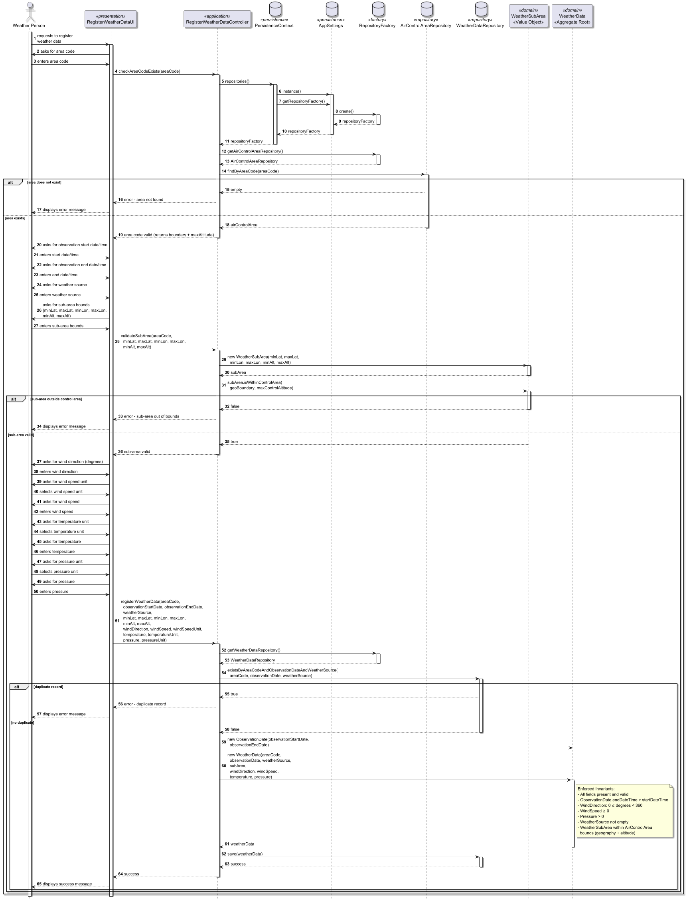

# US041 - Register weather data

## 1. Context

* As a Weather Person, I want to register weather data in the system for a specific air control area.
* This task is being developed for the first time in the sprint 2 and it has dependencies with the following requirements:
  * US050 - Register an air control area

### 1.1 List of issues

**Main Issue:** Issue #43

**Analysis:** Issue #62

**Design:** Issue #67

**Implement:** Issue #87

## 2. Requirements

**US041 -** As a Weather Person, I want to register weather data in the system for a specific air control area.

### Acceptance Criteria:

- **US041.1** The system must ensure that the weather data is associated with an existing air control area. If the area does not exist, the registration must be rejected with an appropriate error message.
- **US041.2** The weather record must include all mandatory fields: area code, observation start date/time, observation end date/time, weather source, wind direction (angle relative to North in degrees), wind speed, temperature, and pressure. Incomplete or invalid registrations must be rejected with a descriptive error message.
- **US041.3** The observation end date/time must be after the observation start date/time.
- **US041.4** The combination (AreaCode + startDateTime + endDateTime + WeatherSource) must be unique. Duplicate registrations for the same area, time period and source must be rejected with an appropriate error message.
- **US041.5** The weather data must be associated with a rectangular sub-area (defined by geographic bounds and altitude range) that is fully contained within the referenced air control area. Sub-areas that exceed the control area boundaries must be rejected with an appropriate error message.
- **US041.6** When the user provides the sub-area bounds, the system must immediately validate that the sub-area is contained within the air control area before collecting the remaining meteorological fields.

### Dependencies/References:

Regarding this requirement, we understand that it relates to:

- **US050 - Register an air control area**: weather data can only be registered for an existing air control area.
- **US042 - Import bulk weather data** and **US043 - Consult weather data**: the same weather data will later be used for bulk import and consultation.
- **US100 / US110 / US113**: the weather data (especially wind) will be used by the flight simulation engine.
- **Section 3.2** of the requirements document defines wind direction and wind speed as core meteorological attributes needed for simulation.

## 3. Analysis

The domain model for weather data must capture the meteorological information required by the flight simulation while maintaining a clear relationship with the air control area.


| Attribute       | Description                                                                                   | Constraints                                              |
|-----------------|-----------------------------------------------------------------------------------------------|----------------------------------------------------------|
| AreaCode        | Reference to the air control area                                                             | Must exist (foreign key / aggregate reference)           |
| WeatherSubArea  | Rectangular sub-area within the control area(minLat, maxLat, minLon, maxLon, minAlt, maxAlt)  | minLat < maxLat; minLon < maxLon; minAlt < maxAlt;       |
| startDateTime   | Start date and time of the observation period                                                 | Valid calendar value                                     |
| endDateTime     | End date and time of the observation period                                                   | Valid calendar value; after startDateTime                |
| WindDirection   | Angle relative to North (degrees)                                                             | 0 ≤ value < 360                                          |
| WindSpeed       | Wind speed in m/s                                                                             | WindSpeed≥ 0; unit must be one of WindSpeedUnit          |
| Pressure        | Atmospheric pressure                                                                          | > 0, unit must be one of PressureUnit                    |
| WeatherSource   | Origin/provider of the weather data                                                           | Must not be empty                                        |
| Temperature     | Air temperature                                                                               | Valid numeric value, unit must be one of TemperatureUnit |

**Key business rules:**

- The air control area **must already exist** in the system before registering weather data.
- The weather data must be associated with a **rectangular sub-area** fully contained within the referenced air control area (geographically and in altitude).
- Sub-area validation must occur **immediately after the user provides the bounds**, before collecting meteorological fields.
- Wind speed cannot be negative.
- Wind direction must be a valid angle (0° to 359°).
- Pressure must be a positive value.
- Weather source must be identified (not empty).
- The observation end date/time must be after the start date/time.
- The combination (AreaCode + startDateTime + endDateTime + WeatherSource) must be unique — duplicate registrations are rejected.

**Relationship with the domain:**
`WeatherData` is an independent aggregate whose invariant is that an observation can only exist if all physical fields are complete and valid. It references the `AirControlArea` through the `AreaCode` value object — this is a contextual reference only, not a lifecycle dependency. The weather data will later be consumed by the simulation engine to influence flight physics (wind effect on aircraft trajectory and fuel consumption).

## 4. Design

### 4.1. Realization

The design of the solution for this requirement is based on the following class diagram:


The following sequence diagram illustrates the realization of US041 — Register weather data:



**Main classes and responsibilities:**

- `WeatherData` → Aggregate Root, enforces all domain invariants
- `WeatherSubArea` → Value Object, represents the rectangular sub-area (geographic bounds + altitude range) within the control area to which the weather data applies; validates containment within the AirControlArea boundary
- `AreaCode`, `ObservationDate`, `WeatherSource`, `WindDirection`, `WindSpeed`, `Temperature`, `Pressure` → Value Objects, each responsible for validating their own constraints

**Invariants enforced inside the WeatherData aggregate root:**

- `AreaCode` must reference an existing `AirControlArea`
- `WeatherSubArea` must be fully contained within the referenced `AirControlArea` (geographic boundary and altitude range)
- `WeatherSource` must not be empty
- `WindSpeed` ≥ 0; unit must be a valid WindSpeedUnit
- `WindDirection` must be between 0° and 359°
- `ObservationDate` must be a valid date/time
- `ObservationDate.endDateTime` must be after `ObservationDate.startDateTime`
- `Pressure` must be a positive value; unit must be a valid PressureUnit
- `Temperature` must be a valid numeric value; unit must be a valid TemperatureUnit
- The combination `(AreaCode + startDateTime + endDateTime + WeatherSource)` must be unique

### 4.2. Acceptance Tests

**Test 1:** Verifies that it is not possible to create a `WeatherData` with a null `AreaCode`.

**Refers to Acceptance Criteria:** US041.2

```java
@Test
public void ensureWeatherDataCannotHaveNullAreaCode() {
    // Arrange
    AreaCode nullAreaCode = null;
    ObservationDate date = new ObservationDate(
        LocalDateTime.of(2026, 4, 19, 14, 0),
        LocalDateTime.of(2026, 4, 19, 15, 0));
    WeatherSource source = new WeatherSource("IPMA");
    WindDirection direction = new WindDirection(180.0);
    WindSpeed speed = new WindSpeed(20.0, WindSpeedUnit.KMH);
    Temperature temp = new Temperature(15.0, TemperatureUnit.C);
    Pressure pressure = new Pressure(1013.0, PressureUnit.HPA);

    // Act & Assert
    assertThrows(IllegalArgumentException.class, () -> {
        new WeatherData(nullAreaCode, date, source,
            direction, speed, temp, pressure);
    });
}
```

---

**Test 2:** Verifies that it is not possible to create a `WindDirection` with a negative value.

**Refers to Acceptance Criteria:** US041.2

```java
@Test
public void ensureWindDirectionCannotBeNegative() {
    // Arrange
    double negativeValue = -1.0;

    // Act & Assert
    assertThrows(IllegalArgumentException.class, () -> {
        new WindDirection(negativeValue);
    });
}
```

---

**Test 3:** Verifies that it is not possible to create a `WindDirection` with a value equal to or above 360°.

**Refers to Acceptance Criteria:** US041.2

```java
@Test
public void ensureWindDirectionCannotBeEqualTo360() {
    // Arrange
    double value360 = 360.0;

    // Act & Assert
    assertThrows(IllegalArgumentException.class, () -> {
        new WindDirection(value360);
    });
}
```

---

**Test 4:** Verifies that it is not possible to create a `WindSpeed` with a negative value.

**Refers to Acceptance Criteria:** US041.2

```java
@Test
public void ensureWindSpeedCannotBeNegative() {
    // Arrange
    double negativeValue = -1.0;
    WindSpeedUnit unit = WindSpeedUnit.KMH;

    // Act & Assert
    assertThrows(IllegalArgumentException.class, () -> {
        new WindSpeed(negativeValue, unit);
    });
}
```

---

**Test 5:** Verifies that it is not possible to create a `WindSpeed` with a null unit.

**Refers to Acceptance Criteria:** US041.2

```java
@Test
public void ensureWindSpeedCannotHaveNullUnit() {
    // Arrange
    double value = 20.0;
    WindSpeedUnit nullUnit = null;

    // Act & Assert
    assertThrows(IllegalArgumentException.class, () -> {
        new WindSpeed(value, nullUnit);
    });
}
```

---

**Test 6:** Verifies that it is not possible to create a `Pressure` with a zero value.

**Refers to Acceptance Criteria:** US041.2

```java
@Test
public void ensurePressureCannotBeZero() {
    // Arrange
    double zeroValue = 0.0;
    PressureUnit unit = PressureUnit.HPA;

    // Act & Assert
    assertThrows(IllegalArgumentException.class, () -> {
        new Pressure(zeroValue, unit);
    });
}
```

---

**Test 7:** Verifies that it is not possible to create a `Pressure` with a negative value.

**Refers to Acceptance Criteria:** US041.2

```java
@Test
public void ensurePressureCannotBeNegative() {
    // Arrange
    double negativeValue = -1.0;
    PressureUnit unit = PressureUnit.HPA;

    // Act & Assert
    assertThrows(IllegalArgumentException.class, () -> {
        new Pressure(negativeValue, unit);
    });
}
```

---

**Test 8:** Verifies that it is not possible to create a `Pressure` with a null unit.

**Refers to Acceptance Criteria:** US041.2

```java
@Test
public void ensurePressureCannotHaveNullUnit() {
    // Arrange
    double value = 1013.0;
    PressureUnit nullUnit = null;

    // Act & Assert
    assertThrows(IllegalArgumentException.class, () -> {
        new Pressure(value, nullUnit);
    });
}
```

---

**Test 9:** Verifies that it is not possible to create a `WeatherSource` with an empty value.

**Refers to Acceptance Criteria:** US041.2

```java
@Test
public void ensureWeatherSourceCannotBeEmpty() {
    // Arrange
    String emptyValue = "";

    // Act & Assert
    assertThrows(IllegalArgumentException.class, () -> {
        new WeatherSource(emptyValue);
    });
}
```

---

**Test 10:** Verifies that it is not possible to create an `ObservationDate` with a null start date/time.

**Refers to Acceptance Criteria:** US041.2

```java
@Test
public void ensureObservationDateCannotHaveNullStart() {
    // Arrange
    LocalDateTime nullStart = null;
    LocalDateTime end = LocalDateTime.of(2026, 4, 19, 15, 0);

    // Act & Assert
    assertThrows(IllegalArgumentException.class, () -> {
        new ObservationDate(nullStart, end);
    });
}
```

---

**Test 11:** Verifies that it is not possible to create an `ObservationDate` with a null end date/time.

**Refers to Acceptance Criteria:** US041.2

```java
@Test
public void ensureObservationDateCannotHaveNullEnd() {
    // Arrange
    LocalDateTime start = LocalDateTime.of(2026, 4, 19, 14, 0);
    LocalDateTime nullEnd = null;

    // Act & Assert
    assertThrows(IllegalArgumentException.class, () -> {
        new ObservationDate(start, nullEnd);
    });
}
```

---

**Test 12:** Verifies that it is not possible to create an `ObservationDate` where end date/time is before start date/time.

**Refers to Acceptance Criteria:** US041.3

```java
@Test
public void ensureObservationDateEndCannotBeBeforeStart() {
    // Arrange
    LocalDateTime start = LocalDateTime.of(2026, 4, 19, 15, 0);
    LocalDateTime end = LocalDateTime.of(2026, 4, 19, 14, 0);

    // Act & Assert
    assertThrows(IllegalArgumentException.class, () -> {
        new ObservationDate(start, end);
    });
}
```

---

**Test 13:** Verifies that it is not possible to create an `ObservationDate` where end date/time equals start date/time.

**Refers to Acceptance Criteria:** US041.3

```java
@Test
public void ensureObservationDateEndCannotEqualStart() {
    // Arrange
    LocalDateTime same = LocalDateTime.of(2026, 4, 19, 14, 0);

    // Act & Assert
    assertThrows(IllegalArgumentException.class, () -> {
        new ObservationDate(same, same);
    });
}
```

---

**Test 14:** Verifies that a valid `WeatherData` is created successfully with all mandatory fields.

**Refers to Acceptance Criteria:** US041.1, US041.2, US041.3,
US041.4

```java
@Test
public void ensureWeatherDataIsCreatedSuccessfully() {
    // Arrange
    AreaCode areaCode = new AreaCode("LPPT");
    ObservationDate date = new ObservationDate(
        LocalDateTime.of(2026, 4, 19, 14, 0),
        LocalDateTime.of(2026, 4, 19, 15, 0));
    WeatherSource source = new WeatherSource("IPMA");
    WindDirection direction = new WindDirection(180.0);
    WindSpeed speed = new WindSpeed(20.0, WindSpeedUnit.KMH);
    Temperature temp = new Temperature(15.0, TemperatureUnit.C);
    Pressure pressure = new Pressure(1013.0, PressureUnit.HPA);

    // Act
    WeatherData weatherData = new WeatherData(areaCode,
        date, source, direction, speed, temp, pressure);

    // Assert
    assertEquals(areaCode, weatherData.areaCode());
    assertEquals(date, weatherData.observationDate());
    assertEquals(source, weatherData.weatherSource());
    assertEquals(direction, weatherData.windDirection());
    assertEquals(speed, weatherData.windSpeed());
    assertEquals(temp, weatherData.temperature());
    assertEquals(pressure, weatherData.pressure());
}
```

## 5. Implementation

The implementation follows the design presented in section 4 and enforces US041 business rules in domain, application, presentation and persistence layers.

### 5.1. Evidence of implementation aligned with design

The following evidence shows that the implementation matches the planned architecture:

1. **Use case orchestration and authorization in application layer**

  - `RegisterWeatherDataController` enforces access control through `AuthorizationService`, allowing only `WEATHER_PERSON`.
- The controller validates that the referenced air control area exists and retrieves its boundary, then immediately validates that the provided `WeatherSubArea` is fully contained within it — before prompting the user for meteorological fields — satisfying **US041.5** and **US041.6**.
- The controller rejects duplicates by checking `(AreaCode + ObservationDate + WeatherSource)` in `WeatherDataRepository`, satisfying **US041.4**.

2. **Domain invariants in aggregate and value objects**

- `WeatherData` enforces mandatory fields and rejects null aggregate construction.
- `ObservationDate` enforces that end date/time is strictly after start date/time, satisfying **US041.3**.
- `WindDirection`, `WindSpeed`, `Pressure`, `Temperature` and `WeatherSource` validate their own constraints, satisfying **US041.2**.

3. **Console UI flow aligned with sequence design**

- `RegisterWeatherDataUI` collects all mandatory inputs and delegates registration to `RegisterWeatherDataController`.
- The UI performs robust input handling for date/time parsing and enum selection (`WindSpeedUnit`, `TemperatureUnit`, `PressureUnit`).
- On success, UI confirms registration; on invalid data/domain violations, it presents clear error messages.

4. **Persistence and repository contract**

- `WeatherDataRepository` defines explicit duplicate-check operation by area/date/source.
- `JpaWeatherDataRepository` and `InMemoryWeatherDataRepository` both implement the same uniqueness query semantics used by the controller.
- At database level, `WeatherData` is mapped with a JPA unique constraint on `(area_code, observation_start_date, observation_end_date, weather_source)`, reinforcing **US041.4**.

### 5.2. Relevant artifacts and configuration files

The main files required to understand and execute this implementation are:

- **Application/use case layer**
  - `aisafe.core/src/main/java/aiSafe/weatherdata/application/RegisterWeatherDataController.java`
- **Domain model and invariants**
  - `aisafe.core/src/main/java/aiSafe/weatherdata/domain/WeatherData.java`
  - `aisafe.core/src/main/java/aiSafe/weatherdata/domain/WeatherSubArea.java`
  - `aisafe.core/src/main/java/aiSafe/weatherdata/domain/ObservationDate.java`
  - `aisafe.core/src/main/java/aiSafe/weatherdata/domain/WeatherSource.java`
  - `aisafe.core/src/main/java/aiSafe/weatherdata/domain/WindDirection.java`
  - `aisafe.core/src/main/java/aiSafe/weatherdata/domain/WindSpeed.java`
  - `aisafe.core/src/main/java/aiSafe/weatherdata/domain/Temperature.java`
  - `aisafe.core/src/main/java/aiSafe/weatherdata/domain/Pressure.java`
  - `aisafe.core/src/main/java/aiSafe/weatherdata/domain/WindSpeedUnit.java`
  - `aisafe.core/src/main/java/aiSafe/weatherdata/domain/TemperatureUnit.java`
  - `aisafe.core/src/main/java/aiSafe/weatherdata/domain/PressureUnit.java`
- **Presentation layer (backoffice console)**
  - `aisafe.app.backoffice.console/src/main/java/aiSafe/app/backoffice/console/presentation/weatherdata/RegisterWeatherDataUI.java`
  - `aisafe.app.backoffice.console/src/main/java/aiSafe/app/backoffice/console/presentation/weatherdata/RegisterWeatherDataAction.java`
  - `aisafe.app.backoffice.console/src/main/java/aiSafe/app/backoffice/console/presentation/MainMenu.java`
- **Repository and persistence**
  - `aisafe.core/src/main/java/aiSafe/weatherdata/repositories/WeatherDataRepository.java`
  - `aisafe.persistence.impl/src/main/java/aiSafe/persistence/impl/jpa/JpaWeatherDataRepository.java`
  - `aisafe.persistence.impl/src/main/java/aiSafe/persistence/impl/inmemory/InMemoryWeatherDataRepository.java`
  - `aisafe.persistence.impl/src/main/resources/META-INF/persistence.xml`
- **Validation tests**
  - `aisafe.core/src/test/java/aiSafe/weatherdata/domain/WeatherDataTest.java`
  - `aisafe.core/src/test/java/aiSafe/weatherdata/domain/WeatherSubAreaTest.java`
  - `aisafe.core/src/test/java/aiSafe/weatherdata/domain/ObservationDateTest.java`
  - `aisafe.core/src/test/java/aiSafe/weatherdata/domain/WindDirectionTest.java`
  - `aisafe.core/src/test/java/aiSafe/weatherdata/domain/WindSpeedTest.java`
  - `aisafe.core/src/test/java/aiSafe/weatherdata/domain/PressureTest.java`
  - `aisafe.core/src/test/java/aiSafe/weatherdata/domain/TemperatureTest.java`
  - `aisafe.core/src/test/java/aiSafe/weatherdata/domain/WeatherSourceTest.java`

### 5.3. Major commits (summary)

The following commits are the main milestones for US041 and closely related documentation or domain-model updates (chronological order):

- `9fef657` — initial analysis documentation for weather data registration (#62).
- `7d33284` — US041 design documentation, diagrams and acceptance tests (#67).
- `21cd99a` — documentation/diagram cleanup for the weather registration story; commit message still references “US050” (#67).
- `2ef0f5b` — global domain model diagram (`domain-model.puml`): remove `WeatherDataId`; `ObservationDate` as start/end date-time (#89).
- `66459c4` — US041 documentation: `WeatherData` uses observation start/end date-time (#67).
- `e05aaa4` — US041 documentation: weather unit types modeled as enums (#67).
- `f82a08f` — global domain model diagram: unit enums associated with wind/temperature/pressure value objects (#89).
- `549c0e5` — main implementation of US041 — register weather data (controller, console UI, repository and persistence wiring) (#87).
- `5eb065d` — restrict “Register weather data” in the backoffice menu to `WEATHER_PERSON` (authorization aligned with the use case) (#87).
- `59f9f46` — US041 readme/design: `WeatherSubArea` and sub-area validation narrative (#67).
- `6f306b6` — regenerate US041 weather-data PNG diagrams from PlantUML (#67).
- `bef57a6` — global domain model diagram: introduce `WeatherSubArea` and link it to `WeatherData` (#89).

> Note: the commit history contains additional commits related to refactoring, test improvements, documentation updates and other minor adjustments that are not listed here but can be explored in the repository for a complete picture of the development process.

## 6. Integration/Demonstration

### 6.1. Architectural Integration

This functionality integrates with the system using the same layered architecture and repository resolution strategy used in other use cases:

- The `WeatherDataRepository` interface is defined in `aisafe.core`.
- Concrete implementations (`JpaWeatherDataRepository` and `InMemoryWeatherDataRepository`) are provided in `aisafe.persistence.impl`.
- `RegisterWeatherDataController` accesses repositories through `PersistenceContext`, keeping application/domain independent of persistence technology.
- The registration flow integrates directly with US050 via `AirControlAreaRepository`, ensuring weather data is only registered for existing areas.

### 6.2. Integration Points


| Layer                  | Component                                                                 | Role                                                      |
|------------------------|---------------------------------------------------------------------------|-----------------------------------------------------------|
| Domain                 | `WeatherData`, `WeatherSubArea`, `ObservationDate`, weather value objects | Aggregate, sub area containment and invariant enforcement |
| Application            | `RegisterWeatherDataController`                                           | Orchestrates registration and validates references        |
| Persistence (JPA)      | `JpaWeatherDataRepository`                                                | Persists weather data to relational DB                    |
| Persistence (InMemory) | `InMemoryWeatherDataRepository`                                           | Supports tests and non-persistent execution               |
| Infrastructure         | `PersistenceContext` / `RepositoryFactory`                                | Resolves active repository implementation at runtime      |
| Presentation           | `RegisterWeatherDataUI` / `RegisterWeatherDataAction`                     | Console entry point and user interaction                  |
| Cross-aggregate check  | `AirControlAreaRepository`                                                | Validates area existence before persistence               |

### 6.3. How to Demonstrate

1. Start the Backoffice console application.
2. Log in with a user that has role `WEATHER_PERSON`.
3. Ensure there is at least one air control area already registered (US050).
4. Navigate to `Operations > Register weather data`.
5. Fill all mandatory fields:
   - area code;
   - observation start date/time and end date/time (ISO format, e.g. `2026-04-19T14:00`);
   - weather source;
   - **sub-area bounds (minLat, maxLat, minLon, maxLon, minAlt, maxAlt)** — the system validates containment immediately before proceeding;
   - wind direction, wind speed (+ unit), temperature (+ unit), pressure (+ unit).
6. Confirm successful registration message.
7. Repeat with the same area/date/source combination to verify duplicate rejection.
8. Try with a non-existing area code to verify area existence validation.
9. Try with a sub-area that exceeds the control area bounds to verify sub-area containment validation.

## 7. Observations

### 7.1. Architectural Decisions

This implementation follows the project's DDD and layered architecture conventions:

- Business invariants are primarily enforced in value objects and aggregate construction, keeping the model expressive and safe by default.
- Cross-aggregate validation (existing `AirControlArea`) is intentionally enforced in the application layer (`RegisterWeatherDataController`) because it depends on repository access and external state.
- Uniqueness is enforced both at application level (repository duplicate query before save) and at persistence level (`@UniqueConstraint`), reducing race-condition risk and strengthening data consistency.

The persistence layer followed the pattern represented below:


### 7.2. Known Limitations and Improvement Opportunities

- The current JPA duplicate-check implementation iterates over `findAll()`; this is acceptable for current scope but should evolve to an optimized query method for larger datasets.
- Input capture currently relies on console validation loops; future UI channels (web/API) should reuse the same application/domain contracts to preserve behavior consistency.
- Additional integration tests can further strengthen confidence on end-to-end scenarios with real persistence configuration.

### 7.3. Third-party Works

- **EAPLI Framework** - provides `AggregateRoot`, `ValueObject`, repository abstractions, authz infrastructure and console UI abstractions used in this implementation.
- **Jakarta Persistence (JPA) / Hibernate** - used for ORM mapping and database persistence of the `WeatherData` aggregate and embedded value objects.
