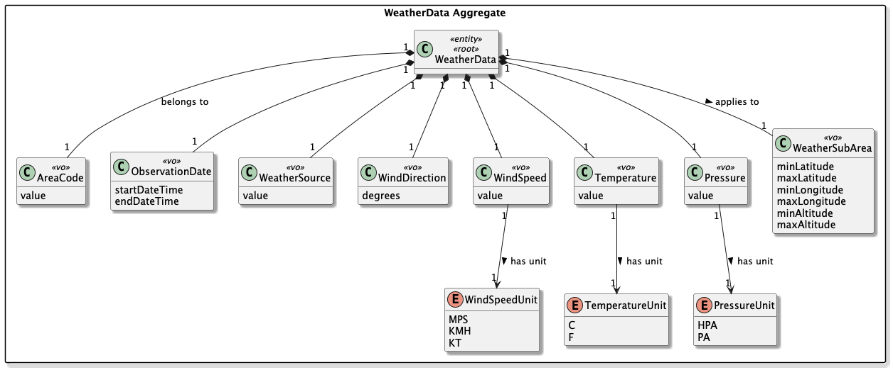
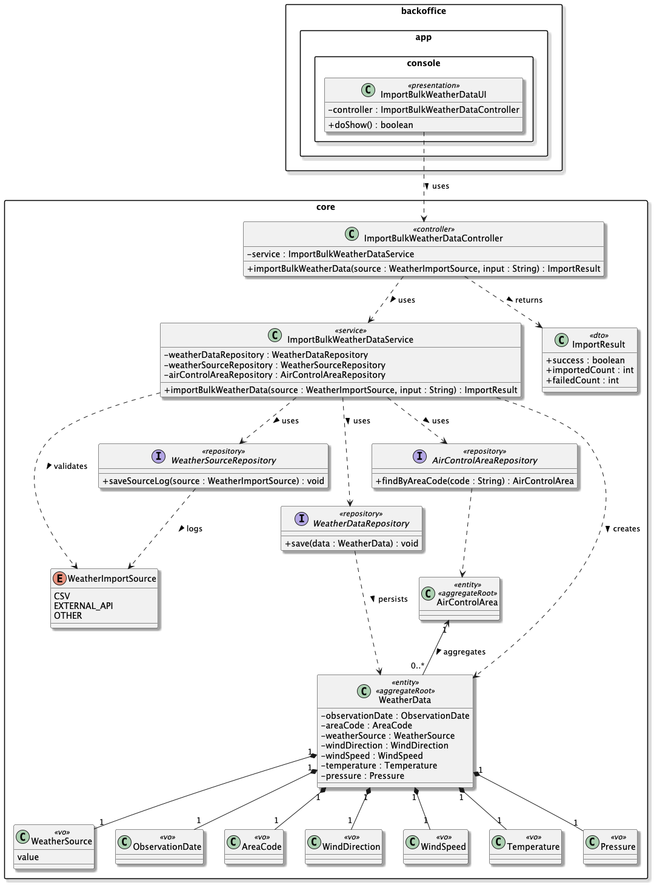
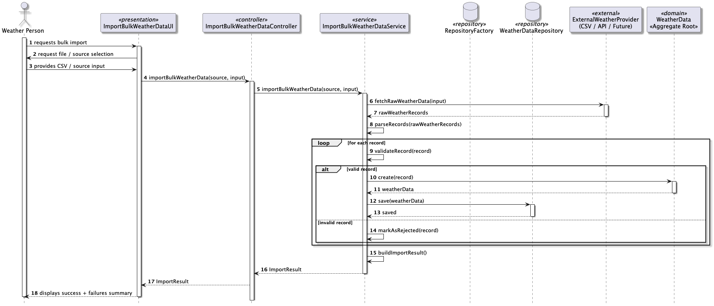

# US042 - Import Bulk Weather Data

## 1. Context

* As a Weather Person, I want to import bulk weather data into the system.
* Weather data might be from multiple external weather service providers, so the system can
  aggregate data from various sources for better accuracy. While a simple CSV file format will
  be available for initial system development, the system should be easy to expand to new
  weather data sources.
* This task is being developed for the first time in sprint 3 and it has dependencies with
  the following requirements:
    * US041 - Register weather data

### 1.1 List of issues

**Main Issue:** Issue #121

**Analysis:** Issue #139

**Design and Unit Tests:** Issue #164

**Implement:** Issue #175


## 2. Requirements

**US042** - As a Weather Person, I want to import bulk weather data into the system.

### Acceptance Criteria:

* **US042.1 -** The system must allow a Weather Person to import bulk weather data into the system.
* **US042.2 -** The system must support importing multiple weather observations in a single operation.
* **US042.3 -** Each imported weather record must be validated according to the same domain rules as weather data registration.
* **US042.4 -** The system must reject duplicate weather data based on the combination (AreaCode + startDateTime + endDateTime + WeatherSource).
* **US042.5 -** The initial supported import format must be CSV, while allowing future extensibility for other weather data providers.

### Dependencies/References:

Regarding this requirement, we understand that it relates to:

- **US050 - Register an air control area**: weather data can only be imported for an existing air control area.
- **US041 - Register weather data**: bulk import follows the same validation and domain consistency rules for weather data registration.
- **US043 - Consult weather data**: imported weather data will later be available for consultation in the system.
- **US100 / US110 / US113**: weather data (especially wind-related attributes) will be used by the flight simulation engine.
- **Section 3.2** of the requirements document defines wind direction, wind speed, pressure, and temperature as core meteorological attributes needed for simulation.


## 3. Analysis

The domain model for weather data must serve as the primary consistency boundary for meteorological observations, ensuring that every imported record is correctly linked to a valid air control area and that all physical values respect domain constraints.



| Attribute      | Description                                                                                   | Constraints                                                                                         |
|----------------|-----------------------------------------------------------------------------------------------|-----------------------------------------------------------------------------------------------------|
| AreaCode       | Reference to the air control area                                                             | Must exist (aggregate reference)                                                                    |
| WeatherSubArea | Rectangular sub-area within the control area (minLat, maxLat, minLon, maxLon, minAlt, maxAlt) | minLat < maxLat; minLon < maxLon; minAlt < maxAlt; must be fully contained within the control area  |
| startDateTime  | Start date and time of the observation period                                                 | Valid calendar value                                                                                |
| endDateTime    | End date and time of the observation period                                                   | Valid calendar value; after startDateTime                                                           |
| WindDirection  | Angle relative to North (degrees)                                                             | 0 ≤ value < 360                                                                                     |
| WindSpeed      | Wind speed                                                                                    | ≥ 0; unit must be one of WindSpeedUnit                                                              |
| Pressure       | Atmospheric pressure                                                                          | > 0; unit must be one of PressureUnit                                                               |
| WeatherSource  | Origin/provider of the weather data                                                           | Must not be empty                                                                                   |
| Temperature    | Air temperature                                                                               | Valid numeric value; unit must be one of TemperatureUnit                                            |

**Key business rules:**

- The **air control area must already exist** before weather data can be imported.
- Bulk import must support **multiple weather observations** in a single operation.
- Each imported weather record must be validated individually.
- Invalid records must be rejected without compromising the consistency of valid ones — partial import is supported.
- Weather source must always be identified.
- Observation `endDateTime` must be after `startDateTime`.
- Physical values (wind, pressure, temperature) must respect domain constraints.
- The combination **(AreaCode + startDateTime + endDateTime + WeatherSource)** must remain unique — duplicate records are rejected with an error message without stopping the import of valid rows.
- The first supported import format is **CSV**, but the architecture allows future extensions for other providers (REST APIs, XML, external services, etc.).

**Relationship with the domain:**
`WeatherData` is an independent aggregate whose invariant is that an observation can only exist if all physical fields are complete and valid. It references the `AirControlArea` through the `AreaCode` value object — a contextual reference only, not a lifecycle dependency. The weather data will later be consumed by the simulation engine to influence flight physics.


## 4. Design

### 4.1. Realization

The design of the solution for this requirement is based on the following class diagram:



The following sequence diagram illustrates the realization of US042 — Import Bulk Weather Data:



**Main classes and responsibilities:**

- `ImportBulkWeatherDataUI` → Console entry point; collects file path and format from the user and displays the import summary.
- `ImportBulkWeatherDataController` → Use case controller; orchestrates the import process, delegates parsing to the registered importer and registration to `RegisterWeatherDataController`.
- `ImportBulkWeatherDataService` → Coordinates parsing, domain validation, and persistence of each record.
- `WeatherDataImporter` → Interface that defines the contract for all importers; allows future extensibility for new formats/providers.
- `CsvWeatherDataImporter` → Concrete implementation of `WeatherDataImporter` for CSV files; parses each row into a `WeatherDataImportRow`.
- `WeatherDataImportRow` → Value record that holds the parsed data for a single weather observation before domain validation.
- `WeatherDataImportResult` → Value record that captures the result (success or failure with reason) for each processed row.
- `RegisterWeatherDataController` → Reused from US041; applies all domain validation rules to each imported row.
- `WeatherData` → Aggregate Root; enforces all domain invariants.
- `WeatherSubArea`, `AreaCode`, `ObservationDate`, `WeatherSource`, `WindDirection`, `WindSpeed`, `Temperature`, `Pressure` → Value Objects, each responsible for validating their own constraints.

**Invariants enforced during bulk import:**

- Each row is validated individually against the same rules as US041.
- `AreaCode` must reference an existing `AirControlArea`.
- `WeatherSubArea` must be fully contained within the referenced `AirControlArea` (geographic boundary and altitude range).
- `WeatherSource` must not be empty.
- `WindSpeed` ≥ 0; unit must be a valid `WindSpeedUnit`.
- `WindDirection` must be between 0° and 359°.
- `ObservationDate.endDateTime` must be after `ObservationDate.startDateTime`.
- `Pressure` must be positive; unit must be a valid `PressureUnit`.
- `Temperature` must be a valid numeric value; unit must be a valid `TemperatureUnit`.
- The combination `(AreaCode + startDateTime + endDateTime + WeatherSource)` must be unique — duplicate rows are rejected without stopping the import of valid rows.

### 4.2. Acceptance Tests

**Test 1:** Verifies that a valid CSV file is imported successfully with multiple records.

**Refers to Acceptance Criteria:** US042.1, US042.2

```java
@Test
void ensureImportFromValidCsvReturnsSuccessForAllRows() {
    final String csv =
            "ACA;Lat.;Long.;Lat.;Long.;Alt_inf(ft);Alt_Sup(ft);Direction(degree);Value(knot);Day;Star;End\n" +
            "121;43.840454;-9.795711;40.225;-7.9501;0;1000;90;28.75;22/06/26;05:00;08:15\n" +
            "121;40.225001;-9.795711;37.052988;-7.9501;0;1000;105;20.7;22/06/26;05:00;08:15";

    final InputStream is = new ByteArrayInputStream(csv.getBytes(StandardCharsets.UTF_8));
    final List<WeatherDataImportRow> rows = importer.importFrom(is);

    assertEquals(2, rows.size());
}
```

**Test 2:** Verifies that each imported record contains all mandatory fields.

**Refers to Acceptance Criteria:** US042.3

```java
@Test
void ensureImportedRowContainsAllMandatoryFields() {
    final String csv =
            "ACA;Lat.;Long.;Lat.;Long.;Alt_inf(ft);Alt_Sup(ft);Direction(degree);Value(knot);Day;Star;End\n" +
            "121;43.840454;-9.795711;40.225;-7.9501;0;1000;90;28.75;22/06/26;05:00;08:15";

    final InputStream is = new ByteArrayInputStream(csv.getBytes(StandardCharsets.UTF_8));
    final List<WeatherDataImportRow> rows = importer.importFrom(is);

    final WeatherDataImportRow row = rows.get(0);
    assertNotNull(row.areaCode());
    assertNotNull(row.observationStart());
    assertNotNull(row.observationEnd());
    assertNotNull(row.windSpeedUnit());
}
```

**Test 3:** Verifies that a row with wrong number of columns throws an exception.

**Refers to Acceptance Criteria:** US042.3

```java
@Test
void ensureImportFailsWhenRowHasWrongNumberOfColumns() {
    final String csv =
            "ACA;Lat.;Long.;Lat.;Long.;Alt_inf(ft);Alt_Sup(ft);Direction(degree);Value(knot);Day;Star;End\n" +
            "121;43.840454;-9.795711";

    final InputStream is = new ByteArrayInputStream(csv.getBytes(StandardCharsets.UTF_8));

    assertThrows(IllegalArgumentException.class, () -> importer.importFrom(is));
}
```

**Test 4:** Verifies that the importer format name is CSV.

**Refers to Acceptance Criteria:** US042.5

```java
@Test
void ensureImporterFormatNameIsCsv() {
    assertEquals("CSV", importer.formatName());
}
```

**Test 5:** Verifies that blank lines in the CSV are skipped without error.

**Refers to Acceptance Criteria:** US042.2

```java
@Test
void ensureBlankLinesAreSkipped() {
    final String csv =
            "ACA;Lat.;Long.;Lat.;Long.;Alt_inf(ft);Alt_Sup(ft);Direction(degree);Value(knot);Day;Star;End\n" +
            "\n" +
            "121;43.840454;-9.795711;40.225;-7.9501;0;1000;90;28.75;22/06/26;05:00;08:15";

    final InputStream is = new ByteArrayInputStream(csv.getBytes(StandardCharsets.UTF_8));
    final List<WeatherDataImportRow> rows = importer.importFrom(is);

    assertEquals(1, rows.size());
}
```


## 5. Implementation

The implementation follows the design presented in section 4 and applies Domain-Driven Design principles across all layers of the AISafe system.

### 5.1. Evidence of implementation aligned with design

1. **Extensible importer architecture**
    - `WeatherDataImporter` defines the contract for all importers.
    - `CsvWeatherDataImporter` is the first concrete implementation, registered at controller startup.
    - New formats (REST, XML, etc.) only require a new implementation — no changes to the controller or service.

   This ensures compliance with:
    * US042.5 (extensibility for future formats)

2. **Row-level validation with partial import**
    - Each `WeatherDataImportRow` is validated individually by delegating to `RegisterWeatherDataController`.
    - Invalid rows produce a `WeatherDataImportResult` with `success = false` and a reason message.
    - Valid rows are persisted without being blocked by invalid ones.

   This ensures compliance with:
    * US042.2 (multiple observations in a single operation)
    * US042.3 (same validation rules as US041)

3. **Duplicate rejection**
    - The repository checks uniqueness on `(AreaCode + startDateTime + endDateTime + WeatherSource)` before saving.
    - Duplicates are rejected with a descriptive error without interrupting the import.

   This ensures compliance with:
    * US042.4 (no duplicate weather data)

4. **Domain invariants enforced at construction**
    - `WeatherData` aggregate construction validates all value objects.
    - `WeatherSubArea` verifies containment within the `AirControlArea` geographic and altitude boundaries.
    - All physical value objects (`WindSpeed`, `WindDirection`, `Pressure`, `Temperature`) enforce their own constraints.

   This ensures compliance with:
    * US042.3 (domain rule enforcement per record)

5. **Role-based access control**
    - Only users with role `WEATHER_PERSON` can execute the use case.
    - Authorization enforced via:
      ```java
      authz.ensureAuthenticatedUserHasAnyOf(AisafeRoles.WEATHER_PERSON);
      ```

### 5.2. Relevant artifacts and configuration files

- **Domain**
    - `aisafe.core/src/main/java/aiSafe/weatherdata/domain/WeatherData.java`
    - `aisafe.core/src/main/java/aiSafe/weatherdata/domain/WeatherSubArea.java`
    - `aisafe.core/src/main/java/aiSafe/weatherdata/domain/WeatherSource.java`
- **Application**
    - `aisafe.core/src/main/java/aiSafe/weatherdata/application/ImportBulkWeatherDataController.java`
    - `aisafe.core/src/main/java/aiSafe/weatherdata/application/ImportBulkWeatherDataService.java`
- **Importer**
    - `aisafe.core/src/main/java/aiSafe/weatherdata/importer/WeatherDataImporter.java`
    - `aisafe.core/src/main/java/aiSafe/weatherdata/importer/csv/CsvWeatherDataImporter.java`
    - `aisafe.core/src/main/java/aiSafe/weatherdata/importer/WeatherDataImportRow.java`
    - `aisafe.core/src/main/java/aiSafe/weatherdata/importer/WeatherDataImportResult.java`
- **Presentation**
    - `aisafe.app.backoffice.console/src/main/java/aiSafe/app/backoffice/console/presentation/weatherdata/ImportBulkWeatherDataUI.java`
- **Persistence**
    - `aisafe.persistence.impl/src/main/java/aiSafe/persistence/impl/jpa/JpaWeatherDataRepository.java`
    - `aisafe.core/src/main/java/aiSafe/weatherdata/repositories/WeatherDataRepository.java`

### 5.3. Major commits (summary)

- `7e51f65` — add analysis documentation for bulk weather data import
- `4937d0c` — add design documentation, class and sequence diagrams, and acceptance tests
- `e601231` — implement `CsvWeatherDataImporter`, `ImportBulkWeatherDataController` and service
- `291b601` — implement bulk weather data import controller, UI, action and menu integration

## 6. Integration/Demonstration

### 6.1. Architectural Integration

This functionality integrates with the system following the persistence architecture defined for the project. The `WeatherDataRepository` interface is defined in the core domain module and resolved at runtime via `PersistenceContext`:

- **`persistence.impl.inmemory`** — used for testing and early development.
- **`persistence.impl.jpa`** — used in production, backed by `JpaWeatherDataRepository` with full ORM mapping via JPA/Hibernate.

### 6.2. Integration Points

| Layer                  | Component                                                          | Role                                               |
|------------------------|--------------------------------------------------------------------|----------------------------------------------------|
| Domain                 | `WeatherData`, `WeatherDataRepository`                             | Aggregate and repository interface                 |
| Application            | `ImportBulkWeatherDataController`, `ImportBulkWeatherDataService`  | Orchestrates import, enforces authz                |
| Importer               | `CsvWeatherDataImporter`                                           | Parses CSV into `WeatherDataImportRow`             |
| Persistence (JPA)      | `JpaWeatherDataRepository`                                         | Persists to relational DB via JPA                  |
| Persistence (InMemory) | `InMemoryWeatherDataRepository`                                    | Used in tests                                      |
| Infrastructure         | `PersistenceContext`                                               | Resolves the active `RepositoryFactory` at runtime |
| Presentation           | `ImportBulkWeatherDataUI`                                          | Console entry point                                |

### 6.3. How to Demonstrate

1. Start the application using the Backoffice console module.
2. Log in with a user holding the `WEATHER_PERSON` role (e.g. `weather@aisafe.local`).
3. Navigate to `Weather > Import Bulk Weather Data`.
4. Provide the path to a valid CSV file and select the `CSV` format.
5. The system displays a summary with the number of successfully imported records and any rejected rows with their reasons.

**Sample CSV input:**
```
ACA;Lat.;Long.;Lat.;Long.;Alt_inf(ft);Alt_Sup(ft);Direction(degree);Value(knot);Day;Star;End
LPPT;38.5;-9.5;39.5;-8.5;0;3000;180;10;01/06/25;00:00;23:59
LPPR;40.6;-9.0;41.5;-8.0;0;3000;90;15;01/06/25;00:00;23:59
```


## 7. Design Decisions

### 7.1. Architectural Decisions

The project follows a layered, DDD-based architecture where the repository contract is always defined in the core domain module, while concrete implementations live in separate modules resolved at runtime by `RepositoryFactory`. This ensures:

- The domain model has **zero dependency** on persistence technology.
- Switching between InMemory and JPA requires only a configuration change.

The importer architecture follows the **Strategy pattern** — `WeatherDataImporter` is the strategy interface, and `CsvWeatherDataImporter` is the first concrete strategy. This makes adding new formats (e.g. REST, XML) a matter of implementing the interface and registering it, with no changes to existing code.

The persistence layer followed the pattern represented below:


### 7.2. Third-party Works

- **EAPLI Framework** — provides the base infrastructure for `AggregateRoot`, `ValueObject`, `Repository`, `AuthzRegistry`, and console UI rendering used throughout this implementation.
- **Jakarta Persistence (JPA) / Hibernate** — used for ORM mapping of the `WeatherData` entity and its embedded value objects.