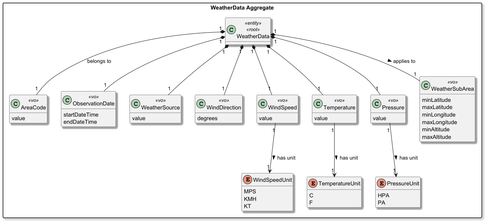

# US044 - Weather Person Remote Access

## 1. Context

* As a Weather Person, I want to remotely access the system through a dedicated TCP client, so that I can perform weather-related operations without local access to the server application.
* This user story belongs to the RCOMP component and reuses the shared remote access infrastructure defined in US078.
* The client must communicate exclusively via TCP with the server embedded in the main AISafe application. Any direct database access from the client is forbidden.

It is also dependent on:

* US030 - Authentication and Authorization
* US041 - Register weather data
* US042 - Import bulk weather data
* US043 - Consult weather data
* US078 - Shared TCP remote access infrastructure
* US090 - External logging of remote accesses

### 1.1 List of issues

**Main Issue:** Issue #113

**Analysis:** Issue #171

**Design:** Issue #177

**Implement:** Issue #178

---

## 2. Requirements

**US044** - As a Weather Person, I want to remotely access the system through a specific TCP-based client application.

### 2.1 Acceptance Criteria

* **US044.1** A dedicated TCP client application for Weather Person must be implemented.
* **US044.2** All client interaction must be performed exclusively via TCP; direct database access is strictly forbidden.
* **US044.3** Authentication and authorization must be enforced for every request.
* **US044.4** Weather Person operations (at least US041/US042/US043, according to team scope) must be available remotely.
* **US044.5** The communication protocol must be documented and compatible with the shared server infrastructure.

### 2.2 Dependencies/References

Regarding this requirement, we understand that it relates to:

* **US030** - role-based authentication and authorization (`WEATHER_PERSON`).
* **US041/US042/US043** - weather operations exposed through TCP.
* **US078** - shared server-side remote access infrastructure and protocol baseline.
* **US090** - login/logout/disconnect/failed-login events must be logged via UDP by the server.
* **NFR08** - no direct data access from client applications.

---

## 3. Analysis

US044 is mainly an infrastructure and integration story. It does not introduce new domain concepts; it exposes existing weather use cases through the network.

### 3.1 Analysis Checklist

- [x] Confirm which weather operations are in scope for remote access.
- [x] Define client session lifecycle (connect, authenticate, execute operations, logout, disconnect).
- [x] Define error scenarios (invalid credentials, unauthorized role, malformed command, timeout, connection loss).
- [x] Confirm mapping between remote commands and existing application controllers/use cases.
- [x] Confirm event types that trigger UDP logs on the server (US090).

### 3.2 Remote Access Concepts

| Concept               | Description                                     | Constraints                                          |
|-----------------------|-------------------------------------------------|------------------------------------------------------|
| Client Connection     | TCP socket between Weather client and server    | Must use agreed application-level protocol           |
| Authenticated Session | Session associated with one Weather Person user | Requires valid credentials and role                  |
| Operation Request     | A weather operation requested through TCP       | Must map to authorized weather use cases             |
| Operation Response    | Server response to client request               | Must include success/error status and payload        |
| Access Event          | Login/logout/disconnect/failed login event      | Must be forwarded by server to US090 logging service |

### 3.3 Relationship with Domain

The client acts only as a transport/UI layer. All business rules remain server-side in existing AISafe application services and domain model.

### 3.4 Scope and Session Analysis

Remote operations in scope for US044 are:

* Register weather data (`US041`)
* Import bulk weather data (`US042`)
* Consult weather data (`US043`)

The remote session lifecycle is defined as:

1. TCP connection establishment;
2. Authentication request with Weather Person credentials;
3. Authorization check for role `WEATHER_PERSON`;
4. Execution of authorized weather operations;
5. Session termination via logout or disconnect.

Expected error scenarios to be handled in the protocol:

* invalid credentials;
* authenticated user without required role;
* malformed or incomplete request payload;
* operation-level validation errors returned by server-side use cases;
* network failure (timeout / broken connection).

For US090 integration, the following access events must be produced server-side:

* `LOGIN_SUCCESS`
* `LOGIN_FAILED`
* `LOGOUT`
* `DISCONNECT`

---

## 4. Design

### 4.1 Realization

The design follows a client-server architecture over TCP, reusing the shared remote access infrastructure from US078.

| Layer       | Component                       | Technology           | Responsibility                                                 |
|-------------|---------------------------------|----------------------|----------------------------------------------------------------|
| Client      | Weather Person remote app       | C (Berkeley sockets) | Console UI, protocol encoding/decoding, session state          |
| Server      | Embedded TCP remote server      | Java (`java.net`)    | Accept connections, authenticate, authorize, dispatch commands |
| Application | Existing weather controllers    | Java (EAPLI)         | Execute US041/US042/US043 business logic                       |
| Logging     | UDP access logger (server-side) | UDP socket           | Emit access events to US090 logging server                     |

The Weather Person client has **no database dependency**. All persistence and domain validation occur on the server.

Domain weather rules remain in existing aggregates (see US041 excerpt):



### 4.2 Protocol Design

Protocol baseline is shared with US078 and documented in `RCOMP/README.md`.

#### 4.2.1 Message Framing

Each TCP message is sent as:

```text
[4 bytes payload length (big-endian)][payload UTF-8]
```

Example payload:

```text
LOGIN;weather@aisafe.local;Weather123
```

#### 4.2.2 Request Format

```text
COMMAND;param1;param2;...
```

#### 4.2.3 Response Format

Success:

```text
OK;status;payload
```

Error:

```text
ERR;errorCode;message
```

#### 4.2.4 Standard Error Codes

| Code               | Meaning                                                                                                                          |
|--------------------|----------------------------------------------------------------------------------------------------------------------------------|
| `AUTH_FAILED`      | Invalid username/password, or user without `WEATHER_PERSON` role                                                                 |
| `FORBIDDEN`        | Reserved in catalog; not emitted separately (role check is inside `LOGIN` via `AuthzRegistry.authenticate(..., WEATHER_PERSON)`) |
| `SESSION_REQUIRED` | Operation requested before successful login                                                                                      |
| `BAD_REQUEST`      | Malformed command or missing parameters                                                                                          |
| `VALIDATION_ERROR` | Business/domain validation failed                                                                                                |
| `INTERNAL_ERROR`   | Unexpected server failure                                                                                                        |

#### 4.2.5 Protocol Design Checklist

- [x] Message framing strategy defined (length-prefixed payload).
- [x] Command grammar and parameter encoding defined.
- [x] Response format (`OK` / `ERR`) defined.
- [x] Error code catalog defined.
- [x] Connection lifecycle defined (connect, login, operations, logout, disconnect).

#### 4.2.6 `REGISTER_WEATHER` parameters

```text
REGISTER_WEATHER;areaCode;start;end;minLat;maxLat;minLon;maxLon;minAlt;maxAlt;source;windDir;windSpeed;windSpeedUnit;temperature;temperatureUnit;pressure;pressureUnit
```

- `start` / `end`: `yyyy-MM-ddTHH:mm` (ISO local date-time)
- Units: `WindSpeedUnit` (`MPS`, `KMH`, `KT`), `TemperatureUnit` (`C`, `F`), `PressureUnit` (`HPA`, `PA`)
- Success response: `OK;WEATHER_REGISTERED;<id>`

#### 4.2.7 `CONSULT_WEATHER` parameters

```text
CONSULT_WEATHER;areaCode;yyyy-MM-dd
```

- Success response: `OK;CONSULT;<count>|<record>|...` (records comma-separated inside each segment)

### 4.3 Command Mapping

| Remote Command        | Business US  | Server Component                   | Required Role                      | Notes                                                                              |
|-----------------------|--------------|------------------------------------|------------------------------------|------------------------------------------------------------------------------------|
| `LOGIN`               | US030        | Authentication / session bootstrap | any (must become `WEATHER_PERSON`) | Must be first command after connect                                                |
| `REGISTER_WEATHER`    | US041        | `RegisterWeatherDataController`    | `WEATHER_PERSON`                   | See parameter order in §4.2.6                                                      |
| `IMPORT_WEATHER_BULK` | US042        | `ImportBulkWeatherDataController`  | `WEATHER_PERSON`                   | `IMPORT_WEATHER_BULK;filePath;format` (e.g. `CSV`; file must exist on server host) |
| `CONSULT_WEATHER`     | US043        | `ConsultWeatherDataController`     | `WEATHER_PERSON`                   | `areaCode` + `date`                                                                |
| `LOGOUT`              | US030/US044  | Session termination handler        | authenticated session              | Ends session explicitly                                                            |

Service identifier for US090 logs: `US44`.

### 4.4 Client Structure (C)

Implemented layout under `RCOMP/` (logical roles from design consolidated into fewer files):

```text
RCOMP/
  include/
    protocol.h
  src/
    common/
      protocol.c          # framed send/receive (length-prefixed UTF-8)
    client/
      weather/
        weather_client.c  # menu, ClientSession state, command build, response check
  Makefile                # target: weather_client
```

| Design concept                      | Implementation                                                   |
|-------------------------------------|------------------------------------------------------------------|
| `ProtocolIO`                        | `protocol.c` / `protocol.h`                                      |
| `ClientSession`                     | `ClientSession` struct in `weather_client.c`                     |
| `CommandBuilder` / `ResponseParser` | `snprintf` + `strncmp(response, "OK;", 3)` in `weather_client.c` |
| `WeatherPersonClient`               | `main()` + menu loop in `weather_client.c`                       |

### 4.5 Server structure (Java) — design to implementation mapping

| Design (diagram)          | Implementation class          |
|---------------------------|-------------------------------|
| `TcpRemoteServer`         | `RemoteAccessTcpServer`       |
| `ConnectionHandler`       | `RemoteConnectionHandler`     |
| `RemoteCommandDispatcher` | `WeatherRemoteCommandHandler` |
| `RemoteSession`           | `RemoteConnectionContext`     |
| `UdpAccessLogger`         | `RemoteAccessUdpLogger`       |
| Message framing           | `RemoteMessageCodec`          |
| Response helper           | `RemoteResponse`              |

Headless deployment entry point: `aiSafe.RemoteAccessMain`. Embedded in backoffice when `remote.tcp.enabled=true` (`Main.java`).

### 4.6 Diagrams

| Diagram  | Source (PlantUML)                                                                          | Export (PNG)                                                                                                                                                                                             |
|----------|--------------------------------------------------------------------------------------------|----------------------------------------------------------------------------------------------------------------------------------------------------------------------------------------------------------|
| Class    | [`classDiagram/us044_ClassDiagram.puml`](classDiagram/us044_ClassDiagram.puml)             | [`classDiagram/us044_ClassDiagram-US044___Weather_Person_Remote_Access__Class_Diagram_.png`](classDiagram/us044_ClassDiagram-US044___Weather_Person_Remote_Access__Class_Diagram_.png)                   |
| Sequence | [`sequenceDiagram/us044_SequenceDiagram.puml`](sequenceDiagram/us044_SequenceDiagram.puml) | [`sequenceDiagram/us044_SequenceDiagram-US044___Weather_Person_Remote_Access__Sequence_Diagram_.png`](sequenceDiagram/us044_SequenceDiagram-US044___Weather_Person_Remote_Access__Sequence_Diagram_.png) |

### 4.7 Design–implementation alignment (Sprint 3)

Verified against running implementation on DEI VM (`RemoteAccessMain` + `weather_client`):

- [x] TCP length-prefixed UTF-8 messages (big-endian 4-byte length)
- [x] Commands `LOGIN`, `LOGOUT`, `REGISTER_WEATHER`, `CONSULT_WEATHER`, `IMPORT_WEATHER_BULK`
- [x] Responses `OK;...` / `ERR;...`
- [x] AuthZ via `WEATHER_PERSON` on login; session required for weather commands
- [x] Persistence only server-side (weather controllers + JPA)
- [x] UDP access events `LOGIN_SUCCESS`, `LOGIN_FAILED`, `LOGOUT`, `DISCONNECT` with service `US44` (sent when `remote.udp.logging.host` is set)
- [x] `DISCONNECT` emitted only when the TCP socket closes while still authenticated (not after explicit `LOGOUT`)
- [x] Multiple concurrent TCP clients supported (`CachedThreadPool` per connection)

### 4.8 Acceptance Tests (design-level)

**AT1 - Successful remote session**

Given a valid Weather Person user, when the client connects and sends `LOGIN`, then one authorized command (`REGISTER_WEATHER`, `IMPORT_WEATHER_BULK`, or `CONSULT_WEATHER`) is executed, the server returns `OK`, and `LOGOUT` closes the session.

**AT2 - Authentication failure**

Given invalid credentials, when `LOGIN` is sent, the server returns `ERR;AUTH_FAILED;...` and no weather operation is accepted.

**AT3 - Authorization failure**

Given a user without role `WEATHER_PERSON`, when `LOGIN` is sent, the server returns `ERR;AUTH_FAILED;...` and no weather operation is accepted.

**AT4 - Validation failure**

Given malformed command parameters, when a weather command is sent, the server returns `ERR;BAD_REQUEST;...` or `ERR;VALIDATION_ERROR;...` without partial persistence.

**AT5 - Access logging integration**

For login success, login failure, logout and disconnect, the server emits UDP events with service `US44` for validation in US090.

---

## 5. Implementation

### 5.1 Evidence of implementation aligned with design

The US044 implementation follows the design in section 4 and reuses the shared TCP infrastructure planned for US078.

**Client (C, Berkeley sockets):**

| File                                        | Role                             |
|---------------------------------------------|----------------------------------|
| `RCOMP/include/protocol.h`                  | Public protocol API              |
| `RCOMP/src/common/protocol.c`               | Length-prefixed TCP send/receive |
| `RCOMP/src/client/weather/weather_client.c` | Weather Person menu client       |
| `RCOMP/Makefile`                            | Build target `weather_client`    |

**Server (Java, embedded in AISafe):**

| File                                                                        | Role                          |
|-----------------------------------------------------------------------------|-------------------------------|
| `aisafe.app.backoffice.console/.../remote/RemoteAccessTcpServer.java`       | TCP accept loop               |
| `aisafe.app.backoffice.console/.../remote/RemoteConnectionHandler.java`     | Per-connection handler        |
| `aisafe.app.backoffice.console/.../remote/RemoteConnectionContext.java`     | Per-connection session state  |
| `aisafe.app.backoffice.console/.../remote/RemoteResponse.java`              | `OK` / `ERR` response builder |
| `aisafe.app.backoffice.console/.../remote/WeatherRemoteCommandHandler.java` | US044 command dispatch        |
| `aisafe.app.backoffice.console/.../remote/RemoteMessageCodec.java`          | Message framing               |
| `aisafe.app.backoffice.console/.../remote/RemoteAccessUdpLogger.java`       | US090 UDP events              |
| `aisafe.app.backoffice.console/src/main/java/aiSafe/RemoteAccessMain.java`  | Headless server entry point   |

### 5.2 How to run (team guide)

Step-by-step instructions for **VM DEI**, **local (Kali + PC)** and **demo with SSH tunnel** are maintained in:

**[`RCOMP/GUIDE/US044-GUIDE.md`](../../RCOMP/GUIDE/US044-GUIDE.md)**

Summary:

| Scenario                 | Server                                       | Client                                             |
|--------------------------|----------------------------------------------|----------------------------------------------------|
| A — VM DEI (recommended) | `RemoteAccessMain` on VM (2 SSH sessions)    | `weather_client 127.0.0.1 9000` on VM              |
| B — Local dev            | `RemoteAccessMain` on Windows/Mac (IntelliJ) | Kali: `weather_client <HOST_PC> 9000`              |
| C — Remote demo          | `RemoteAccessMain` on VM                     | Kali: SSH tunnel + `weather_client 127.0.0.1 9000` |

**Test credentials (after bootstrap):** `weather@aisafe.local` / `Weather123`

**VM DEI (headless server):**

```bash
cd aisafe.app.backoffice.console
java -cp "target/classes:target/dependency/*" aiSafe.RemoteAccessMain
```

**Client:**

```bash
cd RCOMP && make && ./weather_client <host> 9000
```

### 5.3 Relevant configuration

`aisafe.app.backoffice.console/src/main/resources/application.properties`:

```properties
remote.tcp.enabled=true
remote.tcp.port=9000
remote.udp.logging.host=127.0.0.1
remote.udp.logging.port=5000
```

| Property                  | Purpose                                                   |
|---------------------------|-----------------------------------------------------------|
| `remote.tcp.enabled`      | When `true`, backoffice `Main` also starts the TCP server |
| `remote.tcp.port`         | TCP listen port (default `9000`)                          |
| `remote.udp.logging.host` | US090/US91 logging server host; empty = UDP logs disabled |
| `remote.udp.logging.port` | UDP destination port (default `5000`, matches `logging_server`) |

For US044-only tests on the VM, `RemoteAccessMain` is enough; `remote.tcp.enabled` is mainly for embedded mode in backoffice.

### 5.4 Major commits (summary)

See git history for issues **#177** (design) and **#178** (implementation). Example messages:

- `docs(US044): design …`
- `feat(US044): implement Weather Person remote TCP client and server …`
- `docs(RCOMP): add US044 team run guide`

---

## 6. Integration/Demonstration

### 6.1 DEI VM deployment

**VM (DEI cloud):** Ubuntu 22.04 LTS, SSH via `vsgate-ssh.dei.isep.ipp.pt:10419`.

**Prepare VM (first time):**

```bash
sudo apt update && sudo apt upgrade -y
sudo apt install -y openjdk-21-jdk maven build-essential git
```

**Deploy:**

1. Clone/pull the repository on the VM.
2. `mvn install -DskipTests` at project root.
3. Run bootstrap once (§5.2 / `US044-GUIDE.md` §4.3).
4. Ensure `application.properties` points to the team PostgreSQL instance.
5. Start `RemoteAccessMain` on the VM (keep terminal open).

**Client access from outside the DEI network:**

- **Scenario A:** two SSH sessions to the VM (server + client on VM) — see `US044-GUIDE.md`.
- **Scenario C:** server on VM; **SSH tunnel and `weather_client` on Kali (Linux)** — tunnel is **not** opened on Windows/Mac.

Direct `weather_client <VM_IP> 9000` from home usually **does not work** without VPN/tunnel (VM not reachable on campus network).

### 6.2 How to demonstrate

1. Start TCP server on VM (`RemoteAccessMain`).
2. Run `weather_client` (on VM or via Kali tunnel — `US044-GUIDE.md`).
3. Login: `weather@aisafe.local` / `Weather123`.
4. Execute one operation (register / consult / import bulk).
5. Logout.
6. (Optional) With `./logging_server` running (US091, UDP **5000**), confirm UDP events (`LOGIN_SUCCESS`, `LOGOUT`, etc., service `US44`) at `http://127.0.0.1:8080`.

**Operational guide for the team:** [`RCOMP/GUIDE/US044-GUIDE.md`](../../RCOMP/GUIDE/US044-GUIDE.md)
