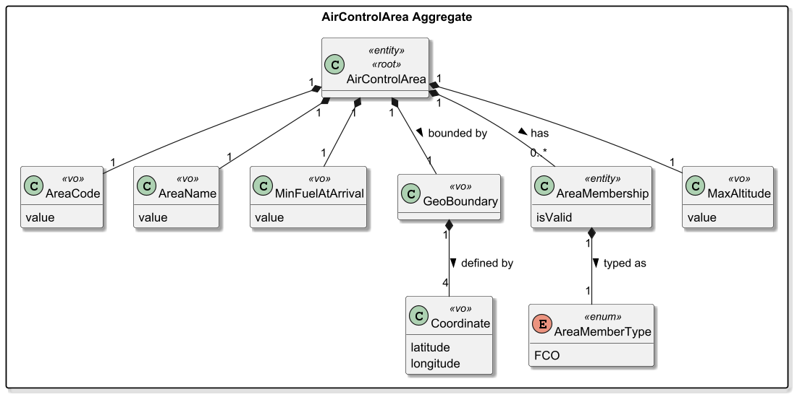
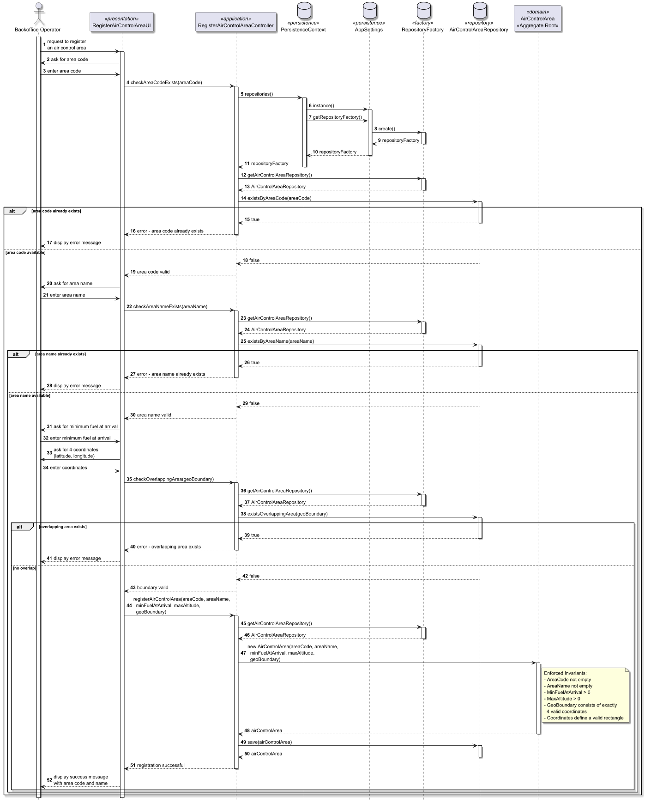

# US050 - Register an air control area

## 1. Context

* As a Backoffice Operator, I want to register an air control area. The area code must be unique in the system. Geographic boundaries must be valid.
  This must also be achievable by a bootstrap process.
* This task is being developed for the first time in the sprint 2 and it has dependencies with the following requirements:
  * US052 - Create an airport

### 1.1 List of issues

**Main Issue:** Issue #46

**Analysis:** Issue #68

**Design:** Issue #74

**Implementation:** Issue #88

## 2. Requirements

**US050 -** As a Backoffice Operator, I want to register an air control area. The area code must be unique in the system. Geographic boundaries must be valid. This must also be achievable by a bootstrap process.

### Acceptance Criteria:

- **US050.1** The system must ensure that the area code is unique in the entire system. Attempting to register a duplicate area code must be rejected with an appropriate error message.
- **US050.2** The system must ensure that the area name is unique in the entire system. Attempting to register a duplicate area name must be rejected with an appropriate error message.
- **US050.3** The air control area must include a valid geographic boundary (**rectangle** defined by 4 coordinates or min/max latitude and longitude).
- **US050.4** The geographic boundary must be validated (valid rectangle with positive area, no self-intersections).
- **US050.5** All mandatory fields must be provided. The system must reject incomplete registrations.
- **US050.6** The system must support the registration of air control areas through a bootstrap process (initial data loaded automatically at application startup).

- **US050.1** The system must ensure that the area code is unique in the entire system. Attempting to register a duplicate area code must be rejected with an appropriate error message.
- **US050.2** The system must ensure that the area name is unique in the entire system. Attempting to register a duplicate area name must be rejected with an appropriate error message.
- **US050.3** The air control area must include a valid geographic boundary (**rectangle** defined by 4 coordinates).
- **US050.4** The geographic boundary must be validated (valid rectangle with positive area, no self-intersections).
- **US050.5** The air control area extends from zero up to a configurable maximum altitude. The default maximum altitude must not be hardcoded — it must be defined by configuration.
- **US050.6** No two air control areas may overlap geographically. Attempting to register an area that overlaps an existing one must be rejected with an appropriate error message.
- **US050.7** All mandatory fields must be provided. The system must reject incomplete registrations.
- **US050.8** The system must support the registration of air control areas through a bootstrap process (initial data loaded automatically at application startup).

### Dependencies/References:

Regarding this requirement, we understand that it relates to:

- **US052 - Create an airport**: every airport must belong to exactly one air control area.
- **US041 - Register weather data**: weather records are associated with an existing air control area.
- **US100**: air control areas are the spatial scope for flight simulation and safety violation detection.
- **Section 3.2** of the requirements document defines the concept of air control area and its geographic boundaries.

## 3. Analysis

The domain model for an air control area must represent a geographic region used for flight control and simulation. Although in real life an air control area is a polygon, **for the sake of simplicity in this project it will be modeled as a rectangle**.



| Attribute        | Description                                   | Constraints                                                                            |
|------------------|-----------------------------------------------|----------------------------------------------------------------------------------------|
| AreaCode         | Unique code that identifies the area          | Must be unique across the entire system                                                |
| AreaName         | Name of the area used in air control business | Must be unique across the entire system; not empty                                     |
| GeoBoundary      | Geographic boundaries of the area             | **Rectangle** defined by 4 coordinates (or min/max latitude and longitude), valid area |
| MinFuelAtArrival | Minimum fuel required at destination airport  | Positive value (used in flight plan validation)                                        |
| MaxAltitude      | Maximum altitude of the air control area      | Positive value; loaded from configuration (default: 14000m)                            |
| Coordinate       | Latitude and longitude points                 | Valid geographic coordinates                                                           |

**Key business rules:**

- The `AreaCode` must be unique in the entire system.
- The `AreaName` must be unique in the entire system.
- The `AreaName` must not be null, empty or blank.
- The `GeoBoundary` **must be a valid rectangle** (4 points forming a rectangle with positive area).
- The rectangle must not have self-intersections and must have positive area.
- `MinFuelAtArrival` must be a positive value.
- `MaxAltitude` must be a positive value and must be loaded from configuration — never hardcoded.
- No two air control areas may overlap geographically.
- The system must allow registration both through the normal service/UI and via bootstrap process at startup.

**Airport–Area relationship (clarified by the client):**
**One air control area can contain multiple airports.** Each airport must belong to exactly one air control area. This is a one-to-many relationship (1 AirControlArea ↔ 0..* Airport).

**Relationship with the domain:**
`AirControlArea` is an independent **Aggregate Root**. It is referenced by `Airport` (each airport belongs to exactly one air control area) and by `WeatherData` (through `AreaCode`). The geographic boundary is modeled as a `GeoBoundary` value object containing a list of `Coordinate` value objects. The area extends from zero up to a configurable `MaxAltitude`. This aggregate is central to the simulation engine, as flight simulations occur within defined air control areas.

## 4. Design

### 4.1. Realization

The design of the solution for this requirement is based on the following class diagram:


The following sequence diagram illustrates the realization of US050 — Register an air control area:



**Main classes and responsibilities:**

- `AirControlArea` → Aggregate Root, enforces all domain invariants
- `AreaCode`, `AreaName`, `MinFuelAtArrival`, `MaxAltitude`, `GeoBoundary`, `Coordinate` → Value Objects, each responsible for validating their own constraints
- `AirControlAreaRepository` → Persistence interface defined in `aisafe.core`, implemented in `aisafe.persistence.impl`
- `RegisterAirControlAreaController` → Orchestrates the use case, verifies area code uniqueness and delegates to the domain
- `RegisterAirControlAreaUI` → Console UI in `aisafe.app.backoffice.console` that collects user input and delegates to the controller

**Invariants enforced inside the AirControlArea aggregate:**

- `AreaCode` must not be null, empty or blank
- `AreaCode` must be unique in the system
- `AreaName` must not be null, empty or blank
- `AreaName` must be unique in the system
- `MinFuelAtArrival` must be a positive value (> 0)
- `MaxAltitude` must be a positive value (> 0)
- `GeoBoundary` must have exactly 4 coordinates
- `GeoBoundary` coordinates must all be distinct
- `GeoBoundary` must form a valid rectangle with positive area
- No two air control areas may overlap geographically
- `Coordinate` latitude must be between -90 and 90
- `Coordinate` longitude must be between -180 and 180

### 4.2. Acceptance Tests

**Test 1:** Verifies that it is not possible to create an
`AirControlArea` with a null `AreaCode`.

**Refers to Acceptance Criteria:** US050.7

```java
@Test
public void ensureAirControlAreaCannotHaveNullAreaCode() {
    // Arrange
    AreaCode nullAreaCode = null;
    AreaName areaName = new AreaName("Lisbon Control");
    MinFuelAtArrival minFuel = new MinFuelAtArrival(100.0);
    MaxAltitude maxAltitude = new MaxAltitude(14000.0);
    GeoBoundary boundary = new GeoBoundary(List.of(
        new Coordinate(0, 0),
        new Coordinate(1, 0),
        new Coordinate(1, 1),
        new Coordinate(0, 1)
    ));

    // Act & Assert
    assertThrows(IllegalArgumentException.class, () -> {
        new AirControlArea(nullAreaCode, areaName,
            minFuel, maxAltitude, boundary);
    });
}
```

---

**Test 2:** Verifies that it is not possible to create an
`AirControlArea` with a null `AreaName`.

**Refers to Acceptance Criteria:** US050.7

```java
@Test
public void ensureAirControlAreaCannotHaveNullAreaName() {
    // Arrange
    AreaCode areaCode = new AreaCode("LPPT");
    AreaName nullAreaName = null;
    MinFuelAtArrival minFuel = new MinFuelAtArrival(100.0);
    MaxAltitude maxAltitude = new MaxAltitude(14000.0);
    GeoBoundary boundary = new GeoBoundary(List.of(
        new Coordinate(0, 0),
        new Coordinate(1, 0),
        new Coordinate(1, 1),
        new Coordinate(0, 1)
    ));

    // Act & Assert
    assertThrows(IllegalArgumentException.class, () -> {
        new AirControlArea(areaCode, nullAreaName,
            minFuel, maxAltitude, boundary);
    });
}
```

---

**Test 3:** Verifies that it is not possible to create a
`MaxAltitude` with a negative value.

**Refers to Acceptance Criteria:** US050.5, US050.7

```java
@Test
public void ensureMaxAltitudeCannotBeNegative() {
    // Arrange
    double negativeValue = -1.0;

    // Act & Assert
    assertThrows(IllegalArgumentException.class, () -> {
        new MaxAltitude(negativeValue);
    });
}
```

---

**Test 4:** Verifies that it is not possible to create a
`MaxAltitude` with a zero value.

**Refers to Acceptance Criteria:** US050.5, US050.7

```java
@Test
public void ensureMaxAltitudeCannotBeZero() {
    // Arrange
    double zeroValue = 0.0;

    // Act & Assert
    assertThrows(IllegalArgumentException.class, () -> {
        new MaxAltitude(zeroValue);
    });
}
```

---

**Test 5:** Verifies that it is not possible to create a
`MinFuelAtArrival` with a negative value.

**Refers to Acceptance Criteria:** US050.7

```java
@Test
public void ensureMinFuelAtArrivalCannotBeNegative() {
    // Arrange
    double negativeValue = -1.0;

    // Act & Assert
    assertThrows(IllegalArgumentException.class, () -> {
        new MinFuelAtArrival(negativeValue);
    });
}
```

---

**Test 6:** Verifies that it is not possible to create a
`GeoBoundary` with less than 4 coordinates.

**Refers to Acceptance Criteria:** US050.3, US050.4

```java
@Test
public void ensureGeoBoundaryCannotHaveLessThan4Coordinates() {
    // Arrange
    List coords = List.of(
        new Coordinate(0, 0),
        new Coordinate(1, 0),
        new Coordinate(1, 1)
    );

    // Act & Assert
    assertThrows(IllegalArgumentException.class, () -> {
        new GeoBoundary(coords);
    });
}
```

---

**Test 7:** Verifies that it is not possible to create a
`GeoBoundary` with duplicate coordinates.

**Refers to Acceptance Criteria:** US050.4

```java
@Test
public void ensureGeoBoundaryCannotHaveDuplicateCoordinates() {
    // Arrange
    List coords = List.of(
        new Coordinate(0, 0),
        new Coordinate(1, 0),
        new Coordinate(1, 1),
        new Coordinate(0, 0)
    );

    // Act & Assert
    assertThrows(IllegalArgumentException.class, () -> {
        new GeoBoundary(coords);
    });
}
```

---

**Test 8:** Verifies that it is not possible to create a
`GeoBoundary` with zero area.

**Refers to Acceptance Criteria:** US050.4

```java
@Test
public void ensureGeoBoundaryCannotHaveZeroArea() {
    // Arrange
    List coords = List.of(
        new Coordinate(0, 0),
        new Coordinate(1, 0),
        new Coordinate(2, 0),
        new Coordinate(3, 0)
    );

    // Act & Assert
    assertThrows(IllegalArgumentException.class, () -> {
        new GeoBoundary(coords);
    });
}
```

---

**Test 9:** Verifies that a valid `AirControlArea` is created
successfully.

**Refers to Acceptance Criteria:** US050.1, US050.2, US050.3,
US050.4, US050.5, US050.7

```java
@Test
public void ensureAirControlAreaIsCreatedSuccessfully() {
    // Arrange
    AreaCode areaCode = new AreaCode("LPPT");
    AreaName areaName = new AreaName("Lisbon Control");
    MinFuelAtArrival minFuel = new MinFuelAtArrival(100.0);
    MaxAltitude maxAltitude = new MaxAltitude(14000.0);
    GeoBoundary boundary = new GeoBoundary(List.of(
        new Coordinate(0, 0),
        new Coordinate(1, 0),
        new Coordinate(1, 1),
        new Coordinate(0, 1)
    ));

    // Act
    AirControlArea area = new AirControlArea(
        areaCode, areaName, minFuel, maxAltitude, boundary);

    // Assert
    assertEquals(areaCode, area.areaCode());
    assertEquals(areaName, area.areaName());
    assertEquals(minFuel, area.minFuelAtArrival());
    assertEquals(maxAltitude, area.maxAltitude());
    assertEquals(boundary, area.geoBoundary());
}
```

## 5. Implementation

The implementation follows the design presented in section 4 and enforces US050 business rules in the domain, application, persistence and bootstrap layers.

### 5.1 Evidence of implementation aligned with design

The following evidences show that the implementation matches the planned architecture (UI -> controller -> domain/repository -> persistence/bootstrap):

1. **Use case orchestration and authorization in application layer**

   - `RegisterAirControlAreaController` enforces access control using `AuthorizationService` and allows only `BACKOFFICE_OPERATOR`.
   - The controller validates duplicate area code and duplicate area name through repository queries before persistence.
   - Registration is delegated to the aggregate after creating the corresponding value objects.
2. **Domain invariants in aggregate and value objects**

   - `AirControlArea` enforces mandatory fields (`AreaCode`, `AreaName`, `MinFuelAtArrival`, `GeoBoundary`) and prevents invalid construction.
   - `AreaName`, `AreaCode`, `MinFuelAtArrival` and `Coordinate` validate their own constraints.
   - `GeoBoundary` enforces exactly 4 distinct coordinates and validates that they define a rectangle with positive area.
3. **Console UI flow aligned with sequence design**

   - `RegisterAirControlAreaUI` collects all mandatory data (code, name, minimum fuel and 4 coordinates).
   - The UI performs early checks for duplicate code/name through the controller and only proceeds on valid input.
   - On success, the UI confirms registration; on invalid input it presents domain/application validation errors.
4. **Persistence and repository contract**

   - `AirControlAreaRepository` defines explicit operations to verify uniqueness by code and name.
   - `JpaAirControlAreaRepository` and `InMemoryAirControlAreaRepository` implement these operations and support save/query flow used by the controller.
   - `AirControlArea` includes JPA synchronization hooks (`@PrePersist/@PreUpdate/@PostLoad`) to keep rectangle coordinates and boundary VO consistent.
5. **Bootstrap registration support**

   - `AirControlAreaBootstrapper` creates initial air control area data at startup.
   - Bootstrap logic is idempotent (`registerIfMissing`) and avoids duplicates by checking existing area code before inserting data.

### 5.2 Relevant artifacts and configuration files

The main files required to understand and execute this implementation are:

- **Application/use case layer**
  - `aisafe.core/src/main/java/aiSafe/aircontrolarea/application/RegisterAirControlAreaController.java`
- **Domain model and invariants**
  - `aisafe.core/src/main/java/aiSafe/aircontrolarea/domain/AirControlArea.java`
  - `aisafe.core/src/main/java/aiSafe/aircontrolarea/domain/AreaCode.java`
  - `aisafe.core/src/main/java/aiSafe/aircontrolarea/domain/AreaName.java`
  - `aisafe.core/src/main/java/aiSafe/aircontrolarea/domain/MinFuelAtArrival.java`
  - `aisafe.core/src/main/java/aiSafe/aircontrolarea/domain/Coordinate.java`
  - `aisafe.core/src/main/java/aiSafe/aircontrolarea/domain/GeoBoundary.java`
- **Presentation layer (backoffice console)**
  - `aisafe.app.backoffice.console/src/main/java/aiSafe/app/backoffice/console/presentation/aircontrolarea/RegisterAirControlAreaUI.java`
  - `aisafe.app.backoffice.console/src/main/java/aiSafe/app/backoffice/console/presentation/aircontrolarea/RegisterAirControlAreaAction.java`
  - `aisafe.app.backoffice.console/src/main/java/aiSafe/app/backoffice/console/presentation/MainMenu.java`
- **Repository and persistence**
  - `aisafe.core/src/main/java/aiSafe/aircontrolarea/repositories/AirControlAreaRepository.java`
  - `aisafe.persistence.impl/src/main/java/aiSafe/persistence/impl/jpa/JpaAirControlAreaRepository.java`
  - `aisafe.persistence.impl/src/main/java/aiSafe/persistence/impl/inmemory/InMemoryAirControlAreaRepository.java`
  - `aisafe.persistence.impl/src/main/resources/META-INF/persistence.xml`
  - `aisafe.infrastructure.application/src/main/resources/application.properties.sample`
- **Bootstrap support**
  - `aisafe.bootstrappers/src/main/java/aiSafe/infrastructure/bootstrap/AirControlAreaBootstrapper.java`
- **Validation tests**
  - `aisafe.core/src/test/java/aiSafe/aircontrolarea/domain/AirControlAreaTest.java`
  - `aisafe.core/src/test/java/aiSafe/aircontrolarea/domain/GeoBoundaryTest.java`
  - `aisafe.core/src/test/java/aiSafe/aircontrolarea/domain/AreaCodeTest.java`
  - `aisafe.core/src/test/java/aiSafe/aircontrolarea/domain/MinFuelAtArrivalTest.java`

### 5.3 Major commits (summary)

The following commits are the major milestones related to this requirement:

- `86c7fe5` - US050 analysis documentation.
- `db2ae0e` - US050 design documentation and diagrams.
- `b74ea0e` - Initial US050 unit tests for domain validation.
- `def7643` - Area name value object introduction and test/document updates.
- `227b233` - US050 documentation/diagram refinement.
- `8ec0151` - Main US050 implementation of register air control area (domain, application, UI, repository and bootstrap integration).
- `2cca9b8` - Adds the `MaxAltitude` value object to the `AirControlArea` model.
- `c845925` - Updates US050 documentation to include the configurable max altitude requirement.
- `f9cf7f1` - Updates US050 class/sequence diagrams to align with the latest model and flow.

> Note: additional US050 refinements are currently in the working tree (not yet committed), namely overlap validation enhancements and post-merge test consistency fixes related to `MaxAltitude`.

## 6. Integration/Demonstration

### 6.1. Architectural Integration

This functionality integrates with the system using the same layered architecture and repository resolution strategy used in other use cases:

- The `AirControlAreaRepository` interface is defined in `aisafe.core`.
- Concrete implementations (`JpaAirControlAreaRepository` and `InMemoryAirControlAreaRepository`) are provided in `aisafe.persistence.impl`.
- `RegisterAirControlAreaController` accesses repositories through `PersistenceContext`, keeping application/domain independent of persistence technology.
- The same aggregate and repository contract are reused by bootstrap (`AirControlAreaBootstrapper`) to load initial data at startup.

### 6.2. Integration Points

| Layer                  | Component                                                | Role                                                 |
|------------------------|----------------------------------------------------------|------------------------------------------------------|
| Domain                 | `AirControlArea`, `GeoBoundary`, area value objects      | Aggregate and invariant enforcement                  |
| Application            | `RegisterAirControlAreaController`                       | Orchestrates registration and validation flow        |
| Persistence (JPA)      | `JpaAirControlAreaRepository`                            | Persists air control areas to relational DB          |
| Persistence (InMemory) | `InMemoryAirControlAreaRepository`                       | Supports tests and non-persistent execution          |
| Infrastructure         | `PersistenceContext` / `RepositoryFactory`               | Resolves active repository implementation at runtime |
| Bootstrap              | `AirControlAreaBootstrapper`                             | Seeds initial air control areas at startup           |
| Presentation           | `RegisterAirControlAreaUI` / `RegisterAirControlAreaAction` | Console entry point and user interaction          |

### 6.3. How to Demonstrate

1. Start the Backoffice console application.
2. Log in with a user that has role `BACKOFFICE_OPERATOR`.
3. Navigate to `Operations > Register air control area`.
4. Fill all mandatory fields:
   - area code;
   - area name;
   - minimum fuel at arrival;
   - 4 valid coordinates that form a valid rectangle.
5. Confirm successful registration message.
6. Repeat with the same area code to verify duplicate code rejection.
7. Repeat with the same area name to verify duplicate name rejection.
8. Try invalid boundaries (duplicate points, non-rectangle, zero area) to verify boundary validation.

## 7. Observations

### 7.1. Architectural Decisions

This implementation follows the project's DDD and layered architecture conventions:

- Business invariants are primarily enforced in value objects and aggregate construction, keeping the model expressive and safe by default.
- Uniqueness checks by code/name are enforced in the application layer before persistence and complemented by repository-level behavior.
- Registration through UI and bootstrap uses the same domain model and repository contracts, reducing behavior divergence between manual and startup flows.

The persistence layer followed the pattern represented below:


### 7.2. Known Limitations and Improvement Opportunities

- Duplicate checks currently rely on repository queries before save; for very high concurrency scenarios, complementary DB-level constraints and transaction strategies should be considered.
- Rectangle validation is intentionally simplified to reduce complexity; if needed, future iterations can evolve to support polygonal boundaries.
- Additional end-to-end integration tests can further strengthen confidence across UI, application and persistence layers.

### 7.3. Third-party Works

- **EAPLI Framework** - provides `AggregateRoot`, `ValueObject`, repository abstractions, authz infrastructure and console UI abstractions used in this implementation.
- **Jakarta Persistence (JPA) / Hibernate** - used for ORM mapping and database persistence of the `AirControlArea` aggregate and embedded value objects.
