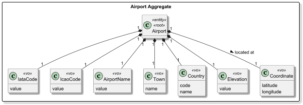
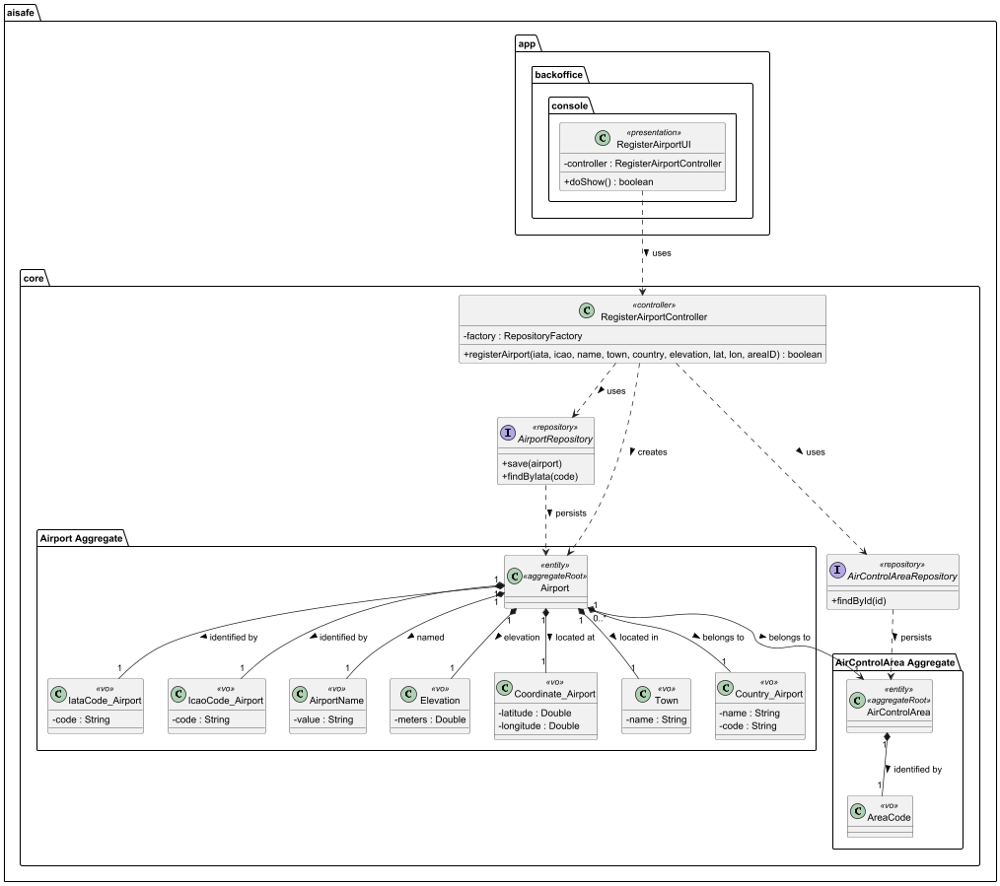
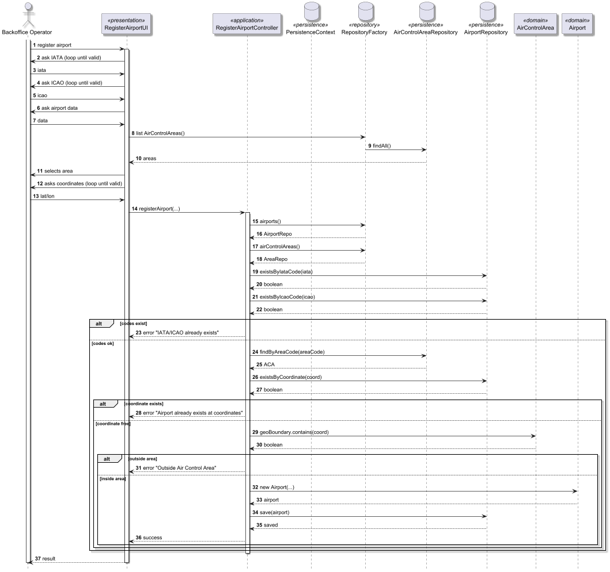

# US052 Create an airport

## 1. Context

* As a Backoffice Operator, I want to register an airport in a given air control area. An airport must be associated with exactly one air control area. The airport has an ICAO and IATA code that must be unique worldwide. An airport has location coordinates that must be valid and an elevation in meters above sea level. This must also be achieved by a bootstrap process.
* This task is being developed for the first time in the sprint 2 and it has dependencies with the following requirements:
  * US050 - Register an air control area (An airport must be associated with exactly one existing area).

### 1.1 List of issues

**Main Issue:** Issue #50

**Analysis**: Issue #51

**Design and Unit Test:** Issue #92

**Implement:** Issue #99


## 2. Requirements

**US052 -** As a Backoffice Operator, I want to register an airport in a given air control area. An airport must be associated with exactly one air control area. The airport has an ICAO and IATA code that must be unique worldwide. An airport has location coordinates that must be valid and an elevation in meters above sea level. This must also be achieved by a bootstrap process.

### Acceptance Criteria:

* **US052.1 -** The system must allow a Backoffice Operator to register a new airport.
* **US052.2 -** Each airport must be associated with exactly one air control area.
* **US052.3 -** The airport must have an IATA code and an ICAO code.
* **US052.4 -** The IATA and ICAO codes must be unique worldwide; the system must reject duplicates.
* **US052.5 -** The system must validate that IATA and ICAO codes match their expected formats.
* **US052.6 -** The airport must have valid geographic coordinates (latitude and longitude).
* **US052.7 -** The system must validate that the coordinates are within valid ranges.
* **US052.8 -** The airport must have an elevation value in meters above sea level.
* **US052.9 -** All fields (air control area, IATA, ICAO, coordinates, elevation) are mandatory.
* **US052.10 -** The system must not allow registration with missing or invalid data.
* **US052.11 -** The registration must be achievable via a bootstrap process (e.g., loading from a file at startup).
* **US052.12 -** Upon successful registration, the system must confirm the operation to the operator.

### Dependencies/References:

Regarding this requirement, we understand that it relates to:
- US050 - Register an air control area: Necessary to satisfy the invariant that an airport belongs to a managed airspace.
- US073 - Create a flight route: Airports registered here will serve as the mandatory origin and destination points for routes.
- Section 3.2: The requirements document defines the specific attributes required for an airport (codes, coordinates, altitude).

## 3. Analysis

The domain model for airport must serve as the primary consistency boundary for airport infrastructure, ensuring the global uniqueness of international aviation identifiers (IATA and ICAO codes) and the geographic integrity of location and elevation data while maintaining a mandatory association with an air control area.



| Attribute   | Description                                           | Constraints                                            |
|-------------|-------------------------------------------------------|--------------------------------------------------------|
| IataCode    | Unique 3-letter international airport identifier.     | Must be unique worldwide; exactly 3 uppercase letters. |
| IcaoCode    | Unique 4-letter standard airport identifier.          | Must be unique worldwide; exactly 4 uppercase letters. |
| AirportName | Official name of the airport infrastructure.          | Must not be empty.                                     |
| Town        | City or locality where the airport is located.        | Must not be empty.                                     |
| Country     | Country where the airport is physically situated.     | Must include a valid country code and name.            |
| Elevation   | The altitude of the airport above mean sea level.     | Must be a defined value in meters.                     |
| Coordinate  | Precise geographic location (Latitude and Longitude). | Must represent valid physical geographic ranges.       |

**Key business rules:**
* Identifier Integrity: The system must query the AirportRepository (e.g., existsByIataOrIcao) to prevent duplicate registrations.
* Geographic Validity: The Coordinate Value Object must enforce that the provided latitude and longitude are within valid physical ranges.
* Atomic Persistence: The airport and all its technical Value Objects (Elevation, Town, etc.) must be saved as a single unit via JPA to maintain database consistency.
* Mandatory Link: Creation fails if the provided AreaCode does not point to a valid existing AirControlArea.

**Relationship with the domain:**  
`Airport` is an independent aggregate whose invariant is ensuring the uniqueness of international aviation identifiers and the integrity of geographical positioning. It serves as the primary consistency boundary for aviation infrastructure within the AISafe platform. The aggregate root (Airport) protects technical specifications such as IATA/ICAO codes, geographic coordinates, and elevation, ensuring that only physically valid and properly associated airports can act as operational nodes for route definition and flight management.

## 4. Design

*In this sections, the team should present the solution design that was adopted to solve the requirement. This should include, at least, a diagram of the realization of the functionality (e.g., sequence diagram) and the specification of the main tests used to validade the functionality. A class diagram may be useful to describe the classes involved.*

### 4.1. Realization

The design of the solution for this requirement is based on the following class diagram:



The following sequence diagram illustrates the realization of US052 - Create an Airport




### 4.2. Acceptance Tests

Include here the main tests used to validate the functionality. Focus on how they relate to the acceptance criteria. May be automated or manual tests.

**Test 1:** *Verifies that an airport is successfully created with valid data*

**Refers to Acceptance Criteria:** US052.1, US052.2, US052.3, US052.6, US052.8


```java
@Test
void ensureAirportIsCreatedSuccessfullyWithValidData() {

  final var area = new AirControlArea(new AreaCode("PT01"));

  final var airport = new Airport(
          new IataCode_Airport("OPO"),
          new IcaoCode_Airport("LPPR"),
          new AirportName("Porto Airport"),
          new Town("Porto"),
          new Country_Airport("Portugal", "PT"),
          new Elevation(70.0),
          new Coordinate_Airport(41.242, -8.678),
          area
  );

  assertNotNull(airport);
}
````

**Test 2:** *Verifies that airport creation fails with invalid IATA code*

**Refers to Acceptance Criteria:** US052.5


```java
@Test(expected = IllegalArgumentException.class)
void ensureInvalidIataCodeIsRejected() {

  final var area = new AirControlArea(new AreaCode("PT02"));

  new Airport(
          new IataCode_Airport("OP"), // invalid
          new IcaoCode_Airport("LPPT"),
          new AirportName("Lisboa Airport"),
          new Town("Lisboa"),
          new Country("Portugal", "PT"),
          new Elevation(20.0),
          new Coordinate_Airport(38.774, -9.134),
          area
  );
}
````

**Test 3:** *Verifies that airport creation fails with invalid ICAO code*

**Refers to Acceptance Criteria:** US052.5


```java
@Test(expected = IllegalArgumentException.class)
void ensureInvalidIcaoCodeIsRejected() {

  final var area = new AirControlArea(new AreaCode("PT03"));

  new Airport(
          new IataCode_Airport("LIS"),
          new IcaoCode_Airport("LPP"), // invalid
          new AirportName("Lisboa Airport 2"),
          new Town("Lisboa"),
          new Country_Airport("Portugal", "PT"),
          new Elevation(25.0),
          new Coordinate_Airport(38.781, -9.135),
          area
  );
}
````

**Test 4:** *Verifies that coordinates must be within valid ranges*

**Refers to Acceptance Criteria:** US052.6, US052.7


```java
@Test(expected = IllegalArgumentException.class)
void ensureInvalidCoordinatesAreRejected() {

  final var area = new AirControlArea(new AreaCode("PT04"));

  new Airport(
          new IataCode_Airport("BRG"),
          new IcaoCode_Airport("LPBR"),
          new AirportName("Braga Airport"),
          new Town("Braga"),
          new Country_Airport("Portugal", "PT"),
          new Elevation(90.0),
          new Coordinate_Airport(100.0, -8.600), // invalid latitude
          area
  );
}
````

**Test 5:** *Verifies that elevation must be defined (non-negative)*

**Refers to Acceptance Criteria:** US052.8


```java
@Test(expected = IllegalArgumentException.class)
void ensureInvalidElevationIsRejected() {

  final var area = new AirControlArea(new AreaCode("UK01"));

  new Airport(
          new IataCode_Airport("LON"),
          new IcaoCode_Airport("EGLL"),
          new AirportName("London Heathrow"),
          new Town("London"),
          new Country_Airport("United Kingdom", "UK"),
          null, // invalid
          new Coordinate_Airport(51.470, -0.454),
          area
  );
}
````

**Test 6:** *Verifies that airport must have an associated air control*

**Refers to Acceptance Criteria:** US052.2


```java
@Test(expected = IllegalArgumentException.class)
void ensureAirportMustHaveAirControlArea() {

  new Airport(
          new IataCode_Airport("MAD"),
          new IcaoCode_Airport("LEMD"),
          new AirportName("Madrid Airport"),
          new Town("Madrid"),
          new Country_Airport("Spain", "ES"),
          new Elevation(610.0),
          new Coordinate_Airport(40.472, -3.561),
          null
  );
}
````

**Test 7:** *Verifies that airport name cannot be empty*

**Refers to Acceptance Criteria:** US052.9, US052.10


```java
@Test(expected = IllegalArgumentException.class)
void ensureAirportNameCannotBeEmpty() {

  final var area = new AirControlArea(new AreaCode("ES01"));

  new Airport(
          new IataCode_Airport("MAD"),
          new IcaoCode_Airport("LEBL"),
          new AirportName(""), // invalid
          new Town("Barcelona"),
          new Country_Airport("Spain", "ES"),
          new Elevation(12.0),
          new Coordinate_Airport(41.297, 2.083),
          area
  );
}
````

**Test 8:** *Verifies that town cannot be empty*

**Refers to Acceptance Criteria:** US052.9


```java
@Test(expected = IllegalArgumentException.class)
void ensureTownCannotBeEmpty() {

  final var area = new AirControlArea(new AreaCode("FR01"));

  new Airport(
          new IataCode_Airport("PAR"),
          new IcaoCode_Airport("LFPG"),
          new AirportName("Paris Airport"),
          new Town(""), // invalid
          new Country_Airport("France", "FR"),
          new Elevation(119.0),
          new Coordinate_Airport(49.009, 2.547),
          area
  );
}
````

**Test 9:** *Verifies that country must have valid code and name*

**Refers to Acceptance Criteria:** US052.9


```java
@Test(expected = IllegalArgumentException.class)
void ensureCountryMustBeValid() {

  final var area = new AirControlArea(new AreaCode("DE01"));

  new Airport(
          new IataCode_Airport("BER"),
          new IcaoCode_Airport("EDDB"),
          new AirportName("Berlin Airport"),
          new Town("Berlin"),
          new Country_Airport("", ""), // invalid
          new Elevation(48.0),
          new Coordinate_Airport(52.366, 13.503),
          area
  );
}
````

## 5. Implementation

The implementation follows the design presented in section 4 and applies Domain-Driven Design principles across all layers.

### 5.1. Evidence of implementation aligned with design

The following evidence shows that the implementation matches the planned architecture:

1. **Domain invariants enforced at construction**
- `Airport` validates that all mandatory attributes are present in the constructor.
- `IataCode_Airport` validates that the code contains exactly 3 uppercase letters.
- `IcaoCode_Airport` validates that the code contains exactly 4 uppercase letters.
- `Coordinate_Airport` validates latitude and longitude ranges.
- `Elevation validates` that elevation values are non-negative.
These validations satisfy:
- US052.3, US052.5, US052.6, US052.7, US052.8, US052.9, and US052.10

2. **Value objects for all attributes**
- All airport attributes are encapsulated in dedicated value objects:
  - IataCode_Airport 
  - IcaoCode_Airport 
  - AirportName 
  - Town 
  - Country_Airport 
  - Elevation 
  - Coordinate_Airport
This guarantees type safety, encapsulated validation logic, and immutability-like behavior within the aggregate.

3. **Uniqueness enforced at two levels**
- Repository level: are used before persistence to prevent duplicate airport registration.
  - existsByIataCode(...)
  - existsByIcaoCode(...)

- Database level: enforce global uniqueness directly in the database.
  - @UniqueConstraint(columnNames = "iata_code")
  - @UniqueConstraint(columnNames = "icao_code")

These mechanisms satisfy US052.4.

4. **Mandatory association with Air Control Area**
- `Airport``contains a mandatory @ManyToOne(optional = false) association with AirControlArea.
- Registration fails if no valid air control area is selected. 
This satisfies US052.2 and US052.9.

5. **Role-based access control**
- The Register Airport option is only rendered for users with `BACKOFFICE_OPERATOR` role, as enforced in `MainMenu`.
- The controller additionally calls `authz.ensureAuthenticatedBackofficeUser()` before executing any registration logic, satisfying integration with **US030**.

6. **Bootstrap support**
- Airports can be automatically registered during system startup using `AirportBootstrapper`.
- The bootstrap process reuses the same domain and repository validation rules as the UI registration process.
This satisfies US052.11.

### 5.2. Relevant artifacts and configuration files

The main files required to understand and execute this implementation are:

- **Domain**
  - `aisafe.core/src/main/java/aiSafe/airport/domain/Airport.java`
  - `aisafe.core/src/main/java/aiSafe/airport/domain/Country_Airport.java`
  - `aisafe.core/src/main/java/aiSafe/airport/domain/AirportName.java`
  - `aisafe.core/src/main/java/aiSafe/airport/domain/Coordinate_Airport.java`
  - `aisafe.core/src/main/java/aiSafe/airport/domain/Elevation.java`
  - `aisafe.core/src/main/java/aiSafe/airport/domain/IataCode_Airport.java`
  - `aisafe.core/src/main/java/aiSafe/airport/domain/IcaoCode_Airport.java`
  - `aisafe.core/src/main/java/aiSafe/airport/domain/Town.java`
- **Application**
  - `aisafe.core/src/main/java/aiSafe/airport/application/RegisterAirportController.java`
- **Presentation**
  - `aisafe.app.backoffice.console/src/main/java/aiSafe/app/backoffice/console/presentation/airport/RegisterAirportAction.java`
  - `aisafe.app.backoffice.console/src/main/java/aiSafe/app/backoffice/console/presentation/airport/RegisterAirportUI.java`
  - `aisafe.app.backoffice.console/src/main/java/aiSafe/app/backoffice/console/presentation/MainMenu.java`
- **Persistence**
  - `aisafe.persistence.impl/src/main/java/aiSafe/persistence/impl/jpa/JpaAirportRepository.java`
  - `aisafe.persistence.impl/src/main/java/aiSafe/persistence/impl/inmemory/InMemoryAirportRepository.java`
  - `aisafe.core/src/main/java/aiSafe/airport/repositories/AirportRepository.java`
  - `aisafe.persistence.impl/src/main/resources/META-INF/persistence.xml`
- **Bootstrap**
  - `aisafe.bootstrappers/src/main/java/aiSafe/infrastructure/bootstrap/MasterDataBootstrapper.java`
  - ``aisafe.bootstrappers/src/main/java/aiSafe/infrastructure/bootstrap/AirportBootstrapper.java``

### 5.3. Major commits (summary)

The following commits are the major milestones related to this requirement:

- `d1a18d6` - add analysis documentation for the airport registration requirement
- `1334535` - add design documentation, including class and sequence diagrams for Airport registration
- `1334535` - add acceptance tests for the Airport aggregate, covering all validation rules and invariants
- `b74e8f2` - minor fix on class diagram
- `2158d5b` - implement the `Airport` aggregate root and its value objects, enforcing all domain rules
- `f9e2881` - implement in-memory and jpa persistence for `AirportRepository` 

## 6. Integration/Demonstration

### 6.1. Architectural Integration

This functionality integrates with the system following the persistence architecture defined for the project. The `AirportRepository` interface is defined in the core domain module (`core.airport.repositories`) and resolved at runtime via `PersistenceContext`, which delegates to the active `RepositoryFactory` implementation:

- **`persistence.impl.inmemory`** — used for testing and early development, backed by `InMemoryAirportRepository`.
- **`persistence.impl.jpa`** — used in production, backed by `JpaAirportRepository` with full ORM mapping via JPA/Hibernate.
  This design ensures the domain and application layers are fully decoupled from persistence technology.

### 6.2. Integration Points

| Layer                  | Component                                              | Role                                               |
|------------------------|--------------------------------------------------------|----------------------------------------------------|
| Domain                 | `Airport`, `AirportRepository`                         | Aggregate and repository interface                 |
| Application            | `RegisterAirportController`                            | Orchestrates registration, enforces authz          |
| Persistence (JPA)      | `JpaAirportRepository`                                 | Persists to relational DB via JPA                  |
| Persistence (InMemory) | `InMemoryAirportRepository`                            | Used in tests and bootstrap dry-runs               |
| Infrastructure         | `PersistenceContext`                                   | Resolves the active `RepositoryFactory` at runtime |
| Bootstrap              | `MasterDataBootstrapper` `AirportBootstrapper`         | Seeds airports at startup                          |
| Presentation           | `RegisterAirportUI` / `RegisterAirportAction`          | Console entry point                                |

### 6.3. How to Demonstrate

1. Start the application using the Backoffice console module.
2. Log in with a user holding the `BACKOFFICE_OPERATOR` role.
3. Navigate to `Operations > Register an airport`.
4. Fill in all required fields.

## 7. Observations

### 7.1. Architectural Decisions

The project follows a layered, DDD-based architecture where the repository contract (`XRepository`) is always defined in the core domain module, while concrete implementations (`InMemoryXRepository`, `JpaXRepository`) live in separate modules resolved at runtime by `RepositoryFactory`. This ensures:

- The domain model has **zero dependency** on persistence technology.
- Switching between InMemory and JPA requires only a configuration change, not a code change.

The persistence layer followed the pattern represented below:


### 7.2. Third-party Works

- **EAPLI Framework** — provides the base infrastructure for `AggregateRoot`, `ValueObject`, `Repository`, `AuthzRegistry`, and console UI rendering used throughout this implementation.
- **Jakarta Persistence (JPA) / Hibernate** — used for ORM mapping of the `Airport` entity and its embedded value objects.