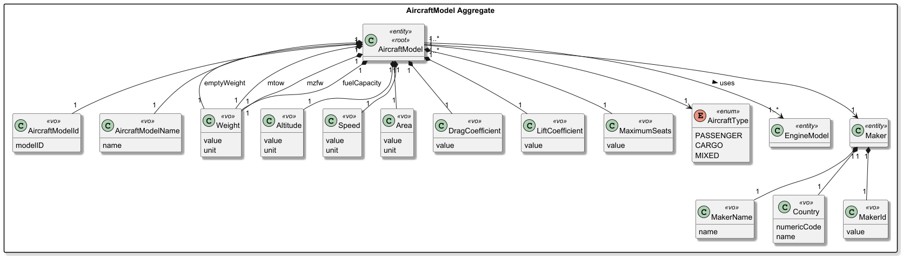
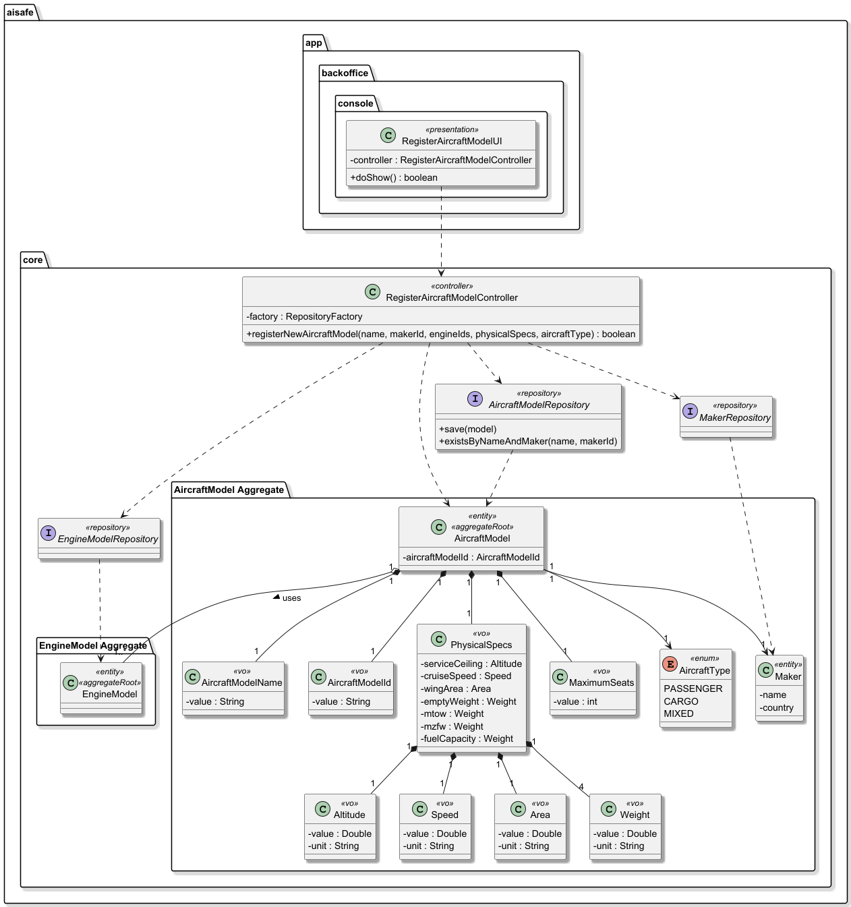
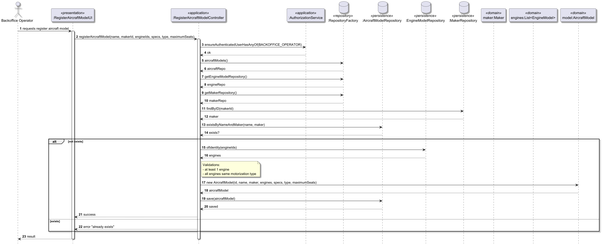

# US055 Create an Aircraft Model

## 1. Context

* As a Backoffice Operator, I want to register a new aircraft model. Any model must have at least one engine model (let’s assume that all engines are of the same type). Aircraft has a model name and manufacturer, and their combination must be unique. At least one certified engine model must be associated. An aircraft model will have a type, maximum range and other flight characteristics. This must also be achieved by a bootstrap process.
* This task is being developed for the first time in the sprint 2 and it has dependencies with the following requirements:
  * US056 - Create an aircraft engine model (Necessary to associate at least one certified engine).

### 1.1 List of issues

**Main Issue:** Issue #53

**Analysis**: Issue #55

**Design and Unit Test:** Issue #91

**Implement:** Issue #100


## 2. Requirements

**US055 -** As a Backoffice Operator, I want to register a new aircraft model. Any model must have at least one engine model (let’s assume that all engines are of the same type). Aircraft has a model name and manufacturer, and their combination must be unique. At least one certified engine model must be associated. An aircraft model will have a type, maximum range and other flight characteristics. This must also be achieved by a bootstrap process.

### Acceptance Criteria:

* **US055.1 -** The system must allow a Backoffice Operator to register a new aircraft model.
* **US055.2 -** Each aircraft model must have a model name and manufacturer.
* **US055.3 -** The combination of model name and manufacturer must be unique; the system must reject duplicates.
* **US055.4 -** Each aircraft model must be associated with at least one engine model.
* **US055.5 -** All associated engine models must be of the same type.
* **US055.6 -** The aircraft model must have a defined type (e.g., commercial, cargo, etc.).
* **US055.7 -** The aircraft model must include maximum range and other flight characteristics.
* **US055.8 -** All mandatory fields must be provided; the system must reject incomplete data.
* **US055.9 -** The system must validate the consistency of the provided data.
* **US055.10 -** The registration must be achievable via a bootstrap process (e.g., loading from a file at startup).
* **US055.11 -** Upon successful registration, the system must confirm the operation to the operator.

### Dependencies/References:

Regarding this requirement, we understand that it relates to:
- US056 - Create an engine model: Used to define the certified engines required for the model's creation.
- US057 / US058: Relates to the ongoing management (addition/removal) of certified engines for the model.
- US070 - Add aircraft to company: Aircraft models defined here are mandatory templates for registering physical aircraft units in a fleet.
- Section 3.2: The requirements document defines the specific physical parameters (Weights, Coefficients, Speeds) required for flight physics calculations.

## 3. Analysis

The domain model for aircraft model must serve as the primary consistency boundary for the technical and performance specifications of an aircraft type, ensuring that every model is correctly characterized by valid physical parameters and maintains a mandatory association with at least one certified engine.



| Attribute                | Description                                                                 | Constraints                                                                |
|--------------------------|-----------------------------------------------------------------------------|----------------------------------------------------------------------------|
| AircraftModelId <<vo>>   | Globally unique identifier of the aircraft model.                           | Must be unique and not empty.                                              |
| AircraftModelName <<vo>> | The commercial/technical name of the aircraft model.                        | Must not be empty; combination with Maker must be unique.                  |
| Weight <<vo>>            | Physical mass limits including Empty Weight, MTOW, MZFW, and Fuel Capacity. | Must be strictly positive values; units required (e.g., kg).               |
| Altitude <<vo>>          | The service ceiling representing the maximum operating altitude.            | Must be a positive value.                                                  |
| Speed <<vo>>             | The cruise speed of the aircraft model.                                     | Must be a positive value.                                                  |
| Area <<vo>>              | Total surface of the aircraft's wings (Wing Area).                          | Must be a positive value.                                                  |
| Coefficient <<vo>>       | Dimensionless values for Drag and Lift used in physics calculations.        | Must be defined for simulation accuracy.                                   |
| AircraftType <<enum>>    | Classification of the model's purpose.                                      | Must be one of the defined Enum values: PASSENGER, CARGO, or MIXED.        |
| EngineModelId <<vo>>     | Unique identifier referencing a certified engine model.                     | Must correspond to a valid EngineModel aggregate.                          |
| Maker <<entity>>         | The entity responsible for manufacturing the aircraft.                      | Must exist and be referenced by the AircraftModel.                         |
| MakerName <<vo>>         | Official name of the manufacturer .                                         | Must not be empty.                                                         |
| Country <<vo>>           | Manufacturer’s location (name and code).                                    | Must include both country name and ISO/ITU code (e.g., Portugal, PT).      |
| MakerId <<vo>>           | Unique identifier of the manufacturer.                                      | Must be unique and non-null.                                               |

**Key business rules:**
* Identity Uniqueness: The system must verify through the AircraftModelRepository that no other model shares the same Name and Maker combination.
* Motorization Invariant: The aggregate root protects the rule that a model must retain at least one certified engine. If a removal operation (US058) would leave the model with zero engines, the operation is rejected by the domain.
* Physical Integrity: Technical parameters (Weight, Speed, Altitude) are encapsulated in Value Objects that ensure these values are strictly positive, preventing mathematical errors in simulation reports.
* Atomic Persistence: The model and its performance VOs are saved as a single unit via JPA to maintain database consistency.

**Relationship with the domain:**  
`AircraftModel` is an independent aggregate whose invariant is ensuring technical performance integrity and mandatory motorization. It serves as the primary consistency boundary for aircraft specifications within the AISafe platform.

## 4. Design

*In this sections, the team should present the solution design that was adopted to solve the requirement. This should include, at least, a diagram of the realization of the functionality (e.g., sequence diagram) and the specification of the main tests used to validade the functionality. A class diagram may be useful to describe the classes involved.*

### 4.1. Realization

The design of the solution for this requirement is based on the following class diagram:



The following sequence diagram illustrates the realization of US055 - Create an Aircraft Model



### 4.2. Acceptance Tests

Include here the main tests used to validate the functionality. Focus on how they relate to the acceptance criteria. May be automated or manual tests.

**Test 1:** *Verifies that an aircraft model can be successfully created with valid data*

**Refers to Acceptance Criteria:** US055.1, US055.2, US055.4, US055.7, US055.8


```java
@Test
void ensureAircraftModelIsCreatedSuccessfullyWithValidData() {

  final var maker = new Maker(
          new MakerId("MAKER-001"),
          new MakerName("Airbus"),
          new Country("France", "FR")
  );

  final var engines = List.of(
          new EngineModel("ENG-001")
  );

  final var specs = new PhysicalSpecs(
          new Altitude(12000, AltitudeUnit.METERS),
          new Speed(850, SpeedUnit.KMH),
          new Area(122.6, AreaUnit.m2),
          new Weight(41000, WeightUnit.KG),
          new Weight(75000, WeightUnit.KG),
          new Weight(60000, WeightUnit.KG),
          new Weight(20000, WeightUnit.KG),
          new LiftCoefficient(0.5),
          new DragCoefficient(0.02)
  );

  final var aircraftModel = new AircraftModel(
          new AircraftModelId("MODEL-001"),
          new AircraftModelName("A320-TEST1"),
          maker,
          engines,
          specs,
          AircraftType.PASSENGER,
          new MaximumSeats(180)
  );

  assertNotNull(aircraftModel);
}
````

**Test 2:** *Verifies that aircraft model creation fails when no engine is provided.*

**Refers to Acceptance Criteria:** US055.4

```java
@Test(expected = IllegalArgumentException.class)
public void ensureAircraftModelMustHaveAtLeastOneEngine() {

  final var maker = new Maker("Airbus", "France");

  final var specs = new PhysicalSpecs(
          new Altitude(12000, AltitudeUnit.METERS),
          new Speed(850, SpeedUnit.KMH),
          new Area(122.6, AreaUnit.m2),
          new Weight(41000, WeightUnit.KG),
          new Weight(75000, WeightUnit.KG),
          new Weight(60000, WeightUnit.KG),
          new Weight(20000, WeightUnit.KG),
          new LiftCoefficient(0.5),
          new DragCoefficient(0.02)
  );

  new AircraftModel(
          new AircraftModelId("MODEL-002"),
          new AircraftModelName("A320-TEST2"),
          maker,
          Collections.emptyList(),
          specs,
          AircraftType.PASSENGER,
          new MaximumSeats(180)
  );
}
````

**Test 3:** *Verifies that aircraft model creation fails when engine types are not homogeneous.*

**Refers to Acceptance Criteria:** US055.5

```java
@Test(expected = IllegalArgumentException.class)
public void ensureAllEnginesMustBeOfSameType() {

  final var maker = new Maker(
          new MakerId("MAKER-002"),
          new MakerName("Boeing"),
          new Country("USA", "US")
  );

  final var engine1 = new EngineModel(
          new EngineModelId("ENG-001"),
          EngineModelName.valueOf("CFM56"),
          Power.valueOf(27000, "N"),
          TSFC.valueOf(0.5, "N"),
          FuelType.valueOf("JET A"),
          MotorizationType.TURBOFAN,
          maker
  );

  final var engine2 = new EngineModel(
          new EngineModelId("ENG-002"),
          EngineModelName.valueOf("TurboProp-X"),
          Power.valueOf(15000, "N"),
          TSFC.valueOf(0.6, "N"),
          FuelType.valueOf("JET A"),
          MotorizationType.TURBOPROP, // diferente
          maker
  );

  new AircraftModel(
          new AircraftModelId("MODEL-003"),
          new AircraftModelName("B737-TEST"),
          maker,
          List.of(engine1, engine2), 
          specs,
          AircraftType.PASSENGER,
          new MaximumSeats(180)
  );
}
````

**Test 4:** *Verifies that aircraft model creation fails when theres no Aircraft Model Name is provided.*

**Refers to Acceptance Criteria:** US055.2, US055.9

```java
@Test(expected = IllegalArgumentException.class)
public void ensureAircraftModelNameCannotBeEmpty() {

  final var maker = new Maker("Airbus", "France");

  final var engineIds = List.of(new EngineModelId("ENG-004"));

  final var specs = new PhysicalSpecs(
          new Altitude(12000, AltitudeUnit.METERS),
          new Speed(850, SpeedUnit.KMH),
          new Area(122.6, AreaUnit.m2),
          new Weight(41000, WeightUnit.KG),
          new Weight(75000, WeightUnit.KG),
          new Weight(60000, WeightUnit.KG),
          new Weight(20000, WeightUnit.KG),
          new LiftCoefficient(0.5),
          new DragCoefficient(0.02)
  );

  new AircraftModel(
          new AircraftModelId("MODEL-004"),
          new AircraftModelName(""),
          maker,
          engineIds,
          specs,
          AircraftType.PASSENGER,
          new MaximumSeats(180)
  );
}
````

**Test 5:** *Verifies that aircraft model cannot be created with invalid physical parameters*

**Refers to Acceptance Criteria:** US055.8, US055.10

```java
@Test(expected = IllegalArgumentException.class)
public void ensurePhysicalParametersMustBePositive() {

  final var maker = new Maker("Airbus", "France");

  final var engineIds = List.of(new EngineModelId("ENG-005"));

  final var specs = new PhysicalSpecs(
          new Altitude(-100, AltitudeUnit.METERS), // inválido
          new Speed(0, SpeedUnit.KMH),
          new Area(122.6, AreaUnit.m2),
          new Weight(-1, WeightUnit.KG),
          new Weight(75000, WeightUnit.KG),
          new Weight(60000, WeightUnit.KG),
          new Weight(20000, WeightUnit.KG),
          new LiftCoefficient(0.5),
          new DragCoefficient(0.02)
  );

  new AircraftModel(
          new AircraftModelId("MODEL-005"),
          new AircraftModelName("A320-INVALID"),
          maker,
          engineIds,
          specs,
          AircraftType.PASSENGER,
          new MaximumSeats(100)
  );
}
````

## 5. Implementation

The implementation follows the design presented in section 4 and applies Domain-Driven Design principles across all layers.

### 5.1. Evidence of implementation aligned with design

The following evidence shows that the implementation matches the planned architecture:

1. **Domain invariants enforced at construction**
- `AircrfatModel` validates that all mandatory attributes are present in the constructor.
  - It ensures that:
  - At least one engine model is always provided (US055.4)
  - All engines belong to the same motorization type (US055.5)
  - Model name, maker, and type are mandatory (US055.2, US055.9)
- `PhysicalSpecs` validates every physical attribute (`Area`, `Speed`, `Weight`, `Altitude`) is positive and/or follows physics rules.

2. **Value objects for all attributes**
- All aircraft model attributes are encapsulated in dedicated value objects:
  - Altitude
  - Speed
  - Area
  - Weight
  - Lift and Drag coefficients
  - AircraftModelId
  - AircraftModelName
This guarantees type safety, encapsulated validation logic, and immutability-like behavior within the aggregate.

3. **Uniqueness enforced at two levels**
- Repository level: are used before persistence to prevent duplicate Name + Maker registration.
  - existsByNameAndMaker(...)

- Database level: enforce global uniqueness directly in the database.
  - uniqueConstraints = @UniqueConstraint(columnNames = {"aircraft_model_name", "maker_id"}

4. **Mandatory association with Engine Models**
- Each aircraft model must be associated with at least one engine model.
This is enforced in:
  - Constructor validation
  - Bootstrap validation logic

```
if (engines.isEmpty()) {
throw new IllegalArgumentException("At least one engine required");
}
````
This satisfies:
  - US055.4

5. **Role-based access control**
- The Aircraft Management submenu is only rendered for users with `BACKOFFICE_OPERATOR` role, as enforced in `MainMenu`.
- The controller additionally calls `authz.ensureAuthenticatedBackofficeUser()` before executing any registration logic, satisfying integration with **US030**.

6. **Bootstrap support**
- Aircraft Models can be automatically registered during system startup using `AircraftModelBootstrapper`.
- The bootstrap process reuses the same domain and repository validation rules as the UI registration process.
  This satisfies US055.10.

### 5.2. Relevant artifacts and configuration files

The main files required to understand and execute this implementation are:

- **Domain**
  - `aisafe.core/src/main/java/aiSafe/aircraftModel/domain/AircraftModel.java`
  - `aisafe.core/src/main/java/aiSafe/aircraftModel/domain/AircraftModelId.java`
  - `aisafe.core/src/main/java/aiSafe/aircraftModel/domain/AircraftModelName.java`
  - `aisafe.core/src/main/java/aiSafe/aircraftModel/domain/AircraftType.java`
  - `aisafe.core/src/main/java/aiSafe/aircraftModel/domain/Altitude.java`
  - `aisafe.core/src/main/java/aiSafe/aircraftModel/domain/AltitudeUnit.java`
  - `aisafe.core/src/main/java/aiSafe/aircraftModel/domain/Area.java`
  - `aisafe.core/src/main/java/aiSafe/aircraftModel/domain/AreaUnit.java`
  - `aisafe.core/src/main/java/aiSafe/aircraftModel/domain/DragCoefficient.java`
  - `aisafe.core/src/main/java/aiSafe/aircraftModel/domain/LiftCoefficient.java`
  - `aisafe.core/src/main/java/aiSafe/aircraftModel/domain/PhysucalSpecs.java`
  - `aisafe.core/src/main/java/aiSafe/aircraftModel/domain/Speed.java`
  - `aisafe.core/src/main/java/aiSafe/aircraftModel/domain/SpeedUnit.java`
  - `aisafe.core/src/main/java/aiSafe/aircraftModel/domain/Weight.java`
  - `aisafe.core/src/main/java/aiSafe/aircraftModel/domain/WeightUnit.java`
- **Application**
  - `aisafe.core/src/main/java/aiSafe/aircraftModel/application/RegisterAircraftModelController.java`
- **Presentation**
  - `aisafe.app.backoffice.console/src/main/java/aiSafe/app/backoffice/console/presentation/airport/RegisterAircraftModelAction.java`
  - `aisafe.app.backoffice.console/src/main/java/aiSafe/app/backoffice/console/presentation/airport/RegisterAircraftModelUI.java`
  - `aisafe.app.backoffice.console/src/main/java/aiSafe/app/backoffice/console/presentation/MainMenu.java`
- **Persistence**
  - `aisafe.persistence.impl/src/main/java/aiSafe/persistence/impl/jpa/JpaAircraftModelRepository.java`
  - `aisafe.persistence.impl/src/main/java/aiSafe/persistence/impl/inmemory/InMemoryAircraftModelRepository.java`
  - `aisafe.core/src/main/java/aiSafe/aircraftModel/repositories/AircarftModelRepository.java`
  - `aisafe.persistence.impl/src/main/resources/META-INF/persistence.xml`
- **Bootstrap**
  - `aisafe.bootstrappers/src/main/java/aiSafe/infrastructure/bootstrap/MasterDataBootstrapper.java`
  - ``aisafe.bootstrappers/src/main/java/aiSafe/infrastructure/bootstrap/AircraftModelBootstrapper.java``

### 5.3. Major commits (summary)

The following commits are the major milestones related to this requirement:

- `b7cd327` - add analysis documentation for the AircraftModel registration requirement
- `aedc89e` && `9ca1830` - add design documentation, including class and sequence diagrams for aircraft model registration
- `aedc89e` - add acceptance tests for the AircraftModel aggregate, covering all validation rules and invariants
- `b74e8f2` - minor fix on class diagram
- `f5f2f5c` - implement the `AircraftModel` aggregate root and its value objects, enforcing all domain rules
- `89cd7d8` - implement in-memory and jpa persistence for `AircraftModelRepository`

## 6. Integration/Demonstration

### 6.1. Architectural Integration

This functionality integrates with the system following the persistence architecture defined for the project. The `AircraftModelRepository` interface is defined in the core domain module (`core.aircraftModel.repositories`) and resolved at runtime via `PersistenceContext`, which delegates to the active `RepositoryFactory` implementation:

- **`persistence.impl.inmemory`** — used for testing and early development, backed by `InMemoryAircraftModelRepository`.
- **`persistence.impl.jpa`** — used in production, backed by `JpaAircraftModelRepository` with full ORM mapping via JPA/Hibernate.
  This design ensures the domain and application layers are fully decoupled from persistence technology.

### 6.2. Integration Points

| Layer                  | Component                                                 | Role                                               |
|------------------------|-----------------------------------------------------------|----------------------------------------------------|
| Domain                 | `AircraftModel`, `AircraftModelRepository`                | Aggregate and repository interface                 |
| Application            | `RegisterAircraftModelController`                         | Orchestrates registration, enforces authz          |
| Persistence (JPA)      | `JpaAircraftModelRepository`                              | Persists to relational DB via JPA                  |
| Persistence (InMemory) | `InMemoryAircraftModelRepository`                         | Used in tests and bootstrap dry-runs               |
| Infrastructure         | `PersistenceContext`                                      | Resolves the active `RepositoryFactory` at runtime |
| Bootstrap              | `MasterDataBootstrapper` `AircraftModelBootstrapper`      | Seeds Aircraft Models at startup                   |
| Presentation           | `RegisterAircraftModelUI` / `RegisterAircraftModelAction` | Console entry point                                |

### 6.3. How to Demonstrate

1. Start the application using the Backoffice console module.
2. Log in with a user holding the `BACKOFFICE_OPERATOR` role.
3. Navigate to `Operations > Aircraft management > Regsiter aircraft model`.
4. Fill in all required fields.

## 7. Observations

### 7.1. Architectural Decisions

The project follows a layered, DDD-based architecture where the repository contract (`XRepository`) is always defined in the core domain module, while concrete implementations (`InMemoryXRepository`, `JpaXRepository`) live in separate modules resolved at runtime by `RepositoryFactory`. This ensures:

- The domain model has **zero dependency** on persistence technology.
- Switching between InMemory and JPA requires only a configuration change, not a code change.

The persistence layer followed the pattern represented below:


### 7.2. Third-party Works

- **EAPLI Framework** — provides the base infrastructure for `AggregateRoot`, `ValueObject`, `Repository`, `AuthzRegistry`, and console UI rendering used throughout this implementation.
- **Jakarta Persistence (JPA) / Hibernate** — used for ORM mapping of the `AircraftModel` entity and its embedded value objects.