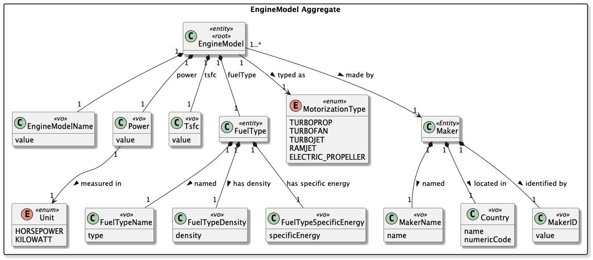
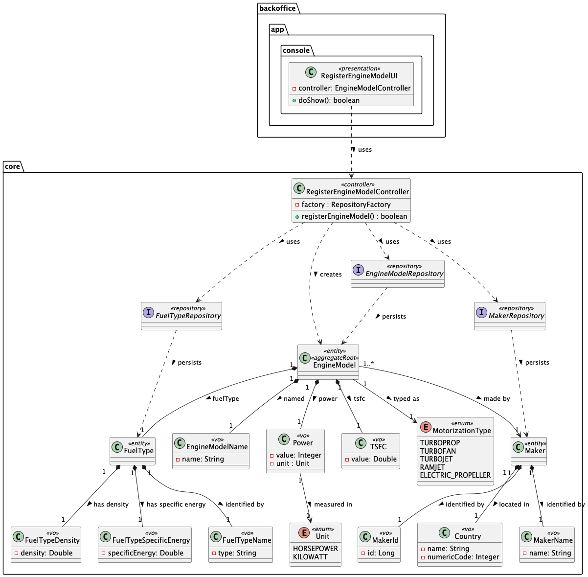
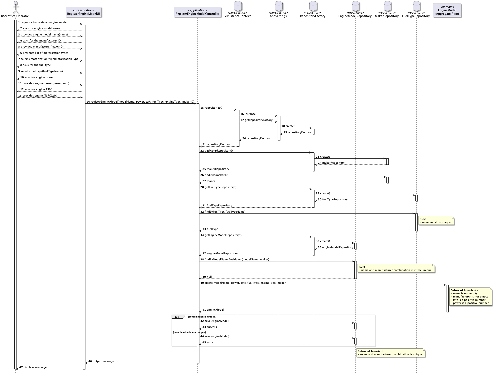

# US056 - Create an Aircraft Engine Model

## 1. Context

* As a Backoffice Operator, I want to register a new aircraft engine model to be used by aircrafts. The model's name and manufacturer combination must be unique. Other important information regarding the type, power, fuel, and efficiency should be included. This must also be achievable by a bootstrap process.
* This task is being developed for the first time in the sprint 2 and it has dependencies with the following requirements:
  * US055 - Create an Aircraft Model

### 1.1 List of issues

**Main Issue:** Issue #38

**Analysis:** Issue #39

**Design:** Issue #65

**Implement:** Issue #86

## 2. Requirements

**US056 -** As a Backoffice Operator, I want to register a new aircraft engine model to be used by aircrafts. The model's name and manufacturer combination must be unique. Other important information regarding the type, power, fuel, and efficiency should be included. This must also be achievable by a bootstrap process.


### Acceptance Criteria:

- US056.1 The system must ensure that the combination of engine model name and manufacturer is unique. Attempting to register a duplicate combination must be rejected with an appropriate error message.
- US056.2 The engine model must include the following attributes: model name, manufacturer, engine type, power, fuel type, and thrust-specific fuel consumption (TSFC) for efficiency.
- US056.3 All mandatory fields must be provided. The system must reject incomplete registrations.
- US056.4 The engine type must be one of the predefined allowed values.
- US056.5 The system must support the registration of engine models through a bootstrap process.

### Dependencies/References:

Regarding this requirement, we understand that it relates to:
- **US055 - Create an Aircraft Model**: an aircraft model references certified engine models. Therefore, engine models must exist before they can be associated with aircraft models.
- **US057 - Add an engine model to an aircraft model**: once created, an engine model can be added to an aircraft model's list of certified engines, provided the engine type is compatible.
- **Section 3.2** of the requirements document defines the engine-related attributes, including the motorization types and physics parameters (thrust, TSFC) relevant to flight simulation.

## 3. Analysis

The domain model for an Aircraft Engine Model must capture the following attributes:



| Attribute          | Description                                                                                | Constraints                                                              |
|--------------------|--------------------------------------------------------------------------------------------|--------------------------------------------------------------------------|
| Engine Model Name  | The commercial name of the engine model                                                    | Unique combined with manufacturer                                        |
| Maker              | The company that manufactures the engine                                                   | Must reference an existing maker, unique combined with engine model name |
| Motorization Type  | Category of motorization                                                                   | One of: turboprop, turbofan, turbojet, ramjet, electric propeller        |
| Power              | The maximum rated output of the engine, determining its performance and thrust capability. | Positive value                                                           |
| Fuel Type          | The type of fuel the engine can use.                                                       | Exists in the System                                                     |
| TSFC               | Thrust Specific Fuel Consumption (N/N/s)                                                   | Positive value                                                           |

**Key business rule:** The combination of (model name + manufacturer) must be unique across all registered engine models.

**Relationship with the domain:** An engine model is an independent aggregate that can later be associated with one or more aircraft models (US055/US057). The engine type must be compatible with the aircraft model's motorization category when being certified.

**Bootstrap process:** The system must support loading engine models at startup via a configuration/data file, so that a base set of engine models is available without manual registration through the UI.

## 4. Design

### 4.1. Realization

The design of the solution for this requirement is based on the following class diagram:



The following sequence diagram illustrates the realization of US056 — create a new aircraft engine model 



### 4.2. Acceptance Tests

For all the test cases, there is a common setup that creates a valid `Maker` instance and a valid `FuelType` instance, which are required for creating an `EngineModel`. These instances are created in the `setUp()` method annotated with `@BeforeEach`, ensuring that each test starts with a consistent state.

**Test 1:** Verifies that if the maker and name are the same then they are considered equal .

**Refers to Acceptance Criteria:** US056.1

```java
@Test
void ensureTwoEngineModelsWithSameNameAndMakerAreEqual() {
  // Arrange
  EngineModelName modelName = EngineModelName.valueOf("GE90B");
  Power power = Power.valueOf(27000, Unit.HORSEPOWER);
  TSFC tsfc = TSFC.valueOf(0.5);
  MotorizationType motorizationType = MotorizationType.TURBOFAN;

  final var model1 = new EngineModel(modelName, power, tsfc, fuelType, motorizationType, maker);
  final var model2 = new EngineModel(modelName, power, tsfc, fuelType, motorizationType, maker);

  // Act & Assert
  assertTrue(model1.sameAs(model2), "Two EngineModels with the same name and maker should be considered the same");
}
```

**Test 2:** Verifies that the system correctly creates an engine model when all mandatory fields are valid and the name/manufacturer combination is unique.

**Refers to Acceptance Criteria:** US056.2, US056.3

```java
@Test
public void ensureEngineModelIsCreatedSuccessfully() {
  // Arrange
  EngineModelName modelName = EngineModelName.valueOf("GE90B");
  Power power = Power.valueOf(27000, Unit.HORSEPOWER);
  TSFC tsfc = TSFC.valueOf(0.5);
  MotorizationType motorizationType = MotorizationType.TURBOFAN;

  final var model = new EngineModel(modelName, power, tsfc, fuelType, motorizationType, maker);

  // Act & Assert
  assertNotNull(model, "EngineModel should be created successfully with valid attributes");
}
```

**Test 3:** Verifies that creating an engine model with an invalid (null or blank) name is rejected.

**Refers to Acceptance Criteria:** US056.3

```java
@Test
void ensureEngineModelNameCannotBeNull(){
  // Arrange
  EngineModelName modelName = null;
  Power power = Power.valueOf(27000, Unit.HORSEPOWER);
  TSFC tsfc = TSFC.valueOf(0.5);
  MotorizationType motorizationType = MotorizationType.TURBOFAN;


  // Act & Assert
  assertThrows(IllegalArgumentException.class, () -> new EngineModel(modelName, power, tsfc, fuelType, motorizationType, maker));
}
```

**Test 4:** Verifies that creating an engine model with a negative TSFC value is rejected.

**Refers to Acceptance Criteria:** US056.3

```java
@Test
void  ensureEngineModelTSFCCannotBeNegative(){
  // Arrange
  EngineModelName modelName = EngineModelName.valueOf("GE90B");
  Power power = Power.valueOf(27000, Unit.HORSEPOWER);
  Double tsfc = -0.5;
  MotorizationType motorizationType = MotorizationType.TURBOFAN;

  // Acts & Assert
  assertThrows(IllegalArgumentException.class, () -> new EngineModel(modelName, power, TSFC.valueOf(tsfc), fuelType, motorizationType, maker));
}
```

**Test 5:** Verifies that creating an engine model with an invalid engine type is rejected.

**Refers to Acceptance Criteria:** US056.4

```java
@Test
void ensureInvalidEngineTypeCannotBeNull() {
  // Arrange
  EngineModelName modelName = EngineModelName.valueOf("GE90B");
  Power power = Power.valueOf(27000, Unit.HORSEPOWER);
  TSFC tsfc = TSFC.valueOf(0.5);
  MotorizationType motorizationType = null;

  // Act & Assert
  assertThrows(IllegalArgumentException.class, () -> new EngineModel(modelName, power, tsfc, fuelType, motorizationType, maker));
}
```

**Test 6:** Verifies that creating an engine model with a null or blank fuel type is rejected.

**Refers to Acceptance Criteria:** US056.3

```java
void ensureFuelTypeCannotBeNull(){
  // Arrange
  EngineModelName modelName = EngineModelName.valueOf("GE90B");
  Power power = Power.valueOf(27000, Unit.HORSEPOWER);
  TSFC tsfc = TSFC.valueOf(0.5);
  FuelType fuelType = null;
  MotorizationType motorizationType = MotorizationType.TURBOFAN;

  // Act & Assert
  assertThrows(IllegalArgumentException.class, () -> new EngineModel(modelName, power, tsfc, fuelType, motorizationType, maker));
}
```

**Test 7:** Verifies that creating an engine model with a negative power value is rejected.

**Refers to Acceptance Criteria:** US056.3

```java
@Test
void  ensureEngineModelPowerCannotBeNegative(){
  // Arrange
  EngineModelName modelName = EngineModelName.valueOf("GE90B");
  Integer negativePowerValue = -27000;
  Unit powerUnit = Unit.HORSEPOWER;
  TSFC tsfc = TSFC.valueOf(0.5);
  FuelType fuelType = FuelType.valueOf("JET A", 0.804, 42.8);
  MotorizationType motorizationType = MotorizationType.TURBOFAN;
  
  // Act & Assert
  assertThrows(IllegalArgumentException.class, () -> new EngineModel(modelName, Power.valueOf(negativePowerValue, powerUnit), tsfc, fuelType, motorizationType, maker));
}
```

## 5. Implementation

The implementation follows the design presented in section 4 and applies Domain-Driven Design principles across all layers.

### 5.1. Evidence of implementation aligned with design

The following evidence shows that the implementation matches the planned architecture:

1. **Domain invariants enforced at construction**
  - `EngineModel` validates all attributes via `Preconditions` in the constructor.
  - Null values, non-negative power, and non-positive TSFC are rejected immediately, satisfying **US056.2** and **US056.3**.
2. **Value objects for all attributes**
  - Each attribute is encapsulated in a dedicated value object (`EngineModelName`, `Power`, `TSFC`, `FuelType`), ensuring type safety and self-validation.
  - `MotorizationType` and `Unit` enums are persisted as `STRING` via `@Enumerated(EnumType.STRING)` inside their `@Embeddable` classes, avoiding fragile ordinal-based storage.
3. **Uniqueness enforced at two levels**
  - Domain level: `sameAs` compares (name + maker) to detect duplicates before persistence.
  - Database level: `@UniqueConstraint(columnNames = {"modelName", "maker_id"})` rejects duplicates at the DB layer, satisfying **US056.1**.
4. **Role-based access control**
  - The Aircraft Management submenu is only rendered for users with `BACKOFFICE_OPERATOR` role, as enforced in `MainMenu`.
  - The controller additionally calls `authz.ensureAuthenticatedBackofficeUser()` before executing any registration logic, satisfying integration with **US030**.
5. **Bootstrap support**
  - Engine models can be registered programmatically at startup by invoking the same application service used by the UI, satisfying **US056.5**.

### 5.2. Relevant artifacts and configuration files

The main files required to understand and execute this implementation are:

- **Domain**
  - `aisafe.core/src/main/java/aiSafe/aircraftmanagement/domain/EngineModel.java`
  - `aisafe.core/src/main/java/aiSafe/aircraftmanagement/domain/EngineModelName.java`
  - `aisafe.core/src/main/java/aiSafe/aircraftmanagement/domain/Power.java`
  - `aisafe.core/src/main/java/aiSafe/aircraftmanagement/domain/TSFC.java`
  - `aisafe.core/src/main/java/aiSafe/aircraftmanagement/domain/FuelType.java`
  - `aisafe.core/src/main/java/aiSafe/aircraftmanagement/domain/MotorizationType.java`
  - `aisafe.core/src/main/java/aiSafe/aircraftmanagement/domain/Maker.java`
  - `aisafe.core/src/main/java/aiSafe/aircraftmanagement/domain/Country.java`
  - `aisafe.core/src/main/java/aiSafe/aircraftmanagement/domain/FuelTypeDensity.java`
  - `aisafe.core/src/main/java/aiSafe/aircraftmanagement/domain/FuelTypeName.java`
  - `aisafe.core/src/main/java/aiSafe/aircraftmanagement/domain/FuelTypeSpecificEnergy.java`
  - `aisafe.core/src/main/java/aiSafe/aircraftmanagement/domain/MakerID.java`
  - `aisafe.core/src/main/java/aiSafe/aircraftmanagement/domain/MakerName.java`
  - `aisafe.core/src/main/java/aiSafe/aircraftmanagement/domain/Unit.java`
- **Application**
  - `aisafe.core/src/main/java/aiSafe/aircraftmanagement/application/RegisterEngineModelController.java`
- **Presentation**
  - `aisafe.app.backoffice.console/src/main/java/aiSafe/app/backoffice/console/presentation/aircraftmanagement/RegisterEngineModelAction.java`
  - `aisafe.app.backoffice.console/src/main/java/aiSafe/app/backoffice/console/presentation/aircraftmanagement/RegisterEngineModelUI.java`
  - `aisafe.app.backoffice.console/src/main/java/aiSafe/app/backoffice/console/presentation/MainMenu.java`
- **Persistence**
  - `aisafe.persistence.impl/src/main/java/aiSafe/persistence/impl/jpa/JpaEngineModelRepository.java`
  - `aisafe.persistence.impl/src/main/java/aiSafe/persistence/impl/jpa/JpaMakerRepository.java`
  - `aisafe.persistence.impl/src/main/java/aiSafe/persistence/impl/jpa/JpaFuelTypeRepository.java`
  - `aisafe.persistence.impl/src/main/java/aiSafe/persistence/impl/inmemory/InMemoryEngineModelRepository.java`
  - `aisafe.persistence.impl/src/main/java/aiSafe/persistence/impl/inmemory/InMemoryMakerRepository.java`
  - `aisafe.persistence.impl/src/main/java/aiSafe/persistence/impl/inmemory/InFuelTypeRepository.java`
  - `aisafe.core/src/main/java/aiSafe/aircraftmanagement/repositories/EngineModelRepository.java`
  - `aisafe.core/src/main/java/aiSafe/aircraftmanagement/repositories/MakerRepository.java`
  - `aisafe.core/src/main/java/aiSafe/aircraftmanagement/repositories/FuelTypeRepository.java`
  - `aisafe.persistence.impl/src/main/resources/META-INF/persistence.xml`
- **Bootstrap**
  - `aisafe.bootstrappers/src/main/java/aiSafe/infrastructure/bootstrap/MasterDataBootstrapper.java`
  - `aisafe.bootstrappers/src/main/java/aiSafe/infrastructure/bootstrap/EngineModelBootstrapper.java`
  - `aisafe.bootstrappers/src/main/java/aiSafe/infrastructure/bootstrap/MakerBootstrapper.java`
  - `aisafe.bootstrappers/src/main/java/aiSafe/infrastructure/bootstrap/FuelTypeBootstrapper.java`

### 5.3. Major commits (summary)

The following commits are the major milestones related to this requirement:

- `3f6bd3b` - add analysis documentation for the engine model registration requirement
- `51c24d4` - add design documentation, including class and sequence diagrams for engine model registration
- `d5acf7b` - add acceptance tests for the EngineModel aggregate, covering all validation rules and invariants
- `8bc917f` - implement the `EngineModel` aggregate root and its value objects, enforcing all domain rules
- `ac40269` - implement in-memory persistence for `EngineModelRepository` to support testing and early development
- `3965bdd` - update design after product owner feedback about the fuel type
- `94d7593` - update implementation with changes made in the design

## 6. Integration/Demonstration

### 6.1. Architectural Integration

This functionality integrates with the system following the persistence architecture defined for the project. The `EngineModelRepository` interface is defined in the core domain module (`core.aircraftmanagement.repositories`) and resolved at runtime via `PersistenceContext`, which delegates to the active `RepositoryFactory` implementation:

- **`persistence.impl.inmemory`** — used for testing and early development, backed by `InMemoryEngineModelRepository`.
- **`persistence.impl.jpa`** — used in production, backed by `JpaEngineModelRepository` with full ORM mapping via JPA/Hibernate.
  This design ensures the domain and application layers are fully decoupled from persistence technology.

### 6.2. Integration Points

| Layer                  | Component                                             | Role                                               |
|------------------------|-------------------------------------------------------|----------------------------------------------------|
| Domain                 | `EngineModel`, `EngineModelRepository`                | Aggregate and repository interface                 |
| Application            | `RegisterEngineModelController`                       | Orchestrates registration, enforces authz          |
| Persistence (JPA)      | `JpaEngineModelRepository`                            | Persists to relational DB via JPA                  |
| Persistence (InMemory) | `InMemoryEngineModelRepository`                       | Used in tests and bootstrap dry-runs               |
| Infrastructure         | `PersistenceContext`                                  | Resolves the active `RepositoryFactory` at runtime |
| Bootstrap              | `MasterDataBootstrapper`                              | Seeds engine models at startup                     |
| Presentation           | `RegisterEngineModelUI` / `RegisterEngineModelAction` | Console entry point                                |

### 6.3. How to Demonstrate

1. Start the application using the Backoffice console module.
2. Log in with a user holding the `BACKOFFICE_OPERATOR` role.
3. Navigate to `Operations > Aircraft Management > Register Engine Model`.
4. Fill in all required fields: name, maker, engine type, power (value + unit), fuel type, and TSFC.

## 7. Observations

### 7.1. Architectural Decisions

The project follows a layered, DDD-based architecture where the repository contract (`XRepository`) is always defined in the core domain module, while concrete implementations (`InMemoryXRepository`, `JpaXRepository`) live in separate modules resolved at runtime by `RepositoryFactory`. This ensures:

- The domain model has **zero dependency** on persistence technology.
- Switching between InMemory and JPA requires only a configuration change, not a code change.

The persistence layer followed the pattern represented below:


### 7.2. Third-party Works

- **EAPLI Framework** — provides the base infrastructure for `AggregateRoot`, `ValueObject`, `Repository`, `AuthzRegistry`, and console UI rendering used throughout this implementation.
- **Jakarta Persistence (JPA) / Hibernate** — used for ORM mapping of the `EngineModel` entity and its embedded value objects.