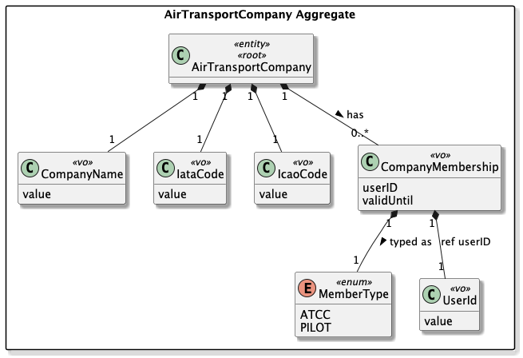
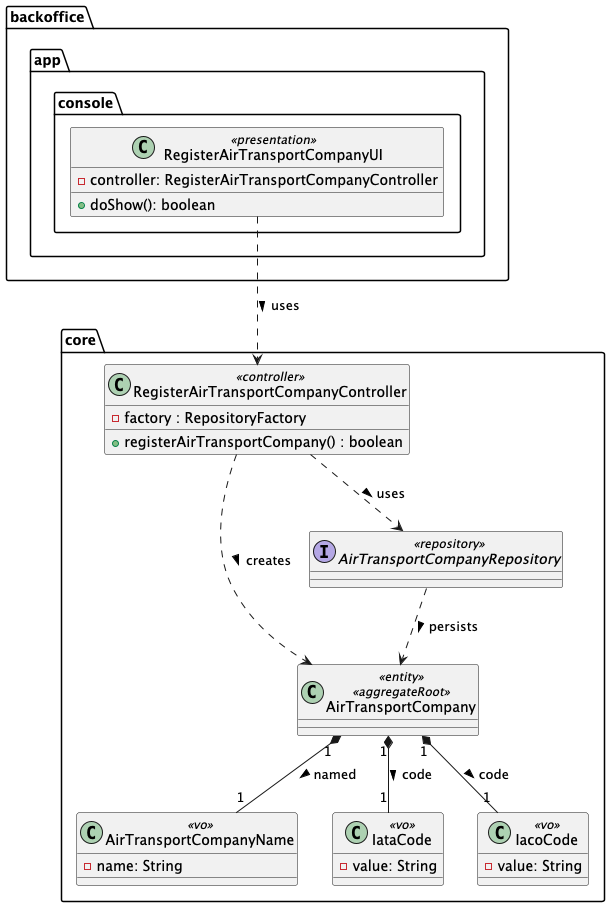
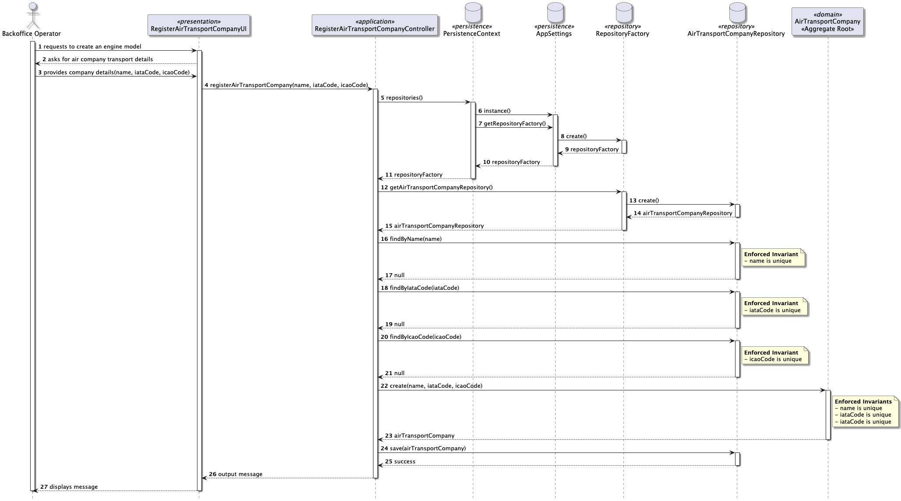

# US060 - Register an Air Transport Company

## 1. Context

* As a Backoffice Operator, I want to register an air transport company. A company has a company name, and IATA (2 letters) and ICAO code (2-3 letters) that must be unique.
* This task is being developed for the first time in sprint 2 and it has dependencies with the following requirements:
  * US061 - Add a Customer's Collaborator
  * US070 - Add an Aircraft to an Air Transport Company

### 1.1 List of issues

**Main Issue:** Issue #40

**Analysis:** Issue #73

**Design:** Issue #78

**Implement:** Issue #96

## 2. Requirements

**US060** As a Backoffice Operator, I want to register an air transport company. A company has a company name, and IATA (2 letters) and ICAO code (2-3 letters) that must be unique. This must also be achievable by a bootstrap process.

### Acceptance Criteria:

- US060.1 The system must ensure the IATA code is exactly 2 letters and unique across all registered air transport companies.
- US060.2 The system must ensure the ICAO code is between 2 and 3 letters and unique across all registered air transport companies.
- US060.3 The company name must be provided and cannot be blank. It must be unique across all registered air transport companies.
- US060.4 Attempting to register a company with a duplicate IATA or ICAO code must be rejected with an appropriate error message.
- US060.5 The system must support the registration of air transport companies through a bootstrap process.

### Dependencies/References:

Regarding this requirement, we understand that it relates to:
- **US061 - Add a Customer's Collaborator**: once a company is registered, Backoffice Operators can add collaborators (ATCCs and pilots) to it.
- **US070 - Add an Aircraft to an Air Transport Company**: an air transport company must exist before aircraft can be added to its fleet.
- **US073 - Create a Flight Route**: flight routes are created by Air Transport Company Collaborators and are associated with a registered company.
- **Section 3.1.3** of the requirements document describes the air transport company domain, including the need to store collaborators and manage fleet and routes.

## 3. Analysis

The domain model for an Air Transport Company must capture the following attributes:



| Attribute    | Description                                | Constraints                          |
|--------------|--------------------------------------------|--------------------------------------|
| Company Name | The full name of the air transport company | Mandatory; unique                    |
| IATA Code    | 2-letter airline designator code           | Mandatory; exactly 2 letters; unique |
| ICAO Code    | 2 to 3-letter airline designator code      | Mandatory; 2-3 letters; unique       |

**Key business rules:**
- The IATA code must be exactly 2 letters and globally unique in the system.
- The ICAO code must be 2 to 3 letters and globally unique in the system.
- Both codes serve as identifiers used in flight designators and routes.

**Relationship with the domain:** An `AirTransportCompany` is an aggregate root. It can have multiple collaborators (ATCCs and pilots) and a fleet of aircraft. These associations are managed through dedicated use cases (US061, US070).

**Bootstrap process:** The system must support loading air transport companies at startup via a configuration/data file, ensuring a base set of companies is available without manual registration.

## 4. Design

### 4.1. Realization

The design of the solution for this requirement is based on the following class diagram:



The following sequence diagram illustrates the realization of US060 — Register an Air Transport Company 



### 4.2. Acceptance Tests

**Test 1:** Verifies that the system correctly creates an air transport Company when all mandatory fields are valid and the fields are unique

**Refers to Acceptance Criteria:** US060.3


```java
@Test
public void ensureAirTransportCompanyIsCreated() {
  // Arrange
  CompanyName companyName = CompanyName.valueOf("AirTest");
  IataCode iataCode = IataCode.valueOf("AT");
  IcaoCode icaoCode = IcaoCode.valueOf("ATC");

  final AirTransportCompany airTransportCompany = new AirTransportCompany(companyName, iataCode, icaoCode);

  // Act & Assert
  assertNotNull(airTransportCompany, "Air Transport Company should be created successfully");
}
````

**Test 2:** Verifies that the system detects the creation of an air transport company when the IATA code is not unique.

**Refers to Acceptance Criteria:** US060.1

```java
@Test
public void ensureAirTransportCompanyIsNotCreatedWithDuplicateIATACode() {
  // Arrange
  CompanyName companyName1 = CompanyName.valueOf("AirTest1");
  IataCode iataCode = IataCode.valueOf("AT");
  IcaoCode icaoCode1 = IcaoCode.valueOf("AT1");
  final AirTransportCompany airTransportCompany1 = new AirTransportCompany(companyName1, iataCode, icaoCode1);
  CompanyName companyName2 = CompanyName.valueOf("AirTest2");
  IcaoCode icaoCode2 = IcaoCode.valueOf("AT2");
  final AirTransportCompany airTransportCompany2 = new AirTransportCompany(companyName2, iataCode, icaoCode2);

  // Act & Assert
  assertNotNull(airTransportCompany1, "First Air Transport Company should be created successfully");
  assertTrue(airTransportCompany1.sameAs(airTransportCompany2), "Second Air Transport Company should be considered the same as the first due to duplicate IATA code");
}
```

**Test 3:** Verifies that the system rejects the creation of an air transport company when the IATA code is not exactly 2 letters.

**Refers to Acceptance Criteria:** US060.1

```java
@Test
public void ensureAirTransportCompanyIsNotCreatedWithInvalidIATACode() {
  // Arrange
  CompanyName companyName = CompanyName.valueOf("AirTest");
  String invalidIataCode = "A";
  IcaoCode icaoCode = IcaoCode.valueOf("AT1");

  // Act & Assert
  assertThrows(IllegalArgumentException.class, () -> {
    new AirTransportCompany(companyName, IataCode.valueOf(invalidIataCode), icaoCode);
  }, "Creating an Air Transport Company with an invalid IATA code should throw an exception");
}
```

**Test 4:** Verifies that the system detects the creation of an air transport company when the ICAO code is not unique.

**Refers to Acceptance Criteria:** US060.2

```java
@Test
public void ensureAirTransportCompanyIsNotCreatedWithDuplicateICAOCode() {
  // Arrange
  CompanyName companyName1 = CompanyName.valueOf("AirTest1");
  IataCode iataCode1 = IataCode.valueOf("AT");
  IcaoCode icaoCode1 = IcaoCode.valueOf("AT1");
  final AirTransportCompany airTransportCompany1 = new AirTransportCompany(companyName1, iataCode1, icaoCode1);
  CompanyName companyName2 = CompanyName.valueOf("AirTest2");
  IataCode iataCode2 = IataCode.valueOf("AT");
  final AirTransportCompany airTransportCompany2 = new AirTransportCompany(companyName2, iataCode2, icaoCode1);

  // Act & Assert
  assertNotNull(airTransportCompany1, "First Air Transport Company should be created successfully");
  assertTrue(airTransportCompany1.sameAs(airTransportCompany2), "Second Air Transport Company should be considered the same as the first due to duplicate ICAO code");
}
```

**Test 5:** Verifies that the system rejects the creation of an air transport company when the ICAO code is not between 2 and 3 letters.

**Refers to Acceptance Criteria:** US060.2

```java
@Test
public void ensureAirTransportCompanyIsNotCreatedWithInvalidICAOCode() {
  // Arrange
  CompanyName companyName = CompanyName.valueOf("AirTest");
  IataCode iataCode = IataCode.valueOf("AT");
  String invalidIcaoCode = "A";

  // Act & Assert
  assertThrows(IllegalArgumentException.class, () -> {
    new AirTransportCompany(companyName, iataCode, IcaoCode.valueOf(invalidIcaoCode));
  }, "Creating an Air Transport Company with an invalid ICAO code should throw an exception");
}
```

**Test 6:** Verifies that the system rejects the creation of an air transport company when the company name is blank.

**Refers to Acceptance Criteria:** US060.3

```java
@Test
public void ensureAirTransportCompanyIsNotCreatedWithBlankCompanyName() {
  // Arrange
  String blankCompanyName = "";
  IataCode iataCode = IataCode.valueOf("AT");
  IcaoCode icaoCode = IcaoCode.valueOf("AT1");
  // Act & Assert
  assertThrows(IllegalArgumentException.class, () -> {
    new AirTransportCompany(CompanyName.valueOf(blankCompanyName), iataCode, icaoCode);
  }, "Creating an Air Transport Company with a blank company name should throw an exception");
}
```

**Test 7:** Verifies that the system detects the creation of an air transport company when the company name is duplicated.

**Refers to Acceptance Criteria:** US060.3

```java
@Test
public void ensureAirTransportCompanyIsNotCreatedWithDuplicateCompanyName() {
  // Arrange
  CompanyName companyName = CompanyName.valueOf("AirTest");
  IataCode iataCode1 = IataCode.valueOf("AT");
  IcaoCode icaoCode1 = IcaoCode.valueOf("AT1");
  final AirTransportCompany airTransportCompany1 = new AirTransportCompany(companyName, iataCode1, icaoCode1);
  IataCode iataCode2 = IataCode.valueOf("AD");
  IcaoCode icaoCode2 = IcaoCode.valueOf("AT2");
  final AirTransportCompany airTransportCompany2 = new AirTransportCompany(companyName, iataCode2, icaoCode2);

  // Act & Assert
  assertNotNull(airTransportCompany1, "First Air Transport Company should be created successfully");
  assertTrue(airTransportCompany1.sameAs(airTransportCompany2), "Second Air Transport Company should be considered the same as the first due to duplicate company name!");
}
```

## 5. Implementation

The implementation follows the design presented in section 4 and applies Domain-Driven Design principles across the domain, application, presentation and persistence layers.

### 5.1. Evidence of implementation aligned with design

The following evidence shows that the implementation matches the planned architecture and satisfies the acceptance criteria:

1. **Domain invariants enforced with value objects**
  - `CompanyName`, `IataCode` and `IcaoCode` are implemented as `@Embeddable` value objects.
  - `CompanyName.valueOf(...)` rejects null/blank names (**US060.3**).
  - `IataCode.valueOf(...)` enforces exactly 2 characters (**US060.1**).
  - `IcaoCode.valueOf(...)` enforces 2–3 characters (**US060.2**).

2. **Uniqueness enforced at application level before persistence**
  - `RegisterAirTransportCompanyController` queries the repository (`findByCompanyName`, `findByIataCode`, `findByIcaoCode`) and rejects duplicates with an error message (**US060.1**, **US060.2**, **US060.3**, **US060.4**).

3. **Uniqueness reinforced at database level (JPA)**
  - `AirTransportCompany` is mapped as a JPA `@Entity` and includes a `@UniqueConstraint`.
  - Additionally, each embedded attribute column is marked `unique = true` (`companyName`, `iataCode`, `icaoCode`), ensuring DB-level protection against duplicates.

4. **Role-based access control**
  - The controller calls `authorizationGuardService.ensureAuthenticatedBackofficeUser()` before executing registration logic.
  - The console feature is exposed in the backoffice `MainMenu` under `Operations`.

5. **Repository abstraction with pluggable persistence**
  - The `AirTransportCompanyRepository` interface lives in the core module, while concrete implementations are provided in:
    - In-memory: `InMemoryAirTransportCompanyRepository`
    - JPA: `JpaAirTransportCompanyRepository`
  - The active repository implementation is resolved through the configured `RepositoryFactory` (InMemory or JPA), keeping the domain/application layers independent from persistence technology.

6. **Bootstrap support (current state)**
  - The project already contains a master bootstrap entry point (`AisafeBootstrap` → `MasterDataBootstrapper`).

### 5.2. Relevant artifacts and configuration files

The main files required to understand and execute this implementation are:

- **Domain**
  - `aisafe.core/src/main/java/aiSafe/airtransportcompany/domain/AirTransportCompany.java`
  - `aisafe.core/src/main/java/aiSafe/airtransportcompany/domain/CompanyName.java`
  - `aisafe.core/src/main/java/aiSafe/airtransportcompany/domain/IataCode.java`
  - `aisafe.core/src/main/java/aiSafe/airtransportcompany/domain/IcaoCode.java`
- **Repository contract (core)**
  - `aisafe.core/src/main/java/aiSafe/airtransportcompany/repositories/AirTransportCompanyRepository.java`
- **Application**
  - `aisafe.core/src/main/java/aiSafe/airtransportcompany/application/RegisterAirTransportCompanyController.java`
- **Presentation**
  - `aisafe.app.backoffice.console/src/main/java/aiSafe/app/backoffice/console/presentation/airTransportCompany/RegisterAirTransportCompanyAction.java`
  - `aisafe.app.backoffice.console/src/main/java/aiSafe/app/backoffice/console/presentation/airTransportCompany/RegisterAirTransportCompanyUI.java`
  - `aisafe.app.backoffice.console/src/main/java/aiSafe/app/backoffice/console/presentation/MainMenu.java`
- **Persistence**
  - `aisafe.persistence.impl/src/main/java/aiSafe/persistence/impl/inmemory/InMemoryAirTransportCompanyRepository.java`
  - `aisafe.persistence.impl/src/main/java/aiSafe/persistence/impl/jpa/JpaAirTransportCompanyRepository.java`
  - `aisafe.core/src/main/java/aiSafe/infrastructure/persistence/RepositoryFactory.java`
  - `aisafe.persistence.impl/src/main/java/aiSafe/persistence/impl/inmemory/InMemoryRepositoryFactory.java`
  - `aisafe.persistence.impl/src/main/java/aiSafe/persistence/impl/jpa/JpaRepositoryFactory.java`
  - `aisafe.persistence.impl/src/main/resources/META-INF/persistence.xml`
- **Bootstrap (entry point)**
  - `aisafe.app.bootstrap/src/main/java/aiSafe/app/bootstrap/AisafeBootstrap.java`
  - `aisafe.bootstrappers/src/main/java/aiSafe/infrastructure/bootstrap/MasterDataBootstrapper.java`
  - `aisafe.bootstrappers/src/main/java/aiSafe/infrastructure/bootstrap/AirTransportCompanyBootstrapper.java`

### 5.3. Major commits (summary)

The following commits are the major milestones related to this requirement:

- `991b626` - add analysis documentation for air transport company registration
- `30174cf` - add design documentation, including class and sequence diagrams for air transport company registration
- `88f97f8` - add acceptance tests for air transport company registration
- `a24eebb` - implement domain model for air transport company, including value objects and invariants
- `b9c9454` - implement bootstrap process 

## 6. Integration/Demonstration

### 6.1. Architectural Integration

This functionality integrates with the system following the persistence architecture defined for the project. The `AirTransportCompanyRepository` interface is defined in the core module and resolved at runtime via `PersistenceContext`, which delegates to the active `RepositoryFactory` implementation:

- **`persistence.impl.inmemory`** — used for testing and early development, backed by `InMemoryAirTransportCompanyRepository`.
- **`persistence.impl.jpa`** — used in production, backed by `JpaAirTransportCompanyRepository`, with ORM mapping registered in `META-INF/persistence.xml`.

This ensures the domain and application layers are decoupled from persistence technology.

### 6.2. Integration Points

| Layer                   | Component                                                             | Role                                              |
|-------------------------|-----------------------------------------------------------------------|---------------------------------------------------|
| Domain                  | `AirTransportCompany`, `CompanyName`, `IataCode`, `IcaoCode`          | Aggregate and value objects                       |
| Domain                  | `AirTransportCompanyRepository`                                       | Repository interface                              |
| Application             | `RegisterAirTransportCompanyController`                               | Orchestrates registration and enforces uniqueness |
| Persistence (JPA)       | `JpaAirTransportCompanyRepository`                                    | Persists to relational DB via JPA                 |
| Persistence (InMemory)  | `InMemoryAirTransportCompanyRepository`                               | Used in tests and early development               |
| Infrastructure          | `RepositoryFactory` / `PersistenceContext`                            | Resolves the active repository implementation     |
| Presentation            | `RegisterAirTransportCompanyUI` / `RegisterAirTransportCompanyAction` | Console entry point                               |

### 6.3. How to Demonstrate

1. Start the Backoffice console application.
2. Log in with a user holding the `BACKOFFICE_OPERATOR` role.
3. Navigate to `Operations > Register Air Transport Company`.
4. Provide a company name, IATA code (exactly 2 letters) and ICAO code (2–3 letters).
5. Confirm the company is registered successfully.
6. Try registering again with the same company name, IATA or ICAO code and confirm the system rejects it with an error message.

## 7. Observations

### 7.1. Architectural Decisions

The project follows a layered, DDD-based architecture where repository contracts (`XRepository`) are defined in the core domain module, while concrete implementations (`InMemoryXRepository`, `JpaXRepository`) live in separate modules resolved at runtime by `RepositoryFactory`. This ensures:

- The domain model has **zero dependency** on persistence technology.
- Switching between InMemory and JPA requires only a configuration change, not a code change.

The persistence layer followed the pattern represented below:


### 7.2. Third-party Works

- **EAPLI Framework** — provides the base infrastructure for `AggregateRoot`, `ValueObject`, `Repository`, `AuthzRegistry`, and console UI rendering used throughout this implementation.
- **Jakarta Persistence (JPA) / EclipseLink** — used for ORM mapping of the `AirTransportCompany` entity and its embedded value objects.