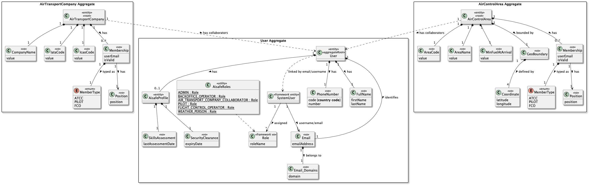
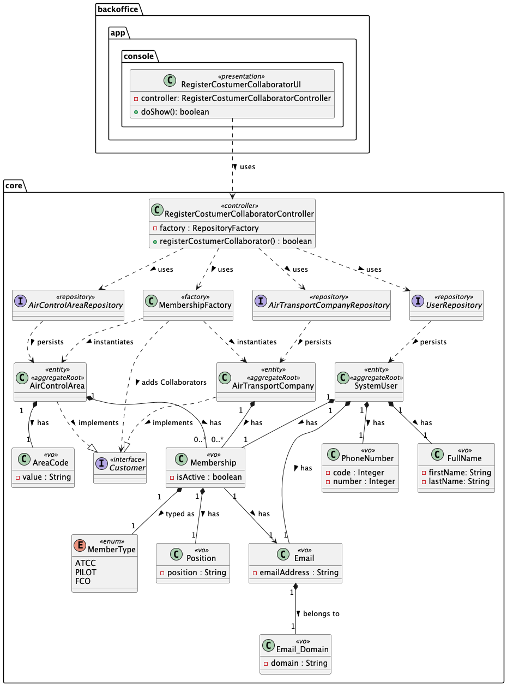
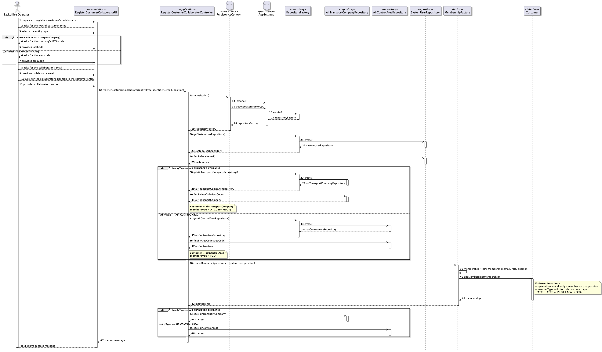

# US061 - Add a Customer's Collaborator

## 1. Context

* As a Backoffice Operator, I want to register a customer's collaborator. A customer may be an air transport company or an air control area. The collaborator will also be a user of the system. Thus, each collaborator will be a distinct system user. There is no need to verify that the collaborator's email is in the customer's domain. This must also be achievable by a bootstrap process.
* This task is being developed for the first time in sprint 2 and it has dependencies with the following requirements:
  * US030 - Authentication and Authorization
  * US031 - Register Users
  * US050 - Register an Air Control Area
  * US060 - Register an Air Transport Company

### 1.1 List of issues

**Main Issue:** Issue #41

**Analysis:** Issue #75

**Design:** Issue #97

**Implement:** Issue #104

## 2. Requirements

**US061** As a Backoffice Operator, I want to register a customer's collaborator. A customer may be an air transport company or an air control area. The collaborator will also be a user of the system. Thus, each collaborator will be a distinct system user. There is no need to verify that the collaborator's email is in the customer's domain. This could be extremely difficult or even impossible, and many users have emails outside the company's main domain. This must also be achievable by a bootstrap process.

### Acceptance Criteria:

- US061.1 The system must allow a Backoffice Operator to register a collaborator for a customer (air transport company or air control area).
- US061.2 Each collaborator must be a distinct system user, identified by a unique valid email address.
- US061.3 The collaborator must have a name, email, and position (role within the customer organisation).
- US061.4 There is no requirement to verify that the collaborator's email belongs to the customer's domain.
- US061.5 The system must assign the appropriate role to the collaborator based on the customer type: Air Transport Company Collaborator (ATCC) for companies, or Flight Control Operator (FCO) for air control areas.
- US061.6 The customer the collaborator is being added to must already exist in the system.
- US061.7 The system must support the registration of collaborators through a bootstrap process.

### Dependencies/References:

Regarding this requirement, we understand that it relates to:
- **US030 - Authentication and Authorization**: the collaborator is a system user and must be subject to authentication and authorization rules.
- **US031 - Register Users**: the creation of a collaborator implies the creation of a system user. The mechanisms defined in US031 should be reused or extended.
- **US050 - Register an Air Control Area**: an air control area must exist before a Flight Control Operator can be associated with it.
- **US060 - Register an Air Transport Company**: an air transport company must exist before an ATCC can be associated with it.
- **US062 - List Customer's Collaborators**: collaborators registered via this US will be listed through US062.
- **US063 - Edit Customer's Collaborator**: the email and phone number of a collaborator registered here can later be edited.
- **US064 - Disable Customer's Collaborator**: a collaborator registered here can be disabled via US064.
- **Section 3.1.3** describes the air transport company and its collaborators; **section 3.1.4** describes flight control entities and their operators (FCOs).

## 3. Analysis

The domain model for an Customer's Collaborator must capture the following attributes:



| Attribute    | Description                                                            | Constraints                           |
|--------------|------------------------------------------------------------------------|---------------------------------------|
| Name         | Full name of the collaborator                                          | Mandatory; non-blank                  |
| Email        | Email address used as the system user identifier                       | Mandatory; unique; valid email format |
| Phone Number | Contact phone number                                                   | Optional                              |
| Position     | Role/title within the customer organisation                            | Mandatory                             |
| Customer     | The customer (company or air control area) the collaborator belongs to | Mandatory; must already exist         |
| System Role  | Role assigned in the system (ATCC/Pilot or FCO)                        | Derived from customer type            |

**Key business rules:**
- A collaborator is always a system user — creating a collaborator also creates (or links to) a user account.
- The email does not need to belong to the customer's domain, as stated in the requirements.
- The system role assigned depends on the type of customer: ATCC for air transport companies, FCO for air control areas.
- Each collaborator is a distinct user — the same person cannot be registered twice under the same or different customers with the same email.

**Customer polymorphism:** The `Customer` concept is shared between `AirTransportCompany` and `AirControlArea`. A collaborator is always linked to one of these two types. This will be modelled using a common interface or abstract supertype to support extensibility.

**Bootstrap process:** The system must support loading collaborators at startup via a configuration/data file.

## 4. Design

### 4.1. Realization

The design of the solution for this requirement is based on the following class diagram:



The following sequence diagram illustrates the realization of US061 — Add a Customer's Collaborator



### 4.2. Acceptance Tests


**Test 1:** Verifies that a Backoffice Operator can successfully register a collaborator for an existing air transport company

**Refers to Acceptance Criteria:** US061.1

```java 
@Test
public void ensureMembershipIsCreatedSuccessfullyForATC() {
  // Arrange
  CompanyName companyName = CompanyName.valueOf("AirTest");
  IataCode iataCode = IataCode.valueOf("AT");
  IcaoCode icaoCode = IcaoCode.valueOf("ATC");

  final AirTransportCompany airTransportCompany = new AirTransportCompany(companyName, iataCode, icaoCode);

  final var user = new User(
          new FullName("John", "Doe"),
          new Email("john.doe@company.com"),
          new PhoneNumber(351, 912345678),
          AisafeRoles.PILOT
  );

  Position position = Position.valueOf("Chief Pilot");
  MemberType memberType = MemberType.PILOT;
  Membership membership = new Membership(user.email(), position, memberType);
  
  airTransportCompany.addMembership(membership);
  
  // Act & Assert
  assertNotNull(airTransportCompany.memberships(), "Membership should be created and added to the air transport company");
  assertTrue(airTransportCompany.memberships().contains(membership), "Membership should be associated with the air transport company");
}
````

**Test 2:** Verifies that a Backoffice Operator can successfully register a collaborator for an existing air control area

**Refers to Acceptance Criteria:** US061.1

```java 
@Test
public void ensureMembershipIsCreatedSuccessfullyForAACA() {
  // Arrange
  AreaCode areaCode = new AreaCode("LPPT");
  AreaName areaName = new AreaName("Lisbon Control Area");
  MinFuelAtArrival minFuel = new MinFuelAtArrival(100.0);
  GeoBoundary boundary = new GeoBoundary(List.of(
          new Coordinate(0, 0),
          new Coordinate(1, 0),
          new Coordinate(1, 1),
          new Coordinate(0, 1)
  ));

  AirControlArea area = new AirControlArea(areaCode, areaName, minFuel, boundary);

  final var user = new User(
          new FullName("John", "Doe"),
          new Email("john.doe@company.com"),
          new PhoneNumber(351, 912345678),
          AisafeRoles.PILOT
  );

  Position position = Position.valueOf("Chief Pilot");
  MemberType memberType = MemberType.FCO;
  Membership membership = new Membership(user.email(), position, memberType);
  
  area.addMembership(membership);
  
  // Act & Assert
  assertNotNull(area.memberships(), "Membership should be created and added to the air control area");
  assertTrue(area.memberships().contains(membership), "Membership should be associated with the air control area");
}
````

**Test 3:** Verifies that each collaborator is a distinct system user, identified by a unique valid email address 

**Refers to Acceptance Criteria:** US061.2

```java
@Test
public void ensureCollaboratorEmailExists() {
  // Arrange
  final var user = new User(
          new FullName("John", "Doe"),
          new Email("john.doe@company.com"),
          new PhoneNumber(351, 912345678),
          AisafeRoles.PILOT
  );

  Position position = Position.valueOf("Chief Pilot");
  MemberType memberType = MemberType.PILOT;
  Membership membership = new Membership(user.email(), position, memberType);

  // Act & Assert
  assertNotNull(membership.memberEmail(), "Collaborator email should not be null");
  assertEquals(membership.memberEmail(), user.email(), "Collaborator email should be the same as the user's email");
}
```

**Test 4:** Verifies that the collaborator has a position (role within the customer organisation)

**Refers to Acceptance Criteria:** US061.3

```java
@Test
public void ensureCollaboratorHasPosition() {
  // Arrange
  final var user = new User(
          new FullName("John", "Doe"),
          new Email("john.doe@company.com"),
          new PhoneNumber(351, 912345678),
          AisafeRoles.PILOT
  );

  Position position = Position.valueOf("Chief Pilot");
  MemberType memberType = MemberType.PILOT;
  Membership membership = new Membership(user.email(), position, memberType);

  // Act & Assert
  assertNotNull(position, "Collaborator position should not be null");
  assertEquals(position, membership.position(), "Collaborator position should be 'Chief Pilot'");
}
```

**Test 5:** Verifies that the system assigns the appropriate role to the collaborator based on the customer type (Air Transport Company)

**Refers to Acceptance Criteria:** US061.5

```java
@Test
public void ensureCollaboratorHasCorrectRoleBasedOnCustomerType() {
  // Arrange
  CompanyName companyName = CompanyName.valueOf("AirTest");
  IataCode iataCode = IataCode.valueOf("AT");
  IcaoCode icaoCode = IcaoCode.valueOf("ATC");

  final AirTransportCompany airTransportCompany = new AirTransportCompany(companyName, iataCode, icaoCode);

  final var user = new User(
          new FullName("John", "Doe"),
          new Email("john.doe@company.com"),
          new PhoneNumber(351, 912345678),
          AisafeRoles.PILOT
  );

  Position position = Position.valueOf("Chief Pilot");
  MemberType memberType = MemberType.FCO;
  Membership membership = new Membership(user.email(), position, memberType);
  MemberType memberType2 = MemberType.PILOT;
  Membership membership2 = new Membership(user.email(), position, memberType2);

  airTransportCompany.addMembership(membership2);

  // Act & Assert
  assertThrows(IllegalArgumentException.class, () -> airTransportCompany.addMembership(membership));
  assertNotNull(airTransportCompany.memberships(), "Membership should be created and added to the air transport company");
  assertTrue(airTransportCompany.memberships().contains(membership2), "Membership with correct role should be associated with the air transport company");
  assertFalse(airTransportCompany.memberships().contains(membership), "Membership with incorrect role should not be associated with the air transport company");
  assertEquals(1, airTransportCompany.memberships().size(), "Only one membership should be associated with the air transport company");
}
```

**Test 6:** Verifies that the system assigns the appropriate role to the collaborator based on the customer type (Air Control Area)

**Refers to Acceptance Criteria:** US061.5

```java
@Test
public void ensureCollaboratorHasCorrectRoleBasedOnCustomerType() {
  AreaCode areaCode = new AreaCode("LPPT");
  AreaName areaName = new AreaName("Lisbon Control Area");
  MinFuelAtArrival minFuel = new MinFuelAtArrival(100.0);
  GeoBoundary boundary = new GeoBoundary(List.of(
          new Coordinate(0, 0),
          new Coordinate(1, 0),
          new Coordinate(1, 1),
          new Coordinate(0, 1)
  ));

  AirControlArea area = new AirControlArea(areaCode, areaName, minFuel, boundary);

  final var user = new User(
          new FullName("John", "Doe"),
          new Email("john.doe@company.com"),
          new PhoneNumber(351, 912345678),
          AisafeRoles.FLIGHT_CONTROL_OPERATOR
  );

  Position position = Position.valueOf("Chief Pilot");
  MemberType memberType = MemberType.FCO;
  Membership membership = new Membership(user.email(), position, memberType);
  MemberType memberType2 = MemberType.PILOT;
  Membership membership2 = new Membership(user.email(), position, memberType2);

  area.addMembership(membership);

  // Act & Assert
  assertThrows(IllegalArgumentException.class, () -> area.addMembership(membership2));
  assertNotNull(area.memberships(), "Membership should be created and added to the air transport company");
  assertTrue(area.memberships().contains(membership), "Membership with correct role should be associated with the air transport company");
  assertFalse(area.memberships().contains(membership2), "Membership with incorrect role should not be associated with the air transport company");
  assertEquals(1, area.memberships().size(), "Only one membership should be associated with the air transport company");
}
```

## 5. Implementation

### 5.1. Alignment with the design

The implementation follows the layered architecture and the polymorphic customer concept described in section 4:

- **`Costumer`** (`aisafe.core/.../costumermanagement/domain/Costumer.java`) is the shared abstraction implemented by **`AirTransportCompany`** and **`AirControlArea`**. Both aggregates own an `@ElementCollection` of **`Membership`** embeddables, persisted in `air_transport_company_memberships` and `air_control_area_memberships`, respectively.
- **`Membership`** holds the collaborator’s email (same identity as the domain **`User`**), **`Position`** (organisation role/title), and **`MemberType`** (ATCC, PILOT, or FCO). Duplicate emails per customer are rejected in **`addMembership`** via **`hasCollaborator`**.
- **`MembershipFactory`** centralises the mapping from the user’s **assigned framework role** to **`MemberType`**: air transport companies accept roles compatible with ATCC or PILOT; air control areas require FCO. This enforces **US061.5** at application level while keeping validation rules on the aggregates (only PILOT/ATCC vs only FCO).
- **`AddCostumerCollaboratorController`** orchestrates the use case inside a **transaction**: it ensures a **Backoffice Operator** is authenticated, loads an existing **User** by email (US061.2 — user must already exist; aligns with **US031** reuse), resolves the customer by **IATA code** (type 1) or **area code** (type 2), builds membership through **`MembershipFactory`**, and saves the aggregate. Rollback occurs on failure.
- **Bootstrap:** **`CostumerCollaboratorBootstrapper`** runs after users, air control areas, and air transport companies in **`MasterDataBootstrapper`**. It reuses **`MembershipFactory`** and skips registration gracefully when prerequisite data is missing, satisfying **US061.7**.

Automated evidence includes domain and factory tests under `aisafe.core/src/test/java/aiSafe/costumermanagement/` and `.../airtransportcompany/domain/`, `.../aircontrolarea/domain/`.

### 5.2. Relevant artifacts and configuration files

The main files required to understand and execute this implementation are:

- **Domain**
  - `aisafe.core/src/main/java/aiSafe/costumermanagement/domain/Costumer.java`
  - `aisafe.core/src/main/java/aiSafe/costumermanagement/domain/Membership.java`
  - `aisafe.core/src/main/java/aiSafe/costumermanagement/domain/MemberType.java`
  - `aisafe.core/src/main/java/aiSafe/costumermanagement/domain/Position.java`
  - `aisafe.core/src/main/java/aiSafe/airtransportcompany/domain/AirTransportCompany.java`
  - `aisafe.core/src/main/java/aiSafe/aircontrolarea/domain/AirControlArea.java`
- **Application**
  - `aisafe.core/src/main/java/aiSafe/costumermanagement/application/AddCostumerCollaboratorController.java`
  - `aisafe.core/src/main/java/aiSafe/costumermanagement/application/MembershipFactory.java`
- **Presentation**
  - `aisafe.app.backoffice.console/src/main/java/aiSafe/app/backoffice/console/presentation/costumermanagement/AddCostumerCollaboratorUI.java`
  - `aisafe.app.backoffice.console/src/main/java/aiSafe/app/backoffice/console/presentation/costumermanagement/AddCostumerCollaboratorAction.java`
  - `aisafe.app.backoffice.console/src/main/java/aiSafe/app/backoffice/console/presentation/MainMenu.java`
- **Repositories**
  - `aisafe.core/src/main/java/aiSafe/airtransportcompany/repositories/AirTransportCompanyRepository.java`
  - `aisafe.core/src/main/java/aiSafe/aircontrolarea/repositories/AirControlAreaRepository.java`
  - `aisafe.core/src/main/java/aiSafe/usermanagement/repositories/UserRepository.java`
- **Persistence**
  - `aisafe.persistence.impl/src/main/java/aiSafe/persistence/impl/inmemory/InMemoryAirTransportCompanyRepository.java`
  - `aisafe.persistence.impl/src/main/java/aiSafe/persistence/impl/jpa/JpaAirTransportCompanyRepository.java`
  - `aisafe.persistence.impl/src/main/java/aiSafe/persistence/impl/inmemory/InMemoryAirControlAreaRepository.java`
  - `aisafe.persistence.impl/src/main/java/aiSafe/persistence/impl/jpa/JpaAirControlAreaRepository.java`
  - `aisafe.persistence.impl/src/main/java/aiSafe/persistence/impl/inmemory/InMemoryUserManagementUserRepository.java`
  - `aisafe.persistence.impl/src/main/java/aiSafe/persistence/impl/jpa/JpaUserManagementUserRepository.java`
  - `aisafe.core/src/main/java/aiSafe/infrastructure/persistence/RepositoryFactory.java`
  - `aisafe.persistence.impl/src/main/java/aiSafe/persistence/impl/inmemory/InMemoryRepositoryFactory.java`
  - `aisafe.persistence.impl/src/main/java/aiSafe/persistence/impl/jpa/JpaRepositoryFactory.java`
  - `aisafe.persistence.impl/src/main/resources/META-INF/persistence.xml`
- **Bootstrap**
  - `aisafe.bootstrappers/src/main/java/aiSafe/infrastructure/bootstrap/CostumerCollaboratorBootstrapper.java`
  - `aisafe.bootstrappers/src/main/java/aiSafe/infrastructure/bootstrap/MasterDataBootstrapper.java`
  - `aisafe.bootstrappers/src/main/java/aiSafe/infrastructure/bootstrap/UserBootstrapper.java` (seed users `collaborator@aisafe.local`, `fco@aisafe.local`, etc.)

Persistence details are embedded in the JPA entities above (`@ElementCollection` / `@Embeddable`); no separate collaborator entity table is required beyond the collection tables.

### 5.3. Major commits (summary)

The following commits are the major milestones related to this requirement:

- `04f3f74` — analysis documentation for adding a customer's collaborator
- `19fb756`, `54794ea`, `0d64702` — design updates, acceptance tests, and diagrams
- `ef8003c` — implementation (controller, factory, UI, bootstrap, domain integration)

## 6. Integration/Demonstration

### 6.1. Architectural integration

This functionality integrates with **user management** (existing **`User`** and **`UserRepository`**), **authorization** (**`AuthorizationGuardService`** for backoffice operators), and **customer aggregates** resolved through **`RepositoryFactory`** / **`PersistenceContext`** (same pattern as other aggregates). Collaborators are not standalone aggregates: membership rows are part of the company or area aggregate, which keeps consistency with DDD boundaries.

Bootstrap ordering in **`MasterDataBootstrapper`** matters: **users**, **air control areas**, **air transport companies**, then **customer collaborators**, so **US061.6** is satisfied when demo data is loaded.

### 6.2. Integration points

| Layer             | Component                                                                       | Role                                                       |
|-------------------|---------------------------------------------------------------------------------|------------------------------------------------------------|
| Domain            | `Costumer`, `Membership`, `MemberType`, `AirTransportCompany`, `AirControlArea` | Membership rules and persistence as part of the aggregate  |
| Application       | `AddCostumerCollaboratorController`, `MembershipFactory`                        | Transactional orchestration and role-to-membership mapping |
| Infrastructure    | `PersistenceContext`, repositories                                              | Load/save customers and users                              |
| Presentation      | `AddCostumerCollaboratorUI`, menu action                                        | Console workflow                                           |
| Bootstrap         | `CostumerCollaboratorBootstrapper`, `UserBootstrapper`                          | Startup/demo data (**US061.7**)                            |

### 6.3. How to demonstrate

**Via Backoffice console**

1. Ensure target users exist with the correct **Aisafe** roles (e.g. register via US031 flow or run bootstrap). Example bootstrap users: `collaborator@aisafe.local` (ATCC-capable role) and `fco@aisafe.local` (FCO role), created in **`UserBootstrapper`**.
2. Ensure an **air transport company** (e.g. IATA `TP`) and/or **air control area** (e.g. `LPPT`) exist (**US060** / **US050**).
3. Start the Backoffice console application and authenticate as a **Backoffice Operator**.
4. Open **Operations → Add customer collaborator**.
5. Choose customer type **1** (company) or **2** (area), enter the **IATA** or **area code**, the collaborator's **email**, and **position**.
6. Confirm success message; optionally inspect the database collection tables or run tests.

**Via bootstrap**

1. Run the application bootstrap (e.g. **`AisafeBootstrap`**) with permissions as defined in **`MasterDataBootstrapper`** (admin auth when users already exist).
2. Confirm console output from **`CostumerCollaboratorBootstrapper`** (e.g. collaborator registered or skipped with reason).

## 7. Observations

### 7.1. Design choices and trade-offs

- **Prerequisite user account:** The controller requires the email to match an **existing** **`User`**. This reuses **US031** semantics (collaborators are full system users) and avoids duplicating user creation logic in US061; operators register or bootstrap users first, then attach them to a customer.
- **Role source:** **`MemberType`** is derived from **`User.assignedRole()`** in **`MembershipFactory`**, not from free-text input. Organisation **position** is still captured as **`Position`** (**US061.3**).
- **Pilot vs ATCC:** For air transport companies, both **PILOT** and **ATCC** system roles map to valid memberships (see aggregate precondition). This matches the domain tests and supports pilots as distinct collaborators where applicable.

### 7.2. Third-party works

- **EAPLI Framework** — `UseCaseController`, transactional context usage, console **`AbstractUI`**, and validation helpers underpin this feature alongside the rest of the codebase.
- **Jakarta Persistence (JPA)** — embeddable **`Membership`** and **`@ElementCollection`** mapping for collaborator lists on **`AirTransportCompany`** and **`AirControlArea`**.