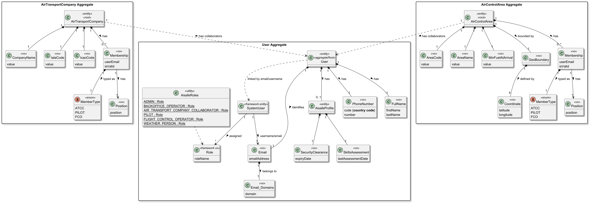
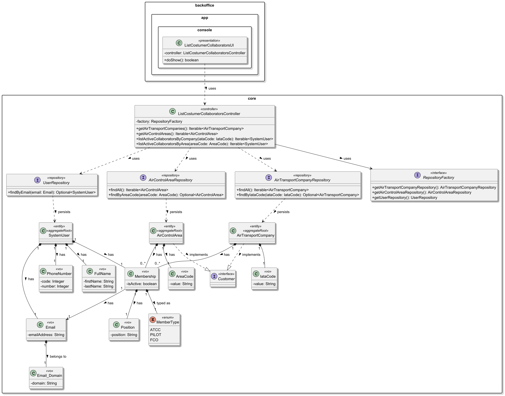
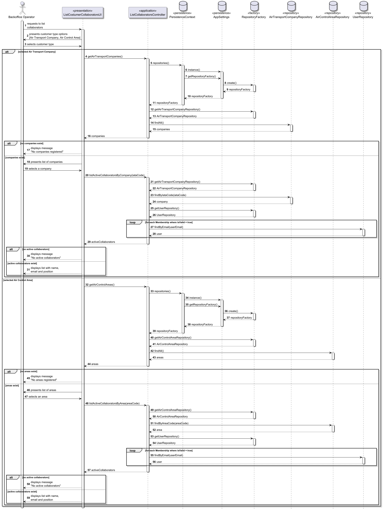

# US062 - List costumer’s collaborators

## 1. Context

* As a Backoffice Operator, I want to list all collaborators of a given customer. It should not list disabled collaborators.
* This task is being developed for the first time in sprint 2 and it has dependencies with the following requirements:
  * US050 - Register an Air Control Area
  * US060 - Register an Air Transport Company
  * US061 - Add a Customer's Collaborator

### 1.1 List of issues

**Main Issue:** Issue #54

**Analysis:** Issue #77

**Design:** Issue #84

**Implement:** Issue #106

## 2. Requirements

**US062** As a Backoffice Operator, I want to list all collaborators of a given customer. It should not list disabled collaborators.

### Acceptance Criteria:

- **US062.1** The Backoffice Operator must first select the customer type (Air Transport Company or Air Control Area) before selecting a specific customer.
- **US062.2** After selecting the customer type, the system must present the list of all existing customers of that type for the operator to select one.
- **US062.3** The selected customer must already exist in the system. If no customers of the selected type exist, the system must display an appropriate message.
- **US062.4** Only active collaborators must be listed — those with `isValid = true` in their membership. Disabled collaborators must not appear in the listing.
- **US062.5** The list must include at least the collaborator's name, email and position.
- **US062.6** If the selected customer has no active collaborators, the system must display an appropriate message indicating the list is empty.

### Dependencies/References:

Regarding this requirement, we understand that it relates to:

- **US050 - Register an Air Control Area**: an air control area must exist before its collaborators can be listed.
- **US060 - Register an Air Transport Company**: an air transport company must exist before its collaborators can be listed.
- **US061 - Add a Customer's Collaborator**: collaborators registered via US061 will be listed through this US.
- **US064 - Disable Customer's Collaborator**: collaborators disabled via US064 have `isValid = false` and must not appear in this listing.
- **Section 3.1.3** describes the air transport company and its collaborators; **section 3.1.4** describes flight control entities and their operators (FCOs).

## 3. Analysis

The listing of collaborators is always scoped to a specific customer.
The Backoffice Operator first selects the customer type, then selects a specific customer from the presented list, and finally sees all active collaborators of that customer.

The filtering of active collaborators is done through the `isValid` field present in both `CompanyMembership` (for Air Transport Companies) and `AreaMembership` (for Air Control Areas).



| Attribute  | Description                                                            | Constraints                                        |
|------------|------------------------------------------------------------------------|----------------------------------------------------|
| Name       | Full name of the collaborator                                          | Displayed in the listing                           |
| Email      | Email address used as the system user identifier                       | Displayed in the listing                           |
| Position   | Role/title within the customer organisation                            | Displayed in the listing                           |
| isValid    | Whether the collaborator is active or disabled                         | Only collaborators with isValid = true are listed  |
| Customer   | The customer (company or air control area) the collaborator belongs to | Used to filter the listing                         |
| MemberType | Role assigned in the system (ATCC/PILOT or FCO)                        | Derived from customer type                         |

**Key business rules:**
- The Backoffice Operator must first select the customer type — Air Transport Company or Air Control Area.
- After selecting the type, the system presents all existing customers of that type for selection.
- Only active collaborators are listed — those with `isValid = true` in `CompanyMembership` or `AreaMembership`.
- Disabled collaborators (`isValid = false`) are excluded from the result.
- If the selected customer has no active collaborators, the system displays an appropriate empty state message.

**Relationship with the domain:**
This US is a pure query operation — it does not create or modify any aggregate. For Air Transport Companies, it reads the `Membership` list within the `AirTransportCompany` aggregate, filtering by `isActive = true`. For Air Control Areas, it reads the `Membership` list within the `AirControlArea` aggregate, filtering by `isActive = true`. In both cases, the `Email` reference in the `Membership` is used to retrieve the collaborator's details from the `SystemUser` aggregate.

## 4. Design

### 4.1. Realization

The design of the solution for this requirement is based on the following class diagram:



The following sequence diagram illustrates the realization of US062 — List Customer's Collaborators:



**Main classes and responsibilities:**

- `AirTransportCompany` → Aggregate Root holding `Membership` list filtered by `isActive = true`
- `AirControlArea` → Aggregate Root holding `Membership` list filtered by `isActive = true`
- `SystemUser` → Aggregate Root providing collaborator details (name, email) retrieved via `Email` reference in `Membership`
- `Membership` → Value Object holding `isActive` flag and `Email` reference used to filter active collaborators and retrieve user details
- `Customer` → Interface implemented by both `AirTransportCompany` and `AirControlArea` to support polymorphism
- `AirTransportCompanyRepository` → Persistence interface to retrieve all companies and find a specific one by IATA code
- `AirControlAreaRepository` → Persistence interface to retrieve all areas and find a specific one by area code
- `UserRepository` → Persistence interface to retrieve collaborator details by email
- `ListCostumerCollaboratorsController` → Orchestrates the use case, retrieves customers and filters active collaborators
- `ListCostumerCollaboratorsUI` → Console UI in `aisafe.app.backoffice.console` that presents options and delegates to the controller

### 4.2. Acceptance Tests

Since this US is a pure query operation, the unit tests focus on
the filtering logic of the `Membership` value object.

---

**Test 1:** Verifies that a `Membership` with `isActive = true`
is considered active.

**Refers to Acceptance Criteria:** US062.4

```java
@Test
public void ensureActiveMembershipIsActive() {
    // Arrange
    Email email = new Email("joao@tap.pt");
    MemberType type = MemberType.ATCC;
    Position position = new Position("Manager");

    // Act
    Membership membership = new Membership(email, type, position, true);

    // Assert
    assertTrue(membership.isActive());
}
```

---

**Test 2:** Verifies that a `Membership` with `isActive = false`
is not considered active.

**Refers to Acceptance Criteria:** US062.4

```java
@Test
public void ensureDisabledMembershipIsNotActive() {
    // Arrange
    Email email = new Email("joao@tap.pt");
    MemberType type = MemberType.ATCC;
    Position position = new Position("Manager");

    // Act
    Membership membership = new Membership(email, type, position, false);

    // Assert
    assertFalse(membership.isActive());
}
```

---

**Test 3:** Verifies that a `Membership` cannot be created with
a null `Email`.

**Refers to Acceptance Criteria:** US062.4

```java
@Test
public void ensureMembershipCannotHaveNullEmail() {
    // Arrange
    Email nullEmail = null;
    MemberType type = MemberType.ATCC;
    Position position = new Position("Manager");

    // Act & Assert
    assertThrows(IllegalArgumentException.class, () -> {
        new Membership(nullEmail, type, position, true);
    });
}
```

---

**Test 4:** Verifies that a `Membership` cannot be created with
a null `MemberType`.

**Refers to Acceptance Criteria:** US062.4

```java
@Test
public void ensureMembershipCannotHaveNullMemberType() {
    // Arrange
    Email email = new Email("joao@tap.pt");
    MemberType nullType = null;
    Position position = new Position("Manager");

    // Act & Assert
    assertThrows(IllegalArgumentException.class, () -> {
        new Membership(email, nullType, position, true);
    });
}
```

---

**Test 5:** Verifies that a `Position` cannot be created with
an empty value.

**Refers to Acceptance Criteria:** US062.5

```java
@Test
public void ensurePositionCannotBeEmpty() {
    // Arrange
    String emptyValue = "";

    // Act & Assert
    assertThrows(IllegalArgumentException.class, () -> {
        new Position(emptyValue);
    });
}
```

---

**Test 6:** Verifies that a `Position` cannot be created with
a null value.

**Refers to Acceptance Criteria:** US062.5

```java
@Test
public void ensurePositionCannotBeNull() {
    // Arrange
    String nullValue = null;

    // Act & Assert
    assertThrows(IllegalArgumentException.class, () -> {
        new Position(nullValue);
    });
}
```

## 5. Implementation

The implementation follows the design presented in section 4 and enforces the listing flow through application and presentation layers, using existing domain/repository contracts.

### 5.1 Evidence of implementation aligned with design

The following evidences show that the implementation matches the planned architecture (`UI -> controller -> repositories -> domain`):

1. **Use case orchestration and authorization in application layer**

   - `ListCostumerCollaboratorsController` enforces access control using `AuthorizationGuardService` and allows only `BACKOFFICE_OPERATOR`.
   - The controller exposes two query entry points:
     - `listActiveCollaboratorsByCompany(iataCode)`
     - `listActiveCollaboratorsByArea(areaCode)`
   - Customer retrieval is done through repositories (`AirTransportCompanyRepository` and `AirControlAreaRepository`) resolved via `PersistenceContext`.

2. **Active collaborator filtering logic**

   - Filtering is executed over `Membership` collections in `AirTransportCompany` and `AirControlArea`.
   - Only memberships with `isActive = true` are included.
   - For each active membership, collaborator details are resolved in `UserRepository` by email.
   - The resulting projection includes exactly what is required by the acceptance criteria: `name`, `email`, `position`.

3. **Console UI flow aligned with sequence design**

   - `ListCostumerCollaboratorsUI` first asks the operator to choose customer type (company or area).
   - After type selection, the UI lists available customers and asks for one selection.
   - The UI handles empty states:
     - no companies/areas registered;
     - no active collaborators for selected customer.
   - When collaborators exist, the UI prints a table with name, email and position.

4. **Menu integration in backoffice console**

   - A new menu action `ListCostumerCollaboratorsAction` was added.
   - `MainMenu` now includes `List customer collaborators` in `Operations` for backoffice users.

### 5.2 Relevant artifacts

The main files required to understand this implementation are:

- **Application/use case layer**
  - `aisafe.core/src/main/java/aiSafe/costumermanagement/application/ListCostumerCollaboratorsController.java` (includes nested `ActiveCollaborator` pairing `User` + `Membership`, matching SD-ListCostumerCollaborator)
- **Presentation layer (backoffice console)**
  - `aisafe.app.backoffice.console/src/main/java/aiSafe/app/backoffice/console/presentation/costumermanagement/ListCostumerCollaboratorsUI.java`
  - `aisafe.app.backoffice.console/src/main/java/aiSafe/app/backoffice/console/presentation/costumermanagement/ListCostumerCollaboratorsAction.java`
  - `aisafe.app.backoffice.console/src/main/java/aiSafe/app/backoffice/console/presentation/MainMenu.java`
- **Domain and repositories reused by this US**
  - `aisafe.core/src/main/java/aiSafe/costumermanagement/domain/Membership.java`
  - `aisafe.core/src/main/java/aiSafe/airtransportcompany/domain/AirTransportCompany.java`
  - `aisafe.core/src/main/java/aiSafe/aircontrolarea/domain/AirControlArea.java`
  - `aisafe.core/src/main/java/aiSafe/airtransportcompany/repositories/AirTransportCompanyRepository.java`
  - `aisafe.core/src/main/java/aiSafe/aircontrolarea/repositories/AirControlAreaRepository.java`
  - `aisafe.core/src/main/java/aiSafe/usermanagement/repositories/UserRepository.java`

### 5.3 Major commits (summary)

The following commits are the major milestones related to this requirement:

- `84749a8` - US062 design artifacts: class diagram, sequence diagram and domain model excerpt.
- `0e99702` - US062 diagram exports (PNG) update for documentation consistency.
- `9cf93a3` - US062 main implementation: list customer collaborators flow in application and backoffice UI.

> Note: there may be additional local refinements in the working tree (not yet committed), including output formatting improvements.

## 6. Integration/Demonstration

### 6.1. Architectural Integration

This functionality integrates with the same layered architecture used by other use cases:

- The controller is implemented in `aisafe.core` and uses `PersistenceContext` / `RepositoryFactory` to stay persistence-agnostic.
- Existing aggregates (`AirTransportCompany`, `AirControlArea`) and value object (`Membership`) are reused without introducing write side-effects (pure query operation).
- Collaborator identity is resolved via `UserRepository` using the membership email.
- The use case is exposed in the console through a dedicated UI/action pair and integrated in `MainMenu`.

### 6.2. Integration Points

| Layer        | Component                                                                                     | Role                                                          |
|--------------|-----------------------------------------------------------------------------------------------|---------------------------------------------------------------|
| Domain       | `AirTransportCompany`, `AirControlArea`, `Membership`                                        | Source of collaborator memberships and active flag            |
| Application  | `ListCostumerCollaboratorsController` (`ActiveCollaborator`)                                 | Use case orchestration; pairs each active `Membership` with `User` from `findByEmail` |
| Persistence  | `AirTransportCompanyRepository`, `AirControlAreaRepository`, `UserRepository`                | Customer retrieval and collaborator lookup by email           |
| Infrastructure | `PersistenceContext` / `RepositoryFactory`                                                  | Runtime repository resolution                                 |
| Presentation | `ListCostumerCollaboratorsUI`, `ListCostumerCollaboratorsAction`, `MainMenu`                | Backoffice interaction flow and operation entry point         |

### 6.3. How to Demonstrate

1. Start the Backoffice console application.
2. Log in with a user that has role `BACKOFFICE_OPERATOR`.
3. Navigate to `Operations > List customer collaborators`.
4. Choose customer type:
   - `1 - Air Transport Company`, or
   - `2 - Air Control Area`.
5. Select one customer from the list shown by the UI.
6. Validate outcomes:
   - if no customers exist for the selected type, the UI displays the corresponding empty message;
   - if customer has no active collaborators, the UI displays `No active collaborators.`;
   - otherwise, the UI prints the list with `name`, `email` and `position`.

## 7. Observations

### 7.1. Architectural Decisions

This implementation follows the project's DDD and layered architecture conventions:

- The use case is implemented as a **read-only query** in the application layer, without introducing new persistence contracts.
- Active filtering is centralized in the controller based on `Membership.isActive()`, keeping UI focused on interaction concerns.
- Listing follows the sequence diagram: for each active `Membership`, `UserRepository.findByEmail` loads `User`; the controller returns `ActiveCollaborator` records (`User` + `Membership`) so the UI can format name, email and position without a separate string DTO.

The persistence layer followed the pattern represented below:


### 7.2. Known Limitations and Improvement Opportunities

- Current sorting follows repository iteration order; a future iteration can add explicit ordering (for example by collaborator name).
- The controller currently throws an exception when a membership email exists but corresponding user record is missing; a resilient fallback strategy could be added if required.
- End-to-end automated tests for the UI path can be added in a future iteration to complement domain tests already present for memberships.

### 7.3. Third-party Works

- **EAPLI Framework** - provides `UseCaseController`, repository abstractions, authorization/session support and console UI abstractions used in this implementation.
- **Jakarta Persistence (JPA) / Hibernate** - supports persistence and retrieval of aggregates and embedded memberships used by this listing.
