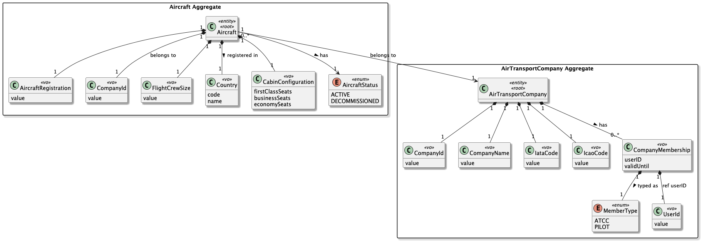

# US072 - List an air transport company’s fleet
## 1. Context

* As an Air Transport Company Collaborator, I want to list my company’s aircraft fleet.
* This task is being developed for the first time in the sprint 2, and it has dependencies with the following requirements:
    * US070 - Add an Aircraft to an Air Transport Company
    * US055 - Create an Aircraft Model
    * US060 - Register an Air Transport Company
  
### 1.1 List of issues

**Main Issue:** Issue #57

**Analysis:** Issue #72

**Design and Unit Tests:** Issue #93

**Implement:** Issue #105

## 2. Requirements

**US072 -** — As an Air Transport Company Collaborator, I want to list my company's aircraft fleet.
* This US also covers four sub-variants:
    * US072a - List fleet filtered by model
    * US072b - List fleet filtered by maker
    * US072c - List fleet filtered by capacity (number of passengers)
    * US072d - List fleet filtered by age

### Acceptance Criteria:

- **US072.1** The system must list all aircraft belonging to a specific Air Transport Company.
- **US072.2** The system must allow filtering aircraft by model.
- **US072.3** The system must allow filtering aircraft by manufacturer (maker).
- **US072.4** The system must allow filtering aircraft by capacity (number of passengers).
- **US072.5** The system must allow filtering aircraft by age.
- **US072.6** If no aircraft match the filter criteria, the system must return an empty list.
- **US072.7** The system must ensure that only aircraft belonging to the selected company are listed.


### Dependencies/References:

- **US070 - Add an aircraft to an air transport company**
- **US055 - Create an Aircraft Model**
- **US060 - Register an Air Transport Company**
- **Section 3.2** of the requirements document

## 3. Analysis

The functionality focuses on retrieving aircraft entities associated with a company and applying filters dynamically.




| Attribute           | Description                                      |
|---------------------|--------------------------------------------------|
| Aircraft            | Entity representing a company aircraft           |
| CompanyId           | Identifies the owning company                    |
| Model               | Aircraft model                                   |
| Maker               | Manufacturer of the aircraft                     |
| Capacity            | Total passenger capacity                         |
| Age                 | Derived from manufacturing/registration date     |

**Key business rules:**

- Only aircraft belonging to the company can be listed.
- Filters are optional but must be correctly applied when provided.
- Results must reflect real-time data consistency.

**Relationship with the domain:**

The Aircraft aggregate is responsible for representing fleet entities in the system. The AirTransportCompany defines the ownership context through the CompanyId, which is used to scope and filter the aircraft belonging to each company.
Filtering operations (by model, maker, capacity, and age) are performed over the Aircraft aggregate, ensuring that only aircraft belonging to the specified company are returned.

---
## 4. Design

*In these sections, the team should present the solution design that was adopted to solve the requirement. This should include, at least, a diagram of the realization of the functionality (e.g., sequence diagram) and the specification of the main tests used to validate the functionality. A class diagram may be useful to describe the classes involved.*

### 4.1. Realization

The design of the solution for this requirement is based on the following class diagram:


The following sequence diagram illustrates the realization of US072 — List an air transport company’s fleet:


#### Main classes and responsibilities (US072 - List an air transport company’s fleet)

- `Aircraft` → Aggregate Root responsible for representing an aircraft belonging to an Air Transport Company. It provides the core information required for fleet listing and filtering operations, such as model, maker, capacity, and age.
- `AircraftRegistration` → Value Object responsible for uniquely identifying each aircraft through its registration code.
- `CompanyId` → Value Object responsible for identifying the Air Transport Company that owns the fleet being listed.
- `AircraftModel` → Aggregate Root responsible for defining aircraft model information, including its designation and technical characteristics used in filtering by model.
- `Maker` → Entity responsible for representing the manufacturer of aircraft models, used indirectly in fleet filtering by maker.
- `AirTransportCompany` → Aggregate Root responsible for representing the company that owns the aircraft fleet and defining the context for fleet retrieval operations.
- `AircraftRepository` → Repository interface responsible for retrieving aircraft belonging to a specific company and supporting filtering operations required by the US072 variants:
    - by model (US072a)
    - by maker (US072b)
    - by capacity (US072c)
    - by age (US072d)
- `AirTransportCompanyRepository` → Repository interface responsible for retrieving the currently selected Air Transport Company (current session context).
- `ListFleetController` → Application controller responsible for coordinating the fleet listing use case. It retrieves the company context, delegates data retrieval to the repository, and applies the selected filter (model, maker, capacity, or age) according to the user request.
- `ListFleetUI` → Presentation layer responsible for interacting with the Air Transport Company Collaborator, collecting filter criteria (or none), invoking the controller, and presenting the resulting fleet list.

### 4.2. Acceptance Tests

Include here the main tests used to validate the functionality. Focus on how they relate to the acceptance criteria. May be automated or manual tests.

**Test 1:** Verifies that all aircraft belong to a specific Air Transport Company

**Refers to Acceptance Criteria:** US072.1

```java
@Test
public void ensureAircraftBelongToASpecificATC() {
    // Arrange
    when(companyRepository.getCurrentCompany()).thenReturn(company);
    when(aircraftRepository.findByCompany(company.identity())).thenReturn(List.of(aircraftA, aircraftB));

    // Act
    List<Aircraft> fleet = controller.listFleet();

    // Assert
    assertEquals(2, fleet.size());
    assertTrue(fleet.contains(aircraftA));
    assertTrue(fleet.contains(aircraftB));
}
```

---

**Test 2:** Verifies that aircraft can be filtered by model.

**Refers to Acceptance Criteria:** US072.2

```java
@Test
public void ensureFleetCanBeFilteredByModel() {
    // Arrange
    when(companyRepository.getCurrentCompany()).thenReturn(company);
    when(aircraftRepository.findByCompanyAndModel(company.identity(), "A320"))
            .thenReturn(List.of(aircraftA320_1, aircraftA320_2));

    // Act
    List<Aircraft> fleet = controller.listFleetByModel("A320");

    // Assert
    assertEquals(2, fleet.size());
    assertTrue(fleet.stream().allMatch(a -> a.model().designation().equals("A320")));
}
```

---

**Test 3:** Verifies that aircraft can be filtered by maker.

**Refers to Acceptance Criteria:** US072.3

```java
@Test
public void ensureFleetCanBeFilteredByMaker() {
    // Arrange
    when(companyRepository.getCurrentCompany()).thenReturn(company);
    when(aircraftRepository.findByCompanyAndMaker(company.identity(), "Airbus"))
            .thenReturn(List.of(aircraftAirbus1, aircraftAirbus2));

    // Act
    List<Aircraft> fleet = controller.listFleetByMaker("Airbus");

    // Assert
    assertEquals(2, fleet.size());
    assertTrue(fleet.stream().allMatch(a -> a.model().maker().name().equals("Airbus")));
}
```

---

**Test 4:** Verifies that aircraft can be filtered by capacity.

**Refers to Acceptance Criteria:** US072.4

```java
@Test
public void ensureFleetCanBeFilteredByCapacity() {
    // Arrange
    when(companyRepository.getCurrentCompany()).thenReturn(company);
    when(aircraftRepository.findByCompanyAndCapacity(company.identity(), 180))
            .thenReturn(List.of(aircraft180Seats));

    // Act
    List<Aircraft> fleet = controller.listFleetByCapacity(180);

    // Assert
    assertEquals(1, fleet.size());
    assertEquals(180, fleet.get(0).cabinConfiguration().totalSeats());
}
```

---

**Test 5:** Verifies that aircraft can be filtered by age.

**Refers to Acceptance Criteria:** US072.5

```java
@Test
public void ensureFleetCanBeFilteredByAge() {
    // Arrange
    when(companyRepository.getCurrentCompany()).thenReturn(company);
    when(aircraftRepository.findByCompanyAndAge(company.identity(), 10))
            .thenReturn(List.of(aircraft10YearsOld));

    // Act
    List<Aircraft> fleet = controller.listFleetByAge(10);

    // Assert
    assertEquals(1, fleet.size());
    assertEquals(10, fleet.get(0).ageInYears());
}
```

---

**Test 6:** Verifies that an empty list is returned when no aircraft match the filter criteria.

**Refers to Acceptance Criteria:** US072.6

```java
@Test
public void ensureEmptyListIsReturnedWhenNoAircraftMatchFilter() {
    // Arrange
    when(companyRepository.getCurrentCompany()).thenReturn(company);
    when(aircraftRepository.findByCompanyAndModel(company.identity(), "B777"))
            .thenReturn(Collections.emptyList());

    // Act
    List<Aircraft> fleet = controller.listFleetByModel("B777");

    // Assert
    assertNotNull(fleet);
    assertTrue(fleet.isEmpty());
}
```

---

**Test 7:** Verifies that only aircraft belonging to the selected company are listed.

**Refers to Acceptance Criteria:** US072.7

```java
@Test
public void ensureOnlyAircraftFromSelectedCompanyAreListed() {
    // Arrange
    when(companyRepository.getCurrentCompany()).thenReturn(companyA);
    when(aircraftRepository.findByCompany(companyA.identity())).thenReturn(List.of(companyAAircraft));

    // Act
    List<Aircraft> fleet = controller.listFleet();

    // Assert
    assertEquals(1, fleet.size());
    assertEquals(companyA.identity(), fleet.get(0).companyId());
}
```

---
## 5. Implementation

The implementation follows the design presented in section 4 and applies Domain-Driven Design principles across all layers.

### 5.1. Evidence of implementation aligned with design

The following evidence shows that the implementation matches the planned architecture:

1. **Fleet retrieval scoped to a specific company**
    - `ListFleetController` exposes a private helper `resolveCompany(long companyId)` that retrieves the `AirTransportCompany` entity via `AirTransportCompanyRepository.ofIdentity(companyId)`, throwing `IllegalStateException` if not found. All repository calls pass the resolved `AirTransportCompany` object, ensuring that only aircraft belonging to the selected company are returned, satisfying US072.1 and US072.7.

2. **Filtering operations delegated to the repository**
    - The `AircraftRepository` interface exposes dedicated query methods for each filter variant, all scoped to a specific company:
        - `findByCompany(company)` — full fleet (US072.1)
        - `findByCompanyAndModel(company, modelName)` — filter by model (US072a / US072.2)
        - `findByCompanyAndMaker(company, makerName)` — filter by maker (US072b / US072.3)
        - `findByCompanyAndMinCapacity(company, minCapacity)` — filter by minimum capacity (US072c / US072.4)
        - `findByCompanyAndMaxCapacity(company, maxCapacity)` — filter by maximum capacity (US072c / US072.4)
        - `findByCompanyAndMaxAge(company, maxAge)` — filter by maximum age (US072d / US072.5)
    - All methods are implemented in both `JpaAircraftRepository` and `InMemoryAircraftRepository`, ensuring the same behaviour across persistence strategies.

3. **Empty list returned when no aircraft match**
    - All repository query methods return `List<Aircraft>`, never `null`. When no aircraft match the given filter, an empty list is returned and displayed to the collaborator as `"No aircraft found for the selected criteria."`, satisfying US072.6.

4. **Age derived from `RegistrationYear`**
    - Aircraft age is obtained via `Aircraft.age()`, which delegates to `RegistrationYear.age()` — a derived value computed from the current year. This avoids storing age as a persistent field while keeping the domain expressive.

5. **Company selection at the UI level**
    - `ListFleetUI` fetches all available companies via `ListFleetController.availableCompanies()` and presents them to the collaborator before any filter is chosen. The collaborator selects a company by ID, and the UI validates that the chosen ID corresponds to a listed company before proceeding, providing early feedback without an unnecessary controller round-trip.

6. **Fleet display with structured output**
    - The `displayFleet` method in `ListFleetUI` presents results in a tabular format showing registration, model, maker, status, age, and seat breakdown by class (First / Business / Economy), giving the collaborator a complete overview of each aircraft in a single view.

### 5.2. Relevant artifacts and configuration files

The main files required to understand and execute this implementation are:

- **Repository Interface**
    - `aisafe.core/src/main/java/aiSafe/aircraft/repositories/AircraftRepository.java`
- **Application**
    - `aisafe.core/src/main/java/aiSafe/aircraft/application/ListFleetController.java`
- **Presentation**
    - `aisafe.app.backoffice.console/src/main/java/aiSafe/app/backoffice/console/presentation/aircraft/ListFleetUI.java`
    - `aisafe.app.backoffice.console/src/main/java/aiSafe/app/backoffice/console/presentation/aircraft/ListFleetAction.java`
- **Persistence**
    - `aisafe.persistence.impl/src/main/java/aiSafe/persistence/impl/jpa/JpaAircraftRepository.java`
    - `aisafe.persistence.impl/src/main/java/aiSafe/persistence/impl/inmemory/InMemoryAircraftRepository.java`

### 5.3. Major commits (summary)

The following commits are the major milestones related to this requirement:

- `770b84e` — add analysis document for US072 (#72)
- `34469d1` — add sequence diagram for US072 (#93)
- `fc3cd25` — add acceptance tests to US072 README and update class diagram (#93)
- `233d050` — implement ListFleet use case controller (#105)
- `5953401` — add ListFleet UI and action for backoffice console (#105)
---

## 6. Integration/Demonstration

### 6.1. Architectural Integration

This functionality integrates with the system following the same persistence architecture defined for US070. The `AircraftRepository` interface is defined in the core domain module and resolved at runtime via `PersistenceContext`:

- **`persistence.impl.inmemory`** — used for testing, backed by `InMemoryAircraftRepository`, using Java streams to filter aircraft by company, model, maker, capacity, and age.
- **`persistence.impl.jpa`** — used in production, backed by `JpaAircraftRepository`, using JPQL predicates to filter aircraft by the same criteria at the database level.

This use case is read-only — no aggregate state is modified. The `ListFleetController` only queries repositories and returns results to the UI, which is responsible solely for presentation.

### 6.2. Integration Points

| Layer                    | Component                                                | Role                                                                          |
|--------------------------|----------------------------------------------------------|-------------------------------------------------------------------------------|
| Domain                   | `Aircraft`, `AircraftRepository`                         | Aggregate queried for fleet listing and filtering operations                  |
| Domain                   | `AirTransportCompany`, `AirTransportCompanyRepository`   | Provides company context; used to scope all aircraft queries                  |
| Application              | `ListFleetController`                                    | Resolves company, delegates filtered queries to repository, returns results   |
| Persistence (JPA)        | `JpaAircraftRepository`                                  | Executes JPQL queries filtered by company, model, maker, capacity, or age     |
| Persistence (InMemory)   | `InMemoryAircraftRepository`                             | Executes stream-based filtering for tests and bootstrap dry-runs              |
| Infrastructure           | `PersistenceContext`                                     | Resolves repository instances used by the controller                          |
| Presentation             | `ListFleetAction`                                        | Menu action that delegates execution to `ListFleetUI`                         |
| Presentation             | `ListFleetUI`                                            | Console UI — lists companies, collects filter choice, displays fleet table    |

### 6.3. How to Demonstrate

1. Start the application using the Backoffice console module.
2. Log in with a user holding the `BACKOFFICE_OPERATOR` role.
3. Navigate to `Operations > Fleet Management > List Aircraft Fleet`.
4. The UI (`ListFleetUI`) lists all available companies with their IDs and names. The collaborator enters the desired company ID.
5. The UI presents the following filter options:
    - `1` — No filter (full fleet)
    - `2` — By aircraft model name
    - `3` — By maker name
    - `4` — By minimum number of seats
    - `5` — By maximum number of seats
    - `6` — By maximum age in years
6. After selecting a filter and providing the required input, the controller queries the repository and the UI displays the results in a tabular format with columns: Registration, Model, Maker, Status, Age, and Seats (F/J/Y).
7. If no aircraft match the selected criteria, the system displays `"No aircraft found for the selected criteria."`, satisfying US072.6.

---

## 7. Observations

### 7.1. Architectural Decisions

The filtering operations were deliberately placed in the `AircraftRepository` interface rather than implemented as in-memory stream filters at the controller level. This ensures that JPA-backed queries benefit from database-level filtering, avoiding the need to load the entire fleet into memory before applying criteria — an important consideration for companies with large fleets.

The `ListFleetController` resolves the `AirTransportCompany` entity before every repository call via `resolveCompany(companyId)`, passing the full entity rather than a raw identifier. This keeps the repository interface expressive and type-safe, avoiding primitive obsession at the persistence boundary.

The capacity filter was split into two separate variants — minimum capacity (`findByCompanyAndMinCapacity`) and maximum capacity (`findByCompanyAndMaxCapacity`) — rather than a single range query, to keep the UI interaction simple and each filter option independently usable. A combined range filter could be a future improvement.

An alternative considered was to expose a single generic `findByCompanyWithFilters(company, filters)` method accepting a criteria object. This was rejected in favour of explicit, named methods that make the repository contract self-documenting and easier to test individually.

### 7.2. Third-party Works

- **EAPLI Framework** — provides the base infrastructure for `AggregateRoot`, `DomainRepository`, `InMemoryDomainRepository`, `JpaAutoTxRepository`, `AbstractUI`, `Console`, and `Action` used throughout this implementation.
- **Jakarta Persistence (JPA) / Hibernate** — used for ORM mapping of the `Aircraft` entity and JPQL-based filtering queries in `JpaAircraftRepository`.