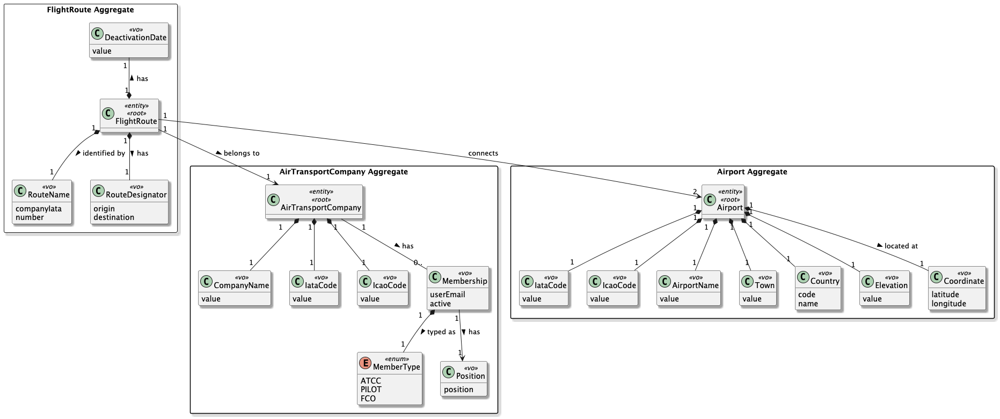
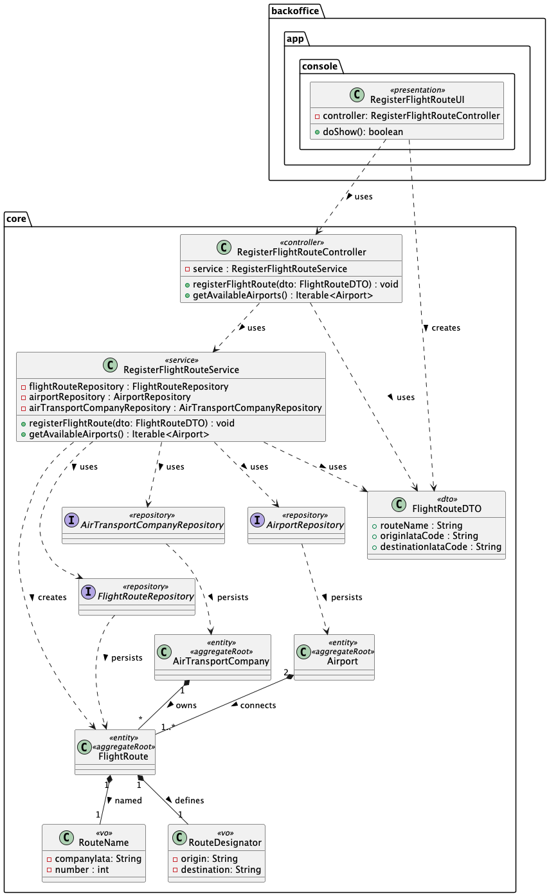
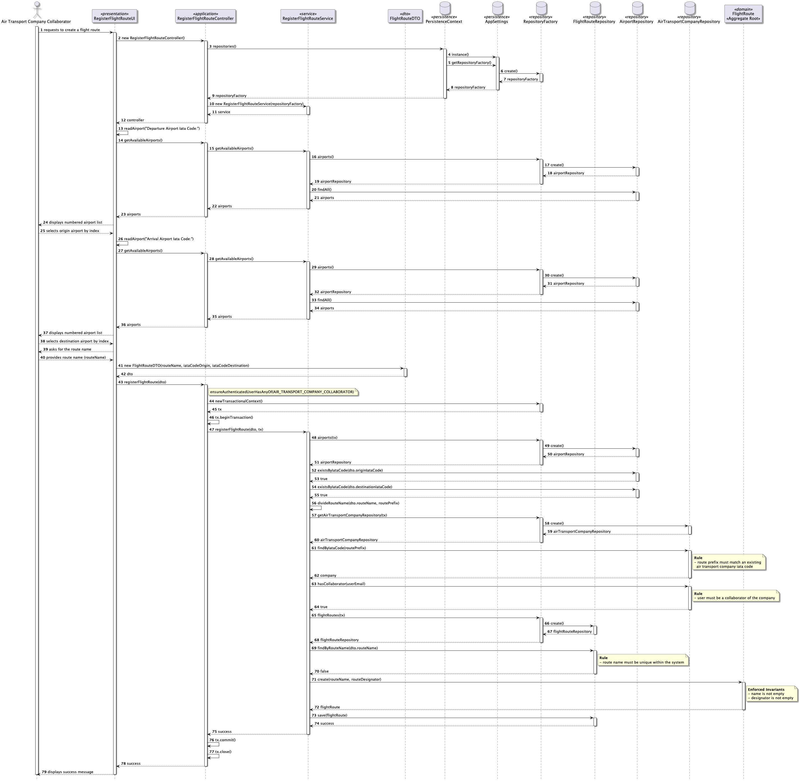

# US073 - Create a Flight Route

## 1. Context

* As an Air Transport Company Collaborator, I want to add a flight route for my company. A route is defined between two airports (start and end) and has a name composed of 2 letters (the company's initials) followed by up to 4 numbers (e.g. TP123). The route's name must be unique.
* This user story is a necessary dependency for flight creation, as a flight must be associated with a route. It is also a prerequisite for US074 (Delete a flight route), since a route must exist before it can be deactivated.

### 1.1 List of issues

**Main Issue:** Issue #125

**Analysis:** Issue #141

**Design:** Issue #142

**Implement:** Issue #149

## 2. Requirements

**US073 —** As an Air Transport Company Collaborator, I want to add a flight route for my company. A route is between two airports (start and end) and has a name with 2 letters (the company's initials) and up to 4 numbers (e.g. TP123). The route's name must be unique.

### 2.1 Acceptance Criteria

- **US073.1** The system must ensure that the route name is unique. Attempting to register a duplicate route name must be rejected with an appropriate error message.
- **US073.2** The route must include the following attributes: route name, origin airport, and destination airport.
- **US073.3** All mandatory fields must be provided. The system must reject incomplete registrations.
- **US073.4** The route name must follow the defined format: 2 letters (company initials) followed by up to 4 numeric digits (e.g. TP123). Names that do not conform to this format must be rejected.
- **US073.5** The origin and destination airports must exist in the system. Attempting to create a route with an unregistered airport must be rejected with an appropriate error message.
- **US073.6** The collaborator can only create routes for their own company.

### 2.2 Dependencies/References

Regarding this requirement, we understand that it relates to:

- **US052 — Create an Airport**: origin and destination airports must already exist in the system before a route can be created between them.
- **US060 — Register an Air Transport Company**: the collaborator creating the route must belong to a registered air transport company, whose initials will prefix the route name.
- **US074 — Delete a Flight Route**: once a route exists, it can be deactivated from a given date onwards, provided no future flights are planned on it.
- **US080 — Create a Flight Plan**: a flight plan must be associated with an existing route, so routes must be created before flights.

---

## 3. Analysis

The domain model for a Flight Route must capture the following attributes:



| Attribute                | Description                                                                         | Constraints                                                              |
|--------------------------|-------------------------------------------------------------------------------------|--------------------------------------------------------------------------|
| Route Name               | Identifier of the route, composed of company initials + up to 4 digits (e.g. TP123) | Unique in the system; must match format `[A-Z]{2}[0-9]{1,4}`             |
| Origin Airport           | The departure airport of the route                                                  | Must reference an existing airport in the system                         |
| Destination Airport      | The arrival airport of the route                                                    | Must reference an existing airport; must differ from origin              |
| Air Transport Company    | The company that owns the route                                                     | Must match the authenticated collaborator's company                      |
| Active                   | Whether the route is currently active                                               | Defaults to `true` upon creation; set to `false` on deactivation (US074) |

### Key Business Rules

- The route name must be **unique** across all registered routes in the system.
- The name format is strictly enforced: exactly **2 uppercase letters** (the company's IATA initials) followed by **1 to 4 digits**.
- A collaborator may only create routes **under their own company** — cross-company route creation
  is forbidden.
- **Origin and destination airports must be distinct.**

### Relationship with the Domain

A `FlightRoute` is an aggregate that references an `AirTransportCompany` and two `Airport` instances (origin and destination). It can later be associated with `FlightPlan` instances. A route  can be deactivated, and it is only possible if no future flights are planned on it (handled in US074).
 
---

## 4. Design

### 4.1 Realization

The design follows the same layered DDD architecture used throughout the project. The `FlightRoute` aggregate is defined in the core domain module.

The use case is split across two application-layer components:

- **`RegisterFlightRouteController`** — thin orchestrator responsible for bridging the UI (or any other entry point) with the service. It holds no business logic.
- **`RegisterFlightRouteService`** — owns all business logic: validating airports, checking company ownership, enforcing route name uniqueness, and creating the aggregate.

Input and output are carried via **`FlightRouteDTO`**, a plain data object with no domain dependencies. This design decision was made to support multiple entry points for the same use case — concretely, the console UI (EAPLI) and the TCP client (RCOMP / US078) — without duplicating any business logic. Both entry points construct a `FlightRouteDTO` and call the same service:

```
ConsoleUI      → RegisterFlightRouteController → RegisterFlightRouteService → Repository
TCP Handler    → RegisterFlightRouteController → RegisterFlightRouteService → Repository
```

The following class diagram illustrates the main components involved:



The following sequence diagram illustrates the realization of US073 — create a new flight route:



### 4.2 Acceptance Tests

For all test cases, a common setup creates a valid `AirTransportCompany` instance and two valid `Airport` instances, used as origin and destination. These are initialized in a `setUp()` method annotated with `@BeforeEach`.
 
---

**Test 1:** Verifies that two routes with the same name are considered equal (duplicate detection).

**Refers to Acceptance Criteria:** US073.1

```java
@Test
void ensureTwoRoutesWithSameNameAreEqual() {
    // Arrange
    RouteName name = RouteName.valueOf("TP", 123);
    RouteDesignator designator = RouteDesignator.valueOf("OPO", "LIS");
    final var route1 = new FlightRoute(name, designator);
    final var route2 = new FlightRoute(name, designator);

    // Act & Assert
    assertTrue(route1.sameAs(route2), "Two FlightRoutes with the same name should be considered the same");
}
```

---

**Test 2:** Verifies that a route is created successfully when all mandatory fields are valid.

**Refers to Acceptance Criteria:** US073.2, US073.3

```java
@Test
void ensureFlightRouteIsCreatedSuccessfully() {
    // Arrange
    RouteName name = RouteName.valueOf("TP", 123);
    RouteDesignator designator = RouteDesignator.valueOf("OPO", "LIS");
 
    // Act
    final var route = new FlightRoute(name, designator);
 
    // Assert
    assertNotNull(route, "FlightRoute should be created successfully with valid attributes");
}
```
 
---

**Test 3:** Verifies that creating a route with a null name is rejected.

**Refers to Acceptance Criteria:** US073.3

```java
@Test
void ensureRouteNameCannotBeNull() {
    // Arrange
    RouteDesignator designator = RouteDesignator.valueOf("OPO", "LIS");
    
    // Act & Assert
    assertThrows(IllegalArgumentException.class, () -> new FlightRoute(null, designator));
}
```
 
---

**Test 4:** Verifies that a route name not matching the required format is rejected.

**Refers to Acceptance Criteria:** US073.4

```java
@Test
void ensureRouteNameMustFollowFormat() {
    // Arrange
    String invalidRouteName = "INVALID_NAME";
    int invalidRouteNumber = 12345; 
    
    // Act & Assert
    assertThrows(IllegalArgumentException.class, () -> RouteName.valueOf(invalidRouteName, invalidRouteNumber));
}
```
 
---

**Test 5:** Verifies that origin and destination airports cannot be the same.

**Refers to Acceptance Criteria:** US073.5

```java
@Test
void ensureOriginAndDestinationCannotBeTheSame() {
    // Arrange
    String origin = "OPO";
    String destination = "OPO";
 
    // Act & Assert
    assertThrows(IllegalArgumentException.class, () -> new RouteDesignator(origin, destination));
}
```
 
---

**Test 6:** Verifies that creating a route with a null origin airport is rejected.

**Refers to Acceptance Criteria:** US073.3, US073.5

```java
@Test
void ensureOriginAirportCannotBeNull() {
    // Arrange
    String nullOrigin = null;
    String destination = "LIS";
 
    // Act & Assert
    assertThrows(IllegalArgumentException.class, () -> new RouteDesignator(nullOrigin, destination));
}
```
 
---

**Test 7:** Verifies that creating a route with a null destination airport is rejected.

**Refers to Acceptance Criteria:** US073.3, US073.5

```java
@Test
void ensureDestinationAirportCannotBeNull() {
    // Arrange
    String origin = "OPO";
    String nullDestination = null;
 
    // Act & Assert
    assertThrows(IllegalArgumentException.class, () -> new RouteDesignator(origin, nullDestination));
}
```
 
---

## 5. Implementation

The implementation follows the design presented in section 4 and applies Domain-Driven Design principles across all layers.

### 5.1. Evidence of implementation aligned with design

The following evidence shows that the implementation matches the planned architecture:

1. **Domain invariants enforced at construction**
   - `FlightRoute` validates that `RouteName` and `RouteDesignator` are not null and that the route name is non-empty.
   - `RouteName` enforces exactly 2 uppercase letters for the prefix and a numeric suffix between 1 and 9999.
   - `RouteDesignator` enforces non-empty 3-letter IATA codes and rejects equal origin/destination.
   - New routes are created with `active = true` by default.
   These validations satisfy **US073.2**, **US073.3**, and **US073.4**.

2. **Value objects for route attributes**
   - `RouteName` and `RouteDesignator` are embedded value objects (`@Embeddable`) persisted as part of the `FlightRoute` aggregate.
   - `sameAs` on `FlightRoute` compares instances by `RouteName`, supporting duplicate detection at domain level (**US073.1**).

3. **Uniqueness enforced at application and database levels**
   - Application level: `RegisterFlightRouteService` calls `flightRouteRepository.findByRouteName(...)` before persisting and throws `IllegalStateException` when a duplicate exists.
   - Database level: `FlightRoute` declares `@UniqueConstraint(columnNames = {"route_prefix", "route_number"})`.
   These mechanisms satisfy **US073.1**.

4. **Airport existence validated before persistence**
   - `RegisterFlightRouteService` checks `airportRepository.existsByIataCode(...)` for both origin and destination before creating the aggregate.
   - Invalid or missing airports result in `IllegalArgumentException` with a descriptive message.
   This satisfies **US073.5**.

5. **Company ownership enforced for collaborators**
   - The route prefix is derived from the route name and matched against `AirTransportCompanyRepository.findByIataCode(...)`.
   - `airTransportCompany.hasCollaborator(userEmail)` ensures the authenticated user belongs to the company identified by the prefix.
   - Unauthorized users receive `IllegalStateException`.
   This satisfies **US073.6**.

6. **Role-based access control**
   - `RegisterFlightRouteController` calls `authz.ensureAuthenticatedUserHasAnyOf(AisafeRoles.AIR_TRANSPORT_COMPANY_COLLABORATOR)` before executing any logic.
   - The console menu exposes the feature only to users with the same role (`MainMenu` → `Operations > Register flight route`).

7. **Layered orchestration with shared business logic**
   - `RegisterFlightRouteController` is a thin `@UseCaseController` that delegates to `RegisterFlightRouteService`.
   - Input is carried through `FlightRouteDTO`, keeping presentation decoupled from domain types.
   - The service wraps persistence in a `TransactionalContext` with explicit `commit` / `rollback`, ensuring atomic registration.

8. **Application-level acceptance tests**
   - `RegisterFlightRouteControllerTest` covers the full use-case flow with mocked repositories and authorization, including happy path, airport validation, name format boundaries, company/collaborator checks, uniqueness, transaction rollback, and role enforcement.

### 5.2. Relevant artifacts and configuration files

The main files required to understand and execute this implementation are:

- **Domain**
  - `aisafe.core/src/main/java/aiSafe/flightRoute/domain/FlightRoute.java`
  - `aisafe.core/src/main/java/aiSafe/flightRoute/domain/RouteName.java`
  - `aisafe.core/src/main/java/aiSafe/flightRoute/domain/RouteDesignator.java`
  - `aisafe.core/src/main/java/aiSafe/flightRoute/domain/dto/FlightRouteDTO.java`
- **Repository contract (core)**
  - `aisafe.core/src/main/java/aiSafe/flightRoute/repositories/FlightRouteRepository.java`
- **Application**
  - `aisafe.core/src/main/java/aiSafe/flightRoute/application/RegisterFlightRouteController.java`
  - `aisafe.core/src/main/java/aiSafe/flightRoute/application/RegisterFlightRouteService.java`
- **Presentation**
  - `aisafe.app.backoffice.console/src/main/java/aiSafe/app/backoffice/console/presentation/flightRoute/RegisterFlightRouteAction.java`
  - `aisafe.app.backoffice.console/src/main/java/aiSafe/app/backoffice/console/presentation/flightRoute/RegisterFlightRouteUI.java`
  - `aisafe.app.backoffice.console/src/main/java/aiSafe/app/backoffice/console/presentation/MainMenu.java`
- **Persistence**
  - `aisafe.persistence.impl/src/main/java/aiSafe/persistence/impl/jpa/JpaFlightRouteRepository.java`
  - `aisafe.persistence.impl/src/main/java/aiSafe/persistence/impl/inmemory/InMemoryFlightRouteRepository.java`
  - `aisafe.core/src/main/java/aiSafe/infrastructure/persistence/RepositoryFactory.java`
  - `aisafe.persistence.impl/src/main/java/aiSafe/persistence/impl/inmemory/InMemoryRepositoryFactory.java`
  - `aisafe.persistence.impl/src/main/java/aiSafe/persistence/impl/jpa/JpaRepositoryFactory.java`
  - `aisafe.persistence.impl/src/main/resources/META-INF/persistence.xml`
- **Tests**
  - `aisafe.core/src/test/java/aiSafe/flightRoute/domain/FlightRouteTest.java`
  - `aisafe.core/src/test/java/aiSafe/flightRoute/domain/RouteNameTest.java`
  - `aisafe.core/src/test/java/aiSafe/flightRoute/domain/RouteDesignatorTest.java`
  - `aisafe.core/src/test/java/aiSafe/flightRoute/application/RegisterFlightRouteControllerTest.java`
- **Bootstrap**
  - `aisafe.bootstrappers/src/main/java/aiSafe/infrastructure/bootstrap/MasterDataBootstrapper.java`
  - `aisafe.bootstrappers/src/main/java/aiSafe/infrastructure/bootstrap/FlightRouteBootstrap.java`

### 5.3. Major commits (summary)

The following commits are the major milestones related to this requirement:

- `dcbb68b` — add flight route analysis documentation
- `45ecd9f` — add flight route design documentation (class and sequence diagrams)
- `2ce2fb7` — update design documentation with friendlier user input
- `b9f2a87` — update design documentation with `RegisterFlightRouteService` and `FlightRouteDTO`
- `5e42f2c` — implement flight route registration (domain, application, persistence, console UI, and acceptance tests)

## 6. Integration/Demonstration

### 6.1. Architectural Integration

This functionality integrates with the system following the persistence architecture defined for the project. The `FlightRouteRepository` interface is defined in the core module (`flightRoute.repositories`) and resolved at runtime via `PersistenceContext`, which delegates to the active `RepositoryFactory` implementation:

- **`persistence.impl.inmemory`** — used for testing and early development, backed by `InMemoryFlightRouteRepository`.
- **`persistence.impl.jpa`** — used in production, backed by `JpaFlightRouteRepository`, with the `FlightRoute` entity registered in `META-INF/persistence.xml`.

The use case depends on data created by prerequisite user stories:

- **US052** — airports must exist before a route can reference them as origin/destination.
- **US060 / US061** — an air transport company and its collaborator must exist; the route prefix must match the company's IATA code, and the authenticated user must be registered as that company's collaborator.

Downstream features consume registered routes:

- **US074** — deactivates an existing route.
- **US080 / US111** — flight plans and flights are associated with existing routes.

The design also anticipates a TCP entry point reusing `RegisterFlightRouteController` and `FlightRouteDTO`; 

### 6.2. Integration Points

| Layer                  | Component                                             | Role                                                     |
|------------------------|-------------------------------------------------------|:---------------------------------------------------------|
| Domain                 | `FlightRoute`, `RouteName`, `RouteDesignator`         | Aggregate and embedded value objects                     |
| Domain                 | `FlightRouteRepository`                               | Repository interface                                     |
| Domain                 | `FlightRouteDTO`                                      | Input contract shared across entry points                |
| Application            | `RegisterFlightRouteController`                       | Authz + orchestration                                    |
| Application            | `RegisterFlightRouteService`                          | Business rules, transactions, persistence                |
| Persistence (JPA)      | `JpaFlightRouteRepository`                            | Persists to relational DB via JPA                        |
| Persistence (InMemory) | `InMemoryFlightRouteRepository`                       | Used in tests and bootstrap dry-runs                     |
| Infrastructure         | `RepositoryFactory` / `PersistenceContext`            | Resolves the active repository implementation at runtime |
| Bootstrap              | `MasterDataBootstrapper` / `FlightRouteBootstrap`     | Seeds sample routes (TP123, FP134, GG543) at startup     |
| Presentation           | `RegisterFlightRouteUI` / `RegisterFlightRouteAction` | Console entry point under `Operations`                   |

### 6.3. How to Demonstrate

1. Start the Backoffice console application and run the master data bootstrap (if the database is empty), so that airports, air transport companies, and collaborators are available.
2. Log in with the air transport company collaborator bootstrapped by the system:
   - **Username:** `collaborator@aisafe.local`
   - **Password:** `Collaborator123`
3. Navigate to `Operations > Register flight route`.
4. Select an origin airport and a destination airport from the numbered list.
5. Enter a route name whose prefix matches the collaborator's company IATA code (e.g. `TP456` for TAP).
6. Confirm the success message (`Flight route 'TP456' registered successfully.`).
7. Try registering the same route name again and confirm the system rejects it (`A flight route with the same name already exists.`).
8. Try an invalid name (e.g.`TPABC`) or the same origin and destination, and confirm the system displays the corresponding validation error without crashing the menu.

## 7. Observations

### 7.1. Architectural Decisions

The project follows a layered, DDD-based architecture where the repository contract (`XRepository`) is always defined in the core domain module, while concrete implementations (`InMemoryXRepository`, `JpaXRepository`) live in separate modules resolved at runtime by `RepositoryFactory`. This ensures:

- The domain model has **zero dependency** on persistence technology.
- Switching between InMemory and JPA requires only a configuration change, not a code change.

The persistence layer followed the pattern represented below:


The introduction of `RegisterFlightRouteService` and `FlightRouteDTO` follows the same rationale: decoupling the entry point (UI, TCP handler) from the business logic, so that new access channels can be added without touching the domain or duplicating validation rules.

### 7.2. Third-party Works

- **EAPLI Framework** — provides the base infrastructure for `AggregateRoot`, `ValueObject`, `Repository`, `AuthzRegistry`, and console UI rendering used throughout this implementation.
- **Jakarta Persistence (JPA) / Hibernate** — used for ORM mapping of the `FlightRoute` entity and its embedded value objects.