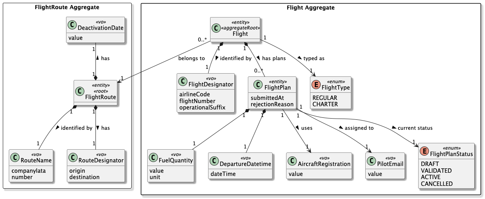
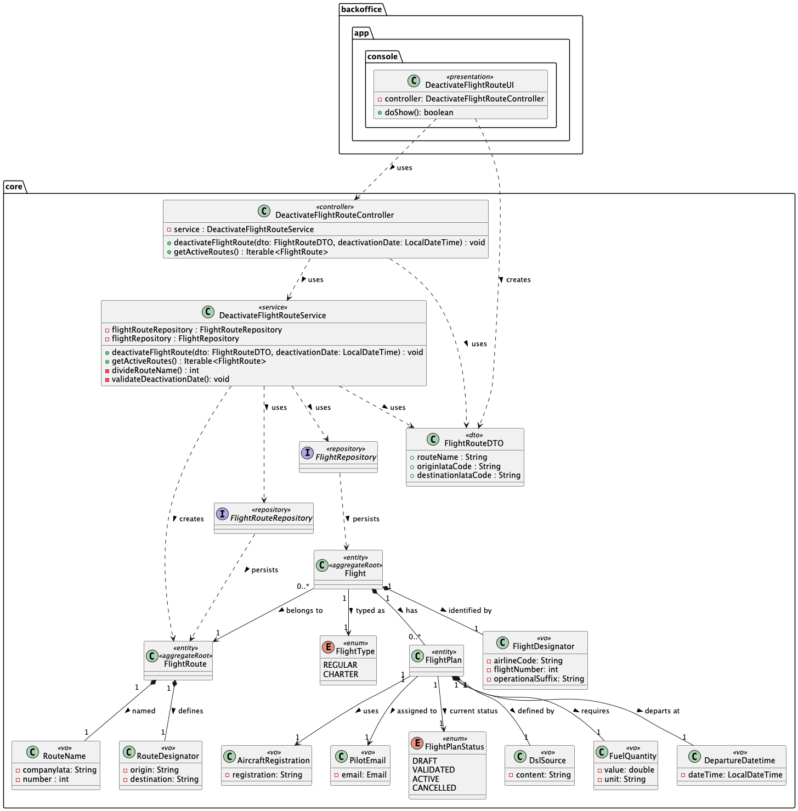
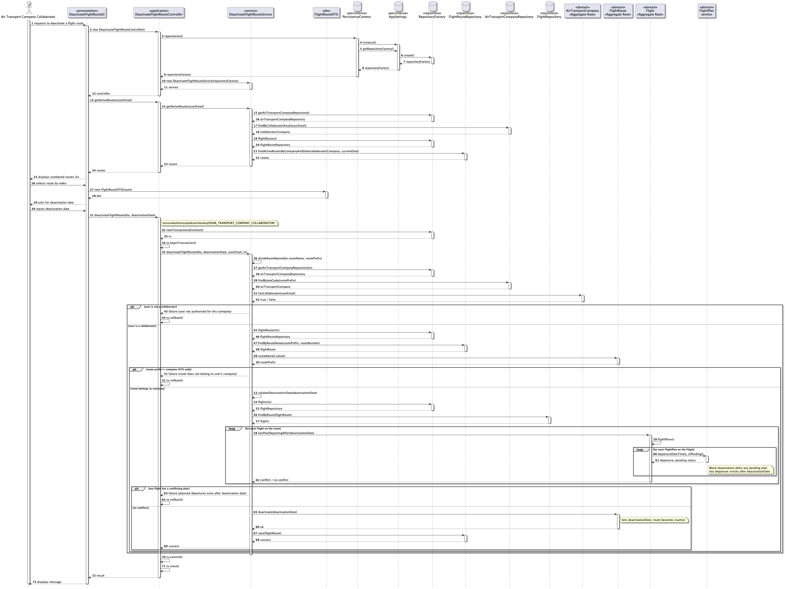
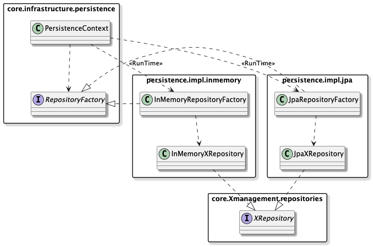

# US074 - Delete (Deactivate) a Flight Route

## 1. Context

* As an Air Transport Company Collaborator, I want to deactivate a flight route from a given date onwards, so that no more flights can be planned on that route after that date.
* The system must prevent deactivation of a flight route if there are already planned flights scheduled after the given deactivation date.
* This user story is directly related to the flight management module developed in EAPLI.

It is also dependent on:

* US073 — Create a Flight Route
* US080 — Create a Flight Plan

### 1.1 List of issues

**Main Issue:** Issue #156

**Analysis:** Issue #157

**Design:** Issue #158

**Implement:** Issue #159

---

## 2. Requirements

**US074** — As an Air Transport Company Collaborator, I want to deactivate a flight route from a given date onwards.

### 2.1 Acceptance Criteria

* **US074.1** The system must allow an Air Transport Company Collaborator to deactivate a flight route by specifying a deactivation date.
* **US074.2** After deactivation, no new flights may be created on the deactivated route.
* **US074.3** A flight route cannot be deactivated if there are planned flights scheduled after the specified deactivation date.
* **US074.4** The deactivation date must be valid (present or future).
* **US074.5** A collaborator may only deactivate routes belonging to their own Air Transport Company.
* **US074.6** Previously created flights on the route that are scheduled before the deactivation date remain unaffected.

### 2.2 Dependencies/References

Regarding this requirement, we understand that it relates to:

* **US073 — Create a Flight Route**: a route must exist before it can be deactivated; this US manages the lifecycle of the entity created in US073.
* **US080 — Create a Flight Plan**: flight plans are created against a route; the existence of planned flights after the deactivation date blocks the deactivation operation.

---

## 3. Analysis

The domain model for a Flight Route deactivation must capture the following attributes:



| Attribute         | Description                                                      | Constraints                                         |
|-------------------|------------------------------------------------------------------|-----------------------------------------------------|
| Route             | The flight route to be deactivated                               | Must exist and belong to the collaborator's company |
| Deactivation Date | The date from which the route is considered inactive             | Must be a present or future date                    |
| Route Status      | Indicates whether the route is active or deactivated             | Transitions from `ACTIVE` to `DEACTIVATED`          |
| Planned Flights   | Flights already created on the route after the deactivation date | If any exist, deactivation must be rejected         |

### Key Business Rules

- A route can only be deactivated by a collaborator of the same Air Transport Company that owns the route.
- The deactivation date must be present or future — past dates are not accepted.
- If any flight plan exists on the route with a departure date strictly after the deactivation date, the operation must be rejected with an appropriate message.
- Flights scheduled on or before the deactivation date are not affected and proceed normally.
- Once deactivated, the route cannot be used to create new flight plans.
- The route is not physically deleted from the system — it is marked as deactivated, preserving historical data.

### Relationship with the Domain

`FlightRoute` is an aggregate root within the Air Transport Company bounded context. Deactivation is a lifecycle state transition of this aggregate, governed by an invariant: **a route with planned flights after the deactivation date cannot be deactivated**.

The invariant is enforced by loading all `Flight` aggregates linked to the route and checking their child `FlightPlan` entities (departure date and status) before applying the route deactivation.

---

## 4. Design

### 4.1 Realization

The design follows the same layered DDD architecture used throughout the project. The `FlightRoute` aggregate exposes `deactivate(LocalDateTime)` and `isActive()` / `isActiveAt(...)`, modelling lifecycle through a `deactivationDate` field rather than physical deletion. The `DeactivateFlightRouteController` delegates to `DeactivateFlightRouteService`, which retrieves the route via `FlightRouteRepository`, validates company ownership, checks conflicting departures through `FlightRepository.findByRoute(...)` and `Flight.hasPlanDepartingAfter(...)`, and persists the updated aggregate. Persistence follows the `RepositoryFactory` pattern resolved at runtime via `PersistenceContext`.

The following class diagram illustrates the main components involved:



The following sequence diagram illustrates the realization of US074 — deactivate a flight route:



### 4.2. Acceptance Tests

Tests are organised in two layers:

- **Domain** — invariants on `FlightRoute.deactivate(...)`, `FlightRoute.isActive()`, and `Flight.hasPlanDepartingAfter(...)` (conflict detection over child `FlightPlan` entities, as in US080).
- **Application** — `DeactivateFlightRouteControllerTest` orchestrates repositories, authorization, and transactions.

For application tests, Mockito stubs mirror `RegisterFlightRouteControllerTest`: `PersistenceContext`, `AuthzRegistry`, `RepositoryFactory`, and transactional repositories. Dates use `LocalDate.now().plusDays(n).atStartOfDay()` so `DepartureDateTime` validation passes.
 
---

**Test 1:** Verifies that a deactivation date in the past is rejected.

**Refers to Acceptance Criteria:** US074.4

```java
@Test
void deactivate_throws_when_date_is_in_the_past() {
    final FlightRoute route = new FlightRoute(
            RouteName.valueOf("TP", 123),
            RouteDesignator.valueOf("OPO", "LIS"));
    final LocalDateTime yesterday = LocalDate.now().minusDays(1).atStartOfDay();

    assertThrows(IllegalArgumentException.class, () -> route.deactivate(yesterday));
}
```

---

**Test 2:** Verifies that an active route can be deactivated from a valid date onwards.

**Refers to Acceptance Criteria:** US074.1

```java
@Test
void deactivate_sets_deactivation_date_and_route_becomes_inactive_after_that_instant() {
    final FlightRoute route = new FlightRoute(
            RouteName.valueOf("TP", 123),
            RouteDesignator.valueOf("OPO", "LIS"));
    final LocalDateTime tomorrow = LocalDate.now().plusDays(1).atStartOfDay();

    route.deactivate(tomorrow);

    assertEquals(tomorrow, route.deactivationDate());
    assertTrue(route.isActiveAt(LocalDateTime.now()));
    assertFalse(route.isActiveAt(tomorrow.plusSeconds(1)));
}
```

---

**Test 3:** Verifies that deactivating an already inactive route is rejected.

**Refers to Acceptance Criteria:** US074.1

```java
@Test
void deactivate_throws_when_route_already_inactive() {
    final FlightRoute route = new FlightRoute(
            RouteName.valueOf("TP", 123),
            RouteDesignator.valueOf("OPO", "LIS"));
    route.deactivate(LocalDate.now().atStartOfDay());

    assertThrows(IllegalStateException.class,
            () -> route.deactivate(LocalDate.now().plusDays(1).atStartOfDay()));
}
```
 
---

**Test 4:** Verifies that `Flight.hasPlanDepartingAfter` returns true when a non-cancelled plan departs after the deactivation date.

**Refers to Acceptance Criteria:** US074.3

```java
@Test
void ensureFlightDetectsPlanDepartingAfterDeactivationDate() {
    // Arrange
    final Flight flight = newFlightOnRoute();
    final LocalDateTime deactivation = LocalDateTime.now().plusDays(2);
    final DepartureDateTime departureAfter = new DepartureDateTime(deactivation.plusDays(1));
 
    flight.addFlightPlan(
            AircraftRegistration.valueOf("CS-TUA"),
            new PilotEmail("pilot@company.com"),
            departureAfter,
            new FuelQuantity(1000, "KG"),
            FlightPlanTest.sampleDslSource());
 
    // Act & Assert
    assertTrue(flight.hasPlanDepartingAfter(deactivation));
}
```
 
---

**Test 5:** Verifies that a plan departing on or before the deactivation date does not block deactivation.

**Refers to Acceptance Criteria:** US074.3, US074.6

```java
@Test
void ensureFlightAllowsDeactivationWhenPlansDepartOnOrBeforeDate() {
    // Arrange
    final Flight flight = newFlightOnRoute();
    final LocalDateTime deactivation = LocalDateTime.now().plusDays(5);
    final DepartureDateTime departureBefore = new DepartureDateTime(deactivation.minusDays(1));
 
    flight.addFlightPlan(
            AircraftRegistration.valueOf("CS-TUA"),
            new PilotEmail("pilot@company.com"),
            departureBefore,
            new FuelQuantity(1000, "KG"),
            FlightPlanTest.sampleDslSource());
 
    // Act & Assert
    assertFalse(flight.hasPlanDepartingAfter(deactivation));
}
```
 
---

**Test 6:** Verifies that a flight with no plans does not block route deactivation.

**Refers to Acceptance Criteria:** US074.3

```java
@Test
void hasPlanDepartingAfter_returns_false_when_no_plans() {
    final Flight flight = newFlightOnRoute();
    assertFalse(flight.hasPlanDepartingAfter(LocalDate.now().plusDays(1).atStartOfDay()));
}
```

---

#### Application tests (`DeactivateFlightRouteControllerTest`)

**Test 7:** Verifies successful deactivation when the route exists, belongs to the collaborator's company, and has no conflicting plans.

**Refers to Acceptance Criteria:** US074.1, US074.5

```java
@Test
void deactivateFlightRoute_succeeds_when_no_conflicting_plans() {
    // Arrange
    final FlightRoute route = activeRoute();
    final FlightRouteDTO dto = new FlightRouteDTO("TP123", "OPO", "LIS");
    final LocalDateTime deactivationDate = LocalDateTime.now().plusDays(3);
 
    when(routeRepository.findByRouteName(any(RouteName.class))).thenReturn(Optional.of(route));
    when(companyRepository.findByIataCode(any(IataCode.class))).thenReturn(Optional.of(airTransportCompany));
    when(airTransportCompany.hasCollaborator(any(Email.class))).thenReturn(true);
    when(flightRepository.findByRoute(route)).thenReturn(List.of());
    when(routeRepository.save(any(FlightRoute.class))).thenAnswer(inv -> inv.getArgument(0));
 
    // Act & Assert
    assertDoesNotThrow(() -> controller.deactivateFlightRoute(dto, deactivationDate));
    verify(routeRepository).save(any(FlightRoute.class));
    verify(txCtx).commit();
    verify(txCtx, never()).rollback();
}
```
 
---

**Test 8:** Verifies rejection when the route does not exist.

**Refers to Acceptance Criteria:** US074.1

```java
@Test
void deactivateFlightRoute_throws_when_route_not_found() {
    // Arrange
    final FlightRouteDTO dto = new FlightRouteDTO("TP999", "OPO", "LIS");
    when(routeRepository.findByRouteName(any(RouteName.class))).thenReturn(Optional.empty());
 
    // Act & Assert
    assertThrows(IllegalArgumentException.class,
            () -> controller.deactivateFlightRoute(dto, LocalDateTime.now().plusDays(1)));
    verify(routeRepository, never()).save(any());
    verify(txCtx).rollback();
}
```
 
---

**Test 9:** Verifies rejection when a flight on the route has a plan departing strictly after the deactivation day.

**Refers to Acceptance Criteria:** US074.3

```java
@Test
void deactivateFlightRoute_throws_when_plan_departs_strictly_after_deactivation_date() {
    // Arrange
    final FlightRoute route = activeRoute();
    final FlightRouteDTO dto = new FlightRouteDTO("TP123", "OPO", "LIS");
    final LocalDateTime deactivationDate = LocalDateTime.now().plusDays(2);
    final Flight flightWithConflict = flightWithPlanDepartingAt(deactivationDate.plusDays(1));
 
    when(routeRepository.findByRouteName(any(RouteName.class))).thenReturn(Optional.of(route));
    when(companyRepository.findByIataCode(any(IataCode.class))).thenReturn(Optional.of(airTransportCompany));
    when(airTransportCompany.hasCollaborator(any(Email.class))).thenReturn(true);
    when(flightRepository.findByRoute(route)).thenReturn(List.of(flightWithConflict));
 
    // Act & Assert
    assertThrows(IllegalStateException.class,
            () -> controller.deactivateFlightRoute(dto, deactivationDate));
    verify(routeRepository, never()).save(any());
    verify(txCtx).rollback();
}
```
 
---

**Test 10:** Verifies successful deactivation when a plan departs on or before the deactivation day.

**Refers to Acceptance Criteria:** US074.6

```java
@Test
void deactivateFlightRoute_succeeds_when_plan_departs_on_or_before_deactivation_date() {
    // Arrange — flight with plan on deactivation day; mocks for company, route, flights
    // Act & Assert — assertDoesNotThrow; verify save and commit
}
```

---

**Test 11:** Verifies rejection when the authenticated user is not a collaborator of the route's company.

**Refers to Acceptance Criteria:** US074.5

```java
@Test
void deactivateFlightRoute_throws_when_user_is_not_a_collaborator_of_the_company() {
    // Arrange
    final FlightRoute route = activeRoute();
    final FlightRouteDTO dto = new FlightRouteDTO("TP123", "OPO", "LIS");
 
    when(routeRepository.findByRouteName(any(RouteName.class))).thenReturn(Optional.of(route));
    when(companyRepository.findByIataCode(any(IataCode.class))).thenReturn(Optional.of(airTransportCompany));
    when(airTransportCompany.hasCollaborator(any(Email.class))).thenReturn(false);
 
    // Act & Assert
    assertThrows(IllegalStateException.class,
            () -> controller.deactivateFlightRoute(dto, LocalDateTime.now().plusDays(1)));
    verify(routeRepository, never()).save(any());
}
```
 
---

**Test 12:** Verifies rejection when the route prefix does not match any registered air transport company.

**Refers to Acceptance Criteria:** US074.5

```java
@Test
void deactivateFlightRoute_throws_when_no_company_matches_route_prefix() {
    when(airTransportCompanyRepository.findByIataCode(any())).thenReturn(Optional.empty());

    assertThrows(IllegalArgumentException.class,
            () -> controller.deactivateFlightRoute(DTO, LocalDate.now().plusDays(1).atStartOfDay()));
}
```

---

**Test 13:** Verifies that only users with the `AIR_TRANSPORT_COMPANY_COLLABORATOR` role can deactivate routes.

**Refers to Acceptance Criteria:** US074.1, US074.5

```java
@Test
void deactivateFlightRoute_enforces_air_transport_company_collaborator_role() {
    doThrow(new RuntimeException("Unauthorized"))
            .when(authz).ensureAuthenticatedUserHasAnyOf(AisafeRoles.AIR_TRANSPORT_COMPANY_COLLABORATOR);

    assertThrows(RuntimeException.class,
            () -> controller.deactivateFlightRoute(DTO, LocalDate.now().plusDays(1).atStartOfDay()));
}
```
 
---

## 5. Implementation

The implementation follows the design presented in section 4 and applies Domain-Driven Design principles across all layers.

### 5.1. Evidence of implementation aligned with design

The following evidence shows that the implementation matches the planned architecture:

1. **Lifecycle model on `FlightRoute` (no physical delete)**
   - `deactivationDate` (`LocalDateTime`, nullable) records from when the route is inactive.
   - `isActive()` / `isActiveAt(at)` return true while `deactivationDate` is null or still in the future relative to the reference instant.
   - `deactivate(LocalDateTime)` rejects null dates, past calendar days, and already inactive routes.
   This satisfies **US074.1** and preserves historical data.

2. **Conflict detection via `Flight` aggregate (US080 model)**
   - `Flight.hasPlanDepartingAfter(deactivationDate)` inspects all non-`CANCELLED` `FlightPlan` children.
   - Comparison uses **calendar days**: only departures strictly after the deactivation day block the operation.
   - `DeactivateFlightRouteService` loads flights with `FlightRepository.findByRoute(...)` and applies this check before calling `flightRoute.deactivate(...)`.
   This satisfies **US074.3** and **US074.6**.

3. **Deactivation date validation (present or future)**
   - Validated in `FlightRoute.deactivate(...)` and `DeactivateFlightRouteService.validateDeactivationDate(...)`.
   - The console UI converts the user input (`DD-MM-YYYY`) to `LocalDate.atStartOfDay()`.
   This satisfies **US074.4**.

4. **Company ownership and collaborator authorization**
   - `DeactivateFlightRouteController` enforces `AIR_TRANSPORT_COMPANY_COLLABORATOR`.
   - `DeactivateFlightRouteService` resolves the company by route prefix, verifies `hasCollaborator(userEmail)`, and ensures the route prefix matches the company IATA code.
   - `getActiveRoutes(userEmail)` lists only routes of the collaborator's company via `findActiveRoutesByCompanyAndDate(...)`.
   This satisfies **US074.5**.

5. **Downstream protection for inactive routes (US074.2)**
   - `RegisterFlightController` rejects registration when `!existingRoute.get().isActive()`.
   - `RegisterFlightPlanService.validateFlight(...)` throws when `!flight.route().isActive()`.

6. **Transactional persistence**
   - `DeactivateFlightRouteService` wraps the operation in `TransactionalContext` with explicit `commit` / `rollback` / `close`.

7. **Repository support (JPA and InMemory)**
   - `FlightRouteRepository.findActiveRoutesByCompanyAndDate(...)` implemented in `JpaFlightRouteRepository` and `InMemoryFlightRouteRepository`.
   - `FlightRepository.findByRoute(...)` implemented in `JpaFlightRepository` and `InMemoryFlightRepository`.

8. **Application-level acceptance tests**
   - `DeactivateFlightRouteControllerTest` covers happy path, plan conflicts, date rules, route name format, company/collaborator checks, role enforcement, transaction rollback, and `getActiveRoutes`.

### 5.2. Relevant artifacts and configuration files

The main files required to understand and execute this implementation are:

- **Domain**
  - `aisafe.core/src/main/java/aiSafe/flightRoute/domain/FlightRoute.java`
  - `aisafe.core/src/main/java/aiSafe/flight/domain/Flight.java` (`hasPlanDepartingAfter`)
  - `aisafe.core/src/main/java/aiSafe/flightRoute/domain/dto/FlightRouteDTO.java`
- **Repository contracts (core)**
  - `aisafe.core/src/main/java/aiSafe/flightRoute/repositories/FlightRouteRepository.java`
  - `aisafe.core/src/main/java/aiSafe/flight/repositories/FlightRepository.java`
- **Application**
  - `aisafe.core/src/main/java/aiSafe/flightRoute/application/DeactivateFlightRouteController.java`
  - `aisafe.core/src/main/java/aiSafe/flightRoute/application/DeactivateFlightRouteService.java`
  - `aisafe.core/src/main/java/aiSafe/flight/application/RegisterFlightController.java` (blocks inactive routes)
  - `aisafe.core/src/main/java/aiSafe/flight/application/RegisterFlightPlanService.java` (blocks inactive routes)
- **Presentation**
  - `aisafe.app.backoffice.console/src/main/java/aiSafe/app/backoffice/console/presentation/flightRoute/DeactivateFlightRouteUI.java`
  - `aisafe.app.backoffice.console/src/main/java/aiSafe/app/backoffice/console/presentation/flightRoute/DeactivateFlightRouteAction.java`
  - `aisafe.app.backoffice.console/src/main/java/aiSafe/app/backoffice/console/presentation/MainMenu.java`
- **Persistence**
  - `aisafe.persistence.impl/src/main/java/aiSafe/persistence/impl/jpa/JpaFlightRouteRepository.java`
  - `aisafe.persistence.impl/src/main/java/aiSafe/persistence/impl/inmemory/InMemoryFlightRouteRepository.java`
  - `aisafe.persistence.impl/src/main/java/aiSafe/persistence/impl/jpa/JpaFlightRepository.java`
  - `aisafe.persistence.impl/src/main/java/aiSafe/persistence/impl/inmemory/InMemoryFlightRepository.java`
  - `aisafe.persistence.impl/src/main/resources/META-INF/persistence.xml`
- **Tests**
  - `aisafe.core/src/test/java/aiSafe/flightRoute/application/DeactivateFlightRouteControllerTest.java`

### 5.3. Major commits (summary)

The following commits are the major milestones related to this requirement:

- `b5c04af` — add domain model excerpt and analysis documentation for flight route deactivation
- `b28d61b` — add class and sequence diagrams for flight route deactivation
- `d5a4581` — implement flight route deactivation (domain, application, persistence, console UI, and acceptance tests)

---

## 6. Integration/Demonstration

### 6.1. Architectural Integration

This functionality integrates with the persistence architecture defined for the project. `FlightRouteRepository` and `FlightRepository` are defined in the core module and resolved at runtime via `PersistenceContext`:

- **`persistence.impl.inmemory`** — used for tests and early development.
- **`persistence.impl.jpa`** — used in production, with `FlightRoute.deactivationDate` mapped as a column on `flight_route`.

**Upstream dependencies:**

- **US073** — routes must exist before they can be deactivated.
- **US052 / US060 / US061** — airports, companies, and collaborators must exist; the UI lists only active routes of the logged-in collaborator's company.

**Downstream impact:**

- **US074.2** — `RegisterFlightController` and `RegisterFlightPlanService` reject operations on inactive routes.
- Flights and plans already scheduled on or before the deactivation day continue unchanged (**US074.6**).

### 6.2. Integration Points

| Layer                  | Component                                                       | Role                                                       |
|------------------------|-----------------------------------------------------------------|------------------------------------------------------------|
| Domain                 | `FlightRoute`                                                   | Aggregate; stores `deactivationDate`, exposes `deactivate` |
| Domain                 | `Flight`, `FlightPlan`                                          | Conflict check over planned departures                     |
| Domain                 | `FlightRouteRepository`, `FlightRepository`                     | Repository interfaces                                      |
| Application            | `DeactivateFlightRouteController`                               | Authz + orchestration                                      |
| Application            | `DeactivateFlightRouteService`                                | Business rules, transactions, persistence                  |
| Application            | `RegisterFlightController`, `RegisterFlightPlanService`         | Enforce route active status (US074.2)                       |
| Persistence (JPA)      | `JpaFlightRouteRepository`, `JpaFlightRepository`               | Query and persist aggregates                               |
| Persistence (InMemory) | `InMemoryFlightRouteRepository`, `InMemoryFlightRepository`     | Used in tests and bootstrap                                |
| Infrastructure         | `RepositoryFactory` / `PersistenceContext`                      | Resolves repository implementations at runtime             |
| Presentation           | `DeactivateFlightRouteUI` / `DeactivateFlightRouteAction`       | Console entry point under `Operations`                       |

### 6.3. How to Demonstrate

1. Start the Backoffice console and run the master data bootstrap if the database is empty.
2. Log in as the air transport company collaborator:
   - **Username:** `collaborator@aisafe.local`
   - **Password:** `Collaborator123`
3. Ensure at least one active route exists (bootstrap creates `TP123`, or register one via **Operations > Register flight route**).
4. Navigate to **Operations > Deactivate flight route**.
5. Select a route from the numbered list (only routes of the collaborator's company are shown).
6. Enter a deactivation date (today or a future date, format `DD-MM-YYYY`).
7. Confirm the success message (`Flight route 'TP123' deactivated successfully.`).
8. Try deactivating the same route again and confirm rejection (`Flight route is already deactivated.`).
9. Try deactivating a route that has a flight plan departing **after** the chosen date and confirm rejection (`Cannot deactivate the flight route because there are flights scheduled to depart after the deactivation date.`).
10. With the route deactivated (or deactivation date set to today), try **Register flight** or **Register flight plan** on that route and confirm the system rejects it (`Flight route is not active.`).

---

## 7. Observations

### 7.1. Architectural Decisions

The deactivation operation is modelled as a **state transition** on the `FlightRoute` aggregate rather than a physical deletion. This decision ensures:

- Historical data (past flights, audit trails) is preserved.
- Active status is derived from `deactivationDate` instead of a separate boolean flag, keeping a single source of truth.
- Conflict detection is delegated to the `Flight` aggregate (`hasPlanDepartingAfter`), because `FlightPlan` entities belong to `Flight` (US080), not to `FlightRoute` directly.

The project follows a layered, DDD-based architecture where the repository contract (`XRepository`) is always defined in the core domain module, while concrete implementations (`InMemoryXRepository`, `JpaXRepository`) live in separate modules resolved at runtime by `RepositoryFactory`. This ensures:

- The domain model has **zero dependency** on persistence technology.
- Switching between InMemory and JPA requires only a configuration change, not a code change.

The persistence layer follows the pattern represented below:



`DeactivateFlightRouteService` mirrors the pattern introduced in US073 (`RegisterFlightRouteService`): the controller stays thin while the service owns transactions, company validation, and conflict checks.

Calendar-day comparison in `Flight.hasPlanDepartingAfter` (`toLocalDate().isAfter(cutoff)`) matches the UI date input (day only) with **US074.6**, so plans departing on the deactivation day itself do not block the operation.

### 7.2. Third-party Works

- **EAPLI Framework** — provides the base infrastructure for `AggregateRoot`, `ValueObject`, `Repository`, `AuthzRegistry`, and console UI rendering used throughout this implementation.
- **Jakarta Persistence (JPA) / Hibernate** — used for ORM mapping of the `FlightRoute` entity and its embedded value objects.
- **PlantUML** — used to model the domain structure, sequence diagrams, and class diagrams included in the documentation.