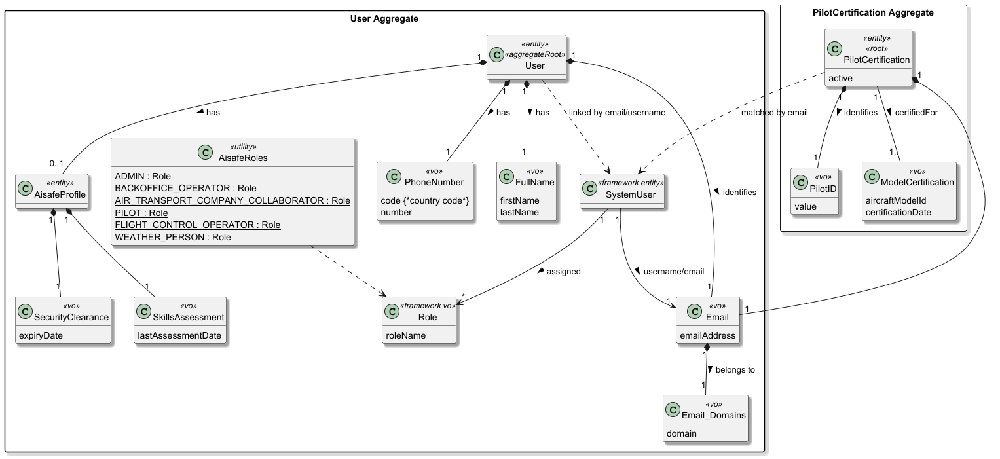
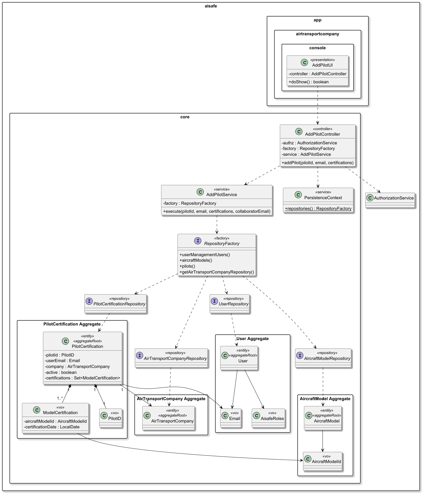
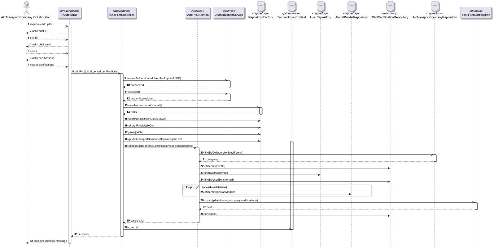

# US075 - Add a pilot

## 1. Context

* As an Air Transport Company Collaborator, I want to add a pilot to my company.
* A pilot is a system’s user. A pilot is certified to pilot one or more aircraft models.
* This task is being developed for the first time in the sprint 3 and it has dependencies with the following requirements:
  * US030 - Authentication and authorization. 
  * US031 - Create a system user.
  * US055 - Register aircraft models.
  * US060 - Register of an air transport company.

### 1.1 List of issues

**Main Issue:** Issue #126

**Analysis**: Issue #135

**Design and Unit Test:** Issue #145

**Implement:** Issue #151


## 2. Requirements

**US075** - As an Air Transport Company Collaborator, I want to add a pilot to my company.

### Acceptance Criteria:
* **US075.1 -** The system must allow an Air Transport Company Collaborator to add a pilot to their specific company.
* **US075.2 -** The pilot must be an existing system user with the appropriate role (PILOT).
* **US075.3 -** A pilot must be associated with at least one certified aircraft model.
* **US075.4 -** All mandatory fields (user email/ID, aircraft models, certification dates) must be provided; the system must reject incomplete data.
* **US075.5 -** The system must validate that the selected aircraft models are registered and valid in the system.
* **US075.6 -** Enforced Invariant: An active pilot must always have at least one valid aircraft model certification.
* **US075.7 -** Upon successful registration, the system must confirm the operation to the collaborator.

### Dependencies/References:
Regarding this requirement, we understand that it relates to:
- US030: The pilot must follow authentication rules to do anything in the system.
- US031: It's necessary that the pilot was previously registered in the system.
- US055 - Aircraft models that the pilot can pilot have to already exist in the system.
- SECTION 3.1.3: "Air transport company" in the project requirements document.

## 3. Analysis

The domain model for pilot certification must serve as the primary consistency boundary for pilot qualifications and operational readiness, ensuring that every active pilot is correctly linked to a valid system identity and maintains a mandatory association with at least one certified aircraft model.



| Attribute                 | Description                                                | Constraints                                                                                                                       |
|---------------------------|------------------------------------------------------------|-----------------------------------------------------------------------------------------------------------------------------------|
| Role                      | User Role one the system (e.g. WEATHER PERSON, PILOT, ...) | Represented by Role value object from framework; assigned only within SystemUser.                                                 |
| AlSafeProfile             | Internal entity for security data                          | Linked to SystemUser; contains security and assessment status.                                                                    |
| SecurityClearance         | Mandatory security status                                  | Must include an automatic expiry date.                                                                                            |
| SkillsAssessment          | Periodic technical evaluation                              | Must be renewed every 5 years per regulations.                                                                                    |
| Email                     | Primary user identification                                | Must be unique and follow the standard email format.                                                                              |
| EmailDomains              | List of email domains available                            | Must be in authorized list                                                                                                        |
| PhoneNumber               | Phone Number of the user                                   | Must be unique, have a valid country code (e.g. +351) and standard digits                                                         |
| FullName                  | Full Name of the user                                      | Must not be empty, composed by the first and last name                                                                            |
| SystemUser (Framework)    | Authentication and authorization aggregate root            | Managed by framework. Stores username/email, password, and assigned roles (RoleSet). Linked logically to User via email/username. |
| PilotID                   | Unique identifier for the pilot profile.                   | Must be unique and not null.                                                                                                      |
| Active                    | Operational status of the pilot within the company.        | Boolean value; used to enforce safety invariants.                                                                                 |
| ModelCertifications       | Internal collection of technical qualifications.           | Mandatory Invariant: An active pilot must always have at least one certification.                                                 |
| AircraftModelId <<vo>>    | Reference to a specific aircraft model.                    | Must correspond to a valid AircraftModel aggregate.                                                                               |
| CertificationDate <<vo>>  | Date when the pilot was certified for a model.             | Must be a valid date; cannot be in the future.                                                                                    |

**Key business rules:**
* System Identity Linkage: A pilot is essentially a SystemUser who has been assigned specific operational responsibilities and certifications. The creation of a pilot profile requires a pre-existing user account with the PILOT role.
* Minimum Certification Invariant: The aggregate root protects the rule that an active pilot cannot exist in the system without at least one valid aircraft model certification. Any operation that would result in zero certifications for an active pilot must be rejected.
* Certification Specificity: Pilots are not generic; they are certified to operate one or more specific aircraft models defined in the system.
* Operational Status: The active flag determines if the pilot is available for flight assignments, such as registering flight plans.

**Relationship with the domain:**  
`PilotCertification` (or Pilot) is an independent aggregate whose invariant is ensuring pilot qualification integrity. It serves as the primary consistency boundary for flight safety, bridging the gap between a generic SystemUser identity and the technical requirements needed to operate an aircraft. The aggregate root ensures that no pilot is considered active unless they possess at least one valid certification, preventing uncertified personnel from being assigned to flight operations or simulation tasks.

## 4. Design

*In this sections, the team should present the solution design that was adopted to solve the requirement. This should include, at least, a diagram of the realization of the functionality (e.g., sequence diagram) and the specification of the main tests used to validade the functionality. A class diagram may be useful to describe the classes involved.*

### 4.1. Realization

The design of the solution for this requirement is based on the following class diagram:



The following sequence diagram illustrates the realization of US075 - Add a Pilot




### 4.2. Acceptance Tests

Include here the main tests used to validate the functionality. Focus on how they relate to the acceptance criteria. May be automated or manual tests.

**Test 1:** *Successfully create a pilot with valid data*

**Refers to Acceptance Criteria:** US075.1, US075.2, US075.3, US075.5, US075.7

```java
@Test
void ensurePilotIsCreatedSuccessfullyWithValidData() {

  final var certifications = Set.of(
          new ModelCertification(
                  new AircraftModelId("A320-001"),
                  LocalDate.of(2025, 12, 12)
          )
  );

  final var pilot = new PilotCertification(
          new PilotID("P-001"),
          new Email("pilot@aisafe.local"),
          validCompany,
          certifications
  );

  assertNotNull(pilot.identity());
  assertEquals("pilot@aisafe.local", pilot.userEmail().value());
  assertEquals(validCompany, pilot.company());
  assertFalse(pilot.certifications().isEmpty());
}
````

**Test 2:** *Pilot must have at least one certification*

**Refers to Acceptance Criteria:** US075.3, US075.6

```java
@Test
void ensurePilotMustHaveAtLeastOneCertification() {

  assertThrows(IllegalArgumentException.class, () ->
          new PilotCertification(
                  new PilotID("P-002"),
                  new Email("pilot@aisafe.local"),
                  validCompany,
                  null
          )
  );
}
````

**Test 3:** *Reject pilot creation with non-existing aircraft model*

**Refers to Acceptance Criteria:** US075.5

```java
@Test
void ensurePilotCannotBeCreatedWithInvalidAircraftModel() {

  final var invalidCert = new ModelCertification(
          new AircraftModelId("INVALID-MODEL"),
          LocalDate.of(2025, 12, 12)
  );

  assertFalse(aircraftModelRepository.ofIdentity(
          invalidCert.aircraftModelId()
  ).isPresent());
}
````
(Controller-level test or integration test — important for US075 validation)

**Test 4:** *Pilot must be linked to an existing system user*

**Refers to Acceptance Criteria:** US075.2

```java
@Test
void ensurePilotMustBeLinkedToExistingUser() {

  final var email = new Email("unknown@aisafe.local");

  assertTrue(userRepository.findByEmail(email).isEmpty());
}
````
**Test 5:** *User must have PILOT role*

**Refers to Acceptance Criteria:** US075.2

```java
@Test
void ensureUserMustHavePilotRole() {

  final var user = new User(
          new FullName("John", "Doe"),
          new Email("pilot@aisafe.local"),
          new PhoneNumber(351, 912345678),
          AisafeRoles.ADMIN
  );

  assertNotEquals(AisafeRoles.PILOT, user.assignedRole());
}
````

**Test 6:** *Pilot email must be unique (no duplicates)*

**Refers to Acceptance Criteria:** US075.4

```java
@Test
void ensurePilotEmailMustBeUnique() {

  final var email = new Email("pilot@aisafe.local");

  assertTrue(pilotRepository.findByUserEmail(email).isPresent());
}
````

**Test 7:** *Pilot ID must be unique*

**Refers to Acceptance Criteria:** US075.4

```java
@Test
void ensurePilotIdMustBeUnique() {

  final var id = new PilotID("P-001");

  assertTrue(pilotRepository.ofIdentity(id).isPresent());
}
````

**Test 8:** *Pilot is associated with the collaborator’s company*

**Refers to Acceptance Criteria:** US075.1

```java
@Test
void ensurePilotIsAssignedToCollaboratorCompany() {

  final var pilot = pilotRepository.ofIdentity(new PilotID("P-001")).orElseThrow();

  assertEquals(collaboratorCompany, pilot.company());
}
````

**Test 9:** *Certification date cannot be in the future*

**Refers to Acceptance Criteria:** US075.3

```java
@Test
void ensureCertificationDateCannotBeInTheFuture() {

  assertThrows(IllegalArgumentException.class, () ->
          new ModelCertification(
                  new AircraftModelId("A320"),
                  LocalDate.now().plusDays(1)
          )
  );
}
````

## 5. Implementation

The implementation follows the design presented in section 4 and applies Domain-Driven Design principles across all layers of the AISafe system. 

### 5.1. Evidence of implementation aligned with design

The following evidence demonstrates that the implementation is consistent with the designed architecture and fulfills all requirements of US075 - Add a Pilot

1. **Domain invariants enforced at construction**
- The `PilotCertification` aggregate ensures all mandatory attributes are validated at creation time.
- The constructor guarantees that a pilot cannot exist without:
  - A valid PilotID
  - A valid Email
  - An associated AirTransportCompany
  - At least one ModelCertification
- Null values are rejected using Preconditions.noneNull.
- Empty certifications are explicitly rejected.

This ensures compliance with:
* US075.3 (at least one aircraft model certification)
* US075.4 (mandatory fields validation)
* US075.6 (active pilot must always have certifications)

2. **Value objects and encapsulation of business rules**
- The domain uses dedicated value objects to encapsulate identity and constraints:
  - PilotID → unique business identifier for pilots
  - Email → pilot system identity
  - ModelCertification → certification of aircraft models
  - AircraftModelId → reference to aircraft model aggregate
- ModelCertification enforces domain constraints:
  - Certification date must not be in the future
  - Aircraft model must be valid (validated at controller level)

This ensures compliance with:
* US075.3 (valid certifications)
* US075.5 (valid aircraft models)
* US075.4 (data integrity)

3. **Aircraft model validation (external aggregate consistency)**
- Aircraft models are validated through the AircraftModelRepository before being accepted into a pilot certification.
- The system ensures that every AircraftModelId used in a certification exists in the system.

This guarantees:
* US075.5 (only registered aircraft models can be assigned)

4. **User existence and role validation**
- A pilot must correspond to an existing system user.
- The controller validates:
  - Existence of user by email (UserRepository.findByEmail)
  - That the user has the PILOT role

This ensures:
* US075.2 (pilot must be an existing system user with PILOT role)

5. **Company association rule (ownership constraint)**
- The pilot is always associated with the Air Transport Company of the authenticated collaborator.
- The company is retrieved using the collaborator’s email and enforced during creation.

This ensures:
* US075.1 (pilot belongs to collaborator’s company)

6. **Uniqueness constraints and identity rules**
- PilotID is enforced as the aggregate identity.
- The repository ensures uniqueness of:
  - Pilot ID (ofIdentity)
  - Pilot email (findByUserEmail)

At database level:
- Unique constraint on pilot_id
- Business rule prevents duplicate pilot registration

This guarantees:
* US075.4 (no duplicates in system)

7. **Role-based access control**
- Only users with role AIR_TRANSPORT_COMPANY_COLLABORATOR can execute the use case.
Authorization is enforced using:
authz.ensureAuthenticatedUserHasAnyOf(
AisafeRoles.AIR_TRANSPORT_COMPANY_COLLABORATOR
);

This ensures compliance with:
* US030 (authentication and authorization dependency)
* US075.1 (restricted access to collaborators)

8. **Operational state management**
- A pilot can be activated or deactivated using domain methods:
   - activate()
   - deactivate()
- Activation enforces invariant:
   - A pilot cannot be active without certifications

This ensures:
* US075.6 (active pilot must always have certifications)

### 5.2. Relevant artifacts and configuration files

The main files required to understand and execute this implementation are:

- **Domain**
  - `aisafe.core/src/main/java/aiSafe/PilotCertification/domain/PilotCertification.java`
  - `aisafe.core/src/main/java/aiSafe/PilotCertification/domain/ModelCertifications.java`
  - `aisafe.core/src/main/java/aiSafe/PilotCertification/domain/PilotID.java`
- **Application**
  - `aisafe.core/src/main/java/aiSafe/PilotCertification/application/AddPilotController.java`
  - `aisafe.core/src/main/java/aiSafe/PilotCertification/application/AddPilotService.java`
- **Presentation**
  - `aisafe.app.backoffice.console/src/main/java/aiSafe/app/backoffice/console/presentation/PilotCertification/AddPilotAction.java`
  - `aisafe.app.backoffice.console/src/main/java/aiSafe/app/backoffice/console/presentation/PilotCertification/AddPilotUI.java`
  - `aisafe.app.backoffice.console/src/main/java/aiSafe/app/backoffice/console/presentation/MainMenu.java`
- **Persistence**
  - `aisafe.persistence.impl/src/main/java/aiSafe/persistence/impl/jpa/JpaPilotCertificationRepository.java`
  - `aisafe.persistence.impl/src/main/java/aiSafe/persistence/impl/inmemory/InMemoryPilotCertificationRepository.java`
  - `aisafe.core/src/main/java/aiSafe/usermanagement/repositories/PilotCertificationRepository.java`
  - `aisafe.persistence.impl/src/main/resources/META-INF/persistence.xml`

### 5.3. Major commits (summary)

The following commits are the major milestones related to this requirement:

- `ebf9950` - add analysis documentation for the pilot registration requirement
- `02387bf` - add design documentation, including class and sequence diagrams for pilot registration
- `02387bf` - add acceptance tests for the pilot aggregate, covering all validation rules and invariants
- `32a1c64` - implement the `PilotCertification` aggregate root and its value objects, enforcing all domain rules
- `aa57bbc` - implement in-memory and jpa persistence for `PilotCertificationRepository`


## 6. Integration/Demonstration

### 6.1. Architectural Integration

This functionality integrates with the system following the persistence architecture defined for the project. The `PilotCertificationRepository` interface is defined in the core domain module (`core.PilotCertification.repositories`) and resolved at runtime via `PersistenceContext`, which delegates to the active `RepositoryFactory` implementation:

- **`persistence.impl.inmemory`** — used for testing and early development, backed by `InMemoryPilotCertificationRepository`.
- **`persistence.impl.jpa`** — used in production, backed by `JpaPilotCertificationRepository` with full ORM mapping via JPA/Hibernate.
  This design ensures the domain and application layers are fully decoupled from persistence technology.

### 6.2. Integration Points

| Layer                  | Component                                            | Role                                               |
|------------------------|------------------------------------------------------|----------------------------------------------------|
| Domain                 | `PilotCertification`, `PilotCertificationRepository` | Aggregate and repository interface                 |
| Application            | `AddPilotController`    `AddPilotService`            | Orchestrates registration, enforces authz          |
| Persistence (JPA)      | `JpaPilotCertificationRepository`                    | Persists to relational DB via JPA                  |
| Persistence (InMemory) | `InMemoryPilotCertificationRepository`               | Used in tests and bootstrap dry-runs               |
| Infrastructure         | `PersistenceContext`                                 | Resolves the active `RepositoryFactory` at runtime |
| Presentation           | `AddPilotUI` / `AddPilotAction`                      | Console entry point                                |

### 6.3. How to Demonstrate

1. Start the application using the Backoffice console module.
2. Log in with a user holding the `ATCC` role.
3. Navigate to `Operations > Aircrfat Mnagement > Add pilot`.
4. Fill in all required fields.

### 7.1. Architectural Decisions

The project follows a layered, DDD-based architecture where the repository contract (`XRepository`) is always defined in the core domain module, while concrete implementations (`InMemoryXRepository`, `JpaXRepository`) live in separate modules resolved at runtime by `RepositoryFactory`. This ensures:

- The domain model has **zero dependency** on persistence technology.
- Switching between InMemory and JPA requires only a configuration change, not a code change.

The persistence layer followed the pattern represented below:


### 7.2. Third-party Works

- **EAPLI Framework** — provides the base infrastructure for `AggregateRoot`, `ValueObject`, `Repository`, `AuthzRegistry`, and console UI rendering used throughout this implementation.
- **Jakarta Persistence (JPA) / Hibernate** — used for ORM mapping of the `PilotCertification` entity and its embedded value objects.