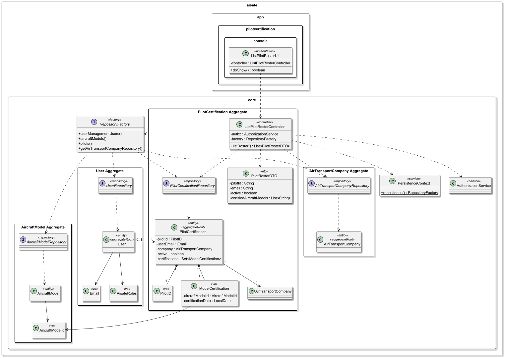
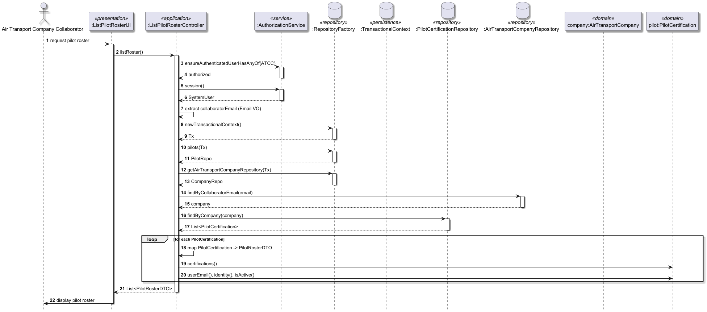

# US076 - List pilot roster

## 1. Context

* As an Air Transport Company Collaborator, I want to list my company’s pilot roster.
* The roster consists of all pilots associated with the collaborator's specific air transport company.
* This task is being developed for the first time in Sprint 3 and has dependencies with the following requirements:
  * US030: Authentication and authorization (to identify the collaborator's company and ensure access rights).
  * US060: Registration of the air transport company.
  * US075: Adding a pilot (pilots must be registered in the company roster before they can be listed).

### 1.1 List of issues

**Main Issue:** Issue #129

**Analysis**: Issue #136

**Design and Unit Test:** Issue #146

**Implement:** Issue #162


## 2. Requirements

**US076** - As an Air Transport Company Collaborator, I want to list my company’s pilot roster.

### Acceptance Criteria:
* **US076.1 -** The system must allow an Air Transport Company Collaborator to view the list of pilots associated with their company.
* **US076.2 -** The system must restrict the view so that a collaborator only sees the roster of the company they belong to.
* **US076.3 -** The roster must display the pilots' essential information, such as full name, email, and their current operational status (active/inactive).
* **US076.4 -** The list should include the aircraft models for which each pilot is currently certified.
* **US076.5 -** The operation must be subject to the system's authorization rules (ensuring the actor has the ATCC role).
* **US076.6 -**  If no pilots are registered for the company, the system should inform the user with an appropriate message.

### Dependencies/References:
Regarding this requirement, we understand that it relates to:
- US030: Necessary to identify the authenticated user and their company context.
- US075: The roster is populated through the "Add a pilot" functionality.
- US055 - Aircraft models that the pilot can pilot have to already exist in the system.
- Section 3.1.3: Defines that a list of collaborators (including pilots) must be stored for each company.

## 3. Analysis

The domain model for pilot certification must serve as the primary consistency boundary for pilot qualifications and operational readiness, ensuring that every active pilot is correctly linked to a valid system identity and maintains a mandatory association with at least one certified aircraft model.


| Attribute                 | Description                                                | Constraints                                                                                                                       |
|---------------------------|------------------------------------------------------------|-----------------------------------------------------------------------------------------------------------------------------------|
| Role                      | User Role one the system (e.g. WEATHER PERSON, PILOT, ...) | Represented by Role value object from framework; assigned only within SystemUser.                                                 |
| AlSafeProfile             | Internal entity for security data                          | Linked to SystemUser; contains security and assessment status.                                                                    |
| SecurityClearance         | Mandatory security status                                  | Must include an automatic expiry date.                                                                                            |
| SkillsAssessment          | Periodic technical evaluation                              | Must be renewed every 5 years per regulations.                                                                                    |
| Email                     | Primary user identification                                | Must be unique and follow the standard email format.                                                                              |
| EmailDomains              | List of email domains available                            | Must be in authorized list                                                                                                        |
| PhoneNumber               | Phone Number of the user                                   | Must be unique, have a valid country code (e.g. +351) and standard digits                                                         |
| FullName                  | Full Name of the user                                      | Must not be empty, composed by the first and last name                                                                            |
| SystemUser (Framework)    | Authentication and authorization aggregate root            | Managed by framework. Stores username/email, password, and assigned roles (RoleSet). Linked logically to User via email/username. |
| PilotID                   | Unique identifier for the pilot profile.                   | Must be unique and not null.                                                                                                      |
| Active                    | Operational status of the pilot within the company.        | Boolean value; used to enforce safety invariants.                                                                                 |
| ModelCertifications       | Internal collection of technical qualifications.           | Mandatory Invariant: An active pilot must always have at least one certification.                                                 |
| AircraftModelId <<vo>>    | Reference to a specific aircraft model.                    | Must correspond to a valid AircraftModel aggregate.                                                                               |
| CertificationDate <<vo>>  | Date when the pilot was certified for a model.             | Must be a valid date; cannot be in the future.                                                                                    |

**Key business rules:**
* Company Isolation: A collaborator from "Company A" must never be able to view the pilot roster of "Company B".
* Operational Visibility: The listing is not just a dump of users; it must show the technical readiness of the pilots, specifically which Aircraft Models they are certified for, as this information is critical for flight planning.
* Data Consistency: The roster view is a projection of the PilotCertification aggregate, which maintains the invariant that active pilots are certified professionals.

**Relationship with the domain:**  
`PilotCertification` (ou Pilot) is an independent aggregate whose invariant is ensuring pilot qualification integrity. It serves as the primary consistency boundary for flight safety, bridging the gap between a generic SystemUser identity and the technical requirements needed to operate an aircraft. The aggregate root ensures that no pilot is considered active unless they possess at least one valid certification, preventing uncertified personnel from being assigned to flight operations or simulation tasks.

## 4. Design

*In this sections, the team should present the solution design that was adopted to solve the requirement. This should include, at least, a diagram of the realization of the functionality (e.g., sequence diagram) and the specification of the main tests used to validade the functionality. A class diagram may be useful to describe the classes involved.*

### 4.1. Realization

### 4.1. Realization

The design of the solution for this requirement is based on the following class diagram:



The following sequence diagram illustrates the realization of US075 - Add a Pilot




### 4.2. Acceptance Tests

Include here the main tests used to validate the functionality. Focus on how they relate to the acceptance criteria. May be automated or manual tests.

**Test 1:** *Authorized collaborator can list pilots*

```java
@Test
void ensureCollaboratorCanListPilotRoster() {

  authz.loginAs(AisafeRoles.AIR_TRANSPORT_COMPANY_COLLABORATOR);

  List<PilotRosterDTO> result =
          controller.listRoster();

  assertNotNull(result);
}
````

**Test 2:** *Only company pilots are returned*

```java
@Test
void ensureOnlyCompanyPilotsAreListed() {

  List<PilotRosterDTO> result =
          controller.listRoster();

  assertTrue(
          result.stream().allMatch(
                  p -> p.email() != null
          )
  );
}
````

**Test 3:** *Unauthorized user is rejected*

```java
@Test
void ensureUnauthorizedUserCannotAccessRoster() {

  authz.loginAs(AisafeRoles.PILOT);

  assertThrows(Exception.class, () ->
          controller.listRoster()
  );
}
````

**Test 4:** *Empty roster shows empty result*

```java
@Test
void ensureEmptyRosterReturnsEmptyList() {

  List<PilotRosterDTO> result =
          controller.listRoster();

  assertTrue(result.isEmpty());
}
````
**Test 5:** *DTO contains correct pilot data*

```java
@Test
void ensureRosterMapsPilotDataCorrectly() {

  List<PilotRosterDTO> result =
          controller.listRoster();

  PilotRosterDTO dto = result.get(0);

  assertNotNull(dto.pilotId());
  assertNotNull(dto.email());
}
````

**Test 6:** *Aircraft models are included*

```java
@Test
void ensureCertifiedAircraftModelsAreIncluded() {

  List<PilotRosterDTO> result =
          controller.listRoster();

  assertTrue(
          result.stream().allMatch(
                  p -> p.certifiedAircraftModels() != null
          )
  );
}
````

## 5. Implementation

The implementation follows the design presented in section 4 and applies Domain-Driven Design principles across all layers of the AISafe system. The solution is aligned with US076 – List Pilot Roster, which focuses on allowing an authorized air transport company collaborator to retrieve a simplified view of pilots associated with their company.

The architecture enforces a strict separation between the domain model (PilotCertification aggregate) and the application-facing representation (PilotRosterDTO), ensuring that only relevant data is exposed to the presentation layer.

### 5.1. Evidence of implementation aligned with design

The following evidence demonstrates that the implementation is consistent with the designed architecture and fulfills all requirements of US076 - List pilots roster.

1. **Access control and authorization**
- The use case is restricted to users with role:
  - AIR_TRANSPORT_COMPANY_COLLABORATOR
- This is enforced at application service level:
````
authz.ensureAuthenticatedUserHasAnyOf(
  AisafeRoles.AIR_TRANSPORT_COMPANY_COLLABORATOR
);
````

This guarantees compliance with US076 – Access restriction to company collaborators.

2. **Context resolution via authenticated user**
- The system retrieves the currently authenticated user via the framework AuthorizationService.
- The collaborator is identified through their email, which is mapped to a business Email value object.
- This ensures that each user can only access the roster of their associated company.

3. **Company-based data filtering**
- The repository layer is used to resolve the AirTransportCompany associated with the collaborator. 
- If no company is found, the system throws an exception, preventing unauthorized access to pilot data. 
- This guarantees strict multi-tenancy separation between companies.

4. **Domain-driven data retrieval**
- Pilots are retrieved through the PilotCertificationRepository using:
  - findByCompany(company)
- This ensures that only pilots belonging to the authenticated collaborator’s company are returned.

5. **DTO-based response projection**
- Instead of exposing domain entities directly, the system maps PilotCertification aggregates into a lightweight PilotRosterDTO.
- Each DTO contains:
   *   Pilot identifier
   *   Email
   *   Active status
   *   Certified aircraft models (as string identifiers)
- This design ensures that domain complexity (aggregates, value objects, relationships) is not exposed outside the application layer.

6. **Separation between domain and application layers**
- PilotCertification remains a pure domain aggregate.
- PilotRosterDTO acts as a read model for UI consumption.
- The controller is responsible for orchestration only, not business logic.

### 5.2. Why DTOs are used
Data Transfer Objects (DTOs) are used in this use case to decouple the domain model from the presentation layer and to ensure controlled data exposure.
The use of DTOs provides several architectural benefits:

#### 1. Protection of the domain model
Domain entities such as PilotCertification contain internal business rules, invariants, and relationships. Exposing them directly would:
* Leak internal structure
* Risk unintended modifications
* Violate encapsulation principles
DTOs prevent direct exposure of the domain layer.

#### 2. Performance optimization
The domain model may include:
* Large object graphs (e.g. certifications, company relations)
* Lazy-loaded JPA associations

DTOs allow the system to:
* Transfer only required fields
* Avoid unnecessary database loading
* Improve response efficiency

#### 3. Separation of concerns
The DTO represents a read-only projection of the domain model:

- Domain → business logic and invariants
- DTO → data representation for UI/API

This separation aligns with DDD and Clean Architecture principles.

#### 4. Stability of the API contract

By using DTOs, changes in the domain model (e.g. new fields, refactoring aggregates) do not break:

* Controllers
* UI layer
* External consumers

The DTO acts as a stable contract between layers.

#### 5. Security and data minimization
DTOs ensure that only relevant information is exposed:

* No sensitive or internal-only fields are leaked
* Only necessary pilot information is returned to collaborators

This is aligned with the principle of least privilege.

### 5.3. Relevant artifacts and configuration files

The main files required to understand and execute this implementation are:

- **Domain**
  - `aisafe.core/src/main/java/aiSafe/PilotCertification/domain/dto/PilotRosterDTO.java`
- **Application**
  - `aisafe.core/src/main/java/aiSafe/PilotCertification/application/ListPilotRosterController.java`
- **Presentation**
  - `aisafe.app.backoffice.console/src/main/java/aiSafe/app/backoffice/console/presentation/PilotCertification/ListPilotRosterAction.java`
  - `aisafe.app.backoffice.console/src/main/java/aiSafe/app/backoffice/console/presentation/PilotCertification/ListPilotRosterUI.java`
  - `aisafe.app.backoffice.console/src/main/java/aiSafe/app/backoffice/console/presentation/MainMenu.java`
- **Persistence**
  - `aisafe.persistence.impl/src/main/java/aiSafe/persistence/impl/jpa/JpaPilotCertificationRepository.java`
  - `aisafe.persistence.impl/src/main/java/aiSafe/persistence/impl/inmemory/InMemoryPilotCertificationRepository.java`
  - `aisafe.core/src/main/java/aiSafe/PilotCertification/repositories/PilotCertificationRepository.java`
  - `aisafe.persistence.impl/src/main/resources/META-INF/persistence.xml`

### 5.4. Major commits (summary)

The following commits are the major milestones related to this requirement:

- `d61d688` - add analysis documentation for the list pilots requirement
- `8bdce99` - add design documentation, including class and sequence diagrams for pilot listing
- `8bdce99` - add acceptance tests for the pilot listing, covering all validation rules and invariants
- `3f0389e` - implement the `ListPilotRoster` controller, UI and DTO enforcing all domain rules


## 6. Integration/Demonstration

### 6.1. Architectural Integration

This functionality integrates with the system following the persistence architecture defined for the project. The `PilotCertificationRepository` interface is defined in the core domain module (`core.PilotCertification.repositories`) and resolved at runtime via `PersistenceContext`, which delegates to the active `RepositoryFactory` implementation:

- **`persistence.impl.inmemory`** — used for testing and early development, backed by `InMemoryPilotCertificationRepository`.
- **`persistence.impl.jpa`** — used in production, backed by `JpaPilotCertificationRepository` with full ORM mapping via JPA/Hibernate.
  This design ensures the domain and application layers are fully decoupled from persistence technology.

### 6.2. Integration Points

| Layer                  | Component                                              | Role                                                             |
|------------------------|--------------------------------------------------------|------------------------------------------------------------------|
| Domain                 | `PilotCertification`, `PilotID`, `ModelCertification`  | Represents the pilot aggregate and certification business rules  |
| Domain (DTO)           | `PilotRosterDTO`                                       | Read-only projection used to expose pilot roster data            |
| Application            | `ListPilotRosterController`                            | Orchestrates use case execution and enforces authorization       |
| Repository (Core)      | `PilotCertificationRepository`                         | Defines access to pilot data filtered by company                 |
| Repository (JPA)       | `JpaPilotCertificationRepository`                      | JPA implementation of pilot persistence                          |
| Repository (InMemory)  | `InMemoryPilotCertificationRepository`                 | Used for tests and bootstrap scenarios                           |
| Infrastructure         | `PersistenceContext`                                   | Provides `RepositoryFactory` and runtime repository resolution   |
| Infrastructure         | `RepositoryFactory`                                    | Creates repositories bound to a transactional context            |
| Authentication/AuthZ   | `AuthorizationService` (`AuthzRegistry`)               | Ensures only authorized collaborators access the use case        |
| Presentation           | `ListPilotRosterAction`                                | Trigger for the use case in the console UI                       |
| Presentation           | `ListPilotRosterUI`                                    | Displays the pilot roster to the user                            |
| Presentation           | `MainMenu`                                             | Exposes the use case in the application menu                     |

### 6.3. How to Demonstrate

1. Start the application using the Backoffice console module.
2. Log in with a user holding the `ATCC` role.
3. Navigate to `Operations > Aircrfat management > List pilot roster`.
4. Fill in all required fields.

### 7.1. Architectural Decisions

The project follows a layered, DDD-based architecture where the repository contract (`XRepository`) is always defined in the core domain module, while concrete implementations (`InMemoryXRepository`, `JpaXRepository`) live in separate modules resolved at runtime by `RepositoryFactory`. This ensures:

- The domain model has **zero dependency** on persistence technology.
- Switching between InMemory and JPA requires only a configuration change, not a code change.

The persistence layer followed the pattern represented below:


### 7.2. Third-party Works

- **EAPLI Framework** — provides the base infrastructure for `AggregateRoot`, `ValueObject`, `Repository`, `AuthzRegistry`, and console UI rendering used throughout this implementation.
- **Jakarta Persistence (JPA) / Hibernate** — used for ORM mapping of the `User` entity and its embedded value objects.