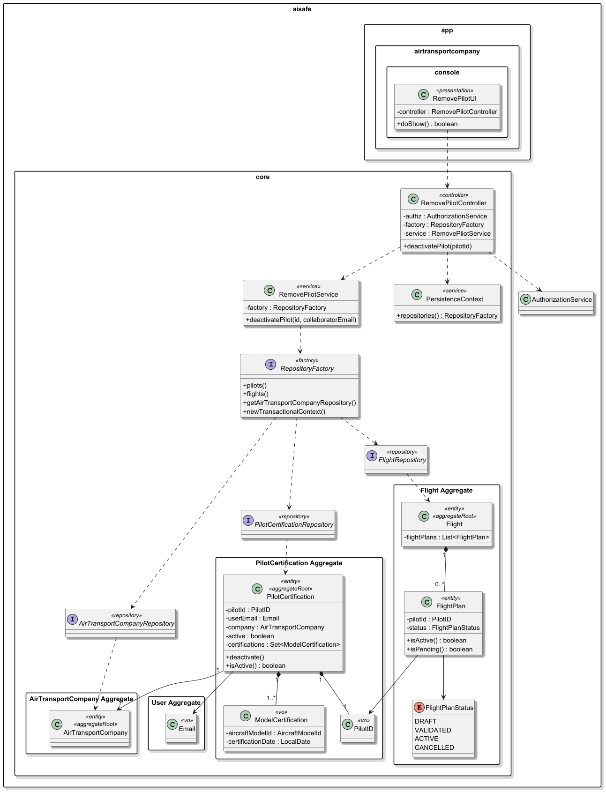
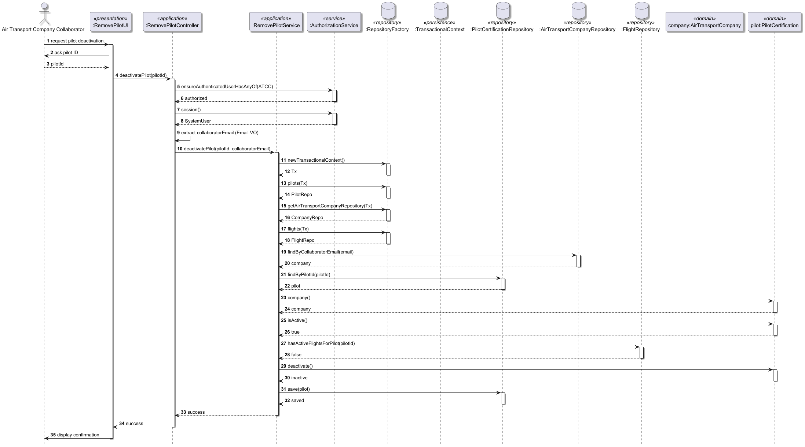

# US077 - Remove a pilot

## 1. Context

* As an Air Transport Company Collaborator, I want to make a pilot inactive in my company’s roster. 
* Removing a pilot from the roster does not delete the user account; instead, it updates their operational status within the company to inactive.
* This task is being developed for the first time in the sprint 3 and it has dependencies with the following requirements:
  * US030: Authentication and authorization. 
  * US075: Add a pilot (the pilot must be active in the roster before being removed).
  * US080: Register flight plan (used to check for existing assignments that prevent deactivation).

### 1.1 List of issues

**Main Issue:** Issue #130

**Analysis**: Issue #138

**Design and Unit Test:** Issue #147

**Implement:** Issue #170


## 2. Requirements

**US077** - As an Air Transport Company Collaborator, I want to make a pilot inactive in my company’s roster.

### Acceptance Criteria:
* **US077.1 -** The system must allow an Air Transport Company Collaborator to view and select an active pilot from their company's roster for removal.
* **US077.2 -** Enforced Invariant: The system must not allow deactivating a pilot who currently has assigned flight plans.
* **US077.3 -** The operation must change the pilot's status to inactive, meaning they can no longer be assigned to new flight plans or simulation tasks.
* **US077.4 -** The system must restrict this action to collaborators belonging to the same air transport company as the pilot.
* **US077.5 -** Upon successful deactivation, the system must confirm the operation to the collaborator.
* **US077.6 -** If deactivation is blocked by assigned flight plans, the system must provide a clear error message explaining the rejection.

### Dependencies/References:
Regarding this requirement, we understand that it relates to:
- US030: Necessary for verifying the identity and company context of the collaborator.
- US075: The roster entry point for pilots.
- US080: The "assigned flight plan" rule creates a direct dependency on the Flight aggregate to check for active pilot links.
- Section 3.1.3: Mentions that the set of active collaborators (including pilots) changes over time.

## 3. Analysis

The domain model for pilot certification must serve as the primary consistency boundary for pilot qualifications and operational readiness, ensuring that every active pilot is correctly linked to a valid system identity and maintains a mandatory association with at least one certified aircraft model.


| Attribute                 | Description                                                | Constraints                                                                                                                       |
|---------------------------|------------------------------------------------------------|-----------------------------------------------------------------------------------------------------------------------------------|
| Role                      | User Role one the system (e.g. WEATHER PERSON, PILOT, ...) | Represented by Role value object from framework; assigned only within SystemUser.                                                 |
| AlSafeProfile             | Internal entity for security data                          | Linked to SystemUser; contains security and assessment status.                                                                    |
| SecurityClearance         | Mandatory security status                                  | Must include an automatic expiry date.                                                                                            |
| SkillsAssessment          | Periodic technical evaluation                              | Must be renewed every 5 years per regulations.                                                                                    |
| Email                     | Primary user identification                                | Must be unique and follow the standard email format.                                                                              |
| EmailDomains              | List of email domains available                            | Must be in authorized list                                                                                                        |
| PhoneNumber               | Phone Number of the user                                   | Must be unique, have a valid country code (e.g. +351) and standard digits                                                         |
| FullName                  | Full Name of the user                                      | Must not be empty, composed by the first and last name                                                                            |
| SystemUser (Framework)    | Authentication and authorization aggregate root            | Managed by framework. Stores username/email, password, and assigned roles (RoleSet). Linked logically to User via email/username. |
| PilotID                   | Unique identifier for the pilot profile.                   | Must be unique and not null.                                                                                                      |
| Active                    | Operational status of the pilot within the company.        | Boolean value; used to enforce safety invariants.                                                                                 |
| ModelCertifications       | Internal collection of technical qualifications.           | Mandatory Invariant: An active pilot must always have at least one certification.                                                 |
| AircraftModelId <<vo>>    | Reference to a specific aircraft model.                    | Must correspond to a valid AircraftModel aggregate.                                                                               |
| CertificationDate <<vo>>  | Date when the pilot was certified for a model.             | Must be a valid date; cannot be in the future.                                                                                    |

**Key business rules:**
* Assignment Check: Before deactivating a pilot, the system must perform a cross-aggregate check. If the pilot's ID is referenced in any Flight with a status of "Active" or "Validated," the deactivation must be rejected.
* Operational Readiness vs. System Account: Deactivating a pilot in the roster (US077) affects their PilotCertification aggregate, but their SystemUser account remains in the system for authentication purposes.
* Data Isolation: The collaborator can only deactivate pilots within the company they are authorized to manage.

**Relationship with the domain:**  
`PilotCertification` (ou Pilot) is an independent aggregate whose invariant is ensuring pilot qualification integrity. It serves as the primary consistency boundary for flight safety, bridging the gap between a generic SystemUser identity and the technical requirements needed to operate an aircraft. The aggregate root ensures that no pilot is considered active unless they possess at least one valid certification, preventing uncertified personnel from being assigned to flight operations or simulation tasks.

## 4. Design

*In this sections, the team should present the solution design that was adopted to solve the requirement. This should include, at least, a diagram of the realization of the functionality (e.g., sequence diagram) and the specification of the main tests used to validade the functionality. A class diagram may be useful to describe the classes involved.*

### 4.1. Realization

### 4.1. Realization

The design of the solution for this requirement is based on the following class diagram:



The following sequence diagram illustrates the realization of US075 - Add a Pilot




### 4.2. Acceptance Tests

Include here the main tests used to validate the functionality. Focus on how they relate to the acceptance criteria. May be automated or manual tests.

**Test 1:** *Authorized collaborator can deactivate a pilot*
Validates: 
* US077.1
* US077.3
* US077.5

```java
@Test
void ensureAuthorizedCollaboratorCanDeactivatePilot() {

  authz.loginAs(
          AisafeRoles.AIR_TRANSPORT_COMPANY_COLLABORATOR
  );

  controller.deactivatePilot("P001");

  final var pilot =
          pilotRepo.findByPilotId(
                  new PilotID("P001")
          ).orElseThrow();

  assertFalse(pilot.isActive());
}
````

**Test 2:** *Unauthorized user cannot deactivate pilot*
Validates:
* US077.4
* dependency US030

```java
@Test
void ensureUnauthorizedUserCannotDeactivatePilot() {

  authz.loginAs(AisafeRoles.PILOT);

  assertThrows(
          Exception.class,
          () -> controller.deactivatePilot("P001")
  );
}
````

**Test 3:** *Collaborator cannot deactivate pilot from another company*
Validates:
* US077.4

```java
@Test
void ensureCollaboratorCannotDeactivatePilotFromAnotherCompany() {

  authz.loginAs(
          AisafeRoles.AIR_TRANSPORT_COMPANY_COLLABORATOR
  );

  assertThrows(
          IllegalArgumentException.class,
          () -> controller.deactivatePilot("OTHER_PILOT")
  );
}
````

**Test 4:** *Cannot deactivate already inactive pilot*

```java
@Test
void ensureInactivePilotCannotBeDeactivatedAgain() {

  final var pilot =
          pilotRepo.findByPilotId(
                  new PilotID("P001")
          ).orElseThrow();

  pilot.deactivate();

  pilotRepo.save(pilot);

  assertThrows(
          IllegalArgumentException.class,
          () -> controller.deactivatePilot("P001")
  );
}
````
**Test 5:** *Pilot with assigned active flights cannot be deactivated*
Validates:
* US077.2 
* US077.6

```java
@Test
void ensurePilotWithAssignedFlightsCannotBeDeactivated() {

  final var pilotId = new PilotID("P001");

  when(flightRepo.hasActiveFlightsForPilot(pilotId))
          .thenReturn(true);

  assertThrows(
          IllegalArgumentException.class,
          () -> controller.deactivatePilot("P001")
  );
}
````

**Test 6:** *Pilot without assigned flights can be deactivated*
Validates:
* US077.2
* US077.3

```java
@Test
void ensurePilotWithoutAssignedFlightsCanBeDeactivated() {

  final var pilotId = new PilotID("P001");

  when(flightRepo.hasActiveFlightsForPilot(pilotId))
          .thenReturn(false);

  controller.deactivatePilot("P001");

  final var pilot =
          pilotRepo.findByPilotId(pilotId)
                  .orElseThrow();

  assertFalse(pilot.isActive());
}
````

**Test 7:** *Deactivation keeps user account intact*

```java
@Test
void ensurePilotUserAccountRemainsAfterDeactivation() {

  controller.deactivatePilot("P001");

  final var user =
          userRepo.findByEmail(
                  new Email("pilot@aisafe.pt")
          );

  assertTrue(user.isPresent());
}
````

**Test 8:** *Pilot not found*

```java
@Test
void ensureNonExistingPilotThrowsException() {

  assertThrows(
          IllegalArgumentException.class,
          () -> controller.deactivatePilot("INVALID")
  );
}
````

## 5. Implementation

The implementation follows the design presented in section 4 and applies Domain-Driven Design principles across all layers of the AISafe system. The solution is aligned with US076 – List Pilot Roster, which focuses on allowing an authorized air transport company collaborator to retrieve a simplified view of pilots associated with their company.

The architecture enforces a strict separation between the domain model (PilotCertification aggregate) and the application-facing representation (PilotRosterDTO), ensuring that only relevant data is exposed to the presentation layer.

### 5.1. Evidence of implementation aligned with design

The following evidence demonstrates that the implementation is consistent with the designed architecture and fulfills all requirements of US076 - List pilots roster.

1. **Access control and authorization**
- The use case is restricted to users with role:
  - AIR_TRANSPORT_COMPANY_COLLABORATOR
- This is enforced at application service level:
````
authz.ensureAuthenticatedUserHasAnyOf(
  AisafeRoles.AIR_TRANSPORT_COMPANY_COLLABORATOR
);
````
This guarantees that only authorized collaborators may deactivate pilots.

2. **Context resolution via authenticated user**
- The system retrieves the currently authenticated user via the framework AuthorizationService.
- The collaborator is identified through their email, which is mapped to a business Email value object.
- This allows the system to determine the collaborator’s associated air transport company and guarantees that operations are executed within the correct organizational context.

3. **Company-based access restriction**
- The repository layer is used to resolve the AirTransportCompany associated with the collaborator.
- This guarantees strict multi-tenancy separation between companies.

**Pilot validation and operational state checks**
Before deactivation, the system validates:
* The pilot exists
* The pilot belongs to the collaborator’s company
* The pilot is currently active
This prevents invalid state transitions such as attempting to deactivate an already inactive pilot.
````
if (!pilot.isActive()) {
throw new IllegalArgumentException(
"Pilot is already inactive"
);
}
````

5. **Cross-aggregate invariant enforcement**
The implementation enforces the business invariant defined in US080.
Before a pilot can be deactivated, the system checks whether the pilot is referenced in active or pending flight plans through the FlightRepository:
````
if (flightRepo.hasActiveFlightsForPilot(id)) {
throw new IllegalArgumentException(
"Cannot deactivate pilot with assigned flight plans"
);
}
````
This cross-aggregate validation guarantees operational safety by ensuring that pilots assigned to active flight operations cannot become unavailable.

6. **Domain-driven state transition**
- The deactivation itself is performed inside the domain aggregate:
pilot.deactivate();
- The aggregate root PilotCertification is responsible for controlling the operational state of the pilot, preserving encapsulation and domain consistency.
- The controller only orchestrates the use case flow and persistence operations.

7. **Transactional consistency**
The use case is executed inside a transactional context:
txCtx.beginTransaction();
If any validation fails, the transaction is rolled back:
txCtx.rollback();
This guarantees atomicity and prevents partial updates or inconsistent states.


### 5.3. Relevant artifacts and configuration files

The main files required to understand and execute this implementation are:

- **Domain**
  - aisafe.core/src/main/java/aiSafe/PilotCertification/domain/PilotCertification.java
  - aisafe.core/src/main/java/aiSafe/PilotCertification/domain/PilotID.java
  - aisafe.core/src/main/java/aiSafe/flight/domain/Flight.java
  - aisafe.core/src/main/java/aiSafe/flight/domain/FlightPlan.java
- **Application**
  - `aisafe.core/src/main/java/aiSafe/PilotCertification/application/RemovePilotController.java`
  - `aisafe.core/src/main/java/aiSafe/PilotCertification/application/RemovePilotService.java` 
- **Presentation**
  - `aisafe.app.backoffice.console/src/main/java/aiSafe/app/backoffice/console/presentation/PilotCertification/RemovePilotAction.java`
  - `aisafe.app.backoffice.console/src/main/java/aiSafe/app/backoffice/console/presentation/PilotCertification/RemovePilotRosterUI.java`
  - `aisafe.app.backoffice.console/src/main/java/aiSafe/app/backoffice/console/presentation/MainMenu.java`
- **Persistence**
  - aisafe.core/src/main/java/aiSafe/PilotCertification/repositories/PilotCertificationRepository.java
  - aisafe.core/src/main/java/aiSafe/flight/repositories/FlightRepository.java
  - aisafe.persistence.impl/src/main/java/aiSafe/persistence/impl/jpa/JpaPilotCertificationRepository.java
  - aisafe.persistence.impl/src/main/java/aiSafe/persistence/impl/jpa/JpaFlightRepository.java
  - aisafe.persistence.impl/src/main/java/aiSafe/persistence/impl/inmemory/InMemoryPilotCertificationRepository.java
  - aisafe.persistence.impl/src/main/java/aiSafe/persistence/impl/inmemory/InMemoryFlightRepository.java
  - aisafe.persistence.impl/src/main/resources/META-INF/persistence.xml

### 5.4. Major commits (summary)

The following commits are the major milestones related to this requirement:

- `aef2ca2` - add analysis documentation for the remove pilots requirement
- `6d82a23` - add design documentation, including class and sequence diagrams for pilot removing
- `6d82a23` - add acceptance tests for the pilot removing, covering all validation rules and invariants
- `8f2cf9b` - implement the `RemovePilot` controller, UI and DTO enforcing all domain rules


## 6. Integration/Demonstration

### 6.1. Architectural Integration
This functionality integrates with the system following the persistence architecture defined for the project.

The PilotCertificationRepository and FlightRepository interfaces are defined in the core domain module and resolved at runtime via PersistenceContext, which delegates to the active RepositoryFactory implementation.

The use case also introduces a cross-aggregate dependency between the PilotCertification aggregate and the Flight aggregate in order to enforce operational safety invariants.

The persistence layer supports two interchangeable implementations:

persistence.impl.inmemory
* Used for testing and early development
* Backed by InMemoryPilotCertificationRepository
* Backed by InMemoryFlightRepository
persistence.impl.jpa
* Used in production
* Backed by JpaPilotCertificationRepository
* Backed by JpaFlightRepository
* Uses JPA/Hibernate ORM mappings

This architecture guarantees that the domain and application layers remain fully decoupled from persistence technology.

### 6.2. Integration Points

| Layer                  | Component                                      | Role                                                           |
|------------------------|------------------------------------------------|----------------------------------------------------------------|
| Domain                 | `PilotCertification`, `PilotID`                | Represents the pilot aggregate and operational status          |
| Domain                 | `Flight`, `FlightPlan`                         | Used to validate existing pilot flight assignments             |
| Application            | `RemovePilotController`   `RemovePilotService` | Orchestrates pilot deactivation and invariant validation       |
| Repository (Core)      | `PilotCertificationRepository`                 | Provides access to pilot aggregates                            |
| Repository (Core)      | `FlightRepository`                             | Provides cross-aggregate validation for assigned flight plans  |
| Repository (JPA)       | `JpaPilotCertificationRepository`              | JPA persistence for pilot aggregates                           |
| Repository (JPA)       | `JpaFlightRepository`                          | JPA persistence and assignment queries                         |
| Repository (InMemory)  | `InMemoryPilotCertificationRepository`         | In-memory implementation used in tests                         |
| Repository (InMemory)  | `InMemoryFlightRepository`                     | In-memory flight repository implementation                     |
| Infrastructure         | `PersistenceContext`                           | Provides `RepositoryFactory` resolution                        |
| Infrastructure         | `RepositoryFactory`                            | Creates repositories bound to transactional contexts           |
| Authentication/AuthZ   | `AuthorizationService` (`AuthzRegistry`)       | Validates collaborator permissions                             |
| Presentation           | `RemovePilotAction`                            | Console action that triggers the use case                      |
| Presentation           | `RemovePilotUI`                                | Collects pilot identifier and displays operation result        |
| Presentation           | `MainMenu`                                     | Exposes the functionality in the application menu              |

### 6.3. How to Demonstrate

1. Start the application using the Backoffice console module.
2. Log in with a user holding the `ATCC` role.
3. Navigate to `Operations > Aircrfat management > Remove pilot`.
4. Fill in all required fields.

### 7.1. Architectural Decisions

The project follows a layered, DDD-based architecture where the repository contract (`XRepository`) is always defined in the core domain module, while concrete implementations (`InMemoryXRepository`, `JpaXRepository`) live in separate modules resolved at runtime by `RepositoryFactory`. This ensures:

- The domain model has **zero dependency** on persistence technology.
- Switching between InMemory and JPA requires only a configuration change, not a code change.

The persistence layer followed the pattern represented below:


### 7.2. Third-party Works

- **EAPLI Framework** — provides the base infrastructure for `AggregateRoot`, `ValueObject`, `Repository`, `AuthzRegistry`, and console UI rendering used throughout this implementation.
- **Jakarta Persistence (JPA) / Hibernate** — used for ORM mapping of the `User` entity and its embedded value objects.