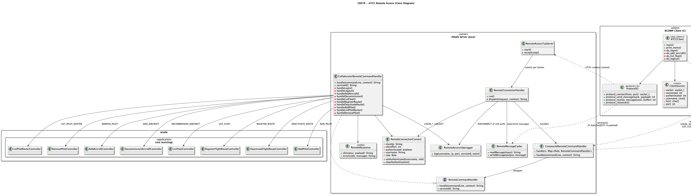
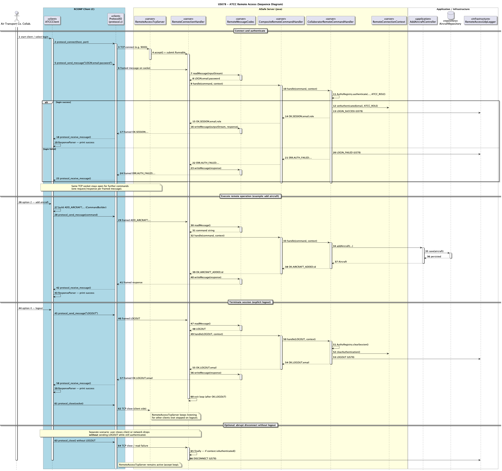

# US078 - Air Transport Company Collaborator Remote Access

## 1. Context

* As an Air Transport Company Collaborator, I want to remotely access the system through a dedicated TCP client, so that I can perform air transport company operations without local access to the server application.
* This user story belongs to the RCOMP component and defines the shared remote access infrastructure that is reused by US044 and US086.
* The client must communicate exclusively via TCP with the server embedded in the main AISafe application. Any direct database access from the client is forbidden.

It is also dependent on:

* US030 - Authentication and Authorization
* US070 - Add an aircraft to an air transport company
* US071 - Decommission an aircraft
* US072 - List an air transport company's fleet
* US073 - Create a flight route
* US074 - Delete a flight route
* US075 - Add a pilot
* US076 - List pilot roster
* US077 - Remove a pilot
* US090 - External logging of remote accesses

### 1.1 List of issues

**Main Issue:** Issue #114

**Analysis:** Issue #181

**Design:** Issue #182

**Implement:** Issue #183

---

## 2. Requirements

**US078** - As an Air Transport Company Collaborator, I want to remotely access the system using the Air Transport Company App.

### 2.1 Acceptance Criteria

* **US078.1** A dedicated TCP client application for Air Transport Company Collaborator must be implemented.
* **US078.2** All client interaction must be performed exclusively via TCP; direct database access is strictly forbidden.
* **US078.3** Authentication and authorization must be enforced for every request.
* **US078.4** Air Transport Company Collaborator operations (at least those defined in the dependent user stories, according to team scope) must be available remotely.
* **US078.5** The communication protocol must be documented and serve as the shared baseline for US044 and US086.

### 2.2 Dependencies/References

Regarding this requirement, we understand that it relates to:

* **US030** - role-based authentication and authorization (`AIR_TRANSPORT_COMPANY_COLLABORATOR`).
* **US070–US077** - air transport company operations exposed through TCP.
* **US090** - login/logout/disconnect/failed-login events must be logged via UDP by the server.
* **NFR08** - no direct data access from client applications.

---

## 3. Analysis

US078 is primarily an infrastructure and integration story. It does not introduce new domain concepts; it exposes existing air transport company use cases through the network. Additionally, US078 defines the shared TCP protocol baseline reused by US044 (Weather Person) and US086 (Pilot).

### 3.1 Remote Access Concepts

| Concept               | Description                                                    | Constraints                                          |
|-----------------------|----------------------------------------------------------------|------------------------------------------------------|
| Client Connection     | TCP socket between ATCC client and server                      | Must use agreed application-level protocol           |
| Authenticated Session | Session associated with one Air Transport Company Collaborator | Requires valid credentials and role                  |
| Operation Request     | An ATCC operation requested through TCP                        | Must map to authorized ATCC use cases                |
| Operation Response    | Server response to client request                              | Must include success/error status and payload        |
| Access Event          | Login/logout/disconnect/failed login event                     | Must be forwarded by server to US090 logging service |

### 3.2 Relationship with Domain

The client acts only as a transport/UI layer. All business rules remain server-side in existing AISafe application services and domain model.

### 3.3 Scope and Session Analysis

Remote operations in scope for US078 are:

* Add an aircraft to an air transport company (`US070`)
* Decommission an aircraft (`US071`)
* List an air transport company's fleet (`US072`)
* Create a flight route (`US073`)
* Delete a flight route (`US074`)
* Add a pilot (`US075`)
* List pilot roster (`US076`)
* Remove a pilot (`US077`)

The remote session lifecycle is defined as:

1. TCP connection establishment;
2. Authentication request with Air Transport Company Collaborator credentials;
3. Authorization check for role `AIR_TRANSPORT_COMPANY_COLLABORATOR`;
4. Execution of authorized ATCC operations;
5. Session termination via logout or disconnect.

Expected error scenarios to be handled in the protocol:

* invalid credentials;
* authenticated user without required role;
* malformed or incomplete request payload;
* operation-level validation errors returned by server-side use cases;
* network failure (timeout / broken connection).

For US090 integration, the following access events must be produced server-side:

* `LOGIN_SUCCESS`
* `LOGIN_FAILED`
* `LOGOUT`
* `DISCONNECT`

---

## 4. Design

### 4.1 Realization

The design follows a client-server architecture over TCP, implementing the shared remote access infrastructure that is also used by US044 and US086.

| Layer       | Component                       | Technology           | Responsibility                                                 |
|-------------|---------------------------------|----------------------|----------------------------------------------------------------|
| Client      | ATCC remote app                 | C (Berkeley sockets) | Console UI, protocol encoding/decoding, session state          |
| Server      | Embedded TCP remote server      | Java (`java.net`)    | Accept connections, authenticate, authorize, dispatch commands |
| Application | Existing ATCC controllers       | Java (EAPLI)         | Execute US070–US077 business logic                             |
| Logging     | UDP access logger (server-side) | UDP socket           | Emit access events to US090 logging server                     |

The ATCC client has **no database dependency**. All persistence and domain validation occur on the server.

### 4.2 Protocol Design

The protocol baseline is shared across all remote access features and is documented in `RCOMP/README.md`.

#### 4.2.1 Message Framing

Each TCP message is sent as:

```text
[4 bytes payload length (big-endian)][payload UTF-8]
```

Example payload:

```text
LOGIN;collaborator@aisafe.local;Collaborator123
```

#### 4.2.2 Request Format

```text
COMMAND;param1;param2;...
```

#### 4.2.3 Response Format

Success:

```text
OK;status;payload
```

Error:

```text
ERR;errorCode;message
```

#### 4.2.4 Standard Error Codes

| Code               | Meaning                                                                                                                          |
|--------------------|----------------------------------------------------------------------------------------------------------------------------------|
| `AUTH_FAILED`      | Invalid username/password, or user without `AIR_TRANSPORT_COMPANY_COLLABORATOR` role                                            |
| `SESSION_REQUIRED` | Operation requested before successful login                                                                                      |
| `BAD_REQUEST`      | Malformed command or missing parameters                                                                                          |
| `VALIDATION_ERROR` | Business/domain validation failed                                                                                                |
| `INTERNAL_ERROR`   | Unexpected server failure                                                                                                        |

#### 4.2.5 `ADD_AIRCRAFT` parameters (US070)

```text
ADD_AIRCRAFT;registration;modelId;engines;fSeats;bSeats;eSeats;year;country;countryCode;status;companyIata
```

- `engines`: comma-separated list of engine model IDs.
- Success response: `OK;AIRCRAFT_ADDED;<registration>`

#### 4.2.6 `LIST_FLEET` parameters (US072)

```text
LIST_FLEET;iataCode
```

- Success response: `OK;FLEET;<registration>,<model>,<status>|...`

### 4.3 Command Mapping

| Remote Command            | Business US | Server Component                      | Required Role                        | Notes                                      |
|---------------------------|-------------|---------------------------------------|--------------------------------------|--------------------------------------------|
| `LOGIN`                   | US030       | Authentication / session bootstrap    | any (must become `ATCC`)             | Must be first command after connect        |
| `ADD_AIRCRAFT`            | US070       | `CollaboratorRemoteCommandHandler`    | `AIR_TRANSPORT_COMPANY_COLLABORATOR` | Add aircraft to fleet                      |
| `DECOMMISSION_AIRCRAFT`   | US071       | `CollaboratorRemoteCommandHandler`    | `AIR_TRANSPORT_COMPANY_COLLABORATOR` | Retire an aircraft                         |
| `LIST_FLEET`              | US072       | `CollaboratorRemoteCommandHandler`    | `AIR_TRANSPORT_COMPANY_COLLABORATOR` | List company fleet                         |
| `REGISTER_FLIGHT_ROUTE`   | US073       | `CollaboratorRemoteCommandHandler`    | `AIR_TRANSPORT_COMPANY_COLLABORATOR` | Create a new flight route                  |
| `DEACTIVATE_FLIGHT_ROUTE` | US074       | `CollaboratorRemoteCommandHandler`    | `AIR_TRANSPORT_COMPANY_COLLABORATOR` | Deactivate a route                         |
| `ADD_PILOT`               | US075       | `CollaboratorRemoteCommandHandler`    | `AIR_TRANSPORT_COMPANY_COLLABORATOR` | Add a pilot to the company roster          |
| `LIST_PILOT_ROSTER`       | US076       | `CollaboratorRemoteCommandHandler`    | `AIR_TRANSPORT_COMPANY_COLLABORATOR` | List all pilots in the roster              |
| `REMOVE_PILOT`            | US077       | `CollaboratorRemoteCommandHandler`    | `AIR_TRANSPORT_COMPANY_COLLABORATOR` | Mark a pilot as inactive                   |
| `LOGOUT`                  | US030/US078 | Session termination handler           | authenticated session                | Ends session explicitly                    |

Service identifier for US090 logs: `US78`.

### 4.4 Client Structure (C)

Implemented layout under `RCOMP/`:

```text
RCOMP/
  include/
    protocol.h
    util.h                # shared UI and session utilities
  src/
    common/
      protocol.c          # framed send/receive
      util.c              # UI headers, login, logout, network status
    client/
      atcc/
        atcc_client.c     # ATCC menu and specific commands
  Makefile                # target: atcc_client
```

### 4.5 Server structure (Java)

| Design (diagram)          | Implementation class               |
|---------------------------|------------------------------------|
| `TcpRemoteServer`         | `RemoteAccessTcpServer`            |
| `ConnectionHandler`       | `RemoteConnectionHandler`          |
| `RemoteCommandDispatcher` | `CompositeRemoteCommandHandler`    |
| `RoleSpecificHandler`     | `CollaboratorRemoteCommandHandler` |
| `RemoteSession`           | `RemoteConnectionContext`          |
| `UdpAccessLogger`         | `RemoteAccessUdpLogger`            |

### 4.6 Diagrams

#### Class Diagram



#### Sequence Diagram 


---

## 5. Implementation

### 5.1 Evidence of implementation aligned with design

The US078 implementation provides the backbone for all remote access.

**Client (C):**

| File                                  | Role                                     |
|---------------------------------------|------------------------------------------|
| `RCOMP/src/client/atcc/atcc_client.c` | Specific ATCC menu and request builders. |
| `RCOMP/src/common/util.c`             | Shared UI logic (Java-like style).       |

**Server (Java):**

| File                                    | Role                              |
|:----------------------------------------|:----------------------------------|
| `CollaboratorRemoteCommandHandler.java` | Logic for US070-US077 operations. |
| `RemoteAccessTcpServer.java`            | Core server infrastructure.       |

### 5.2 How to run (team guide)

Step-by-step instructions are in:
**[`RCOMP/GUIDE/US078-GUIDE.md`](../../../RCOMP/GUIDE/US078-GUIDE.md)**

| Scenario   | Server             | Client                       |
|:-----------|:-------------------|:-----------------------------|
| VM DEI     | `RemoteAccessMain` | `atcc_client 127.0.0.1 9000` |

### 5.3 Relevant configuration

`aisafe.app.backoffice.console/src/main/resources/application.properties`:
```properties
remote.tcp.enabled=true
remote.tcp.port=9000
remote.udp.logging.host=127.0.0.1
remote.udp.logging.port=5000
```

### 5.4 Major commits

- `7881c16e` - add analysis to clarify remote access requirements and dependencies for Air Transport Company Collaborator
- `c9f8253c` - add class and sequence diagrams for ATCC remote access implementation
- `TBD` - implement TCP server and client for US078, covering authentication and ATCC operations

---

## 6. Integration/Demonstration

### 6.1 DEI VM deployment

**Deploy Steps:**
1. `git pull` on VM.
2. `mvn install -DskipTests`.
3. Run bootstrap: `aiSafe.app.bootstrap.AisafeBootstrap`.
4. Start server: `aiSafe.RemoteAccessMain`.

### 6.2 How to demonstrate

This section is better detailed in the Guide.

**[`RCOMP/GUIDE/US078-GUIDE.md`](../../../RCOMP/GUIDE/US078-GUIDE.md)**
