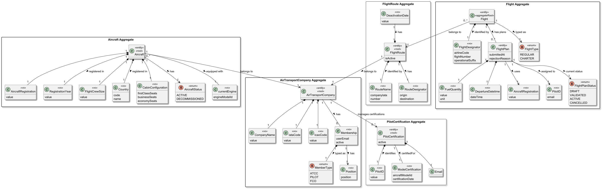
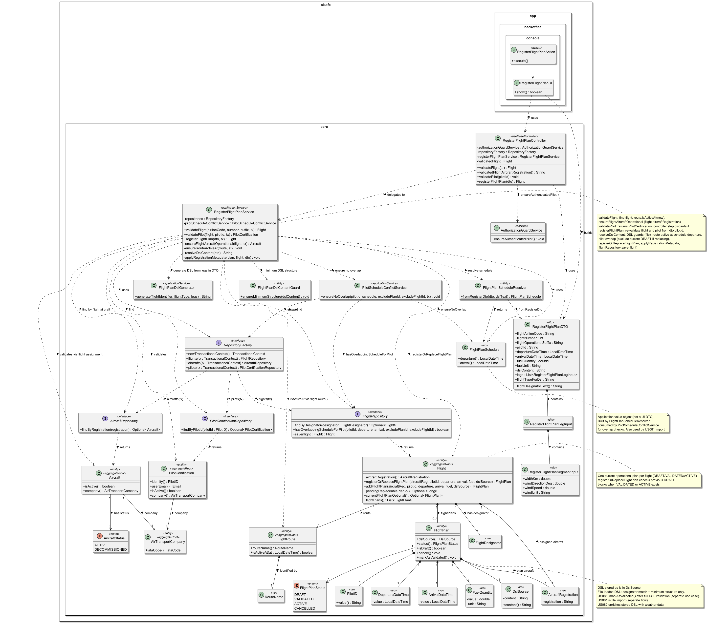
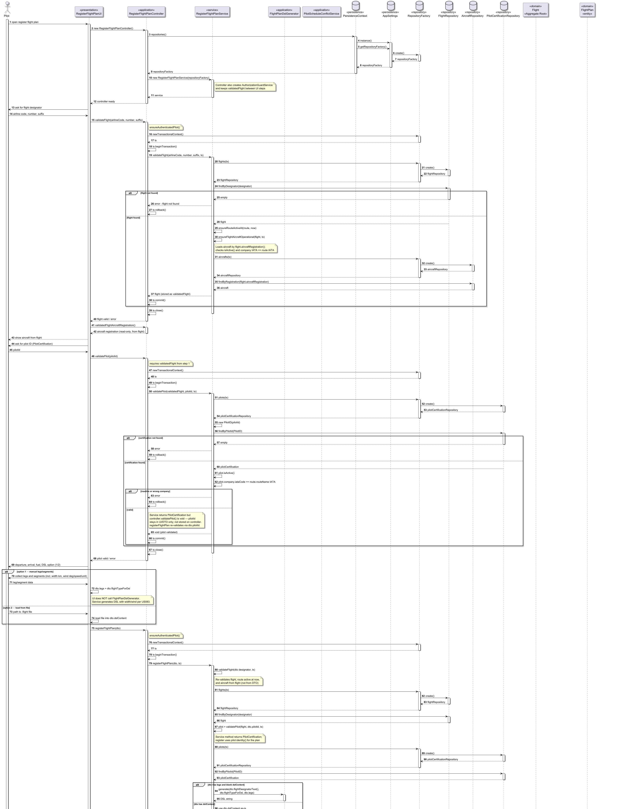

# US080 - Create a Flight Plan

## 1. Context

* As a Pilot, I want to register a flight plan for a route. I must add the aircraft, departure date/time, arrival date/time, fuel quantity, and pilot. The pilot must belong to the route’s company. I must provide the technical flight plan as Core Flight DSL — either by entering legs and segments through the UI (system generates the DSL) or by loading a `.flight` file. The flight plan status is set to `DRAFT` when created; full DSL validation and simulation happen later in **US085**.
* This user story enables the creation of operational flight instances associated with existing routes and aircraft, with the DSL stored on the flight plan for later weather enrichment (**US082**) and validation (**US085**).

It is also a prerequisite for:

* US082 — Insert weather data in a flight
* US085 — Test/validate flight plan

### 1.1 List of issues

**Main Issue:** Issue #128

**Analysis:** Issue #143

**Design:** Issue #148

**Implement:** Issue #153

## 2. Requirements

**US080 —** As Pilot, I want to register a flight plan for a route. I must add the aircraft, departure date/time, arrival date/time, fuel quantity, and pilot. The pilot must belong to the route’s company. Flight plan status is set to `DRAFT` when created; full DSL validation and simulation are deferred to **US085**.

### 2.1 Acceptance Criteria

* **US080.1** The system must allow the creation of a flight plan associated with an existing **Flight** (which already references a route).
* **US080.2** Aircraft, departure date/time, arrival date/time, fuel quantity, and pilot are mandatory fields.
* **US080.3** The pilot must belong to the same company as the selected route.
* **US080.4** The aircraft must belong to the same company as the selected route.
* **US080.5** Fuel quantity must be a positive value.
* **US080.6** A newly created flight plan must automatically receive the status `DRAFT`.
* **US080.7** The system must reject invalid or incomplete flight plans.
* **US080.8** The system must store the full Core Flight DSL on the flight plan. File-loaded DSL undergoes only minimum structural checks (flight identifier match, `type`, `leg`, balanced braces); full semantic validation is deferred to **US085**.

### 2.2 Dependencies/References

Regarding this requirement, we understand that it relates to:

* **US070 — Add an aircraft to an air transport company**: aircraft must already exist in the company fleet.
* **US073 — Create a flight route**: a flight plan must always be associated with an existing route.
* **US075 — Add a pilot**: the assigned pilot must exist and belong to the same company as the route.
* **US081 — Create a flight plan from a file**: imported flight plans must follow the same business rules.
* **US082 — Insert weather data in a flight**: weather information may later be attached to the created flight plan.
* **US085 — Test/validate flight plan**: draft flight plans must later undergo validation/testing.

## 3. Analysis

The domain model for a Flight Route must capture the following attributes:




| Attribute            | Description                                 | Constraints                                         |
|----------------------|---------------------------------------------|-----------------------------------------------------|
| Flight               | Operational flight instance                 | Must exist (designator); plan links via`flight_id`  |
| Flight Route         | Route of the selected flight                | Accessed through`Flight.route()`                    |
| Aircraft             | Aircraft assigned to the flight             | Must belong to the same company as the route        |
| Pilot                | Pilot responsible for the flight            | Must belong to the same company as the route        |
| Departure Date/Time  | Scheduled departure date and time           | Must be valid; strictly in the future               |
| Arrival Date/Time    | Scheduled arrival date and time             | Must be after departure                             |
| Fuel Quantity        | Fuel assigned to the flight                 | Must be a positive value                            |
| DSL Source           | Full Core Flight DSL text stored on plan    | Mandatory; minimum structure when loaded from file  |
| Flight Plan Status   | Current lifecycle state of the flight plan  | Defaults to`DRAFT` upon creation                    |

### Key Business Rules

- A flight plan must always be associated with an existing FlightRoute.
- The selected pilot must belong to the same AirTransportCompany as the route.
- The selected aircraft must also belong to the same company as the route.
- Fuel quantity must be strictly positive.
- All mandatory attributes must be provided before creation.
- Every newly created flight plan starts with status DRAFT.
- DSL content is stored as-is (`DslSource`); **no** full US083 semantic validation in US080. File-loaded DSL is checked for minimum structure (`FlightPlanDslContentGuard`) and the `flight` identifier must match the selected designator.
- **Aircraft** is taken from the selected **Flight** (`Flight.aircraftRegistration()`); the UI does not ask for a separate registration. The assigned aircraft must exist, be `ACTIVE`, and belong to the route company IATA.
- At most **one current flight plan** per `Flight` (`DRAFT`, `VALIDATED`, or `ACTIVE`). A new registration or import **replaces** an existing `DRAFT` (previous plan → `CANCELLED` for history). `VALIDATED` or `ACTIVE` blocks a new plan.
- The **pilot** must have no overlapping flight plans (status `DRAFT`, `VALIDATED`, or `ACTIVE`) for the same schedule window (`PilotScheduleConflictService` / `FlightRepository.hasOverlappingScheduleForPilot`). This remains necessary: a pilot cannot fly two flights at once, even on different designators.
- Manual leg/segment input is collected in the **DTO** by the UI; **`RegisterFlightPlanService`** calls `FlightPlanDslGenerator` when `dslContent` is blank. File content is read into `dto.dslContent` by the UI.
- The DSL supports **one or more legs** (`leg+`) and **one or more segments per leg** (`segment+`); they are **not** persisted as separate JPA entities—only as text in `DslSource` plus derived summary fields (`legCount`, `routeSignature`, airports).
- Route company for cross-aggregate checks is the **IATA code in `RouteName`** (e.g. route name `TP` for flight route `TP123`), compared with `PilotCertification.company` and `Aircraft.company`.

### Relationship with other user stories


| Story      | Role relative to US080                                                                                            |
|------------|-------------------------------------------------------------------------------------------------------------------|
| **US081**  | Separate path: pilot provides a`.flight` file; system reads and stores DSL (validation policy defined in US081).  |
| **US082**  | Selects existing weather data and enriches DSL segments (does not ask pilot to type weather manually).            |
| **US085**  | Validates DSL already stored on the flight plan and runs the C simulator; no external file from the pilot.        |

### Relationship with the Domain

A `FlightPlan` is an entity owned by the **`Flight` aggregate** (`@OneToMany` / `@ManyToOne`). It stores operational data (aircraft registration, assigned pilot as embedded **`PilotID`** from `PilotCertification`, departure, arrival, fuel) and the **full Core Flight DSL** (`DslSource`).

The `Flight` aggregate references:

- one `FlightRoute` (for company/route context),
- zero or more `FlightPlan` instances over time,
- and each plan maintains its `FlightPlanStatus` (starts as `DRAFT`).

The flight plan lifecycle begins in the DRAFT state and may later evolve through validation and simulation processes handled in other user stories.

---

## 4. Design

### 4.1 Realization

The design follows the layered DDD architecture adopted throughout the project.

The `Flight` aggregate is the Aggregate Root responsible for managing operational flight plans.
A `Flight` may contain multiple `FlightPlan` entities over time, allowing different plans to exist for different operational periods.

The application layer is composed of:

- `RegisterFlightPlanUI`
- `RegisterFlightPlanController`
- `RegisterFlightPlanService`

The service orchestrates all validations against existing aggregates before delegating creation of the `FlightPlan` entity to the `Flight` aggregate root.

The following class diagram illustrates the main components involved:



The following sequence diagram illustrates the realization of US080 — create a flight plan:



**Main classes and responsibilities:**

* `Flight` — Aggregate Root responsible for managing flight plans and enforcing domain invariants
* `FlightPlan` — JPA entity on `flight_plan`; linked to `Flight` via `flight_id`; stores embedded VOs and `DslSource`; derives `legCount`, `routeSignature`, airport codes from DSL text
* `DepartureDateTime`, `ArrivalDateTime`, `FuelQuantity`, `AircraftRegistration`, `DslSource` — Embeddable value objects with domain validation; **`PilotID`** (from `PilotCertification`) embedded on the plan
* `FlightPlanDslGenerator` — Static helper invoked by **`RegisterFlightPlanService.resolveDslContent`** when the DTO carries legs but no `dslContent` (not called from the UI)
* `FlightPlanScheduleResolver` — Resolves departure/arrival from DTO (and DSL when applicable) for persistence and overlap checks
* `Flight.registerOrReplaceFlightPlan` / `Flight.importFlightPlan` — One current plan per flight; replace only in `DRAFT`; superseded plans → `CANCELLED`
* `PilotScheduleConflictService` — Rejects registration when the pilot already has an overlapping plan
* `FlightPlanDslContentGuard` — Minimum structural checks on file-loaded DSL (`type`, `leg`, balanced braces)
* `RegisterFlightPlanLegInput`, `RegisterFlightPlanSegmentInput` — DTOs for structured leg/segment capture (segment includes `width` km and `wind` direction/speed/unit per US083 grammar; not persisted as entities)
* `FlightPlanStatus` — Enumeration representing the lifecycle state of the flight plan (`DRAFT`, `VALIDATED`, `ACTIVE`, `CANCELLED`)
* `FlightDesignator` — Value Object identifying the flight (`airlineCode`, `flightNumber`, `operationalSuffix`); used by `FlightRepository.findByDesignator(FlightDesignator)`
* `flightTypeForDsl` (DTO) — `REGULAR` or `CHARTER` for DSL generation (same values as domain `FlightType` / **US083**)
* `FlightRoute` / `RouteName` (`aiSafe.flightRoute.domain`) — Company IATA for validation is `flight.route().routeName().value()` (not the full route designator string)
* `Aircraft` — Must exist, be `ACTIVE`, and at registration time belong to the same company IATA as the route
* `PilotCertification` / `PilotID` — Loaded by `PilotCertificationRepository.findByPilotId(PilotID)` (US075); must be **active** and `company.iataCode` must match route company IATA; **`PilotID`** is stored on the plan (email remains on `PilotCertification` only)
* `FlightRepository` — `findByDesignator(FlightDesignator)`, `hasOverlappingScheduleForPilot(...)`, `save(flight)` with cascade on `flightPlans`
* `AircraftRepository` — `findByRegistration(String)`
* `PilotCertificationRepository` — `findByPilotId(PilotID)` (not `UserRepository` / not email at input)
* `RegisterFlightPlanService` — Orchestrates validation, DSL guards, schedule overlap, `resolveDslContent`, **`Flight.addFlightPlan`**, `applyRegistrationMetadata`, persist
* `RegisterFlightPlanController` — `@UseCaseController`; keeps `validatedFlight` for pilot step; `registerFlightPlan(dto)` delegates to service
* `RegisterFlightPlanUI` / `RegisterFlightPlanAction` — Builds `RegisterFlightPlanDTO` (legs or raw DSL); **does not** call `FlightPlanDslGenerator`
* `RegisterFlightPlanDTO` — Operational fields (including `arrivalDateTime`) + `pilotId` (lookup) + optional `dslContent` or `legs` + `flightTypeForDsl`

**Validation flow performed by the application layer:**

The application service performs the following validations incrementally as data is introduced by the user:

1. Verify that the selected `Flight` exists
2. Verify that the selected `Aircraft` exists
3. Verify that the selected `Aircraft` is `ACTIVE`
4. Load `PilotCertification` by **pilot id** (`PilotID`); verify active and company IATA matches `flight.route().routeName().value()`
5. Collect departure date/time, arrival date/time, and operational fuel quantity
6. Collect DSL input: **(1)** UI fills `dto.legs` + `flightTypeForDsl`, or **(2)** file path → `dto.dslContent`
7. `registerFlightPlan(dto)`: re-validates flight; ensures flight aircraft is operational and company-aligned; re-validates pilot; `resolveDslContent`; if `dslContent` present, `ensureDslFlightMatchesSelectedFlight` + `FlightPlanDslContentGuard.ensureMinimumStructure`; `FlightPlanScheduleResolver.fromRegisterDto`; `PilotScheduleConflictService.ensureNoOverlap`; `flight.registerOrReplaceFlightPlan(...)`; `applyRegistrationMetadata`; `FlightRepository.save(flight)`
8. **US085** (separate menu action *Validate flight plan*): `FlightDslValidator.validate()` on the current **DRAFT** plan → `markAsValidated()`; then optional US082 weather / *Activate* → `ACTIVE`

**Invariants enforced inside the Flight aggregate:**

- `DepartureDateTime` must not be null
- `DepartureDateTime` must not reference a past instant (unless imported via DSL path)
- `ArrivalDateTime` must not be null and must be after departure
- `FuelQuantity` must be strictly positive
- `AircraftRegistration` must not be null
- `PilotID` must not be null
- Every `FlightPlan` must always belong to an existing `Flight`
- Every newly created `FlightPlan` must start with status `DRAFT`
- `DslSource` must not be null or blank

**Cross-aggregate business rules enforced by the application service**

The following business rules require validation across multiple aggregates and are therefore enforced at the application layer:

- The selected `Flight` must exist in the system
- The selected `Aircraft` must exist in the system
- The selected `Aircraft` must be operational (`ACTIVE`)
- The pilot certification aggregate must exist for the given **pilot id**
- The pilot must be active (`PilotCertification.isActive()`)
- The pilot's company IATA must match the route company IATA (`RouteName` value)
- The aircraft's company IATA must match the route company IATA at registration time
- The pilot must not have an overlapping flight plan in `DRAFT`, `VALIDATED`, or `ACTIVE` status
- File-loaded DSL must match the selected flight designator and pass minimum structural checks
- `UserRepository` is **not** used for pilot validation in this use case

### 4.2. Acceptance Tests

**Test 1:** Verifies that it is not possible to create a `FuelQuantity` with a negative value.

**Refers to Acceptance Criteria:** US080.5, US080.7

```java
@Test
public void ensureFuelQuantityCannotBeNegative() {

    // Arrange
    double negativeFuel = -100;

    // Act
    Executable action = () ->
            new FuelQuantity(negativeFuel, "KG");

    // Assert
    assertThrows(
            IllegalArgumentException.class,
            action
    );
}
```

---

**Test 2:** Verifies that it is not possible to create a `FuelQuantity` with zero value.

**Refers to Acceptance Criteria:** US080.5, US080.7

```java
@Test
public void ensureFuelQuantityCannotBeZero() {

    // Arrange
    double zeroFuel = 0;

    // Act
    Executable action = () ->
            new FuelQuantity(zeroFuel, "KG");

    // Assert
    assertThrows(
            IllegalArgumentException.class,
            action
    );
}
```

---

**Test 3:** Verifies that it is not possible to create a `FlightPlan` with a null `DepartureDateTime`.

**Refers to Acceptance Criteria:** US080.2, US080.7

```java
@Test
public void ensureFlightPlanCannotHaveNullDepartureDateTime() {

    // Arrange
    FuelQuantity fuel =
            new FuelQuantity(1000, "KG");

    // Act
    DslSource dsl = sampleDslSource();

    Executable action = () ->
            flight.addFlightPlan(
                    aircraftRegistration,
                    pilotId,
                    null,
                    fuel,
                    dsl
            );

    // Assert
    assertThrows(
            IllegalArgumentException.class,
            action
    );
}
```

---

**Test 4:** Verifies that it is not possible to create a `FlightPlan` with a departure date/time in the past.

**Refers to Acceptance Criteria:** US080.2, US080.7

```java
@Test
public void ensureFlightPlanCannotHavePastDepartureDate() {

    // Arrange
    DepartureDateTime pastDate =
            new DepartureDateTime(
                    LocalDateTime.now().minusDays(1)
            );

    FuelQuantity fuel =
            new FuelQuantity(1000, "KG");

    DslSource dsl = sampleDslSource();

    // Act
    Executable action = () ->
            flight.addFlightPlan(
                    aircraftRegistration,
                    pilotId,
                    pastDate,
                    fuel,
                    dsl
            );

    // Assert
    assertThrows(
            IllegalArgumentException.class,
            action
    );
}
```

---

**Test 5:** Verifies that every newly created `FlightPlan` starts with status `DRAFT`.

**Refers to Acceptance Criteria:** US080.6

```java
@Test
public void ensureFlightPlanStartsInDraftState() {

    // Arrange
    FuelQuantity fuel =
            new FuelQuantity(1000, "KG");

    DslSource dsl = sampleDslSource();

    // Act
    FlightPlan plan = flight.addFlightPlan(
            aircraftRegistration,
            pilotId,
            departureDateTime,
            fuel,
            dsl
    );

    // Assert
    assertEquals(
            FlightPlanStatus.DRAFT,
            plan.status()
    );
}
```

---

**Test 6:** Verifies that it is not possible to create a `FlightPlan` with a null `AircraftRegistration`.

**Refers to Acceptance Criteria:** US080.2, US080.7

```java
@Test
public void ensureFlightPlanCannotHaveNullAircraftRegistration() {

    // Arrange
    FuelQuantity fuel =
            new FuelQuantity(1000, "KG");

    DslSource dsl = sampleDslSource();

    // Act
    Executable action = () ->
            flight.addFlightPlan(
                    null,
                    pilotId,
                    departureDateTime,
                    fuel,
                    dsl
            );

    // Assert
    assertThrows(
            IllegalArgumentException.class,
            action
    );
}
```

---

**Test 7:** Verifies that it is not possible to create a `FlightPlan` with a null `PilotID`.

**Refers to Acceptance Criteria:** US080.2, US080.7

```java
@Test
public void ensureFlightPlanCannotHaveNullPilotId() {

    // Arrange
    FuelQuantity fuel =
            new FuelQuantity(1000, "KG");

    DslSource dsl = sampleDslSource();

    // Act
    Executable action = () ->
            flight.addFlightPlan(
                    aircraftRegistration,
                    null,
                    departureDateTime,
                    fuel,
                    dsl
            );

    // Assert
    assertThrows(
            IllegalArgumentException.class,
            action
    );
}
```

---

**Test 8:** Verifies that the application service rejects a pilot that does not belong to the same company as the route.

**Refers to Acceptance Criteria:** US080.3

```java
@Test
public void ensurePilotMustBelongToRouteCompany() {

    // Arrange
    when(pilotCertification.company().iataCode())
            .thenReturn(IataCode.valueOf("FR"));

    // Act
    Executable action = () ->
            service.validatePilot(
                    flight,
                    "P-001",
                    tx
            );

    // Assert
    assertThrows(
            IllegalArgumentException.class,
            action
    );
}
```

---

**Test 9:** Verifies that the application service rejects an aircraft that is decommissioned.

**Refers to Acceptance Criteria:** US080.7 (aircraft must be operational)

```java
@Test
public void ensureAircraftMustBeActive() {

    // Arrange
    when(aircraft.isActive())
            .thenReturn(false);

    // Act
    Executable action = () ->
            service.validateFlight(
                    airlineCode,
                    flightNumber,
                    suffix,
                    tx
            );

    // Assert
    assertThrows(
            IllegalArgumentException.class,
            action
    );
}
```

---

**Test 10:** Verifies that a valid `FlightPlan` is created successfully and stores DSL.

**Refers to Acceptance Criteria:** US080.1, US080.2, US080.6, US080.8

```java
@Test
public void ensureFlightPlanIsCreatedSuccessfully() {

    // Arrange
    FuelQuantity fuel = new FuelQuantity(1500, "KG");
    DslSource dsl = sampleDslSource();

    // Act
    FlightPlan plan = flight.addFlightPlan(
            aircraftRegistration,
            pilotId,
            departureDateTime,
            fuel,
            dsl
    );

    // Assert
    assertNotNull(plan);
    assertEquals(FlightPlanStatus.DRAFT, plan.status());
    assertNotNull(plan.dslSource());
    assertTrue(plan.dslSource().content().contains("flight TP123"));
    assertTrue(plan.legCount() >= 1);
}
```

---

**Test 11:** Verifies that `addFlightPlan` rejects null or blank `DslSource`.

**Refers to Acceptance Criteria:** US080.7, US080.8

```java
@Test
public void ensureFlightPlanCannotHaveNullDslSource() {

    FuelQuantity fuel = new FuelQuantity(1000, "KG");

    Executable action = () ->
            flight.addFlightPlan(
                    aircraftRegistration,
                    pilotId,
                    departureDateTime,
                    fuel,
                    null
            );

    assertThrows(IllegalArgumentException.class, action);
}
```

---

**Test 12:** Verifies that `FlightPlanDslGenerator` produces DSL with multiple legs and segments.

**Refers to Acceptance Criteria:** US080.8

```java
@Test
public void ensureGeneratorSupportsMultipleLegsAndSegments() {

    final String dsl = FlightPlanDslGenerator.generate(
            "TP123",
            "REGULAR",
            List.of(legWithTwoSegments(), secondLeg())
    );

    assertTrue(dsl.contains("leg {"));
    assertTrue(dsl.contains("width 10 km"));
    assertTrue(dsl.contains("wind 180 deg 15 kt"));
    assertTrue(dsl.split("segment \\{").length >= 3);
}
```

---

**Test 13:** Verifies inactive pilot and missing certification are rejected (`RegisterFlightPlanServiceTest`).

**Refers to Acceptance Criteria:** US080.3, US080.7

Implemented in `RegisterFlightPlanServiceTest` (`ensureInactivePilotIsRejected`, `ensurePilotCertificationMustExist`).

## 5. Implementation

The implementation follows the design presented in section 4 and applies Domain-Driven Design principles across all layers.

### 5.1. Evidence of implementation aligned with design

- [x] Domain: `FlightPlan` entity, embeddable VOs (`DslSource`, `DepartureDateTime`, `ArrivalDateTime`, `FuelQuantity`, `PilotID`), `Flight.addFlightPlan`
- [x] Application: `RegisterFlightPlanService`, `RegisterFlightPlanController`, `RegisterFlightPlanDTO`, `FlightPlanDslGenerator`, `FlightPlanScheduleResolver`, `PilotScheduleConflictService`, `FlightPlanDslContentGuard`
- [x] Console: `RegisterFlightPlanUI`, `RegisterFlightPlanAction`, entry in `MainMenu` (role `PILOT`)
- [x] Persistence: plan saved through `FlightRepository.save(flight)` (JPA cascade / InMemory aggregate); no separate `FlightPlanRepository`
- [x] Tests: domain, service, controller, DSL generator (`aisafe.core/src/test/java/aiSafe/flight/...`)

### 5.2. Relevant artifacts and configuration files

The main files required to understand and execute this implementation are:

* `aisafe.core/.../flight/application/RegisterFlightPlan*.java`
* `aisafe.core/.../flight/domain/FlightPlan.java`, `DslSource.java`
* `aisafe.app.backoffice.console/.../presentation/flight/RegisterFlightPlan*.java`
* `aisafe.app.backoffice.console/src/main/resources/application.properties` — `persistence.repositoryFactory` (`JpaRepositoryFactory` or `InMemoryRepositoryFactory`)
* `aisafe.persistence.impl/.../META-INF/persistence.xml` — `Flight`, `FlightPlan`, `flightRoute.domain.FlightRoute`

### 5.3. Major commits (summary)

| Phase     | Issue  | Commit                          | Description                                                      |
|-----------|--------|---------------------------------|------------------------------------------------------------------|
| Analysis  | #143   | `0fc19b6`                       | US080 analysis docs and domain excerpt                           |
| Design    | #148   | `f9f10f3`, `490c3ea`, `1f9a588` | Class/sequence diagrams, DSL in design, UML refactor             |
| Implement | #153   | `d2c7b91`                       | End-to-end flight plan registration (domain, service, UI, tests) |

**Implement commit `d2c7b91` (#153)** — main delivery:

- Backoffice: `RegisterFlightPlanUI` / `RegisterFlightPlanAction`, menu under Operations (pilot role).
- Application: `RegisterFlightPlanService`, `RegisterFlightPlanController`, DTOs, `FlightPlanDslGenerator`.
- Domain: `FlightPlan` as entity; `Flight` holds `@OneToMany` plans; VOs for departure, fuel, pilot, DSL.
- Importer alignment: `DslFlightPlanImporter` + `FlightPlan.fromDslImport` for US081 raw DSL.
- Tests: `RegisterFlightPlanServiceTest`, `FlightPlanRegistrationTest`, `FlightPlanDslGeneratorTest`, and related flight/DSL tests.

### 5.4. How it works in the application (backoffice console)

**Access:** log in as a user with role **PILOT** → **Operations** → **Register flight plan**.

The UI validates data in steps (flight — including aircraft assigned to the flight — → pilot), then collects operational fields and DSL input. Registration is completed in one transaction via `RegisterFlightPlanController.registerFlightPlan(dto)`.

#### 5.4.1. Fields common to all options (always asked first)

| Step  | Field                      | Rules / notes                                                                                                          |
|-------|----------------------------|------------------------------------------------------------------------------------------------------------------------|
| 1     | Flight airline code (IATA) | 2 letters; must match an existing `Flight` (e.g. `TP`)                                                                 |
| 2     | Flight number              | 1–9999 (e.g. `123` → designator `TP123`)                                                                               |
| 3     | Operational suffix         | Optional, 1 letter                                                                                                     |
| 4     | Aircraft (from flight)     | Shown read-only after flight validation; must exist, be **ACTIVE**, same company IATA as route (e.g. `CS-TUA` on `TP/123`) |
| 5     | Pilot ID (`PilotCertification` / `PilotID`) | Must exist, be **active**, same company IATA as route (e.g. `P-001` from **Add Pilot** / US075) |
| 6     | Departure date/time        | ISO-8601, e.g. `2026-06-15T10:00` — must be **strictly in the future** (`DepartureDateTime`)                           |
| 7     | Arrival date/time          | ISO-8601, e.g. `2026-06-15T11:00` — must be **after** departure (`ArrivalDateTime`)                                    |
| 8     | Operational fuel quantity  | Must be **> 0**                                                                                                        |
| 9     | Operational fuel unit      | Mandatory (e.g. `kg`) — separate from per-leg fuel inside the DSL                                                      |

**Validate the flight before the pilot** (controller keeps `validatedFlight` for the pilot check).

#### 5.4.2. DSL input — two options (same persistence for all)

After the fields above, the console offers:

```
 1. Enter legs and segments manually (system generates DSL)
 2. Load from file (.flight)
```

All three paths end in the same service logic:

1. `resolveDslContent(dto)` → single `String` of Core Flight DSL  
2. `flight.registerOrReplaceFlightPlan(..., new DslSource(dslText))` → new plan **DRAFT** (previous DRAFT → **CANCELLED**; blocked if **VALIDATED**/**ACTIVE**)  
3. `FlightRepository.save(flight)` → JPA writes `flight` + `flight_plan` row(s); InMemory stores the aggregate in memory  

Legs/segments from option **1** are **not** stored as separate tables—only the generated DSL text and derived summary fields on `FlightPlan` (`legCount`, airports, `routeSignature`, etc.).

| Option         | What the user does                                                                                                                        | How DSL is obtained                                                                                                             | US080 validation on DSL |
|----------------|-------------------------------------------------------------------------------------------------------------------------------------------|---------------------------------------------------------------------------------------------------------------------------------|-------------------------|
| **1 — Manual** | Number of legs; per leg: airports, dates (`yyyy-MM-dd`), times (`HH:mm`), route origin/destination, leg fuel, segments (lat/lon/altitude, **width** km, **wind** deg/speed/unit) | `FlightPlanDslGenerator.generate(flightDesignator, flightType, legs)` in **service** (default flight type `REGULAR` if blank); emitted DSL matches US083 segment shape | None (full US083 validation on **Activate**) |
| **2 — File**   | Enter filesystem path to a `.flight` file (UTF-8)                                                                                         | File read into `dto.dslContent`                                                                                                 | Designator match + minimum structure (`type`, `leg`, balanced braces) |

**Option 1 extras:** flight type for DSL must be `REGULAR` or `CHARTER`; at least one leg; each leg at least one segment; each segment must include corridor **width** (km) and **wind** (`direction deg speed` with unit `mps`, `kmh`, or `kt`) so generated DSL can pass validation on **Activate** (US083 / #118).

**Option 2:** DSL is stored **as-is** after structural checks. Full syntax/semantic validation belongs to **US085**. The `flight` line must match the selected designator (e.g. `flight TP123 { ... }`).

**Important:** Plan-level departure/arrival date/time are collected in the UI and used for schedule overlap checks; they may differ from leg dates inside the DSL.

#### 5.4.3. Persistence (JPA and InMemory)

- Switch implementation in `application.properties`:  
  - JPA: `aiSafe.persistence.impl.jpa.JpaRepositoryFactory`  
  - InMemory: `aiSafe.persistence.impl.inmemory.InMemoryRepositoryFactory`
- No `FlightPlanRepository`: the plan is part of the **`Flight`** aggregate (`CascadeType.ALL` on `flightPlans`).
- Bootstrap (`MasterDataBootstrapper` on InMemory init) seeds example data: route `TP123`, flights including `TP/123`, aircraft `CS-TUA`, user `pilot@aisafe.local` — **pilot certification** may still need **Add Pilot to Company** (US075) before registration succeeds.

#### 5.4.4. Example — option 2 (load from file)

```
Flight airline code: TP
Flight number: 123
Aircraft (from flight): CS-TUA
Pilot ID: P-001
Departure date/time: 2026-06-15T10:00
Arrival date/time: 2026-06-15T11:00
Operational fuel quantity: 90
Operational fuel unit: kg
Select option (1-2): 2
Path to DSL file (.flight): C:\plans\tp123-opo-lis.flight
```

Example `tp123-opo-lis.flight` content:

```
flight TP123 {
    type REGULAR
    leg {
        departure OPO 2026-06-15 10:00
        arrival LIS 2026-06-15 11:00
        route { origin OPO destination LIS }
        segment {
            start (41.242, -8.678) end (38.774, -9.134) altitude 12000 m
            width 10 km
            wind 180 deg 15 kt
        }
        fuel 5000 kg
    }
}
```

Success message: flight plan registered, status **DRAFT**.

## 6. Integration/Demonstration

### 6.1. Architectural Integration

- **Menu:** `MainMenu` → Operations → `Register flight plan`, `Import flight plan from file`, **`Validate flight plan` (US085)**, `Activate flight plan` (role: `AisafeRoles.PILOT`).
- **Layers:** UI builds `RegisterFlightPlanDTO` → `RegisterFlightPlanController` (auth + transactions) → `RegisterFlightPlanService` → `Flight` aggregate → `FlightRepository`.
- **Repositories used:** `FlightRepository`, `AircraftRepository`, `PilotCertificationRepository` (not `UserRepository` for pilot checks).
- **Related flows:** US081 imports DSL via `DslFlightPlanImporter` into a `FlightPlan` then `Flight.importFlightPlan`; US085 will validate DSL already on the plan.
- **Persistence factory:** configured in `application.properties`; core code is unaware of JPA vs InMemory.

### 6.2. How to Demonstrate

1. Configure `persistence.repositoryFactory` (JPA with H2 or InMemory).
2. Run backoffice console; ensure bootstrap or manual seed: company TAP (`TP`), route `TP123`, flight `TP/123`, aircraft `CS-TUA`, pilot user and certification.
3. Log in as `pilot@aisafe.local` (or another pilot with certification for `TP`).
4. **Operations** → **Register flight plan**.
5. Complete common fields with a **future** departure date/time and an arrival after departure.
6. Demonstrate each DSL option (1: manual legs, 2: file) or at least option 2 as in §5.4.4.
7. Verify success message and, with JPA, optional inspection of `flight_plan` (`status = DRAFT`, `dsl_content` populated).

**Typical errors during demo:**

| Message                                     | Likely cause                                                                              |
|---------------------------------------------|-------------------------------------------------------------------------------------------|
| Flight not found                            | Flight designator not in repository                                                       |
| Aircraft not found                          | Registration missing or wrong persistence lookup (InMemory: compare `registration.value`) |
| Pilot certification not found               | Unknown pilot id or US075 not completed                                                   |
| Pilot does not belong to the route company  | Pilot company IATA ≠ route prefix (`TP`)                                                  |
| Departure date/time cannot be in the past   | Plan departure ≤ current time                                                             |
| Arrival date/time must be after departure   | Arrival ≤ departure                                                                       |
| Pilot already has a flight plan that overlaps this schedule | Overlapping DRAFT/VALIDATED/ACTIVE plan for same pilot                    |
| DSL flight identifier does not match…       | `flight` line in file ≠ selected designator                                               |
| DSL is incomplete: missing flight type / leg  | Truncated or malformed `.flight` content                                                  |
| DSL content or leg/segment data is required | Option 1 without legs and no file DSL                                                     |

## 7. Observations

### 7.1. Architectural Decisions

**DSL as persistence format for trajectory:** Legs and segments are part of the Core Flight DSL document stored in `DslSource`. The simulator (US085 / SCOMP) obtains segments by parsing that text (or a JSON export derived from it), not by querying `leg`/`segment` tables. Summary columns on `flight_plan` support listing and reporting only.

The project follows a layered, DDD-based architecture where the repository contract (`XRepository`) is always defined in the core domain module, while concrete implementations (`InMemoryXRepository`, `JpaXRepository`) live in separate modules resolved at runtime by `RepositoryFactory`. This ensures:

- The domain model has **zero dependency** on persistence technology.
- Switching between InMemory and JPA requires only a configuration change, not a code change.

The persistence layer followed the pattern represented below:


### 7.2. Flight type alignment (domain and DSL)

Core Flight DSL and the **`Flight`** aggregate share the same flight-type enumeration:

| Layer | Type | Values |
|-------|------|--------|
| **`Flight` aggregate** | `FlightType` | `REGULAR`, `CHARTER` |
| **Core Flight DSL** (US083) | `type` in DSL → `DslFlightPlan.flightType()` | `REGULAR`, `CHARTER` (keywords `regular` / `charter`, case-insensitive) |

When the pilot uses **option 1** (manual legs), `RegisterFlightPlanDTO.flightTypeForDsl` and `FlightPlanDslGenerator` emit `type REGULAR` or `type CHARTER` (default **`REGULAR`** if blank), and each segment includes mandatory **`width`** and **`wind`** lines required by the Core Flight DSL grammar (**US083** / #118).

When the pilot **loads** DSL from file (option 2), the `type` line must use **`REGULAR` or `CHARTER`** per **US083** (legacy `passenger` / `cargo` / `private` are invalid).

**Note:** `AircraftType` on aircraft **models** (`PASSENGER`, `CARGO`, `MIXED`) is unrelated to plan DSL `type`. See **US083** §12.1.

### 7.3. Third-party Works

- **EAPLI Framework** — provides the base infrastructure for `AggregateRoot`, `ValueObject`, `Repository`, `AuthzRegistry`, and console UI rendering used throughout this implementation.
- **Jakarta Persistence (JPA) / Hibernate** — used for ORM mapping of the `FlightPlan` entity and its embedded value objects.
- **PlantUML** — used to model the domain structure, SSDs, sequence diagrams, and class diagrams included in the documentation.
