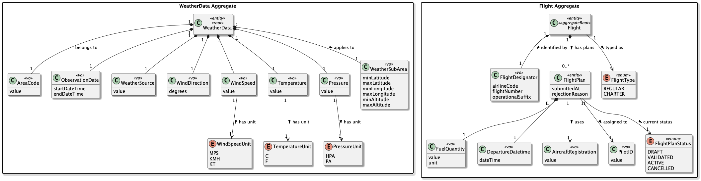

# US082 - Insert Weather Data in a Flight

## 1. Context

* As a Pilot, I want to add weather data to a flight plan of mine. If the flight plan has been
  previously tested, the test becomes invalid due to the new weather conditions.
* This task is being developed for the first time in sprint 3 and it has dependencies with the
  following requirements:
    * US041 - Register weather data (weather data must exist before being attached to a flight plan).
    * US043 - Consult weather data (pilots must be able to search and select weather data).
    * US081 - Create a flight plan from a file (flight plan must already exist before modification).

### 1.1 List of issues

**Main Issue:** Issue #132

**Analysis:** Issue #140

**Design and Unit Tests:** Issue #165

**Implement:** Issue #176

---

## 2. Requirements

**US082 -** As a Pilot, I want to add weather data to a flight plan of mine. If the flight plan
has been previously tested, the test becomes invalid due to the new weather conditions.

### Acceptance Criteria:

* **US082.1 -** The system must allow a Pilot to attach existing weather data to a flight plan.
* **US082.2 -** Only weather data already registered in the system can be used.
* **US082.3 -** The selected weather data must belong to a valid air control area.
* **US082.4 -** The system must ensure consistency between flight plan route and weather data region.
* **US082.5 -** When weather data is added, any previous validation or simulation test of the flight plan must be invalidated.
* **US082.6 -** The system must prevent attaching weather data that conflicts with flight time or location.
* **US082.7 -** The system must confirm successful association of weather data with the flight plan.

### Dependencies/References:

Regarding this requirement, we understand that it relates to:
- US041 - Register weather data: Necessary to ensure that only pre-existing weather data can be
  referenced by a flight plan.
- US043 - Consult weather data: Pilots must be able to search and select registered weather data
  before attaching it.
- US081 - Create a flight plan from a file: The flight plan must already exist as a precondition
  for this operation.
- US083 - Flight DSL specification and validation: The flight structure must remain valid after
  weather data changes.
- US100 / US110 / US113: Weather conditions directly affect simulation results such as wind,
  fuel consumption, and trajectory.

---

## 3. Analysis

The flight plan domain must support dynamic association of weather conditions as a modifying
factor of flight behavior.

`FlightPlan` is an aggregate root responsible for maintaining consistency of a planned flight
execution.

`WeatherData` is an external referenced aggregate that influences flight simulation but is not
owned by the flight plan.



| Attribute        | Description                                                 | Constraints                                                  |
|------------------|-------------------------------------------------------------|--------------------------------------------------------------|
| WeatherDataId    | Unique identifier for a registered weather data entry.      | Must not be null or empty.                                   |
| WeatherRegion    | Air control area to which the weather data belongs.         | Must reference a valid, existing AirControlArea.             |
| WeatherTimestamp | Date and time of the weather observation.                   | Must be temporally consistent with the flight plan schedule. |
| WindCondition    | Wind speed and direction at the time of observation.        | Speed must be non-negative; direction within 0–360 degrees.  |
| Temperature      | Atmospheric temperature at the time of observation.         | Must be a defined value in degrees Celsius.                  |
| Visibility       | Horizontal visibility in meters at the time of observation. | Must be a non-negative value.                                |

**Key business rules:**
* Reference Integrity: A flight plan can only reference weather data that already exists in the
  system — the `WeatherDataRepository` must confirm existence before attachment.
* Spatial Consistency: The `WeatherRegion` of the selected weather data must match the air control
  area of the flight plan route.
* Temporal Consistency: The `WeatherTimestamp` must be compatible with the scheduled flight time
  window — outdated or future-conflicting data must be rejected.
* Invalidation on Change: Attaching new weather data must reset any prior validation or simulation
  state of the flight plan.
* Conflicting Data Rejection: Any weather data that is spatially or temporally incompatible with
  the flight plan must be rejected before association.

**Relationship with the domain:**  
`FlightPlan` is an aggregate root whose invariant is ensuring the consistency of a planned flight
execution. It maintains a reference to `WeatherData` as an external aggregate, meaning the flight
plan does not own the weather data but is responsible for validating its compatibility before
association. The aggregate root ensures that no weather data is attached unless it satisfies both
the spatial (air control area) and temporal (flight schedule) constraints of the plan.

---

## 4. Design

*In this section, the team presents the solution design adopted to solve the requirement. This
includes a diagram of the realization of the functionality and the specification of the main tests
used to validate it. A class diagram is also provided to describe the classes involved.*

### 4.1. Realization

The design of the solution for this requirement is based on the following class diagram:


The following sequence diagram illustrates the realization of US082 - Insert Weather Data in a Flight:


### 4.2. Acceptance Tests

Include here the main tests used to validate the functionality. Focus on how they relate to the
acceptance criteria. May be automated or manual tests.

**Test 1:** *Verifies that weather data is successfully attached to a flight plan*

**Refers to Acceptance Criteria:** US082.1, US082.2, US082.3, US082.7

```java
@Test
void ensureWeatherDataIsSuccessfullyAttachedToFlightPlan() {

    final var area = new AirControlArea(new AreaCode("PT01"));
    final var weatherData = new WeatherData(
            new WeatherDataId("WD-001"),
            new WeatherRegion(area),
            new WeatherTimestamp(LocalDateTime.of(2025, 6, 15, 10, 0)),
            new WindCondition(15.0, 270.0),
            new Temperature(18.0),
            new Visibility(9999)
    );

    final var flightPlan = new FlightPlan(
            new FlightPlanId("FP-001"),
            pilot,
            route
    );

    flightPlan.attachWeatherData(weatherData);

    assertNotNull(flightPlan.weatherData());
    assertEquals(weatherData, flightPlan.weatherData());
}
```

**Test 2:** *Verifies that attaching weather data invalidates a previously validated flight plan*

**Refers to Acceptance Criteria:** US082.5

```java
@Test
void ensureAttachingWeatherDataInvalidatesPreviousValidation() {

    final var area = new AirControlArea(new AreaCode("PT01"));
    final var weatherData = new WeatherData(
            new WeatherDataId("WD-002"),
            new WeatherRegion(area),
            new WeatherTimestamp(LocalDateTime.of(2025, 6, 15, 10, 0)),
            new WindCondition(10.0, 180.0),
            new Temperature(20.0),
            new Visibility(9999)
    );

    final var flightPlan = new FlightPlan(
            new FlightPlanId("FP-002"),
            pilot,
            route
    );

    flightPlan.markAsValidated(); // simulate a previously validated flight plan

    assertTrue(flightPlan.isValidated());

    flightPlan.attachWeatherData(weatherData);

    assertFalse(flightPlan.isValidated());
}
```

**Test 3:** *Verifies that attaching weather data invalidates a previous simulation test*

**Refers to Acceptance Criteria:** US082.5

```java
@Test
void ensureAttachingWeatherDataInvalidatesPreviousSimulationTest() {

    final var area = new AirControlArea(new AreaCode("PT01"));
    final var weatherData = new WeatherData(
            new WeatherDataId("WD-003"),
            new WeatherRegion(area),
            new WeatherTimestamp(LocalDateTime.of(2025, 6, 15, 12, 0)),
            new WindCondition(20.0, 90.0),
            new Temperature(15.0),
            new Visibility(5000)
    );

    final var flightPlan = new FlightPlan(
            new FlightPlanId("FP-003"),
            pilot,
            route
    );

    flightPlan.markAsSimulationTested(); // simulate a previously tested flight plan

    assertTrue(flightPlan.hasPassedSimulation());

    flightPlan.attachWeatherData(weatherData);

    assertFalse(flightPlan.hasPassedSimulation());
}
```

**Test 4:** *Verifies that only weather data already registered in the system can be attached*

**Refers to Acceptance Criteria:** US082.2

```java
@Test(expected = IllegalArgumentException.class)
void ensureUnregisteredWeatherDataCannotBeAttached() {

    final var flightPlan = new FlightPlan(
            new FlightPlanId("FP-004"),
            pilot,
            route
    );

    flightPlan.attachWeatherData(null); // unregistered / null weather data
}
```

**Test 5:** *Verifies that weather data from a mismatched air control area is rejected*

**Refers to Acceptance Criteria:** US082.3, US082.4

```java
@Test(expected = IllegalArgumentException.class)
void ensureWeatherDataFromMismatchedAreaIsRejected() {

    final var routeArea = new AirControlArea(new AreaCode("PT01"));
    final var differentArea = new AirControlArea(new AreaCode("ES01"));

    final var weatherData = new WeatherData(
            new WeatherDataId("WD-005"),
            new WeatherRegion(differentArea), // different area from route
            new WeatherTimestamp(LocalDateTime.of(2025, 6, 15, 10, 0)),
            new WindCondition(10.0, 90.0),
            new Temperature(22.0),
            new Visibility(9999)
    );

    final var route = new FlightRoute(
            new RouteId("RT-001"),
            originAirport,      // airport in PT01
            destinationAirport, // airport in PT01
            routeArea
    );

    final var flightPlan = new FlightPlan(
            new FlightPlanId("FP-005"),
            pilot,
            route
    );

    flightPlan.attachWeatherData(weatherData); // should be rejected
}
```

**Test 6:** *Verifies that weather data conflicting with the flight time is rejected*

**Refers to Acceptance Criteria:** US082.6

```java
@Test(expected = IllegalArgumentException.class)
void ensureConflictingWeatherDataByTimeIsRejected() {

    final var area = new AirControlArea(new AreaCode("PT01"));

    final var weatherData = new WeatherData(
            new WeatherDataId("WD-006"),
            new WeatherRegion(area),
            new WeatherTimestamp(LocalDateTime.of(2020, 1, 1, 0, 0)), // outdated timestamp
            new WindCondition(5.0, 45.0),
            new Temperature(10.0),
            new Visibility(2000)
    );

    final var flightPlan = new FlightPlan(
            new FlightPlanId("FP-006"),
            pilot,
            route,
            new FlightSchedule(
                    LocalDateTime.of(2025, 6, 15, 10, 0),
                    LocalDateTime.of(2025, 6, 15, 12, 0)
            )
    );

    flightPlan.attachWeatherData(weatherData); // should be rejected due to temporal conflict
}
```

**Test 7:** *Verifies that the system confirms the successful association of weather data*

**Refers to Acceptance Criteria:** US082.7

```java
@Test
void ensureSuccessfulAssociationIsConfirmed() {

    final var area = new AirControlArea(new AreaCode("PT01"));
    final var weatherData = new WeatherData(
            new WeatherDataId("WD-007"),
            new WeatherRegion(area),
            new WeatherTimestamp(LocalDateTime.of(2025, 6, 15, 10, 0)),
            new WindCondition(12.0, 200.0),
            new Temperature(19.0),
            new Visibility(8000)
    );

    final var flightPlan = new FlightPlan(
            new FlightPlanId("FP-007"),
            pilot,
            route
    );

    final boolean result = flightPlan.attachWeatherData(weatherData);

    assertTrue(result);
    assertEquals(weatherData, flightPlan.weatherData());
}
```

**Test 8:** *Verifies that a flight plan rejects null weather data*

**Refers to Acceptance Criteria:** US082.1, US082.2

```java
@Test(expected = IllegalArgumentException.class)
void ensureFlightPlanRejectsNullWeatherData() {

    final var flightPlan = new FlightPlan(
            new FlightPlanId("FP-008"),
            pilot,
            route
    );

    flightPlan.attachWeatherData(null);
}
```


## 5. Implementation

The implementation follows the design presented in section 4 and applies Domain-Driven Design principles across all layers of the AISafe system.

### 5.1. Evidence of implementation aligned with design

1. **Layered use case orchestration**
    - `InsertWeatherDataUI` collects the pilot's flight and weather data choices from the console and delegates all logic to the controller.
    - `InsertWeatherDataController` acts as the application entry point, forwarding the DTO to `InsertWeatherDataService` without containing domain logic itself.
    - `InsertWeatherDataService` resolves all aggregates via repositories and drives the domain operation on `FlightPlan`.

   This ensures compliance with:
    * US082.1 (a pilot can attach existing weather data to a flight plan)

2. **Domain-enforced spatial and temporal consistency**
    - `FlightPlan.addWeatherData(WeatherData)` internally calls `validateSpatialConsistency` and `validateTemporalConsistency` before accepting the association.
    - `validateSpatialConsistency` compares the `WeatherRegion` of the provided `WeatherData` against the `AirControlArea` of the flight plan route, throwing `IncompatibleWeatherRegionException` on mismatch.
    - `validateTemporalConsistency` checks that the `ObservationDate` window of the weather data is compatible with the `FlightSchedule`, throwing `IncompatibleWeatherTimestampException` on conflict.

   This ensures compliance with:
    * US082.3 (weather data must belong to a valid air control area)
    * US082.4 (consistency between flight plan route and weather data region)
    * US082.6 (rejection of weather data conflicting with flight time or location)

3. **Reference integrity via repository lookup**
    - `WeatherDataRepository.findById` is called before any domain operation, ensuring only pre-existing, registered weather data can be attached.
    - If no matching record is found, `WeatherDataNotFoundException` is raised and the operation is aborted before touching the flight plan.

   This ensures compliance with:
    * US082.2 (only already-registered weather data can be used)

4. **Automatic invalidation of prior validation and simulation state**
    - When `FlightPlan.addWeatherData` is invoked and spatial/temporal checks pass, the method resets the plan's status to `DRAFT` via `invalidateValidation()`, regardless of its previous state (`VALIDATED` or `TESTED`).
    - This state transition is an invariant of the aggregate root, ensuring no external caller can bypass it.

   This ensures compliance with:
    * US082.5 (any previous validation or simulation test is invalidated on weather data change)

5. **Successful association confirmation**
    - `FlightPlan.addWeatherData` returns `true` on success, and the updated `Flight` aggregate is persisted via `FlightRepository.save`.
    - The UI displays a confirmation message to the pilot upon receiving the success signal from the controller.

   This ensures compliance with:
    * US082.7 (the system confirms successful association of weather data with the flight plan)

6. **Role-based access control**
    - Only users with role `PILOT` can execute the use case.
    - Authorization is enforced at controller level via:
      ```java
      authz.ensureAuthenticatedUserHasAnyOf(AisafeRoles.PILOT);
      ```

### 5.2. Relevant artifacts and configuration files

- **Domain**
    - `aisafe.core/src/main/java/aiSafe/flight/domain/FlightPlan.java`
    - `aisafe.core/src/main/java/aiSafe/flight/domain/Flight.java`
    - `aisafe.core/src/main/java/aiSafe/flight/domain/FlightPlanStatus.java`
    - `aisafe.core/src/main/java/aiSafe/weatherdata/domain/WeatherData.java`
  
- **Application**
    - `aisafe.core/src/main/java/aiSafe/flight/application/InsertWeatherDataController.java`
    - `aisafe.core/src/main/java/aiSafe/flight/application/InsertWeatherDataService.java`
    - `aisafe.core/src/main/java/aiSafe/flight/application/InsertWeatherDataDTO.java`
  
- **Presentation**
    - `aisafe.app.backoffice.console/src/main/java/aiSafe/app/backoffice/console/presentation/flight/InsertWeatherDataUI.java`

- **Persistence**
    - `aisafe.core/src/main/java/aiSafe/flight/repositories/FlightRepository.java`
    - `aisafe.core/src/main/java/aiSafe/weatherdata/repositories/WeatherDataRepository.java`
    - `aisafe.persistence.impl/src/main/java/aiSafe/persistence/impl/jpa/JpaFlightRepository.java`

### 5.3. Major commits (summary)

- `d84a3bd` — add insertWeatherData domain logic and controller
- `c71f32a` — add acceptance tests to US082 README and update domain model excerpt, class diagram and sequence diagram
- `7a371f2` — added the sequence diagram and class diagram for US082
- `4245bad` — added the analysis for US082 and the excerpt of the domain model

---

## 6. Integration/Demonstration

### 6.1. Architectural Integration

This functionality integrates with the system following the persistence architecture defined for the project. Both the `FlightRepository` and `WeatherDataRepository` interfaces are defined in the core domain module and resolved at runtime via `PersistenceContext`:

- **`persistence.impl.inmemory`** — used for testing and early development.
- **`persistence.impl.jpa`** — used in production, backed by JPA/Hibernate with full ORM mapping.

### 6.2. Integration Points

| Layer                  | Component                                                 | Role                                                       |
|------------------------|-----------------------------------------------------------|------------------------------------------------------------|
| Domain                 | `Flight`, `FlightPlan`, `FlightRepository`                | Aggregate roots and repository interface for flight data   |
| Domain                 | `WeatherData`, `WeatherDataRepository`                    | Aggregate and repository interface for weather data        |
| Application            | `InsertWeatherDataController`, `InsertWeatherDataService` | Orchestrates the use case, enforces authz                  |
| Persistence (JPA)      | `JpaFlightRepository`                                     | Persists updated flight aggregate to relational DB via JPA |
| Persistence (InMemory) | `InMemoryFlightRepository`                                | Used in tests                                              |
| Infrastructure         | `PersistenceContext`                                      | Resolves the active `RepositoryFactory` at runtime         |
| Presentation           | `InsertWeatherDataUI`                                     | Console entry point for the pilot                          |

### 6.3. How to Demonstrate

1. Start the application using the Backoffice console module.
2. Log in with a user holding the `PILOT` role (e.g. `pilot@aisafe.local`).
3. Navigate to `Flights > Insert Weather Data in a Flight Plan`.
4. Select one of your existing flight plans from the displayed list.
5. Select an existing weather data entry from the list (filtered by compatible air control area).
6. The system validates spatial and temporal consistency and, if successful, attaches the weather data to the flight plan.
7. If the flight plan had been previously validated or simulation-tested, the system resets its status to `DRAFT` and informs the pilot.
8. A confirmation message is displayed indicating that the weather data was successfully associated.

**Expected output example (successful association):**
```
Flight plan 'FP-001' updated successfully.
Weather data 'WD-007' has been attached.
Previous validation status has been reset to DRAFT.
```

**Expected output example (incompatible region):**
```
ERROR: Weather data region 'ES01' does not match the flight plan route area 'PT01'.
Operation aborted. No changes were made to the flight plan.
```

---

## 7. Design Decisions

### 7.1. Architectural Decisions

The project follows a layered, DDD-based architecture where the repository contract is always defined in the core domain module, while concrete implementations live in separate modules resolved at runtime by `RepositoryFactory`. This ensures:

- The domain model has **zero dependency** on persistence technology.
- Switching between InMemory and JPA requires only a configuration change.

The spatial and temporal consistency validations were deliberately placed inside `FlightPlan` as domain methods rather than in the service layer. This keeps the aggregate root responsible for enforcing its own invariants — no external caller can attach weather data without passing through these checks, regardless of how the use case is invoked.

The decision to reset the flight plan status to `DRAFT` as part of `addWeatherData` (rather than as a separate service step) was made to ensure the invalidation is atomic with the association. Both changes are persisted in a single `FlightRepository.save` call, which prevents any intermediate inconsistent state (e.g. a validated plan with new, untested weather data).

The persistence layer followed the pattern represented below:


### 7.2. Third-party Works

- **EAPLI Framework** — provides the base infrastructure for `AggregateRoot`, `ValueObject`, `Repository`, `AuthzRegistry`, and console UI rendering used throughout this implementation.
- **Jakarta Persistence (JPA) / Hibernate** — used for ORM mapping of the `Flight` and `FlightPlan` entities and their embedded value objects.