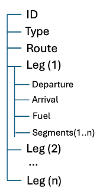

# US083 - Flight DSL Specification and Validation

## 1. Introduction

This document specifies the **Core Flight DSL** used to define and validate flight plans in the AISafe system.

The DSL allows the formal description of flights, flight legs, routes, segments and fuel information in a structured, text-based format. It is implemented with **ANTLR4** and **Java** in module `aisafe.core`.

**Out of scope for US083:** JSON flight documents, persistence, and mapping to JPA domain entities (handled by **US081**).

### 1.1 Relationship with other user stories

| Story | Role relative to US083 |
|-------|-------------------------|
| **US080** | Creates/stores DSL on `FlightPlan` (`DslSource`); manual UI generation uses `FlightPlanDslGenerator` with `type` values defined **here** |
| **US081** | Imports `.flight` files; calls `FlightDslValidator` (this story) before persisting |
| **US085** | Validates DSL already stored on a plan; reuses the same grammar and rules |

The DSL **`type`** values match domain **`FlightType`** (`REGULAR`, `CHARTER`) — see §3.9.

---

## 2. Objectives

The Flight DSL supports:

- Lexical validation
- Syntactic validation
- Semantic validation (single pass, all errors collected)
- Parse tree generation
- Intermediate model construction (`DslFlightPlan`)
- Error reporting with type, description, line and column

---

## 3. Informal Lexical Specification

### 3.1 Keywords

Reserved keywords (case-insensitive):


| Keyword     | Usage                     |
| ----------- | ------------------------- |
| flight      | Flight declaration        |
| type        | Flight type declaration   |
| leg         | Flight leg block          |
| departure   | Departure point           |
| arrival     | Arrival point             |
| route       | Route block               |
| segment     | Trajectory segment        |
| fuel        | Fuel declaration          |
| origin      | Route origin airport      |
| destination | Route destination airport |
| altitude    | Segment altitude          |
| start       | Segment start coordinates |
| end         | Segment end coordinates   |
| regular     | Flight type → `FlightType.REGULAR` (domain-aligned) |
| charter     | Flight type → `FlightType.CHARTER` (domain-aligned) |

Example: `flight`, `FLIGHT` and `Flight` are all valid. For `type`, `regular`, `REGULAR` and `Regular` are equivalent (case-insensitive).

> **Not in this grammar:** `passenger`, `cargo`, `private` (legacy); use `regular` / `charter` per project domain model and LPROG enunciado.

> **Note:** Keywords such as `wind` or `speed` may appear in other formats (e.g. client JSON reference) but are **not** part of the Core Flight DSL v1.

### 3.2 Identifiers

Used for the flight identifier.

- Must start with a letter
- May contain letters, digits and underscore
- Case-sensitive

Examples: `TP123`, `flight_001`, `cargoFlight`

### 3.3 Airport Codes

- IATA: 3 uppercase letters (`OPO`, `LIS`)
- ICAO: 4 uppercase letters (`LPPR`, `LPPT`)

Lowercase codes are rejected by the lexer.

### 3.4 Numeric Literals

Integers and floating-point numbers.

Examples: `100`, `2500`, `45.7`, `12000.50`

### 3.5 Date and Time Literals


| Format | Pattern    | Example    |
| ------ | ---------- | ---------- |
| Date   | YYYY-MM-DD | 2026-05-11 |
| Time   | HH:MM      | 14:30      |

Invalid calendar dates are reported during semantic validation.

### 3.6 Units


| Unit | Meaning   | Used in grammar  |
| ---- | --------- | ---------------- |
| kg   | kilograms | fuel             |
| l    | liters    | fuel             |
| m    | meters    | segment altitude |

### 3.7 Symbols


| Symbol | Meaning          |
| ------ | ---------------- |
| { }    | block delimiters |
| ( )    | coordinate pairs |
| ,      | separator        |

Collections (`[ ]`), association (`:`) and statement terminator (`;`) are **not** used in Core Flight DSL v1.

### 3.8 Whitespace

Whitespace and line breaks are ignored.

### 3.9 Flight type (`type` in DSL)

The **`type`** line uses the same enumeration as the domain: `aiSafe.flight.domain.FlightType` (`REGULAR`, `CHARTER`).

| Grammar keyword (case-insensitive) | Parsed as | Domain enum |
|------------------------------------|-----------|-------------|
| `regular` | `REGULAR` | `FlightType.REGULAR` |
| `charter` | `CHARTER` | `FlightType.CHARTER` |

**Coherence rules:**

- `FlightDSL.g4`, `FlightDslModelBuilder`, and `DslFlightPlan.flightType()` all use **`FlightType`** (no separate `DslFlightType`).
- **US080** (`FlightPlanDslGenerator`, console option 1) and **US081** (file import) must use `REGULAR` or `CHARTER` in generated or validated DSL.
- For operational consistency, the DSL `type` on a plan should normally match `Flight.type()` on the associated flight, but US083 validation does not enforce that cross-check (handled in application use cases if required).
- Legacy values `passenger` / `cargo` / `private` are **rejected** by the lexer/parser.

---

## 4. Informal Syntax Specification

### 4.1 General Structure

A flight plan file contains exactly one flight:

- A flight identifier
- A **`type`** declaration: `REGULAR` or `CHARTER` (`FlightType`; see §3.9)
- One or more legs

Example:

```txt
flight TP123 {
    type REGULAR

    leg {
        departure OPO 2026-05-11 08:00
        arrival LIS 2026-05-11 09:00

        route {
            origin OPO
            destination LIS
        }

        segment {
            start (41.242, -8.678)
            end (38.774, -9.134)
            altitude 12000 m
        }

        fuel 5000 kg
    }
}
```

Each **leg** must contain, in order: `departure`, `arrival`, `route`, one or more `segment` blocks, and `fuel`.

### 4.2 Informal structure



---

## 5. Conceptual Model

### 5.1 Flight (`DslFlightPlan`)

- Identifier (DSL flight id, e.g. `TP123`)
- **`FlightType`** (`REGULAR`, `CHARTER`) — same enum as `Flight.type()`
- One or more legs

### 5.2 Leg

- Departure (airport, date, time)
- Arrival (airport, date, time)
- Route (origin, destination)
- One or more segments
- Fuel (amount, unit)

### 5.3 Segment

- Start coordinates (latitude, longitude)
- End coordinates (latitude, longitude)
- Altitude in meters

### 5.4 Route Signature

For integration with the domain model (US081), each flight plan defines a **route signature** derived from the first leg:

- routeSignature = origin + "-" + destination
- Example: OPO-LIS

This value is used during import to validate that the DSL flight plan matches the route of the target Flight aggregate.

The domain model represents this using:

- `RouteDesignator` (origin + destination)
- `FlightRoute` aggregate

This validation is performed outside US083 (in US081).

---

## 6. Formal Grammar and Implementation

### 6.1 ANTLR grammar


| Item              | Location                                                  |
| ----------------- | --------------------------------------------------------- |
| Grammar file      | `aisafe.core/src/main/antlr4/FlightDSL.g4`                |
| Generated sources | `aisafe.core/gen/` (do not edit; run Maven to regenerate) |

Generate parser classes:

```bash
mvn -pl aisafe.core generate-sources
```

### 6.2 Validation API (for US081)

```java
FlightDslValidationResult result = FlightDslValidator.validate(String source);
// or, from US081 file import:
FlightDslValidationResult result = FlightDslValidator.validateFile(Path path);
```

On failure, use `result.formattedErrors()` for user-facing messages.


| Method / type               | Role                                                    |
| --------------------------- | ------------------------------------------------------- |
| `FlightDslValidator`        | Entry point: lex + parse + build model + semantics      |
| `FlightDslValidationResult` | `isValid()`, `model()`, `errors()`                      |
| `FlightDslError`            | `type()`, `message()`, `line()`, `column()`, `format()` |

### 6.3 Java packages

```text
aiSafe.flight.dsl/
  FlightDslValidator.java           Public API
  FlightDslModelBuilder.java          Visitor → builds intermediate model
  FlightDslStructureListener.java     Listener (parse-time structure tracking)
  FlightDslSemanticValidator.java   Semantic rules
  FlightDslErrorCollector.java        Lexical/syntactic error capture
  FlightDslError.java / FlightDslErrorType.java / FlightDslValidationResult.java

aiSafe.flight.dsl.model/
  DslFlightPlan, DslLeg, DslRoute, DslSegment, DslFuel,
  DslSchedulePoint, DslCoordinates
  (flight type: domain FlightType on DslFlightPlan)
```

The `Dsl*` types are an **intermediate representation**. Mapping to JPA `FlightPlan` / persistence is **US081**.

The parser maps `type regular` / `type charter` directly to `FlightType` on `DslFlightPlan`.

---

## 7. Validation

### 7.1 Lexical Validation

Performed by `FlightDSLLexer` and `FlightDslErrorCollector` (`LEXICAL`):

- Invalid characters / tokens
- Invalid identifiers
- Airport codes not matching IATA/ICAO pattern
- Malformed numeric tokens

### 7.2 Syntactic Validation

Performed by `FlightDSLParser` and `FlightDslErrorCollector` (`SYNTAX`):

- Missing `{` / `}`
- Wrong block order inside a leg
- Missing `segment` or `fuel`
- Invalid flight type token (only `regular` / `charter`; legacy `passenger` / `cargo` / `private` are syntax errors)

### 7.3 Semantic Validation

Performed by `FlightDslSemanticValidator` (`SEMANTIC`). All rules run in **one pass**; all violations are returned together.

**Flight level**

- One flight per file (enforced by grammar `flightPlan : flight EOF`)
- Flight type must be `REGULAR` or `CHARTER` (`FlightType`; enforced by parser — see §3.9)

**Leg level (each leg)**

- Route `origin` must equal that leg's `departure` airport
- Route `destination` must equal that leg's `arrival` airport
- Arrival date/time must be **after** departure date/time on the same leg
- Fuel amount must be positive
- Each segment altitude must be positive
- Segment start and end coordinates must differ
- Date/time literals must be valid (`LocalDate` / `LocalTime` parsing)

**Multi-leg coherence**

- Arrival airport of leg *n* must equal departure airport of leg *n+1*
- Arrival time of leg *n* must be before departure time of leg *n+1*

**Route / airport visits**

- The ordered visit sequence is: departure airport of leg 1, then each leg's arrival. The same airport cannot appear twice in that sequence (e.g. OPO→LIS→MAD is valid; OPO→LIS→OPO is not)

**Structural**

- Segments belong to exactly one leg (enforced by grammar nesting)

---

## 8. Parse Tree Processing


| Component | Class                        | Role                                  |
| --------- | ---------------------------- | ------------------------------------- |
| Visitor   | `FlightDslModelBuilder`      | Builds`DslFlightPlan` from parse tree |
| Listener  | `FlightDslStructureListener` | Counts legs/segments during parse     |

---

## 9. Error Handling

Each error includes:

- **Type:** `LEXICAL`, `SYNTAX`, or `SEMANTIC`
- **Description**
- **Line** and **column** (1-based column)

Example:

```txt
Syntax Error [Line 12, Column 8]: mismatched input ...
```

```txt
Semantic Error [Line 5, Column 1]: Arrival time must be after departure time on leg 1.
```

---

## 10. Verification

### 10.1 Automated tests

```bash
mvn -pl aisafe.core test -Dtest=FlightDslValidatorTest
```

Tests cover: valid single- and two-leg plans, file import API, empty input, syntax/lexical errors with line/column, multiple semantic errors in one pass, case-insensitive keywords, invalid same-leg times, invalid dates, repeated airports, broken multi-leg airport chain.

Sample files:

- `aisafe.core/src/test/resources/flight-plans/valid-single-leg.flight`
- `aisafe.core/src/test/resources/flight-plans/valid-two-legs.flight`

### 10.2 US083 task checklist


| Sprint task                                              | Status |
| -------------------------------------------------------- | ------ |
| Informal lexical/syntactic specification (this document) | Done   |
| Formal ANTLR grammar                                     | Done   |
| Lexical and syntactic validation                         | Done   |
| At least one visitor and one listener                    | Done   |
| Intermediate representation (`Dsl*`)                     | Done   |
| Semantic validation rules                                | Done   |
| Clear errors with line/column                            | Done   |
| Unit tests                                               | Done   |

---

## 11. Technologies


| Technology | Purpose                   |
| ---------- | ------------------------- |
| Java 21    | Implementation            |
| ANTLR 4.13 | Parser generation         |
| JUnit 5    | Tests                     |
| Maven      | Build and code generation |

---

## 12. Observations

### 12.1 LPROG / enunciado alignment

- Core Flight DSL **`type`** values were aligned with the domain model: **`REGULAR`** and **`CHARTER`** only (`FlightDSL.g4`, `DslFlightPlan`, **US080**, **US081**).
- **`AircraftType`** (`PASSENGER`, `CARGO`, `MIXED` on aircraft **models**) remains a separate concept — do not confuse with flight plan `type`.
- Sample files under `aisafe.core/src/test/resources/flight-plans/` and `FlightPlans/` use `type REGULAR` or `type CHARTER`.
