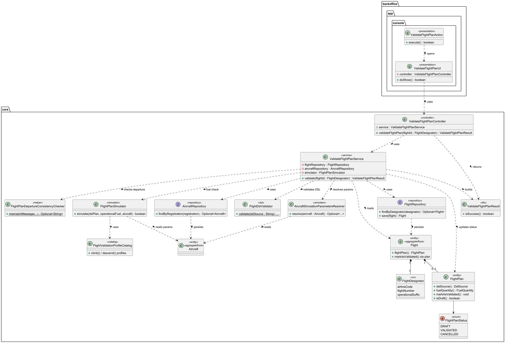
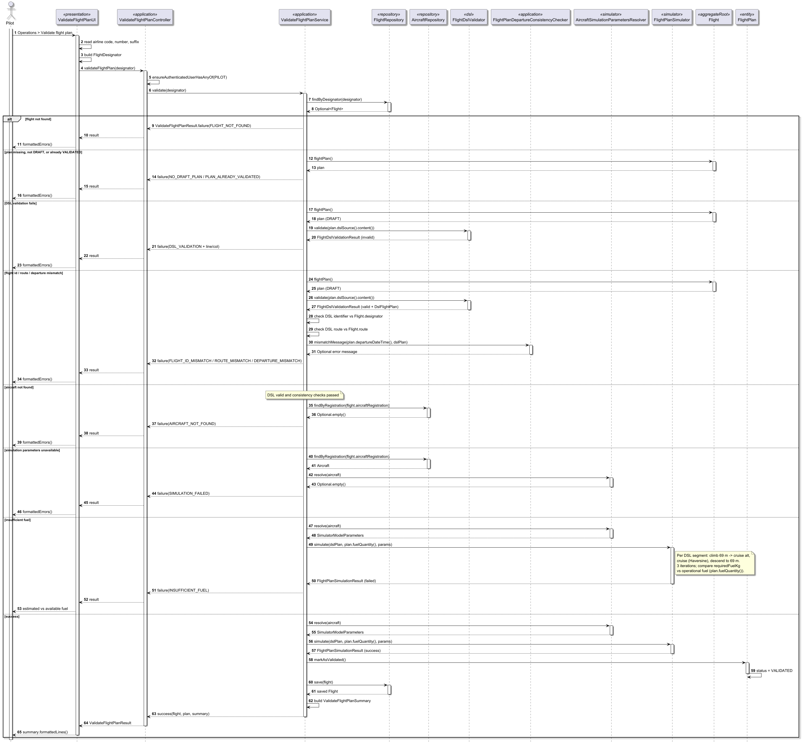

# US085 – Test / Validate Flight Plan

## 1. Context

* As a **Pilot**, I want to **validate** my draft flight plan so that DSL, business rules, and operational fuel are checked before the plan is considered ready for downstream simulation.

This story covers the **Java backoffice** validation step in the flight plan lifecycle (DSL parsing, cross-checks, fuel estimation). Export to SCOMP JSON is a **separate** user story.

### 1.1 Related user stories


| Story             | Role                                                                                            |
| ----------------- | ----------------------------------------------------------------------------------------------- |
| **US080 / US081** | Create or import a flight plan (`DRAFT`) with Core Flight DSL stored on `FlightPlan.dslSource`. |
| **US082**         | Attach weather data; if the plan was`VALIDATED`, revert to `DRAFT`.                             |
| **US083 / US120** | DSL grammar and semantic rules (segments with`width`, `wind`, etc.).                            |
| **US050**         | `MinFuelAtArrival` on `AirControlArea` (planned validation rule — see §3.5).                  |

### 1.2 List of issues

**Main Issue:** Issue #189

**Analysis:** Issue #191

**Design:** Issue #192

**Implement:** Issue #193

---

## 2. Requirements

**US085 —** As a Pilot, I want to test/validate a draft flight plan.

### 2.1 Acceptance criteria

* **US085.1** Only a flight plan in status `DRAFT` can be validated.
* **US085.2** Full Core Flight DSL validation (lexical, syntactic, semantic) must pass (`FlightDslValidator`).
* **US085.3** Cross-checks: DSL flight id, route signature, and plan-level departure must match the selected `Flight`.
* **US085.4** The assigned aircraft must exist and provide simulation parameters (active engines certified for the model).
* **US085.5** A physics-based fuel simulation must estimate trip fuel; **operational fuel** on the plan must be **≥ estimated trip fuel**.
* **US085.6** On success, the plan status becomes `VALIDATED` (no separate `ACTIVE` state).
* **US085.7** A summary is shown (route, fuel available vs estimated, segment count, etc.).

### 2.2 Out of scope (this story)

* Export to SCOMP JSON (separate user story).
* Real-time position simulation, separation violations, weather effects in Java.
* Pilot remote access (US086) — may reuse the same application services later.

### 2.3 Dependencies

* `FlightPlanStatus`: `DRAFT`, `VALIDATED`, `CANCELLED` (no `ACTIVE`).
* `Aircraft`, `AircraftModel`, `EngineModel`, `PhysicalSpecs` for simulation parameters.

---

## 3. Analysis

### 3.1 Flight plan lifecycle (team decision)

```
Register / Import  →  DRAFT
       ↓
Validate (US085)   →  VALIDATED   (DSL + fuel check)
```

Inserting weather on a `VALIDATED` plan (US082) reverts it to `DRAFT`. Replacing a `VALIDATED` plan requires voiding validation first (weather) or operational procedures agreed with the team.

There is **no** “activate for simulation” step in the domain model.

---

### 3.2 Validation flow (Java)


| Step                                | Responsibility                                                             |
| ----------------------------------- | -------------------------------------------------------------------------- |
| Load`Flight` + current `DRAFT` plan | `ValidateFlightPlanService`                                                |
| Parse & validate DSL                | `FlightDslValidator` → `DslFlightPlan`                                    |
| Consistency                         | Flight id, route (first leg origin – last leg arrival), departure vs plan |
| Resolve aircraft                    | `AircraftRepository` → `AircraftSimulationParametersResolver`             |
| Fuel simulation                     | `FlightPlanSimulator.simulate(dslPlan, plan.fuelQuantity(), params)`       |
| Persist                             | `plan.markAsValidated()` + save                                            |

**Operational fuel** used in the check: `FlightPlan.fuelQuantity()` (value entered at registration/import), **not** the `fuel` line inside the DSL leg (unless the team explicitly aligned both at input time).

---

### 3.3 Java fuel simulation — purpose and scope

**Purpose:** Answer one question before `VALIDATED`:

> Does the operational fuel on the plan cover the estimated fuel for the trajectory defined in the DSL, given the assigned aircraft?

**It is not** the SCOMP simulator. It does **not**:

* advance time or emit positions;
* apply attached `WeatherData`;
* check `MinFuelAtArrival` at destination (not implemented yet — §3.5);
* check separation or airspace rules.

#### 3.3.1 Inputs


| Source            | Data                                                                                                                            |
| ----------------- | ------------------------------------------------------------------------------------------------------------------------------- |
| **DSL**           | Segment coordinates, cruise altitude per segment, legs                                                                          |
| **FlightPlan**    | Operational`fuelQuantity` (kg)                                                                                                  |
| **Aircraft (BD)** | Empty weight, wing area, drag/lift coeffs, cruise speed, active engines + TSFC + thrust                                         |
| **Hardcoded**     | Aspect ratio 9, Oswald 0.84, ground altitude 69 m, load factor 70% on seats × 100 kg/passenger                                 |
| **Profiles**      | `FlightValidationProfileCatalog` + `SimulationCalibration.OPERATIONAL` (fuel factor 0.14, climb rate ×2) |

#### 3.3.2 Trajectory model (per DSL segment)

Each DSL `segment` is expanded into three phases:

1. **Climb** — 69 m → segment cruise altitude (vertical at segment start coordinates)
2. **Cruise** — start → end coordinates at cruise altitude (Haversine distance)
3. **Descend** — cruise altitude → 69 m (vertical at segment end coordinates)

Fuel burn uses simplified aerodynamics (drag from mass/speed/altitude, thrust for climb/cruise/descent) and TSFC per active engine. Three iterative passes refine mass as fuel is consumed.

#### 3.3.3 Pass criterion

```
availableFuelKg  =  plan.fuelQuantity() converted to kg
requiredFuelKg   =  iterative simulation result

PASS if  requiredFuelKg ≤ availableFuelKg
FAIL   →  INSUFFICIENT_FUEL
```

---

### 3.4 FlightValidationProfileCatalog

`FlightValidationProfileCatalog` holds **hardcoded** climb/descent steps in Java (calibrated for short-haul operational validation). It is **not** loaded per aircraft model from the database. Only **cruise speed** and **engine count** come from the assigned aircraft (`AircraftSimulationParametersResolver` reads `Aircraft.engineModels()`).

**Design follow-up:** confirm with product whether climb/descend should eventually be per `AircraftModel` or truncated to each plan’s cruise altitude.

---

### 3.5 Known gaps and open points


| Topic                                 | Status              | Notes                                                                                                           |
| ------------------------------------- | ------------------- | --------------------------------------------------------------------------------------------------------------- |
| `MinFuelAtArrival` (US050)            | **Not implemented** | After trip fuel check, validate remaining fuel at destination airport ≥ area minimum (e.g. LIS / LPPT 100 kg). |
| Operational vs DSL fuel               | **Risk**            | Validation uses`plan.fuelQuantity()`; DSL leg `fuel` may differ if not kept in sync at registration.            |
| FlightProfile per aircraft / altitude | **Open**            | Catalog is global; design may need per-model or DSL-truncated profiles.                                         |
| Weather in validation                 | **Out of scope**    | US082 attaches weather but Java fuel sim does not consume it yet.                                               |

---

### 3.6 Analysis checklist

- [X]  Lifecycle: `VALIDATED` is the post-validation state; no `ACTIVE`.
- [X]  Validation: DSL + cross-checks + fuel simulation.
- [X]  Fuel simulation scope: trip fuel only in Java.
- [ ]  `MinFuelAtArrival` rule — deferred to follow-up analysis/implementation.
- [ ]  Per-aircraft or altitude-truncated FlightProfile — design decision pending.

---

## 4. Design

The solution follows the layered DDD architecture used in US080/US082: thin **presentation** (console UI + action), **application** controller enforcing `PILOT` role, **application service** orchestrating repositories and domain/DSL/simulator components, and **domain** state transitions on `FlightPlan`.

Entry point: **Operations → Validate flight plan** in `MainMenu` for role `PILOT`.

### 4.1. Class diagram



Source: [`classDiagram/us085_ClassDiagram.puml`](classDiagram/us085_ClassDiagram.puml)

**Main packages (as designed):**


| Layer        | Classes                                                                                                                          |
| ------------ | -------------------------------------------------------------------------------------------------------------------------------- |
| Presentation | `ValidateFlightPlanUI`, `ValidateFlightPlanAction`                                                                               |
| Application  | `ValidateFlightPlanController`, `ValidateFlightPlanService`, `ValidateFlightPlanResult`, `FlightPlanDepartureConsistencyChecker` |
| Simulator    | `FlightPlanSimulator`, `AircraftSimulationParametersResolver`, `FlightValidationProfileCatalog`                                  |
| DSL (reuse)  | `FlightDslValidator`                                                                                                             |
| Domain       | `Flight`, `FlightPlan`, `FlightPlanStatus`, `Aircraft`                                                                           |
| Repositories | `FlightRepository`, `AircraftRepository`                                                                                         |

### 4.2. Sequence diagram



Source: [`sequenceDiagram/us085_SequenceDiagram.puml`](sequenceDiagram/us085_SequenceDiagram.puml)

**Happy path (final `else` branch):** load `Flight` → ensure `DRAFT` plan → `FlightDslValidator` → cross-checks → resolve aircraft parameters → `FlightPlanSimulator.simulate` → `markAsValidated()` → save → return summary.

**Failure paths (`alt` / `else` branches):** `FLIGHT_NOT_FOUND`, `NO_DRAFT_PLAN` / `PLAN_ALREADY_VALIDATED`, `DSL_VALIDATION`, `FLIGHT_ID_MISMATCH` / `ROUTE_MISMATCH` / `DEPARTURE_MISMATCH`, `AIRCRAFT_NOT_FOUND`, `SIMULATION_FAILED`, `INSUFFICIENT_FUEL`.

### 4.3. Acceptance tests

Automated tests in `aisafe.core` (as designed):


| Test class                                                             | Covers                                                                   |
| ---------------------------------------------------------------------- | ------------------------------------------------------------------------ |
| `ValidateFlightPlanServiceTest`                                        | DSL errors, insufficient fuel, success →`VALIDATED`, departure mismatch |
| `FlightPlanSimulatorTest` / `AircraftSimulationParametersResolverTest` | Fuel model and aircraft parameter resolution                             |

**Test 1:** Verifies that validation promotes a draft plan to `VALIDATED` when DSL and fuel simulation succeed.

**Refers to:** US085.1–US085.7

```java
@Test
void validate_sets_validated_on_success() {
    final Flight flight = flightWithDraftPlan(validDsl());
    stubSimulationSuccess();
    when(flightRepository.findByDesignator(DESIGNATOR)).thenReturn(Optional.of(flight));

    final ValidateFlightPlanResult result = service.validate(DESIGNATOR);

    assertTrue(result.isSuccess());
    assertTrue(flight.flightPlan().isValidated());
}
```

### 4.4. Diagram generation

Regenerate PNGs from PlantUML sources:

```bash
java -jar libs/plantuml-1.2026.2.jar -tpng docs/UserStories/US085/**/*.puml
```

Or run `./generate-plantuml-diagrams.sh` from the repository root when `libs/plantuml-1.2026.2.jar` is present.

---

## 5. Implementation

The implementation follows the design in §4. Scope is **validation only** (`DRAFT` → `VALIDATED`); export to SCOMP JSON is not part of this story.

### 5.1 Evidence of implementation aligned with design

- [X]  **Presentation:** `ValidateFlightPlanUI`, `ValidateFlightPlanAction`; menu entry under **Operations** (role `PILOT`)
- [X]  **Application:** `ValidateFlightPlanController`, `ValidateFlightPlanService`, `ValidateFlightPlanResult`, `ValidateFlightPlanSummary`, `FlightPlanDepartureConsistencyChecker`
- [X]  **Simulator:** `FlightPlanSimulator`, `AircraftSimulationParametersResolver`, `FlightValidationProfileCatalog`, `SimulationCalibration`
- [X]  **DSL reuse:** `FlightDslValidator` (US083/US120)
- [X]  **Domain:** `FlightPlan.markAsValidated()`; lifecycle `DRAFT` / `VALIDATED` / `CANCELLED` (no `ACTIVE`)
- [X]  **Removed:** legacy activate flow (`ActivateFlightPlan*` UI/service/tests)
- [X]  **Tests:** `ValidateFlightPlanServiceTest`, `ValidateFlightPlanSummaryTest`, `FlightPlanSimulatorTest`, `AircraftSimulationParametersResolverTest`

### 5.2 Relevant artifacts


| Layer       | Path                                                                                 |
| ----------- | ------------------------------------------------------------------------------------ |
| Console     | `aisafe.app.backoffice.console/.../flight/ValidateFlightPlan*.java`, `MainMenu.java` |
| Application | `aisafe.core/.../flight/application/validate/`                                       |
| Simulator   | `aisafe.core/.../flight/application/validate/simulator/`                             |
| Domain      | `aisafe.core/.../flight/domain/FlightPlan.java`, `FlightPlanStatus.java`             |
| Tests       | `aisafe.core/src/test/java/aiSafe/flight/application/validate/`                      |

### 5.3 How to use (backoffice console)

1. Log in as **PILOT**.
2. Register or import a flight plan (US080/US081) — status must be `DRAFT`.
3. **Operations → Validate flight plan** → enter flight designator (IATA, number, optional suffix).
4. On success: plan becomes `VALIDATED` and a summary is printed (route, fuel available vs estimated, segments, etc.).
5. On failure: validation errors are listed (DSL, consistency, aircraft, insufficient fuel).

Sample flight plan for smoke test: `FlightPlans/realistic-opo-lis.flight` (TP123 OPO–LIS, operational fuel ≥ estimated).

### 5.4 Automated verification

```bash
mvn -pl aisafe.core test "-Dtest=ValidateFlightPlanServiceTest,ValidateFlightPlanSummaryTest,FlightPlanSimulatorTest,AircraftSimulationParametersResolverTest"
```

---

## 6. Verification

### 6.1 Manual smoke test

1. Bootstrap / register TP123 OPO–LIS (`FlightPlans/realistic-opo-lis.flight`, operational fuel ≥ estimated).
2. **Operations → Validate flight plan** → confirm `VALIDATED` and fuel summary.

### 6.2 Automated

Same command as §5.4.
