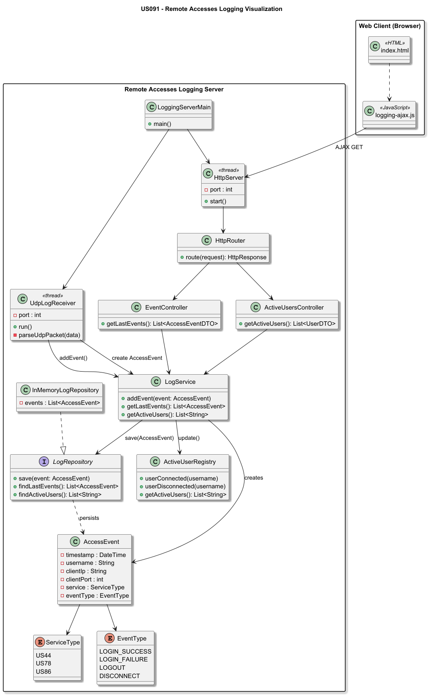
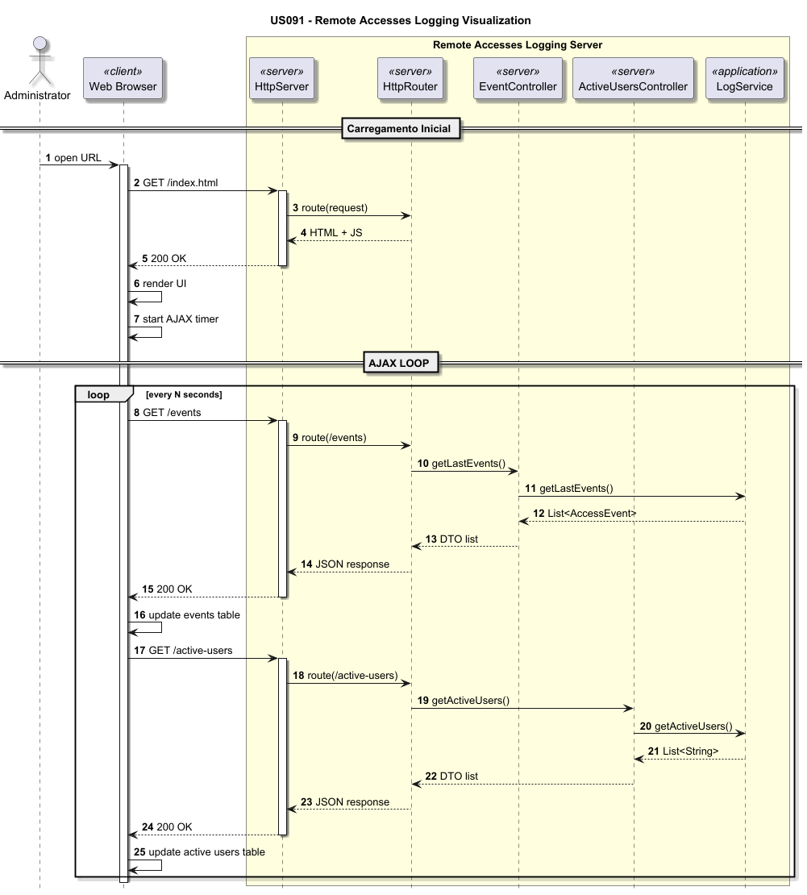

# US091 - Remote Access Logging Visualization

## 1. Context
* As an Administrator, I intend to view the logs stored on the Remote Access Log Server.
* This US is part of the RCOMP component and directly depends on US090 for data reception.
* Visualization should be done through a standard web browser, communicating via HTTP.

## 2. Requirements
* **US091.1** The Log Server must contain an HTTP server.
* **US091.2** Provide a page with the latest recorded events.
* **US091.3** Provide a page with the list of active remote users.
* **US091.4** Use AJAX to update the data without reloading the page.

## 3. Analysis
### Update Strategy (AJAX)
The client (browser) will load an initial static page. A JavaScript script will execute asynchronous requests (GET) to the server at defined intervals (e.g., every 2 seconds) to obtain the latest data in JSON format or HTML fragments [5, 7].

### HTTP Server Endpoints
* `GET /events`: Returns the list of the latest logs.
* `GET /active-users`: Returns the list of users with an open session.
* `GET /`: Serves the `index.html` file.

## 4. Design
Class Diagram:

SSD:
