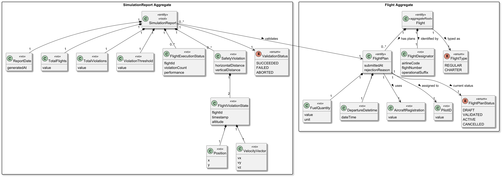
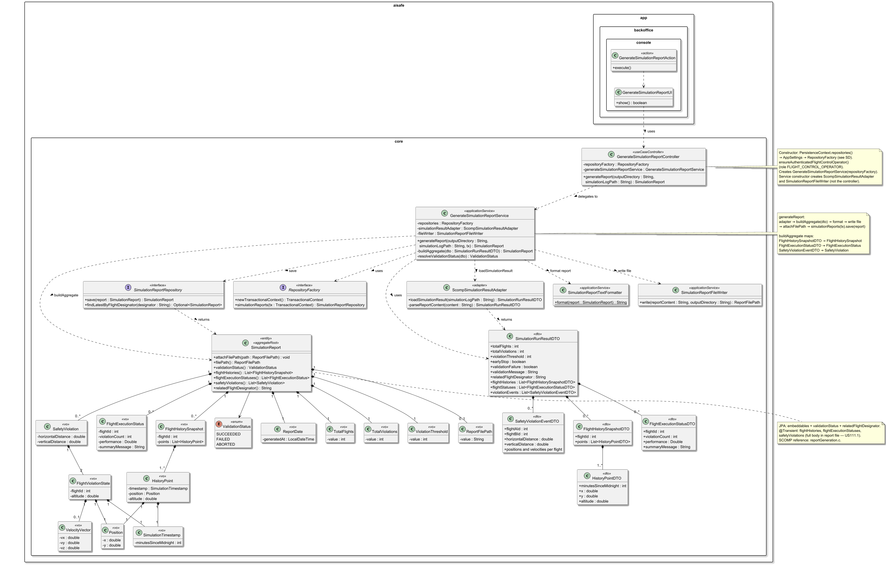
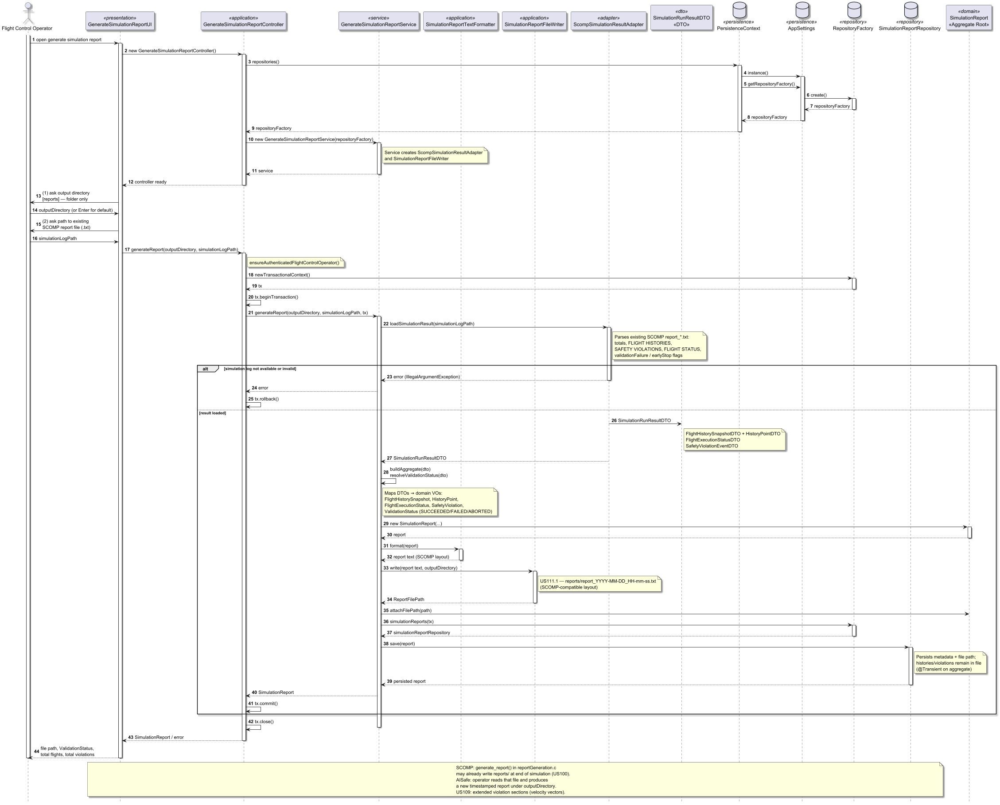

# US111 - Generate a Simulation Report

## 1. Context

* As a **Flight Control Operator**, I want to receive a summary of the simulation results so that I can determine if the programmed flights are safe to run.
* The system must **generate a report file** containing information about the executed simulation: total flights, per-flight execution status, safety violations (with timestamps and positions when they occur), and whether the scheduled flight plan **passed or failed** validation.
* Simulation execution itself is performed by the **SCOMP** module (US100, US102). US111 focuses on **aggregating the outcome** and **persisting a human-readable report** for operational review.

It depends on:

* **US080 — Create a Flight Plan**: flights must have associated plans before simulation.
* **US085 — Test/Validate Flight Plan**: plans should be validated before or as part of the simulation pipeline.
* **US100 / US102 — SCOMP simulation**: produces flight histories, violation events, and threshold-based abort semantics consumed by this story.

It is extended by:

* **US109 — Generate and Store Final Simulation Report (SCOMP)**: formalises the same report structure in C with velocity vectors and performance scores (see `SCOMP/src/reportGeneration.c`).

### 1.1 List of issues

**Main Issue:** Issue #133

**Analysis:** Issue #144

**Design:** Issue #160

**Implement:** Issue #161

## 2. Requirements

**US111** — As a Flight Control Operator, I want to receive a summary of the simulation results so that I can determine if the programmed flights are safe to run.

### 2.1 Acceptance Criteria

* **US111.1** The system must generate a simulation report and **store it in a file**.
* **US111.2** The report must include the **total number of simulated flights**.
* **US111.3** The report must include the **execution status of each simulated flight**.
* **US111.4** If safety violations occur, the report must list their **timestamps** and **involved flight positions**.
* **US111.5** The report must indicate whether the scheduled flight plan **passed or failed** validation.
* **US111.6** The system must support **aborted** simulations caused by reaching the configured violation threshold.
* **US111.7** The generated report must contain enough information for a Flight Control Operator to evaluate operational safety.

### 2.2 Dependencies/References

Regarding this requirement, we understand that it relates to:

* **US080 — Create a Flight Plan**: flight plans (DSL on `FlightPlan`) are simulation input.
* **US085 — Test/Validate Flight Plan**: DSL/plan validation before simulation.
* **US100 — SCOMP simulation**: flight histories and run lifecycle.
* **US102 — SCOMP safety violations**: `SafetyViolationEvent` during the run.
* **US109 — Extended SCOMP report**: velocity vectors and performance formula in C.
* **SCOMP — `reportGeneration.c`**: reference layout for the report file (`generate_report`, `generate_report_validation_failure`).

## 3. Analysis

The domain model for a simulation report must capture the following attributes:




| Attribute                  | Description                            | Constraints                                        |
|----------------------------|----------------------------------------|----------------------------------------------------|
| **ReportDate**             | When the report was generated          | Set automatically at creation                      |
| **TotalFlights**           | Number of simulated flights            | ≥ 0                                                |
| **TotalViolations**        | Safety violations detected in the run  | ≥ 0                                                |
| **ViolationThreshold**     | Max violations before abort            | > 0                                                |
| **FlightExecutionStatus**  | Per-flight summary                     | Flight id, violation count, performance / message  |
| **SafetyViolation**        | One conflict between two flights       | Horizontal/vertical separation at event time       |
| **FlightViolationState**   | State of one flight at violation time  | Flight id, timestamp, altitude, position           |
| **Position**               | 2D coordinates (x, y)                  | From simulation history                            |
| **VelocityVector**         | Optional 3D velocity (vx, vy, vz)      | US109 parity; optional minimum in US111            |
| **ValidationStatus**       | Overall result                         | `SUCCEEDED`, `FAILED`, or `ABORTED`                |
| **ReportFilePath**         | Location of the written report file    | Non-empty after successful export                  |

### Key Business Rules

- A report is produced **after** a simulation run completes (normal end, threshold abort, or validation failure before start).
- **US111.1**: the deliverable is a **file** under a configurable directory (default `reports/`, name `report_YYYY-MM-DD_HH-MM-SS.txt`, aligned with SCOMP).
- **US111.2–US111.3**: header includes total flights; body includes **per-flight** status (violations count, performance or “no violations”).
- **US111.4**: for each violation, list **time**, **positions** (and altitudes) for both involved flights; US109 adds velocity vectors to the same section.
- **US111.5–US111.6**: final **ValidationStatus**:
  - `FAILED` when `totalViolations >= violationThreshold`,
  - `ABORTED` when `validationFailure` is set (pre-run validation, SCOMP `generate_report_validation_failure`) or `earlyStop` without reaching the threshold,
  - `SUCCEEDED` otherwise.
- The report may be linked to the simulated flight context (`relatedFlightDesignator` / flight id) for traceability via `SimulationReportRepository.findLatestByFlightDesignator`.
- Report content is **derived from simulation metrics**, not from editing flight plans.

### Relationship with other user stories


| Story      | Role relative to US111                                                                                |
|------------|-------------------------------------------------------------------------------------------------------|
| **US080**  | Supplies flight plans (DSL) used as input to simulation.                                              |
| **US085**  | Validates plan DSL before simulation; failures may yield an aborted report without flight execution.  |
| **US100**  | Runs the simulation and collects`FlightHistory`.                                                      |
| **US102**  | Populates`SafetyViolationEvent` during the run.                                                       |
| **US109**  | Extends the same report with velocity vectors and documented performance formula.                     |

### Relationship with the Domain

`SimulationReport` is the **aggregate root** for the reporting bounded context. It does not execute simulation; it **summarises** a completed (or aborted) run.

The aggregate holds:

- global metrics (`TotalFlights`, `TotalViolations`, `ViolationThreshold`),
- collections of `FlightExecutionStatus` and `SafetyViolation` value objects (held in memory for formatting; optional `@Transient` on JPA),
- `FlightHistorySnapshot` data for the **FLIGHT HISTORIES** section,
- the overall `ValidationStatus`,
- and the `ReportFilePath` after the file is written.

`SimulationReportRepository` stores aggregate metadata and file path; the **full narrative** remains in the text file (US111.1).

### Report file structure (reference — SCOMP)

US111 aligns with the layout produced by `generate_report()` in `SCOMP/src/reportGeneration.c`:

```
========= SIMULATION REPORT =========
Total Flights: N
Total Violations: V
Violation Threshold: T

-----------------------------------

FLIGHT HISTORIES:
  Flight <id>:
    Time: HH:MM  Position: (x, y)  Altitude: z
    ...

-----------------------------------   (if V > 0)

SAFETY VIOLATIONS:
  Violation #n:
    Time: HH:MM
    Horizontal Distance: ...
    Vertical Distance: ...
    Flight A: Position, Altitude, Velocity, Time
    Flight B: Position, Altitude, Velocity, Time

-----------------------------------

FLIGHT STATUS:
  Flight <id>:
    Total Violations: ... / No violations detected.
    Performance: ...   (or "Unable to calculate" if aborted)

<verdict: SUCCEEDED / FAILED / ABORTED>

========= END OF REPORT =========
```


| Condition                               | Report text /`ValidationStatus`                      |
|-----------------------------------------|------------------------------------------------------|
| `violation_count >= threshold`          | `SIMULATION FAILED` → `FAILED`                       |
| Pre-run validation failure              | `generate_report_validation_failure()` → `ABORTED`   |
| `early_stop` without threshold reached  | `SIMULATION ABORTED` → `ABORTED`                     |
| Otherwise                               | `SIMULATION SUCCEEDED` → `SUCCEEDED`                 |

---

## 4. Design

### 4.1 Realization

The design follows the layered DDD architecture adopted throughout the project.

Two realizations coexist:

1. **SCOMP (C)** — report generated at the end of `start_simulation()` via `generate_report()` (baseline already in the repository).
2. **AISafe (Java)** — backoffice use case: load simulation outcome (from an existing SCOMP report file), build `SimulationReport`, format text, write file, persist aggregate metadata.

The application layer is composed of:

- `GenerateSimulationReportUI`
- `GenerateSimulationReportAction`
- `GenerateSimulationReportController`
- `GenerateSimulationReportService`

The service orchestrates loading simulation data, building the aggregate, formatting, writing the file, and persisting through `SimulationReportRepository`. The controller handles authorization, transaction boundaries, and delegation (same pattern as US080).

The following class diagram illustrates the main components involved:



The following sequence diagram illustrates the realization of US111 — generate simulation report:



**Main classes and responsibilities:**

* `SimulationReport` — Aggregate root; embeddable VOs for metrics and `ReportFilePath`; `@Transient` collections for histories, per-flight status, and violations used when formatting
* `ReportDate`, `TotalFlights`, `TotalViolations`, `ViolationThreshold`, `ReportFilePath` — Embeddable value objects persisted with the aggregate
* `FlightExecutionStatus`, `SafetyViolation`, `FlightViolationState`, `Position`, `VelocityVector`, `SimulationTimestamp`, `FlightHistorySnapshot`, `HistoryPoint` — Value objects composing report content
* `ValidationStatus` — Enumeration: `SUCCEEDED`, `FAILED`, `ABORTED`
* `SimulationRunResultDTO`, `FlightHistorySnapshotDTO`, `FlightExecutionStatusDTO`, `SafetyViolationEventDTO`, `HistoryPointDTO` — Application DTOs from the SCOMP adapter (not persisted as entities)
* `ScompSimulationResultAdapter` — `loadSimulationResult(simulationLogPath)` parses an existing SCOMP report file into `SimulationRunResultDTO`
* `SimulationReportTextFormatter` — Static `format(report)` producing SCOMP-compatible text
* `SimulationReportFileWriter` — `write(reportContent, outputDirectory)` → `ReportFilePath` (`report_YYYY-MM-DD_HH-mm-ss.txt`)
* `GenerateSimulationReportService` — `generateReport(outputDirectory, simulationLogPath, tx)`; `buildAggregate(dto)`; `resolveValidationStatus(dto)`
* `GenerateSimulationReportController` — `@UseCaseController`; `PersistenceContext.repositories()`; `ensureAuthenticatedFlightControlOperator()`; transaction around service call
* `SimulationReportRepository` — `save(report)`, `findLatestByFlightDesignator(designator)`
* `RepositoryFactory` — `simulationReports(TransactionalContext)` (JPA / InMemory implementations in `aisafe.persistence.impl`)
* `GenerateSimulationReportUI` — Collects output directory and path to SCOMP report; displays file path and `ValidationStatus`
* `GenerateSimulationReportAction` — Menu entry for role `FLIGHT_CONTROL_OPERATOR`

**Use-case flow performed by the application layer:**

1. Operator opens **Generate simulation report** (FCO role).
2. UI collects `outputDirectory` (default `reports/`) and `simulationLogPath` (existing SCOMP `report_*.txt`).
3. `GenerateSimulationReportController.generateReport(...)` calls `ensureAuthenticatedFlightControlOperator()`.
4. Controller opens `newTransactionalContext()`, `beginTransaction()`, delegates to the service.
5. `ScompSimulationResultAdapter.loadSimulationResult(simulationLogPath)` → `SimulationRunResultDTO`.
6. `GenerateSimulationReportService.buildAggregate(dto)` → `SimulationReport` with metrics, statuses, violations, `ValidationStatus`.
7. `SimulationReportTextFormatter.format(report)` → report text.
8. `SimulationReportFileWriter.write(text, outputDirectory)` → `ReportFilePath`.
9. `SimulationReport.attachFilePath(path)`.
10. `repositories.simulationReports(tx).save(report)`.
11. Controller `commit()` / `rollback()` and `close()`; UI shows path and validation result.

**ValidationStatus resolution (`GenerateSimulationReportService.resolveValidationStatus`):**

1. If `dto.validationFailure` → `ABORTED`.
2. Else if `dto.totalViolations >= dto.violationThreshold` (and threshold > 0) → `FAILED`.
3. Else if `dto.earlyStop` → `ABORTED`.
4. Else → `SUCCEEDED`.

**Persistence and transaction flow:**

1. `GenerateSimulationReportController()` resolves `RepositoryFactory` via `PersistenceContext` / `AppSettings` (not `new JpaRepositoryFactory()` in application code).
2. `GenerateSimulationReportService` receives `RepositoryFactory` in the constructor and obtains `SimulationReportRepository` with `repositories.simulationReports(tx)` inside the use case.
3. Controller opens `newTransactionalContext()`, `beginTransaction()`, delegates to the service, then `commit()` / `rollback()` and `close()`.
4. JPA stores scalar/embeddable fields and `ReportFilePath`; full trajectory and violation detail remain in the **file** (`@Transient` collections on the aggregate).

**CD ↔ SD consistency:** the controller does **not** call the adapter, formatter, or file writer directly; only `GenerateSimulationReportService` does. `ScompSimulationResultAdapter` and `SimulationReportFileWriter` are created by the **service** constructor, not the controller. `PersistenceContext` and `AppSettings` appear in the SD bootstrap; the CD documents them in a note on the controller.

**Authorization:** `AuthorizationGuardService.ensureAuthenticatedFlightControlOperator()` (role `AisafeRoles.FLIGHT_CONTROL_OPERATOR`, see `UserBootstrapper` / US030).

### 4.2. Acceptance Tests

**Test 1:** Verifies that the report file writer creates a timestamped file under the chosen directory.

**Refers to Acceptance Criteria:** US111.1

```java
@Test
void write_createsTimestampedReportFile(@TempDir Path outputDir) throws Exception {

    final SimulationReportFileWriter writer = new SimulationReportFileWriter();

    final ReportFilePath path = writer.write("sample report", outputDir.toString());

    assertTrue(Files.exists(Path.of(path.value())));
    assertTrue(path.value().contains("report_"));
}
```

---

**Test 2:** Verifies that formatted text includes total flights and the succeeded verdict.

**Refers to Acceptance Criteria:** US111.2, US111.5

```java
@Test
void format_includesTotalsAndSucceededVerdict() {

    final SimulationReport report = buildSampleSucceededReport();

    final String text = SimulationReportTextFormatter.format(report);

    assertTrue(text.contains("Total Flights: 1"));
    assertTrue(text.contains("FLIGHT STATUS:"));
    assertTrue(text.contains("SIMULATION SUCCEEDED"));
}
```

---

**Test 3:** Verifies that the formatter includes the safety violations section when violations exist.

**Refers to Acceptance Criteria:** US111.4

```java
@Test
void format_includesViolationSectionWhenPresent() {

    final SimulationReport report = buildSampleReportWithOneViolation();

    final String text = SimulationReportTextFormatter.format(report);

    assertTrue(text.contains("SAFETY VIOLATIONS:"));
    assertTrue(text.contains("Violation #1:"));
    assertTrue(text.contains("Horizontal Distance:"));
}
```

---

**Test 4:** Verifies `FAILED` when total violations reach the configured threshold.

**Refers to Acceptance Criteria:** US111.5, US111.6

```java
@Test
void resolveValidationStatus_returnsFailed_whenViolationsReachThreshold() {

    final SimulationRunResultDTO dto = new SimulationRunResultDTO(
            1, 100, 100, true, false, null, null,
            List.of(), List.of(), List.of());

    assertEquals(
            ValidationStatus.FAILED,
            GenerateSimulationReportService.resolveValidationStatus(dto)
    );
}
```

---

**Test 5:** Verifies `SUCCEEDED` when violations are below the threshold and the run completed normally.

**Refers to Acceptance Criteria:** US111.5

```java
@Test
void resolveValidationStatus_returnsSucceeded_whenBelowThreshold() {

    final SimulationRunResultDTO dto = new SimulationRunResultDTO(
            1, 2, 100, false, false, null, null,
            List.of(), List.of(), List.of());

    assertEquals(
            ValidationStatus.SUCCEEDED,
            GenerateSimulationReportService.resolveValidationStatus(dto)
    );
}
```

---

**Test 6:** Verifies `ABORTED` on validation failure (pre-run / SCOMP validation report).

**Refers to Acceptance Criteria:** US111.6

```java
@Test
void resolveValidationStatus_returnsAborted_onValidationFailure() {

    final SimulationRunResultDTO dto = new SimulationRunResultDTO(
            0, 0, 0, true, true, "Invalid plans", null,
            List.of(), List.of(), List.of());

    assertEquals(
            ValidationStatus.ABORTED,
            GenerateSimulationReportService.resolveValidationStatus(dto)
    );
}
```

---

**Test 7:** Verifies the SCOMP adapter parses an existing succeeded report file.

**Refers to Acceptance Criteria:** US111.2, US111.7

```java
@Test
void loadSimulationResult_parsesSucceededReportFromClasspath() {

    final Path sample = Path.of("src/test/resources/scomp-report-succeeded.txt");
    final SimulationRunResultDTO dto =
            new ScompSimulationResultAdapter().loadSimulationResult(sample.toString());

    assertEquals(1, dto.totalFlights);
    assertEquals(0, dto.totalViolations);
    assertFalse(dto.validationFailure);
    assertEquals(1, dto.flightHistories.size());
}
```

---

**Test 8:** Verifies the controller delegates to the service inside a transaction after FCO authorization.

**Refers to Acceptance Criteria:** US111.7 (operator use case)

```java
@Test
void generateReport_delegatesWithTransaction() {

  when(generateSimulationReportService.generateReport("reports", "log.txt", tx))
          .thenReturn(report);

  assertSame(report, controller.generateReport("reports", "log.txt"));

  verify(authorizationGuardService).ensureAuthenticatedFlightControlOperator();
  verify(generateSimulationReportService).generateReport("reports", "log.txt", tx);
  verify(tx).commit();
}
```

All tests use the **Arrange–Act–Assert (AAA)** pattern (`// Arrange`, `// Act`, `// Assert`).

Implemented in `aisafe.core/src/test/java/aiSafe/simulationreport/application/` and `.../domain/`.

---

## 5. Implementation

The implementation follows the design presented in section 4 and applies Domain-Driven Design principles across all layers.

### 5.1. Evidence of implementation aligned with design

- [X]  Domain: `SimulationReport` aggregate, value objects, `ValidationStatus`
- [X]  Application: `GenerateSimulationReportService`, `GenerateSimulationReportController`, DTOs, `ScompSimulationResultAdapter`, `SimulationReportTextFormatter`, `SimulationReportFileWriter`
- [X]  Console: `GenerateSimulationReportUI`, `GenerateSimulationReportAction`, entry in `MainMenu` (role `FLIGHT_CONTROL_OPERATOR`)
- [X]  Persistence: `SimulationReportRepository` via `RepositoryFactory.simulationReports(tx)` (`JpaSimulationReportRepository`, `InMemorySimulationReportRepository`)
- [X]  Tests: domain, service, controller, adapter, formatter, file writer (`aisafe.core/src/test/java/aiSafe/simulationreport/...`) — all §4.2 acceptance tests implemented with **Arrange–Act–Assert (AAA)**; JaCoCo **≥94%** instruction coverage on `aiSafe.simulationreport.*` (enforced by `jacoco:check` in `aisafe.core/pom.xml`)

**Alignment with class diagram and sequence diagram:** controller delegates only to the service; service calls adapter → `buildAggregate` → `format` → `write` → `attachFilePath` → `simulationReports(tx).save`; `AuthorizationGuardService.ensureAuthenticatedFlightControlOperator()` in the controller before the transaction. Adapter and file writer are constructed by the **service**, not the controller (as documented in the SD note).

### 5.2. Relevant artifacts and configuration files

The main files required to understand and execute this implementation are:

* `aisafe.core/.../simulationreport/domain/*`
* `aisafe.core/.../simulationreport/application/*`
* `aisafe.core/.../simulationreport/repositories/SimulationReportRepository.java`
* `aisafe.app.backoffice.console/.../presentation/simulationreport/*`
* `aisafe.persistence.impl/.../JpaSimulationReportRepository`, `InMemorySimulationReportRepository`
* `aisafe.persistence.impl/.../META-INF/persistence.xml` — entity `SimulationReport`
* `aisafe.app.backoffice.console/src/main/resources/application.properties` — `simulation.report.outputDir=reports`, `persistence.repositoryFactory`

**SCOMP reference (existing):**

* `SCOMP/src/reportGeneration.c`, `SCOMP/reports/report_*.txt`

### 5.3. Major commits (summary)

| Phase     | Issue | Commit                | Description                                                                       |
|-----------|-------|-----------------------|-----------------------------------------------------------------------------------|
| Analysis  | #144  | `28269c4`             | US111 analysis docs and domain excerpt (`excerpt_simulationReport`)               |
| Design    | #160  | `448fcde`, `28ac610`  | Class/sequence diagrams and readme §1–4, §7; DTOs and flight histories in CD/SD   |
| Implement | #161  | `748debf`             | End-to-end simulation report generation (domain, service, UI, persistence, tests) |

**Design commits (#160):**

- `448fcde` — initial class diagram, sequence diagram, and readme (analysis + design sections).
- `28ac610` — design refresh: flight histories, application DTOs, adapter flow in CD/SD.

**Implement commit `748debf` (#161)** — main delivery:

- Backoffice: `GenerateSimulationReportUI` / `GenerateSimulationReportAction`, menu under Operations (`FLIGHT_CONTROL_OPERATOR`).
- Application: `GenerateSimulationReportService`, `GenerateSimulationReportController`, DTOs, `ScompSimulationResultAdapter`, `SimulationReportTextFormatter`, `SimulationReportFileWriter`.
- Domain: `SimulationReport` aggregate and value objects; `ValidationStatus` resolution.
- Persistence: `SimulationReportRepository` via `RepositoryFactory.simulationReports(tx)` (`JpaSimulationReportRepository`, `InMemorySimulationReportRepository`).
- Tests: adapter, formatter, file writer, service, controller, domain (`aisafe.core/src/test/java/aiSafe/simulationreport/...`); SCOMP fixtures in `src/test/resources/scomp-report-*.txt`; JaCoCo ≥94% on `aiSafe.simulationreport.*`.
- Config: `simulation.report.outputDir=reports` in `application.properties`.

### 5.4. How it works in the application (backoffice console)

**Access:** log in as a user with role **FLIGHT_CONTROL_OPERATOR** (e.g. `fco@aisafe.local` after bootstrap) → **Operations** → **Generate simulation report**.

The UI collects two inputs:


| Prompt                         | Meaning                                                                          | Example                                                  |
|--------------------------------|----------------------------------------------------------------------------------|----------------------------------------------------------|
| **Output directory**           | Folder where AISafe writes the**new** report (`report_YYYY-MM-DD_HH-mm-ss.txt`)  | Press**Enter** for default `reports`, or type `reports`  |
| **Path to SCOMP report file**  | Existing SCOMP log to**read** (metrics, histories, violations)                   | `SCOMP/reports/report_2026-05-16_11-22-07.txt`           |

**Important:** do not paste the `.txt` file path into the output directory field — that field must be a **folder** only.

On success the console shows: file path, `ValidationStatus`, total flights, and total violations. The use case runs in one transaction: load → build aggregate → format → write file → attach path → `SimulationReportRepository.save`.

#### 5.4.1. Persistence (JPA and InMemory)

- Switch implementation in `application.properties`:
  - JPA: `aiSafe.persistence.impl.jpa.JpaRepositoryFactory`
  - InMemory: `aiSafe.persistence.impl.inmemory.InMemoryRepositoryFactory`
- JPA stores embeddable metrics, `ValidationStatus`, `ReportFilePath`, and optional `relatedFlightDesignator`; full trajectory/violation lists remain in the **file** (`@Transient` on the aggregate for formatting).

#### 5.4.2. Example session

```
=== Generate Simulation Report (US111) ===
(1) Where to write the NEW report file.
Output directory [reports] (folder only, press Enter for default): 
<Enter>
(2) Existing SCOMP report used as simulation input.
Path to SCOMP report file (e.g. SCOMP/reports/report_2026-05-16_11-22-07.txt): 
SCOMP/reports/report_2026-05-16_11-22-07.txt

Report generated successfully.
File: reports/report_2026-05-22_12-30-45.txt
Validation status: SUCCEEDED
Total flights: 1
Total violations: 0
```

Run the console from the **repository root** so relative paths to `SCOMP/reports/...` resolve correctly.

---

## 6. Integration/Demonstration

### 6.1. Architectural Integration

- **Menu:** `MainMenu` → Operations → `GenerateSimulationReportAction` (authorized role: `AisafeRoles.FLIGHT_CONTROL_OPERATOR`).
- **Layers:** UI → `GenerateSimulationReportController` (auth + transaction) → `GenerateSimulationReportService` → `ScompSimulationResultAdapter` / formatter / file writer → `SimulationReport` → `SimulationReportRepository`.
- **Bootstrap:** `PersistenceContext.repositories()` → `AppSettings` → `RepositoryFactory` (same as US080).
- **Input:** existing SCOMP report file (US100/US102 output); future in-process DTO from simulation is possible without changing the aggregate API.
- **No change** to `Flight` / `FlightPlan` during report generation (read-only simulation context).

### 6.2. How to Demonstrate

1. Configure `persistence.repositoryFactory` (JPA or InMemory).
2. Run backoffice console from the project root; log in as **FCO** (`fco@aisafe.local` / bootstrap password).
3. **Operations** → **Generate simulation report**.
4. Press **Enter** for output directory `reports`.
5. Provide path to an existing SCOMP report, e.g. `SCOMP/reports/report_2026-05-16_11-22-07.txt`.
6. Confirm success message and open the new file under `reports/`.
7. Optional: repeat with `src/test/resources/scomp-report-failed.txt` (copy path) to observe `ValidationStatus.FAILED` after pointing the adapter at a failed-run report.

**Typical errors during demo:**


| Message                                                | Likely cause                                                                 |
|--------------------------------------------------------|------------------------------------------------------------------------------|
| `Unable to create output directory: ...report....txt`  | SCOMP file path entered in**output directory** instead of the second prompt  |
| `Simulation log file not found`                        | Wrong working directory or path to SCOMP file                                |
| Authorization error                                    | User without`FLIGHT_CONTROL_OPERATOR` role                                   |

### 6.3. SCOMP vs AISafe


| Aspect       | SCOMP (`reportGeneration.c`)  | AISafe (US111)                                   |
|--------------|-------------------------------|--------------------------------------------------|
| Trigger      | End of`start_simulation()`    | Menu action (operator)                           |
| Format       | C`fprintf` templates          | `SimulationReportTextFormatter` (same layout)    |
| Persistence  | File only                     | File +`SimulationReport` metadata in repository  |
| Input        | In-memory structs             | Parsed existing SCOMP report file                |

---

## 7. Observations

### 7.1 Architectural Decisions

- **File as source of truth for operators (US111.1):** the full report body lives in the text file; JPA stores summary metadata and path, not every position sample (`@Transient` histories/violations on the aggregate).
- **SCOMP compatibility:** AISafe formatter follows the existing `reportGeneration.c` layout so operators see one familiar format whether the file is produced by C or Java.
- **SimulationReport separate aggregate:** reporting is decoupled from `Flight` lifecycle; link by `relatedFlightDesignator` for traceability.
- **Repository pattern:** `SimulationReportRepository` in core; `JpaSimulationReportRepository` / `InMemorySimulationReportRepository` in `aisafe.persistence.impl`, resolved via `PersistenceContext` (same as US080).
- **Input in US111:** `ScompSimulationResultAdapter` reads an **existing** SCOMP report file; direct in-process coupling to US100 may be added later without changing the aggregate.

The project follows a layered, DDD-based architecture where the repository contract is defined in the core module and concrete implementations are resolved at runtime by `RepositoryFactory`:


### 7.2 Third-party Works

- **EAPLI Framework** — `AggregateRoot`, `ValueObject`, `Repository`, `AuthzRegistry`, console UI.
- **SCOMP Simulation Module (C)** — US100/US102 execution; US111/US109 report content (`reportGeneration.c`).
- **PlantUML** — class and sequence diagrams in this folder.
