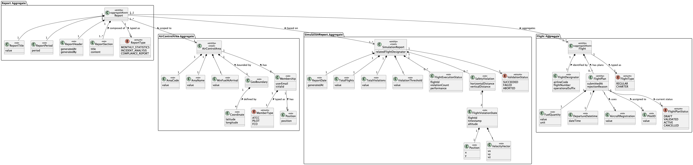
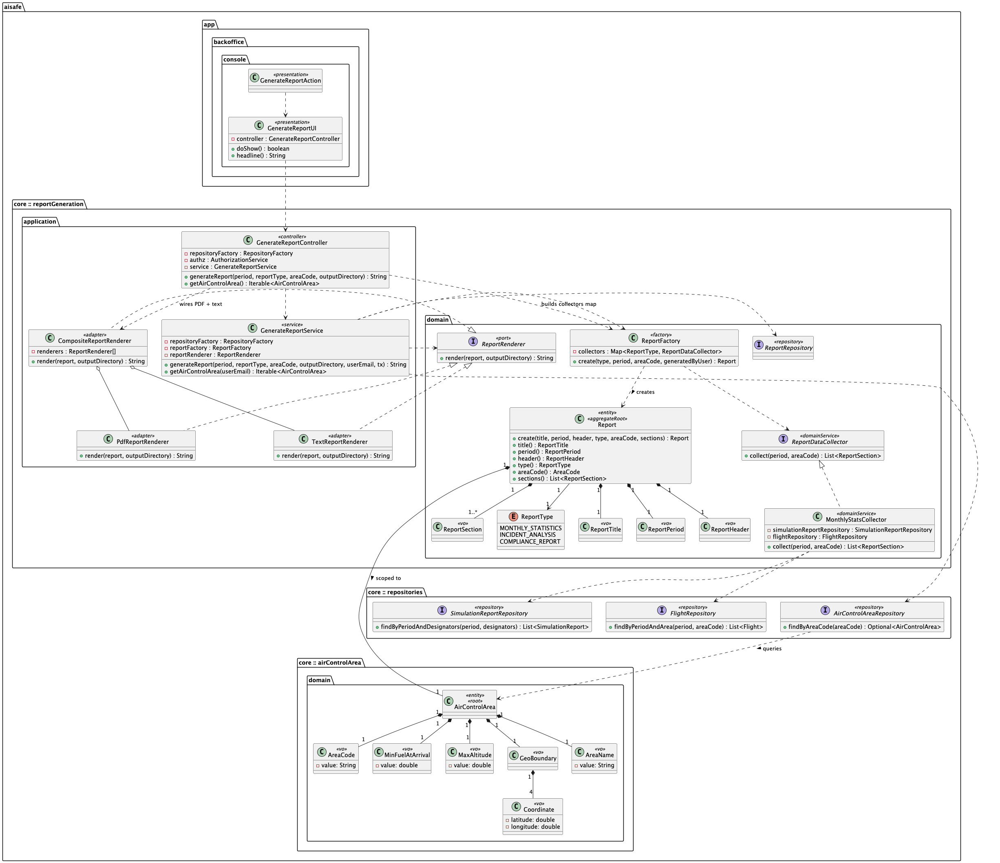
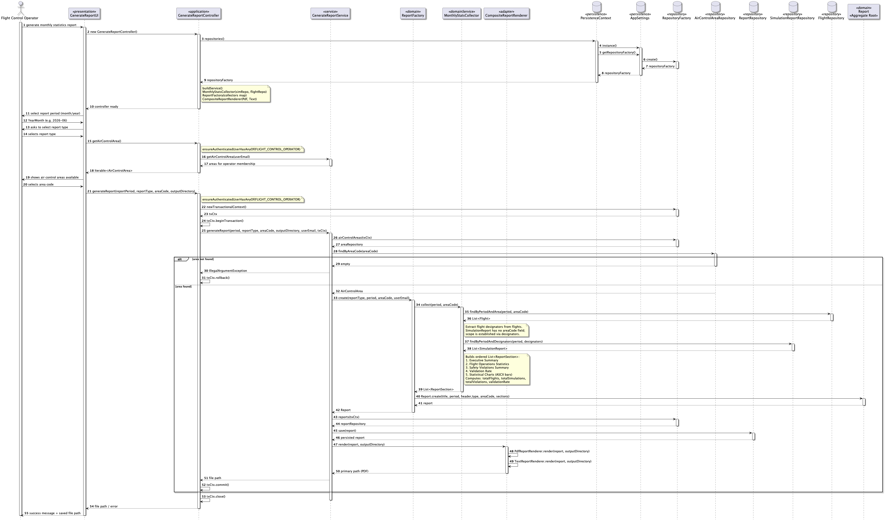

# US112 - Monthly Report Generation

## 1. Context

* As a Flight Control Operator, I want to generate a monthly statistics report so that I can have a consolidated view of flight operations and safety metrics for a given month.
* This user story is foundational for all future report types (e.g. compliance, incident), ensuring consistent branding and structure across all reports generated by the system.
* The system must provide an extensible reporting infrastructure where each report type has a specific way of collecting data, specific sections and graphics.

It is also dependent on:

* US111 — Generate a Simulation Report
* US100 — Simulate Flights in a Given Area
* US080 — Create a Flight Plan

### 1.1 List of issues

**Main Issue:** Issue #134

**Analysis:** Issue #150

**Design:** Issue #172

**Implement:** Issue #179

---

## 2. Requirements

**US112** — As a Flight Control Operator, I want to generate a monthly statistics report.

### 2.1 Acceptance Criteria

* **US112.1** The system must generate a monthly statistics report for a given month/year period.
* **US112.2** The report must include aggregate statistics on flight operations for the selected period.
* **US112.3** The report must include safety violation metrics (total count, most frequent violation types, affected flights).
* **US112.4** The report must include visual graphics/charts presenting the collected statistical data.
* **US112.5** The report must follow a consistent branding and structure shared with all other report types.
* **US112.6** The reporting infrastructure must be extensible to support future report types (e.g. compliance, incident).
* **US112.7** The report must be exported to a file for later consultation.

### 2.2 Dependencies/References

Regarding this requirement, we understand that it relates to:

* **US111 — Generate a Simulation Report**: the monthly report reuses and aggregates data produced by simulation reports.
* **US100 — Simulate Flights in a Given Area**: simulation execution produces the raw data consumed by the monthly report.
* **US080 — Create a Flight Plan**: flight plans are the base entities whose data is aggregated in the monthly report.
* **SCOMP Simulation Module**: the simulation engine executes flights, detects safety violations, and produces the raw data consumed by this report.

---

## 3. Analysis

The domain model for the Monthly Report must capture the following attributes:



| Attribute          | Description                                        | Constraints                                                                             |
|--------------------|----------------------------------------------------|-----------------------------------------------------------------------------------------|
| Report Date        | Timestamp when the report was generated            | Automatically generated; stored in `ReportHeader`                                       |
| Reference Period   | Month and year the report covers                   | Must be a valid past or current month/year                                              |
| Total Flights      | Total number of flights operated during the period | Derived from referenced `Flight` aggregates;                                            |
| Total Simulations  | Number of simulations executed during the period   | Derived from referenced `SimulationReport` aggregates;                                  |
| Total Violations   | Total safety violations detected in the period     | Derived from `SimulationReport.TotalViolations`;                                        |
| Flight Statistics  | Per-flight aggregated metrics                      | Includes flight identifier, status, and violation count; rendered as a `ReportSection`  |
| Violation Summary  | Aggregated safety violation data                   | Includes timestamps, positions, and involved flights; rendered as a `ReportSection`     |
| Top Routes         | Most frequent routes operated in the period        | Aggregated by route designator; includes top 5 routes                                   |
| Validation Rate    | Percentage of flight plans that passed validation  | Derived from `FlightPlanStatus`; value between 0 and 100; rendered as a `ReportSection` |
| Report Type        | Identifies the type of report                      | Must be `MONTHLY_STATISTICS`                                                            |

> **Note on computed attributes:** `Total Flights`, `Total Simulations`, `Total Violations`, and `Validation Rate` are not persisted as explicit Value Objects in the `Report` aggregate. They are computed by the `MonthlyStatsCollector` (domain service) during report generation and materialised as `ReportSection` content. This keeps the aggregate free of derived state.

### Key Business Rules

- The reference period must be specified before generating the report.
- Only flights and simulations whose departure date falls within the reference period are included.
- The report branding and structural layout must be shared with all other report types (foundational infrastructure).
- Each report type defines its own data collection strategy and section composition, implemented as a dedicated `ReportDataCollector` domain service.
- The order of sections within a report is determined implicitly by the insertion order produced by the collector — the `Report` aggregate preserves this order and validates that at least one section exists.
- The generated report must be persisted as a file for later consultation.
- A `ReportFactory` is responsible for orchestrating aggregate creation: it selects the appropriate `ReportDataCollector` based on `ReportType`, collects the sections, and instantiates the `Report`.

### Data Collected by MonthlyStatsCollector

| Metric                        | Source                                                  |
|-------------------------------|---------------------------------------------------------|
| Total flights                 | `FlightRepository.findByPeriodAndArea`                  |
| Regular / charter split       | `Flight.type()`                                         |
| Top Routes                    | Group `Flight` by `Route.routeDesignator()`             |
| Total simulations             | `SimulationReportRepository.findByPeriodAndDesignators` |
| Total safety violations       | Sum of `SimulationReport.totalViolations()`             |
| Validated flight plans / rate | `FlightPlan.status == VALIDATED` within the period      |
| Simulation outcomes by status | Group `SimulationReport` by `ValidationStatus`          |

---

## 4. Design

### 4.1 Realization

The following class diagram illustrates the main components involved:



The following sequence diagram illustrates the realization of US112 — generate a monthly statistics report:



- **`GenerateReportController`** — thin `@UseCaseController`. Handles authorization, transaction lifecycle (begin / commit / rollback), and user email resolution. Delegates all business logic to the service.
- **`GenerateReportService`** — owns the use-case flow: validates the area, delegates to the factory, persists the aggregate, and calls the renderer.
- **`ReportFactory`** — selects the right `ReportDataCollector` for the requested `ReportType`, builds the aggregate with title, period, header, and sections.
- **`MonthlyStatsCollector`** — queries repositories, computes all metrics in memory using Java streams, and builds the five ordered `ReportSection` objects.
- **`ReportMetricsExtractor`** — re-parses the text sections to extract structured numbers for the PDF bar charts, keeping the PDF renderer decoupled from the domain collector.

### 4.2. Acceptance Tests

---

**Test 1:** Verifies that a monthly statistics report is assembled for a given `YearMonth`, area code, and `MONTHLY_STATISTICS` type.

**Refers to Acceptance Criteria:** US112.1

```java
@Test
void create_assemblesMonthlyStatisticsReport() {

    final Map<ReportType, ReportDataCollector> collectors = new EnumMap<>(ReportType.class);
    collectors.put(ReportType.MONTHLY_STATISTICS, (period, areaCode) -> List.of(
            new ReportSection("Executive Summary", "Total flights    : 1")));

    final ReportFactory factory = new ReportFactory(collectors);

    final Report report = factory.create(
            ReportType.MONTHLY_STATISTICS,
            YearMonth.of(2026, 6),
            new AreaCode("LIS"),
            ReportTestFixtures.operatorEmail());

    assertEquals(ReportType.MONTHLY_STATISTICS, report.type());
    assertEquals(YearMonth.of(2026, 6), report.period().period());
    assertEquals("LIS", report.areaCode().value());
    assertFalse(report.sections().isEmpty());
}
```

---

**Test 2:** Verifies the application service generates a monthly report for the requested period, persists it, and returns the exported file path.

**Refers to Acceptance Criteria:** US112.1, US112.7

```java
@Test
void generateReport_persistsAndRendersMonthlyReport() throws Exception {

    final ReportFactory reportFactory = new ReportFactory(Map.of(
            ReportType.MONTHLY_STATISTICS,
            (period, areaCode) -> ReportTestFixtures.sampleMonthlyReport().sections()));

    final GenerateReportService service =
            new GenerateReportService(repositoryFactory, reportFactory, captureRenderer);

    final String path = service.generateReport(
            YearMonth.of(2026, 6),
            ReportType.MONTHLY_STATISTICS,
            "LIS",
            tempDir.toString(),
            ReportTestFixtures.operatorEmail(),
            tx);

    assertTrue(path.endsWith("monthly_2026-06_LIS.pdf"));
    verify(reportRepository).save(any(Report.class));
    assertEquals(ReportType.MONTHLY_STATISTICS, captureRenderer.lastReport.type());
}
```

---

**Test 3:** Verifies aggregate flight-operation statistics for the selected period and area (totals, regular/charter split, validation rate).

**Refers to Acceptance Criteria:** US112.2

```java
@Test
void collect_buildsAllRequiredSections() {

    when(flightRepository.findByPeriodAndArea(eq(period), any(AreaCode.class)))
            .thenReturn(List.of(regularFlight, charterFlight));

    final List<ReportSection> sections = collector.collect(period, new AreaCode("LIS"));

    final String summary = sections.get(0).content();
    assertTrue(summary.contains("Total flights    : 2"));
    assertTrue(summary.contains("Total simulations: 1"));

    final String validation = sections.get(3).content();
    assertTrue(validation.contains("Validated flight plans : 1 / 2"));
    assertTrue(validation.contains("Validation rate        : 50.0%"));
}
```

---

**Test 4:** Verifies safety violation metrics are aggregated (total count and outcome distribution used in charts).

**Refers to Acceptance Criteria:** US112.3

```java
@Test
void collect_buildsAllRequiredSections() {

  // ... same arrange as Test 3 (SimulationReport with totalViolations = 2)

  assertTrue(summary.contains("Safety violations: 2"));
  assertEquals("Safety Violations Summary", sections.get(2).title());
}

@Test
void extract_parsesMetricsFromReportSections() {

    final ReportMetricsExtractor.ReportMetrics metrics =
            ReportMetricsExtractor.extract(ReportTestFixtures.sampleMonthlyReport());

    assertEquals(3, metrics.totalViolations);
    assertEquals(1, metrics.simulationsWithViolations);
    assertFalse(metrics.simulationOutcomes.isEmpty());
}
```

---

**Test 5:** Verifies statistical charts are produced in the collected data and rendered in the PDF export.

**Refers to Acceptance Criteria:** US112.4

```java
@Test
void collect_buildsAllRequiredSections() {

    assertEquals("Statistical Charts", sections.get(4).title());
    assertTrue(sections.get(4).content().contains("Flight type distribution"));
}

@Test
void render_exportsValidPdfWithBrandingAndStatistics() throws IOException {

    final String path = renderer.render(ReportTestFixtures.sampleMonthlyReport(), tempDir.toString());

    final String text = new PDFTextStripper().getText(document);
    assertTrue(text.contains("Statistical Charts"));
    assertTrue(text.contains("Flight type distribution"));
    assertTrue(text.contains("Validation rate"));
}
```

---

**Test 6:** Verifies the shared report structure (ordered sections, type, period, area, branded title).

**Refers to Acceptance Criteria:** US112.5

```java
@Test
void report_create_buildsAggregateWithOrderedSections() {

    final Report report = ReportTestFixtures.sampleMonthlyReport();

    assertEquals(ReportType.MONTHLY_STATISTICS, report.type());
    assertEquals(5, report.sections().size());
    assertEquals("Executive Summary", report.sections().get(0).title());
    assertEquals("Statistical Charts", report.sections().get(4).title());
}

@Test
void render_exportsValidPdfWithBrandingAndStatistics() throws IOException {

    final String text = new PDFTextStripper().getText(document);
    assertTrue(text.contains("AISafe"));
    assertTrue(text.contains("Monthly Statistics"));
}
```

---

**Test 7:** Verifies the reporting infrastructure is extensible via a `ReportType` → `ReportDataCollector` registry (new types require a collector registration, not factory changes).

**Refers to Acceptance Criteria:** US112.6

```java
@Test
void create_rejectsUnregisteredReportType() {

    final ReportFactory factory = new ReportFactory(Map.of(
            ReportType.MONTHLY_STATISTICS,
            (period, areaCode) -> List.of(new ReportSection("S", "C"))));

    assertThrows(IllegalArgumentException.class, () -> factory.create(
            ReportType.INCIDENT_ANALYSIS,
            YearMonth.of(2026, 6),
            new AreaCode("LIS"),
            new Email("op@company.com")));
}
```

---

**Test 8:** Verifies the report is exported to persistent files (PDF and plain text) for later consultation.

**Refers to Acceptance Criteria:** US112.7

```java
@Test
void render_exportsStructuredTextFile() throws IOException {

    final String path = renderer.render(ReportTestFixtures.sampleMonthlyReport(), tempDir.toString());

    assertTrue(path.endsWith(".txt"));
    assertTrue(Files.exists(Path.of(path)));
}

@Test
void render_exportsPdfAndTextFiles() throws Exception {

    final CompositeReportRenderer renderer = new CompositeReportRenderer(
            new PdfReportRenderer(),
            new TextReportRenderer());

    final String primaryPath = renderer.render(
            ReportTestFixtures.sampleMonthlyReport(), tempDir.toString());

    assertTrue(primaryPath.endsWith(".pdf"));
    assertTrue(Files.exists(Path.of(primaryPath)));
    // one .pdf and one .txt under outputDirectory/pdf and outputDirectory/txt
}
```

---


## 5. Implementation

### 5.1. Evidence of Implementation Aligned with Design

1. **Strategy pattern for data collection (OCP)**
   - `ReportDataCollector` is a strategy interface; `MonthlyStatsCollector` is its only current implementation.
   - `ReportFactory` holds a registry (`EnumMap<ReportType, ReportDataCollector>`). New report types require a new collector and a one-line registration — no factory modification needed.
   - This satisfies **US112.6**.

2. **Domain aggregate enforces its own invariants**
   - `Report.create(...)` rejects null fields and empty section lists.
   - `ReportTitle`, `ReportPeriod`, and `ReportHeader` are immutable value objects that validate at construction.
   - All five domain value objects are covered by `ReportDomainTest` and `ReportValueObjectsTest`.

3. **Metrics computed entirely in memory via Java streams**
   - `MonthlyStatsCollector.collect()` executes exactly two repository queries, then derives all metrics (total flights, regular/charter split, violations, validation rate, sim outcomes) in memory.
   - Edge cases (zero flights, zero plans, zero simulations) handled without branching into the DB.

4. **Dual-format rendering via Composite pattern**
   - `CompositeReportRenderer` delegates to `PdfReportRenderer` and `TextReportRenderer` in sequence and returns the primary (PDF) path.
   - `PdfReportRenderer` uses `ReportMetricsExtractor` to parse the pre-built text sections into numbers for vector bar charts, keeping the PDF adapter decoupled from domain logic.

5. **Transaction managed exclusively in the controller**
   - `GenerateReportController` calls `begin`, `commit`, and `rollback` explicitly.
   - `GenerateReportService` receives a `TransactionalContext` but never manages it directly.
   - Verified by `GenerateReportControllerTest` with a `TrackingTransactionalContext`.

6. **Role-based access control**
   - `GenerateReportController` calls `authz.ensureAuthenticatedUserHasAnyOf(AisafeRoles.FLIGHT_CONTROL_OPERATOR)` before any logic executes.
   - This satisfies **US112.5**.

7. **Area existence validated before creation**
   - `GenerateReportService` calls `areaRepo.findByAreaCode(...)` and throws `IllegalArgumentException` if absent.
   - The report aggregate and the file are never created for unknown areas.
   - This satisfies **US112.7**.

### 5.2. Relevant Artifacts and Configuration Files

- **Domain**
   - `aisafe.core/src/main/java/aiSafe/reportGeneration/domain/Report.java`
   - `aisafe.core/src/main/java/aiSafe/reportGeneration/domain/ReportSection.java`
   - `aisafe.core/src/main/java/aiSafe/reportGeneration/domain/ReportType.java`
   - `aisafe.core/src/main/java/aiSafe/reportGeneration/domain/ReportTitle.java`
   - `aisafe.core/src/main/java/aiSafe/reportGeneration/domain/ReportPeriod.java`
   - `aisafe.core/src/main/java/aiSafe/reportGeneration/domain/ReportHeader.java`
   - `aisafe.core/src/main/java/aiSafe/reportGeneration/domain/ReportDataCollector.java`
   - `aisafe.core/src/main/java/aiSafe/reportGeneration/domain/ReportFactory.java`
   - `aisafe.core/src/main/java/aiSafe/reportGeneration/domain/ReportRenderer.java`
   - `aisafe.core/src/main/java/aiSafe/reportGeneration/domain/MonthlyStatsCollector.java`
- **Repository contract (core)**
   - `aisafe.core/src/main/java/aiSafe/reportGeneration/repositories/ReportRepository.java`
- **Application**
   - `aisafe.core/src/main/java/aiSafe/reportGeneration/application/GenerateReportController.java`
   - `aisafe.core/src/main/java/aiSafe/reportGeneration/application/GenerateReportService.java`
   - `aisafe.core/src/main/java/aiSafe/reportGeneration/application/CompositeReportRenderer.java`
   - `aisafe.core/src/main/java/aiSafe/reportGeneration/application/PdfReportRenderer.java`
   - `aisafe.core/src/main/java/aiSafe/reportGeneration/application/TextReportRenderer.java`
   - `aisafe.core/src/main/java/aiSafe/reportGeneration/application/ReportMetricsExtractor.java`
- **Persistence**
   - `aisafe.persistence.impl/src/main/java/aiSafe/persistence/impl/jpa/JpaSimulationReportRepository.java`
   - `aisafe.persistence.impl/src/main/java/aiSafe/persistence/impl/jpa/JpaFlightRepository.java`
- **Tests**
   - `aisafe.core/src/test/java/aiSafe/reportGeneration/domain/MonthlyStatsCollectorTest.java`
   - `aisafe.core/src/test/java/aiSafe/reportGeneration/domain/ReportDomainTest.java`
   - `aisafe.core/src/test/java/aiSafe/reportGeneration/domain/ReportFactoryTest.java`
   - `aisafe.core/src/test/java/aiSafe/reportGeneration/domain/ReportValueObjectsTest.java`
   - `aisafe.core/src/test/java/aiSafe/reportGeneration/application/GenerateReportControllerTest.java`
   - `aisafe.core/src/test/java/aiSafe/reportGeneration/application/GenerateReportServiceTest.java`
   - `aisafe.core/src/test/java/aiSafe/reportGeneration/application/CompositeReportRendererTest.java`
   - `aisafe.core/src/test/java/aiSafe/reportGeneration/application/PdfReportRendererTest.java`
   - `aisafe.core/src/test/java/aiSafe/reportGeneration/application/TextReportRendererTest.java`
   - `aisafe.core/src/test/java/aiSafe/reportGeneration/application/ReportMetricsExtractorTest.java`
   - `aisafe.core/src/test/java/aiSafe/reportGeneration/ReportTestFixtures.java`

### 5.3. Major Commits (Summary)

- `feat: add Report aggregate, value objects, and ReportType enum`
- `feat: implement MonthlyStatsCollector with FlightRepository and SimulationReportRepository queries`
- `feat: implement TextReportRenderer and PdfReportRenderer with PDFBox branded output`
- `feat: implement CompositeReportRenderer, GenerateReportService, and GenerateReportController`
- `feat: add ReportMetricsExtractor for PDF chart data extraction`
- `test: add full test suite for US112 report generation (domain, application, renderers)`

---

## 6. Integration/Demonstration

### 6.1. Architectural Integration

This functionality integrates with the system following the persistence architecture defined for the project. The `ReportRepository` interface is defined in the core module and resolved at runtime via `PersistenceContext`.

The use case depends on data created by prerequisite user stories:

- **US100 / US109** — simulation reports must exist for the target period and area.
- **US085** — flight plans must be validated so the validation rate is meaningful.
- **US050** — the air control area must be registered.

### 6.2. Integration Points

| Layer       | Component                               | Role                                                    |
|-------------|-----------------------------------------|---------------------------------------------------------|
| Domain      | `Report`, `ReportSection`, `ReportType` | Aggregate and value objects                             |
| Domain      | `ReportDataCollector`, `ReportFactory`  | Strategy + Factory pattern for section generation       |
| Domain      | `ReportRenderer`                        | Port interface for output adapters                      |
| Domain      | `MonthlyStatsCollector`                 | Data collection for monthly statistics                  |
| Application | `GenerateReportController`              | Authz + transaction orchestration                       |
| Application | `GenerateReportService`                 | Business rules, area validation, persistence, rendering |
| Application | `CompositeReportRenderer`               | Delegates to PDF and TXT renderers                      |
| Application | `PdfReportRenderer`                     | Branded PDF output via Apache PDFBox                    |
| Application | `TextReportRenderer`                    | Structured plain-text output                            |
| Application | `ReportMetricsExtractor`                | Parses text sections into numbers for PDF charts        |
| Persistence | `JpaSimulationReportRepository`         | Queries simulation reports by period and designators    |
| Persistence | `JpaFlightRepository`                   | Queries flights by period and air control area          |

### 6.3. How to Demonstrate

1. Start the Backoffice console application and run the master data bootstrap (if the database is empty), so that airports, air control areas, flights, and simulation reports are available.
2. Log in with a Flight Control Operator account:
   - **Username:** `fco@aisafe.local`
   - **Password:** `Fco12345`
3. Navigate to `Operations > Generate Monthly Statistics Report`.
4. Enter the period in `YYYY-MM` format (e.g. `2026-06`).
5. Select the air control area from the numbered list (e.g. `LPPT`).
6. Confirm the success message with the output file path.
7. Navigate to the output directory and verify that both a `.pdf` and a `.txt` file have been created.
8. Open the PDF and confirm it contains the AISafe branding, all five section headings, and the bar charts.

---

## 7. Observations

### 7.1. Architectural Decisions

**Open/Closed for new report types:** The registry pattern in `ReportFactory` (`EnumMap<ReportType, ReportDataCollector>`) means that adding a `ComplianceReportCollector` for `ReportType.COMPLIANCE_REPORT` requires zero changes to existing classes. This was an explicit requirement of US112 ("foundational to future report types").

**Partial Implementation Note:** While the `ReportType` enum contains placeholders for `INCIDENT_ANALYSIS` and `COMPLIANCE_REPORT`, only `MONTHLY_STATISTICS` is fully implemented and registered in the current release. Selecting other types will result in a "not yet implemented" message.

**ReportMetricsExtractor as an anti-corruption layer:** Rather than exposing domain objects to the PDF renderer, `ReportMetricsExtractor` re-parses the already-built text sections. This keeps `PdfReportRenderer` as a pure infrastructure adapter with no dependency on domain repositories or collector logic.

**Transaction boundary in the controller:** Following the pattern established throughout the project, `GenerateReportController` is the only component that calls `begin`, `commit`, and `rollback`. The service receives the `TransactionalContext` as a parameter, ensuring it can be tested in isolation with an in-memory context.

### 7.2. Third-Party Works

- **EAPLI Framework** — provides `AggregateRoot`, `ValueObject`, `Repository`, `AuthzRegistry`, and console UI infrastructure.
- **Apache PDFBox** — used by `PdfReportRenderer` to generate the branded PDF output with embedded vector bar charts.
- **Jakarta Persistence (JPA) / Hibernate** — used for ORM mapping of `Report` and its embedded `ReportSection` collection.